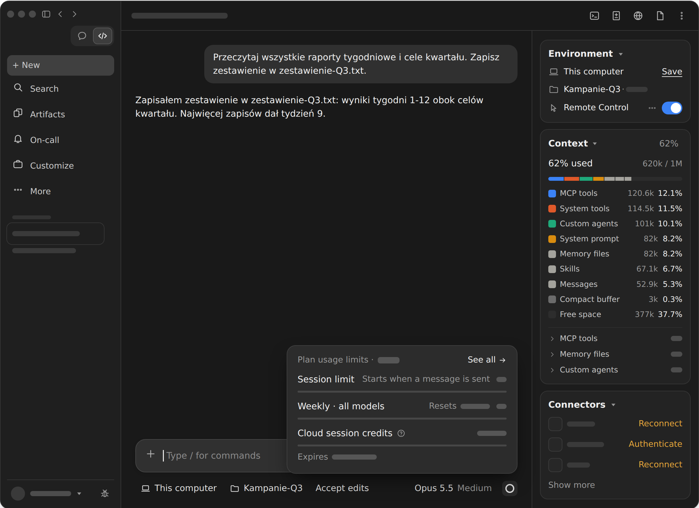
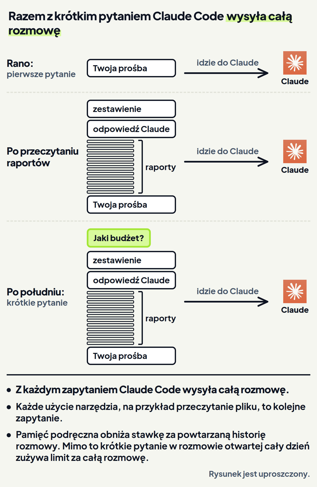
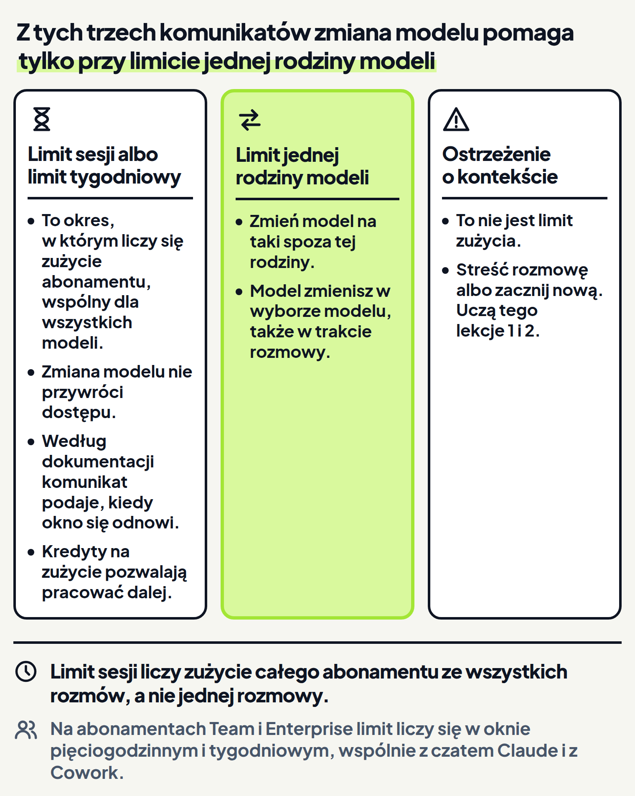

<em>Przewodnik po Claude Code · Moduł 6: Długie rozmowy i limity abonamentu · Lekcja 4 z 4</em>

# Gdzie sprawdzić zużycie abonamentu i co je zużywa najszybciej

Prowadzisz kampanie reklamowe dla szkoły językowej Lingwa, która zbiera zapisy na kursy jesienne. Od rana pracujesz z Claude w jednej rozmowie. Claude przeczytał dwanaście raportów tygodniowych i zapisał zestawienie kwartału. Po południu chcesz jeszcze szybko zapytać o budżet i boisz się, że limit abonamentu skończy się w środku pracy.

Ta obawa ma podstawy. Rozmowa otwarta od godzin może zużyć znacznie więcej limitu abonamentu, niż wynikałoby z Twojej pracy. <!-- fakt: koszty-dluga-sesja-zuzywa-wiecej-niz-aktywnosc --> <!-- fakt: aplikacja-ten-sam-silnik-co-w-terminalu -->

Na abonamentach Pro i Max (płatnych abonamentach claude.ai) zużycie Claude Code masz wliczone w abonament. <!-- fakt: koszty-pro-max-zuzycie-wliczone-w-abonament --> <!-- fakt: plan-platny --> <!-- fakt: dostepnosc-abonament-to-konto-claude-ai --> Abonament ma jednak limit zużycia. <!-- fakt: koszty-kredyty-praca-po-limicie -->

Zużycie abonamentu sprawdzisz w samej aplikacji. W rzędzie pod polem wiadomości, w prawej części, stoi wybór modelu. <!-- fakt: aplikacja-wybor-modelu-w-rzedzie-zmiana-w-trakcie --> Obok niego jest pierścień. Gdy go klikniesz, pokaże zużycie abonamentu. <!-- fakt: aplikacja-pierscien-zuzycie-abonamentu -->

W ćwiczeniu niżej kliknij pierścień, a potem nagłówek karty Context w panelu szczegółów sesji. Kartę i panel znasz z lekcji 1. Zobaczysz, że pierścień otwiera okienko ze zużyciem abonamentu, a karta Context to osobny licznik: pokazuje, ile miejsca zajmuje kontekst tej jednej rozmowy.

<!-- cwiczenie: cw1 -->

## Co tu się stało?

<!-- kolumny -->

#### Pierścień

1. Pierścień obok wyboru modelu otworzył okienko ze zużyciem abonamentu. <!-- fakt: aplikacja-pierscien-zuzycie-abonamentu -->
2. To zużycie jest wspólne dla wszystkich miejsc, w których używasz Claude Code. <!-- fakt: aplikacja-pierscien-zuzycie-abonamentu -->
3. Okienko ma nagłówek Plan usage limits (limity abonamentu). Pierwsze dwa wiersze to Session limit (limit sesji) i Weekly · all models (limit tygodniowy dla wszystkich modeli). Trzeci wiersz to Cloud session credits (kredyty sesji w chmurze). Rozmów w chmurze kurs nie uczy. Szare paski to dane Twojego konta. Swoje zobaczysz w tym okienku u siebie.

#### Karta Context

1. Karta Context pokazuje w procentach, jak pełny jest kontekst tej jednej rozmowy. <!-- fakt: aplikacja-karta-context-procent-w-naglowku -->
2. Każda rozmowa ma własny kontekst. <!-- fakt: aplikacja-sesja-wlasny-kontekst-i-zmiany -->
3. Okienko pierścienia i karta Context pokazują różne rzeczy. To dwa osobne liczniki. <!-- fakt: aplikacja-pierscien-zuzycie-abonamentu --> <!-- fakt: aplikacja-karta-context-procent-w-naglowku -->

<!-- /kolumny -->

## Pierścień i zużycie abonamentu

### Pierścień: zużycie abonamentu

Pierścień obok wyboru modelu po kliknięciu pokazuje zużycie abonamentu, wspólne dla wszystkich miejsc, w których używasz Claude Code. <!-- fakt: aplikacja-pierscien-zuzycie-abonamentu -->

Dzięki temu zużycie sprawdzasz jednym kliknięciem, w samej aplikacji. <!-- fakt: aplikacja-pierscien-zuzycie-abonamentu -->

### Dlaczego zużycie rośnie szybciej, niż się wydaje

Każda tura rozmowy w Claude Code, czyli Twoja prośba i praca Claude nad nią, niesie: <!-- fakt: koszty-sesja-szukania-bledu-wiecej-niz-dzien-czatu --> <!-- fakt: terminal-enter-w-trakcie-pracy-ustawia-wiadomosc-w-kolejce --> <!-- fakt: aplikacja-ten-sam-silnik-co-w-terminalu -->

- treść plików,
- użycie narzędzi, na przykład czytanie plików, <!-- fakt: claude-code-tworzy-nowe-pliki --> <!-- fakt: aplikacja-ten-sam-silnik-co-w-terminalu -->
- rozumowanie w wielu krokach.

Dokumentacja podaje przykład: jedna rozmowa, w której Claude szuka błędu w programie, może zużyć więcej niż dzień rozmów w czacie Claude. <!-- fakt: koszty-sesja-szukania-bledu-wiecej-niz-dzien-czatu --> <!-- fakt: aplikacja-ten-sam-silnik-co-w-terminalu -->

W Twojej rozmowie o kampanii też jest dużo: dwanaście raportów, które Claude przeczytał rano. Każdy przeczytany plik dokłada się do kontekstu. <!-- fakt: kontekst-kazdy-przeczytany-plik-dodaje --> <!-- fakt: aplikacja-ten-sam-silnik-co-w-terminalu --> Co z tego wynika dla limitu, pokaże ćwiczenie 2.

W ćwiczeniu niżej zadasz to samo krótkie pytanie o budżet dwa razy: najpierw w długiej rozmowie, potem w nowej. Za każdym razem spójrz na procent na karcie Context, zanim klikniesz ścieżkę pliku w odpowiedzi. Karta nie pokazuje zużycia abonamentu, ale pokazuje, jak pełny jest kontekst rozmowy. <!-- fakt: aplikacja-karta-context-procent-w-naglowku --> <!-- fakt: aplikacja-pierscien-zuzycie-abonamentu --> Im więcej kontekstu Claude przetwarza, tym więcej tokenów zużywasz. <!-- fakt: koszty-rosna-z-rozmiarem-kontekstu --> <!-- fakt: aplikacja-ten-sam-silnik-co-w-terminalu --> Zobaczysz, że w długiej rozmowie razem z pytaniem idzie cała rozmowa, a w nowej niewiele.

<!-- cwiczenie: cw2 -->

## Co tu się stało?

<!-- kolumny -->

#### Długa rozmowa

1. Razem z krótkim pytaniem Claude Code wysłał całą rozmowę, także dwanaście przeczytanych raportów. <!-- fakt: koszty-kazde-zapytanie-niesie-cala-rozmowe --> <!-- fakt: aplikacja-ten-sam-silnik-co-w-terminalu -->
2. Procent na karcie Context urósł z 62% do 63%, bo kontekst mieści też nowe pytanie, przeczytany plik i odpowiedź. <!-- fakt: kontekst-okno-miesci-wszystko-o-sesji --> <!-- fakt: aplikacja-ten-sam-silnik-co-w-terminalu --> Z pytaniem poszła jednak cała rozmowa, a nie tylko ten 1% przyrostu. <!-- fakt: koszty-kazde-zapytanie-niesie-cala-rozmowe --> <!-- fakt: aplikacja-ten-sam-silnik-co-w-terminalu -->
3. Claude wziął budżet z pliku cele-kwartalu.txt: 24 000 zł.

#### Nowa rozmowa

1. Po kliknięciu + New (nowa rozmowa) panel szczegółów sesji zniknął. Wrócił po wysłaniu pierwszego zadania, bo dopiero wtedy rozmowa się zaczyna. <!-- fakt: aplikacja-panel-szczegolow-sesji-karty-obok-czatu --> <!-- fakt: aplikacja-sesja-startuje-po-wyslaniu-zadania -->
2. Nowa rozmowa zaczęła się z czystym kontekstem, więc z pytaniem poszło niewiele: karta pokazała 5%. <!-- fakt: sesje-niezalezne-zasady-w-claude-md --> <!-- fakt: aplikacja-ten-sam-silnik-co-w-terminalu --> Nie 0%, bo zanim cokolwiek napiszesz, do kontekstu wczytują się na przykład opisy skilli. <!-- fakt: kontekst-na-start-claude-md-mcp-skille --> <!-- fakt: aplikacja-ten-sam-silnik-co-w-terminalu -->
3. Odpowiedź była ta sama, bo nowa rozmowa pracuje w tym samym folderze, z plikiem cele-kwartalu.txt. Folder rozmowy widać w rzędzie pod polem wiadomości. <!-- fakt: aplikacja-rzad-pod-polem-srodowisko-folder-tryb-model -->

<!-- /kolumny -->

Liczby 62%, 63% i 5% w ćwiczeniu są przykładowe.

## Co zużywa limit najszybciej

<!-- analogia: Rozmowa jest jak list, do którego za każdym razem dołączasz całą dotychczasową korespondencję. Nawet krótkie pytanie waży wtedy tyle, co cała teczka. -->

### Długa rozmowa

Zapytanie to nie tylko Twoja prośba. Z każdym zapytaniem Claude Code wysyła całą rozmowę. Każde użycie narzędzi przez Claude to kolejne zapytanie, z wynikami tych narzędzi. <!-- fakt: koszty-kazde-zapytanie-niesie-cala-rozmowe --> <!-- fakt: aplikacja-ten-sam-silnik-co-w-terminalu --> Jednym z takich narzędzi jest czytanie plików. <!-- fakt: claude-code-tworzy-nowe-pliki --> <!-- fakt: aplikacja-ten-sam-silnik-co-w-terminalu -->

Pamięć podręczna (cache) obniża stawkę za powtarzaną historię rozmowy. Krótkie pytanie w rozmowie otwartej cały dzień i tak zużywa limit za całą rozmowę. <!-- fakt: koszty-kazde-zapytanie-niesie-cala-rozmowe --> <!-- fakt: aplikacja-ten-sam-silnik-co-w-terminalu -->

Zużycie rośnie z rozmiarem kontekstu: im więcej kontekstu Claude przetwarza, tym więcej tokenów zużywasz. <!-- fakt: koszty-rosna-z-rozmiarem-kontekstu --> <!-- fakt: aplikacja-ten-sam-silnik-co-w-terminalu --> Dlatego to samo pytanie w ćwiczeniu zużyło dużo w długiej rozmowie, a mało w nowej.

### Co jeszcze zużywa limit szybko

- **Pierwsza wiadomość po dłuższej przerwie.** Gdy przerwa trwała dłużej niż czas przechowywania pamięci podręcznej, ta wiadomość przetwarza od nowa cały kontekst rozmowy. <!-- fakt: pierwsza-wiadomosc-po-przerwie-caly-kontekst --> <!-- fakt: aplikacja-ten-sam-silnik-co-w-terminalu --> Zapowiadała to lekcja 2.
- **Streszczenie dużej rozmowy.** Polecenie /compact czyta rozmowę, którą streszcza, więc streszczenie dużej rozmowy samo jest dużym zapytaniem. <!-- fakt: streszczenie-samo-jest-duzym-zadaniem --> <!-- fakt: aplikacja-ten-sam-silnik-co-w-terminalu --> Streszczenie znasz z lekcji 1.
- **Subagenci, czyli pomocnicy Claude.** Do Twojej rozmowy wraca od nich tylko podsumowanie, ale ich własne zapytania zużywają Twój limit. <!-- fakt: koszty-subagent-wlasne-zapytania-zuzywaja-limit --> <!-- fakt: aplikacja-ten-sam-silnik-co-w-terminalu --> O subagentach jest moduł 9.
- **Wyższy wysiłek.** Sam program Claude Code pisze, że przy wyższym wysiłku praca trwa dłużej i szybciej zużywa limity. <!-- fakt: program-wyzszy-wysilek-dluzej-szybciej-zuzywa-limity --> <!-- fakt: aplikacja-ten-sam-silnik-co-w-terminalu --> Wysiłek znasz z lekcji 3.
- **Ogólna prośba.** Uruchamia szerokie przeszukiwanie plików. Konkretna prośba pozwala Claude pracować, czytając jak najmniej plików. <!-- fakt: koszty-konkretna-prosba-mniej-odczytow --> <!-- fakt: aplikacja-ten-sam-silnik-co-w-terminalu -->

Z tej listy wiesz, co zmienić, żeby limit starczył na dłużej. Sposoby znajdziesz niżej, w części „Kiedy oszczędzać limit, a kiedy nie”.

### Praca w tle

Strona o kosztach podaje, że Claude Code zużywa niewiele tokenów na prace w tle, nawet gdy nic nie robisz. <!-- fakt: koszty-zuzycie-w-tle-niewielkie --> Jej przykłady dotyczą terminala.

Podpowiedź następnego polecenia to krótkie zapytanie w tle. Po odpowiedzi Claude zakładka Code może ją pokazać w pustym polu wiadomości. To zapytanie liczy się do limitów abonamentu. <!-- fakt: aplikacja-podpowiedz-polecenia-liczy-sie-do-limitu --> Składa się głównie z odczytów z pamięci podręcznej rozmowy i kilku tokenów odpowiedzi. <!-- fakt: koszty-podpowiedz-korzysta-z-pamieci-podrecznej --> <!-- fakt: aplikacja-ten-sam-silnik-co-w-terminalu --> Blisko limitu albo po jego osiągnięciu Claude Code sam pomija to zapytanie. <!-- fakt: koszty-podpowiedz-pomijana-blisko-limitu --> <!-- fakt: aplikacja-ten-sam-silnik-co-w-terminalu -->

## Wcześniejszy układ aplikacji

Jeśli pod polem wiadomości nie ma przycisku wyboru środowiska, masz wcześniejszy układ aplikacji. <!-- fakt: aplikacja-wczesniejszy-uklad-brak-selektora --> W nim nie ma panelu szczegółów sesji, więc nie ma też karty Context. <!-- fakt: aplikacja-wczesniejszy-uklad-nie-ma-panelu-szczegolow --> Pierścień obok wyboru modelu jest także w tym układzie. <!-- fakt: aplikacja-pierscien-zuzycie-abonamentu --> Okienko pierścienia pokazuje wtedy także, ile miejsca zajmuje kontekst rozmowy. <!-- fakt: aplikacja-wczesniejszy-uklad-pierscien-pokazuje-kontekst --> Znasz to z lekcji 1.

## Gdy limit się skończy

Komunikat o limicie zatrzymuje pracę. Wtedy musisz wiedzieć, czy pomoże zmiana modelu, czy trzeba poczekać. Dokumentacja opisuje między innymi dwa rodzaje limitu abonamentu i jedno ostrzeżenie, które limitem nie jest.

### Limit sesji albo limit tygodniowy

Limit sesji (tak nazywa go dokumentacja Claude Code) to okno zużycia abonamentu, a nie jedna rozmowa. Tak samo limit tygodniowy. Okno to tu okres, w którym liczy się zużycie abonamentu, zanim się odnowi. W nazwie „limit sesji” sesja oznacza więc taki okres, a nie rozmowę, jak w nazwie panelu szczegółów sesji. <!-- fakt: aplikacja-kazda-rozmowa-to-sesja --> Oba okna są wspólne dla wszystkich modeli, więc zmiana modelu nie przywróci dostępu. <!-- fakt: koszty-limit-sesji-i-tygodnia-wspolny-dla-modeli --> <!-- fakt: aplikacja-ten-sam-silnik-co-w-terminalu --> W okienku pierścienia te dwa okna to wiersze Session limit i Weekly · all models. <!-- fakt: aplikacja-pierscien-zuzycie-abonamentu -->

Według dokumentacji Claude Code komunikat o tym limicie podaje, kiedy okno się odnowi. <!-- fakt: koszty-limit-sesji-i-tygodnia-wspolny-dla-modeli --> <!-- fakt: aplikacja-ten-sam-silnik-co-w-terminalu --> Dzięki temu wiesz, kiedy wrócić do pracy.

### Limit jednej rodziny modeli

Limit może też dotyczyć jednej rodziny modeli. Wtedy zmiana na model spoza tej rodziny pozwala pracować dalej. <!-- fakt: koszty-limit-rodziny-modeli-zmiana-modelu-pomaga --> <!-- fakt: aplikacja-ten-sam-silnik-co-w-terminalu --> Dokumentacja podaje dwa przykłady: limit Opus i limit Sonnet. <!-- fakt: koszty-limit-rodziny-modeli-zmiana-modelu-pomaga -->

W aplikacji model zmieniasz w wyborze modelu, także w trakcie rozmowy. <!-- fakt: aplikacja-wybor-modelu-w-rzedzie-zmiana-w-trakcie --> Wybór modelu znasz z lekcji 3.

### Ostrzeżenie o kontekście

Ostrzeżenie o kontekście nie jest limitem zużycia. Mówi, że rozmowa zbliżyła się do progu, przy którym Claude Code streszcza starszą historię, żeby zwolnić miejsce. <!-- fakt: kontekst-ostrzezenie-to-nie-limit-zuzycia --> <!-- fakt: aplikacja-ten-sam-silnik-co-w-terminalu --> Wtedy streść rozmowę albo zacznij nową, tak jak w lekcjach 1 i 2.

### Gdy nie możesz czekać: kredyty na zużycie

Kredyty na zużycie pozwalają pracować dalej po wyczerpaniu limitu abonamentu. <!-- fakt: koszty-kredyty-praca-po-limicie --> Na abonamentach Pro i Max zarządzasz nimi na claude.ai, na stronie Settings > Usage (ustawienia, zużycie). W jej części Usage credits (kredyty na zużycie) możesz: <!-- fakt: koszty-pro-max-kredyty-na-stronie-settings-usage -->

- włączyć albo wyłączyć kredyty,
- sprawdzić saldo kredytów,
- sprawdzić, ile wydajesz na kredyty w tym miesiącu,
- sprawdzić miesięczny limit wydatków.

Z pytaniami o rachunek za abonament piszesz do wsparcia Anthropic: <!-- fakt: koszty-pytania-o-rachunek-get-help -->

1. Zaloguj się na claude.ai.
2. Kliknij swoje inicjały w lewym dolnym rogu.
3. Wybierz Get help (pomoc).

## Kiedy oszczędzać limit, a kiedy nie

<!-- kolumny -->

#### Oszczędzaj

1. Zaczynasz inną pracę. Kliknij + New i zacznij nową rozmowę. <!-- fakt: aplikacja-nowa-sesja-new-albo-cmd-n --> Stara rozmowa wypierałaby pliki potrzebne dalej. <!-- fakt: stara-rozmowa-wypiera-pliki-i-kosztuje --> <!-- fakt: aplikacja-ten-sam-silnik-co-w-terminalu --> Nieaktualny kontekst marnuje tokeny przy każdej kolejnej wiadomości. <!-- fakt: niezwiazana-praca-nazwij-i-zacznij-od-nowa --> <!-- fakt: aplikacja-ten-sam-silnik-co-w-terminalu -->
2. Pytasz o konkretny plik. Podaj jego nazwę, tak jak w ćwiczeniu: „Sprawdź cele-kwartalu.txt”. Konkretna prośba pozwala Claude pracować, czytając jak najmniej plików. <!-- fakt: koszty-konkretna-prosba-mniej-odczytow --> <!-- fakt: aplikacja-ten-sam-silnik-co-w-terminalu --> Dobrego zlecenia z materiałami uczy lekcja 1 modułu 2.
3. Zadanie jest proste. Obniż wysiłek: przy prostszych zadaniach niższy wysiłek zmniejsza koszty. <!-- fakt: nizszy-wysilek-taniej-przy-prostych-zadaniach --> <!-- fakt: aplikacja-ten-sam-silnik-co-w-terminalu -->
4. Nie potrzebujesz podpowiedzi następnego polecenia. Otwórz Settings > Claude Code (ustawienia). W części Sessions (sesje) wyłącz Prompt suggestions (podpowiedzi poleceń). Podpowiedzi znikną, gdy następnym razem zaczniesz albo wznowisz rozmowę. <!-- fakt: aplikacja-podpowiedzi-wylaczasz-w-ustawieniach -->
5. Wracasz po dłuższej przerwie i nie potrzebujesz ustaleń ze starej rozmowy. Zacznij nową, bo po takiej przerwie pierwsza wiadomość w starej rozmowie może przetworzyć od nowa cały jej kontekst. <!-- fakt: pierwsza-wiadomosc-po-przerwie-caly-kontekst --> <!-- fakt: aplikacja-ten-sam-silnik-co-w-terminalu -->

#### Nie oszczędzaj na siłę

1. Potrzebujesz ustaleń ze starej rozmowy. Zostań w niej albo do niej wróć, bo nowa rozmowa zaczyna się bez historii poprzednich rozmów. <!-- fakt: sesje-niezalezne-zasady-w-claude-md --> <!-- fakt: aplikacja-ten-sam-silnik-co-w-terminalu --> Znasz to z lekcji 2.
2. Zależy Ci na dokładności, na przykład przy sprawdzaniu umowy z klientem. Wyższy wysiłek daje dokładniejsze odpowiedzi, choć szybciej zużywa limity. <!-- fakt: program-wyzszy-wysilek-dluzej-szybciej-zuzywa-limity --> <!-- fakt: aplikacja-ten-sam-silnik-co-w-terminalu --> Znasz to z lekcji 3.
3. Claude ma przejrzeć wiele dużych plików. Zleć to subagentowi. Subagent oszczędza miejsce w Twojej rozmowie, bo wraca tylko z podsumowaniem. Jego zapytania zużywają jednak Twój limit. <!-- fakt: koszty-subagent-wlasne-zapytania-zuzywaja-limit --> <!-- fakt: aplikacja-ten-sam-silnik-co-w-terminalu -->

<!-- /kolumny -->

## Co zależy od rodzaju abonamentu

Nie każda funkcja aplikacji działa na każdym abonamencie. <!-- fakt: dostepnosc-abonament-decyduje-o-funkcjach --> Claude Code wymaga abonamentu Pro, Max, Team albo Enterprise. <!-- fakt: plan-platny --> Przy zwykłej instalacji aplikacja Claude na komputer wymaga logowania kontem claude.ai. <!-- fakt: dostepnosc-aplikacja-wymaga-konta-claude-ai -->

Na abonamentach Team i Enterprise, czyli abonamentach dla organizacji, zużycie Claude Code każdego członka idzie z przydziału na stanowisko. Ten przydział jest wspólny z czatem Claude i z Cowork. <!-- fakt: koszty-team-enterprise-okno-piec-godzin-i-tydzien --> <!-- fakt: dostepnosc-remote-control-team-enterprise-wlacza-administrator --> Cowork to inna część aplikacji Claude, obok czatu i zakładki Code. <!-- fakt: aplikacja-cowork-obok-czatu-i-code -->

Gdy logujesz się kontem claude.ai, Twój abonament decyduje o tym, które funkcje masz. <!-- fakt: dostepnosc-abonament-decyduje-o-funkcjach --> Według dokumentacji z 26.10.2026:

- **Artefakty:** Pro, Max, Team i Enterprise. <!-- fakt: dostepnosc-artefakty-wszystkie-abonamenty --> Uczy ich moduł 3.
- **Sterowanie komputerem (computer use):** pozwala Claude otwierać Twoje aplikacje, sterować ekranem i pracować bezpośrednio na Twoim komputerze tak, jak robisz to Ty. <!-- fakt: aplikacja-sterowanie-komputerem-co-robi --> Działa tylko na Pro i Max, na macOS i Windows, jako wersja zapoznawcza. Na Team i Enterprise go nie ma. <!-- fakt: aplikacja-sterowanie-komputerem-tylko-pro-max -->
- **Dispatch, czyli wysyłanie zadań z telefonu:** tylko Pro i Max. <!-- fakt: aplikacja-dispatch-tylko-pro-max --> Uczy go moduł 8.
- **Remote Control (zdalne sterowanie):** gdy połączy rozmowę z Twojego komputera, widać ją na Twoich innych urządzeniach zalogowanych na Twoje konto claude.ai. <!-- fakt: aplikacja-remote-control-sesja-na-innych-urzadzeniach --> Działa na Pro i Max od razu, a na Team i Enterprise dopiero wtedy, gdy włączy go administrator organizacji. <!-- fakt: dostepnosc-remote-control-team-enterprise-wlacza-administrator --> Uczy go moduł 8.

Dzięki tej liście wiesz, czego szukać w swojej aplikacji, a czego w Twoim abonamencie nie będzie. <!-- fakt: dostepnosc-abonament-decyduje-o-funkcjach -->

Ceny abonamentów Pro, Max, Team i Enterprise są na stronie claude.com/pricing. <!-- fakt: koszty-cennik-abonamentow-na-claude-com --> Przed zmianą abonamentu zajrzyj do aktualnej dokumentacji.

## Czego dokumentacja nie mówi

- Strona dokumentacji o kosztach dotyczy tylko Claude Code. Limity innych produktów Claude opisuje Centrum pomocy Claude. <!-- fakt: koszty-strona-tylko-claude-code-limity-czatu-w-centrum-pomocy -->
- Ile limitu daje który abonament, dokumentacja Claude Code nie podaje.
- Strony o kosztach i o aplikacji nie podają długości okien dla abonamentów Pro i Max.
- Dokumentacja nie opisuje wyglądu komunikatu o limicie w aplikacji, dlatego ćwiczenie go nie pokazuje.
- Dokumentacja nie opisuje, jak otworzyć stronę Settings > Usage z aplikacji.
- Dokumentacja aplikacji nie opisuje, ile zużycia przypada na skille, konektory (na przykład Gmail albo Google Calendar) albo subagentów. <!-- fakt: konektory-google-calendar-gmail-microsoft-365 -->

## Źródła

- [Koszty i zużycie](https://code.claude.com/docs/en/costs)
- [Dostępność funkcji](https://code.claude.com/docs/en/feature-availability)
- [Aplikacja Claude na komputer](https://code.claude.com/docs/en/desktop)
- [Pierwsze kroki w aplikacji](https://code.claude.com/docs/en/desktop-quickstart)
- [Jak działa Claude Code](https://code.claude.com/docs/en/how-claude-code-works)
- [Okno kontekstu](https://code.claude.com/docs/en/context-window)
- [Tryby uprawnień](https://code.claude.com/docs/en/permission-modes)
- [Tryb interaktywny](https://code.claude.com/docs/en/interactive-mode)
- [Konektory i serwery MCP](https://code.claude.com/docs/en/mcp)

Sprawdzone 26.10.2026, Claude Code 2.1.310.
