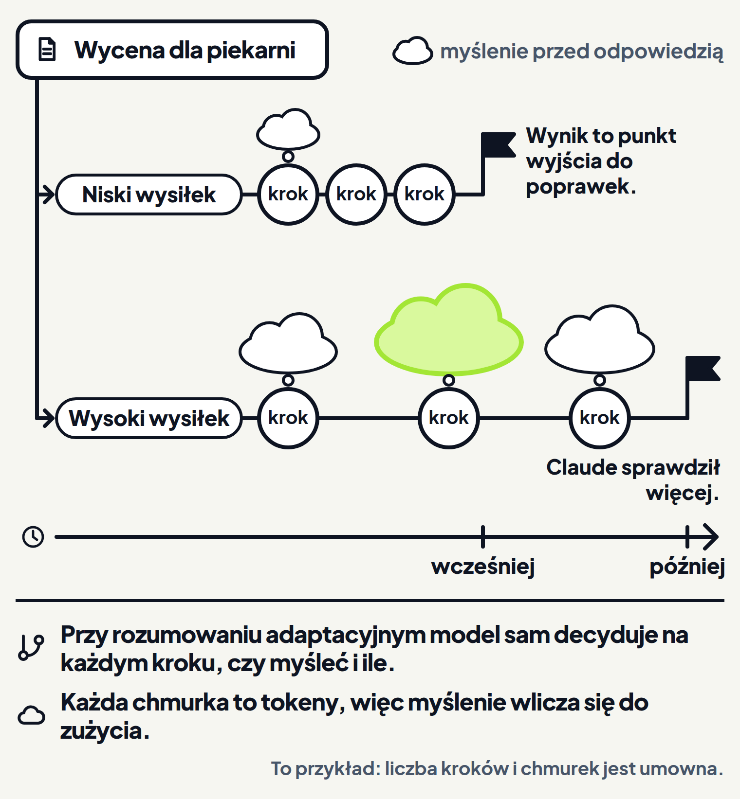
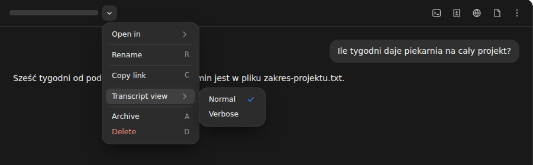

<em>Przewodnik po Claude Code · Moduł 6: Długie rozmowy i limity abonamentu · Lekcja 3 z 4</em>

# Model i wysiłek: szybciej czy dokładniej

Wyceniasz projekt logo i całej identyfikacji wizualnej dla piekarni Złoty Kłos. Raz chcesz szybko podać klientce kwotę przez telefon. Innym razem potrzebujesz wyceny, którą wyślesz bez poprawiania.

Przed odpowiedzią Claude może myśleć nad zadaniem, czyli rozumować. <!-- fakt: myslenie-przed-odpowiedzia-wysilek-glowne-pokretlo --> <!-- fakt: aplikacja-ten-sam-silnik-co-w-terminalu --> Myślenie jest domyślnie włączone. Poprawia wyniki w złożonych zadaniach wymagających rozumowania, ale zużywa dodatkowe tokeny. <!-- fakt: aplikacja-myslenie-domyslnie-wlaczone-zuzywa-tokeny -->

W modelach z rozumowaniem adaptacyjnym ilością myślenia steruje głównie poziom wysiłku. <!-- fakt: myslenie-przed-odpowiedzia-wysilek-glowne-pokretlo --> <!-- fakt: aplikacja-ten-sam-silnik-co-w-terminalu --> W takim rozumowaniu Claude sam decyduje na każdym kroku, czy myśleć i ile. <!-- fakt: wysilek-model-decyduje-czy-i-ile-myslec --> <!-- fakt: aplikacja-ten-sam-silnik-co-w-terminalu --> Przy prostych zadaniach z niższym wysiłkiem jest szybciej i taniej. Wyższy wysiłek daje głębsze rozumowanie przy złożonych problemach. <!-- fakt: wysilek-nizszy-szybciej-taniej-wyzszy-glebiej --> <!-- fakt: aplikacja-ten-sam-silnik-co-w-terminalu --> Tak decydujesz, czy Claude ma pracować szybciej, czy dokładniej.

W bieżącym układzie aplikacji otwierasz wybór modelu w rzędzie pod polem wiadomości i klikasz poziom pod Effort (wysiłek). <!-- fakt: aplikacja-wysilek-pod-effort-w-wyborze-modelu --> <!-- fakt: aplikacja-wybor-modelu-w-rzedzie-zmiana-w-trakcie --> Nową rozmowę zaczyna przycisk + New w pasku bocznym, znasz go z lekcji 2. <!-- fakt: aplikacja-nowa-sesja-new-albo-cmd-n -->

W ćwiczeniu niżej dwa razy poprosisz o tę samą wycenę: raz z niskim, raz z wysokim wysiłkiem. Wysiłek wybierzesz pod Effort w nowej rozmowie, zanim napiszesz prośbę. Patrz, jak długo w rozmowie stoją trzy kropki, zanim przyjdzie odpowiedź. Przy wyższym wysiłku Claude pracuje dłużej. <!-- fakt: program-wyzszy-wysilek-dluzej-szybciej-zuzywa-limity --> <!-- fakt: aplikacja-ten-sam-silnik-co-w-terminalu --> Patrz też, co trafia do pliku z wyceną. Nad oknem jest też trzecia droga, „Widok rozmowy”. Pokazuje menu, w którym zmieniasz widok rozmowy. <!-- fakt: aplikacja-transcript-view-menu-sesji-ctrl-o -->

<!-- cwiczenie: cw1 -->

## Co tu się stało?

<!-- kolumny -->

#### Niski wysiłek

<!-- podglad: cw1 niski -->

1. Poziom wysiłku był już wybrany pod Effort w menu wyboru modelu, zanim poszła prośba. <!-- fakt: aplikacja-wysilek-pod-effort-w-wyborze-modelu -->
2. Z niskim wysiłkiem jest szybciej, więc wycena przyszła po krótkiej chwili. <!-- fakt: wysilek-nizszy-szybciej-taniej-wyzszy-glebiej --> <!-- fakt: aplikacja-ten-sam-silnik-co-w-terminalu -->
3. Tym razem wycena pomija dwie prośby z maila klientki: trzecią rundę poprawek i logo na szyld. To punkt wyjścia, który przeglądasz i poprawiasz. <!-- fakt: wysilek-w-testach-wyzszy-sprawdzal-nizszy-szybciej --> <!-- fakt: aplikacja-ten-sam-silnik-co-w-terminalu -->

#### Wysoki wysiłek

<!-- podglad: cw1 wysoki -->

1. W tym samym menu pod Effort był wybrany wyższy poziom. <!-- fakt: aplikacja-wysilek-pod-effort-w-wyborze-modelu -->
2. Odpowiedź przyszła później. Sam program Claude Code pisze, że wyższy wysiłek daje dokładniejsze odpowiedzi, ale trwa dłużej. <!-- fakt: program-wyzszy-wysilek-dluzej-szybciej-zuzywa-limity --> <!-- fakt: aplikacja-ten-sam-silnik-co-w-terminalu -->
3. Tym razem Claude sprawdził mail: doliczył trzecią rundę poprawek i zaznaczył szyld do ustalenia. Wysoki poziom pasuje do pracy, w której liczy się sprawdzenie. <!-- fakt: wysilek-high-gdy-liczy-sie-sprawdzenie --> <!-- fakt: aplikacja-ten-sam-silnik-co-w-terminalu -->

<!-- /kolumny -->

Liczby w ćwiczeniu to tylko przykład, tak jak to, co Claude doliczył. W Twojej rozmowie wynik może wyglądać inaczej.

Trzecią drogę, „Widok rozmowy”, objaśnia niżej część „Jak zobaczyć, co Claude myślał”.

## Jak działa wysiłek

### Myślenie przed odpowiedzią

Wysiłek steruje rozumowaniem, w którym model sam decyduje na każdym kroku, czy myśleć i ile. Zależy to od tego, jak złożone jest zadanie. <!-- fakt: wysilek-model-decyduje-czy-i-ile-myslec --> <!-- fakt: aplikacja-ten-sam-silnik-co-w-terminalu -->

Myślenie na każdym kroku jest więc opcjonalne. Przy zwykłych prośbach Claude może odpowiedzieć szybciej, a głębsze myślenie zostawić na kroki, którym ono pomaga. <!-- fakt: myslenie-adaptacyjne-popros-w-poleceniu --> <!-- fakt: aplikacja-ten-sam-silnik-co-w-terminalu -->

Chcesz, żeby Claude myślał częściej albo rzadziej niż na wybranym poziomie? Napisz to wprost w poleceniu albo w pliku CLAUDE.md, który znasz z modułu 2. Claude uwzględni to w granicach ustawionego wysiłku. <!-- fakt: myslenie-adaptacyjne-popros-w-poleceniu --> <!-- fakt: aplikacja-ten-sam-silnik-co-w-terminalu -->

### Co kosztuje myślenie

Tokeny myślenia liczą się tak samo jak tokeny odpowiedzi. <!-- fakt: myslenie-tokeny-liczone-jak-odpowiedz --> <!-- fakt: aplikacja-ten-sam-silnik-co-w-terminalu --> Liczą się przy tym wszystkie wygenerowane tokeny myślenia, także wtedy, gdy myślenie jest zwinięte albo ukryte. <!-- fakt: myslenie-placisz-za-wszystkie-tokeny-myslenia --> <!-- fakt: aplikacja-ten-sam-silnik-co-w-terminalu --> Na jedno zapytanie Claude może domyślnie przeznaczyć na myślenie nawet dziesiątki tysięcy tokenów, zależnie od modelu. <!-- fakt: myslenie-tokeny-liczone-jak-odpowiedz --> <!-- fakt: aplikacja-ten-sam-silnik-co-w-terminalu -->

Każdy poziom wysiłku to wymiana: więcej zużytych tokenów za większe możliwości. <!-- fakt: wysilek-wymiana-tokenow-na-mozliwosci --> <!-- fakt: aplikacja-ten-sam-silnik-co-w-terminalu -->

Sam program Claude Code opisuje wysiłek tak: wyższy wysiłek daje dokładniejsze odpowiedzi, ale trwa dłużej i szybciej zużywa Twoje limity. <!-- fakt: program-wyzszy-wysilek-dluzej-szybciej-zuzywa-limity --> <!-- fakt: aplikacja-ten-sam-silnik-co-w-terminalu --> Ile zostało z limitu abonamentu, pokaże lekcja 4.

### Poziomy

Ile poziomów wysiłku masz do wyboru, zależy od modelu. <!-- fakt: wysilek-poziomy-zaleza-od-modelu --> <!-- fakt: aplikacja-ten-sam-silnik-co-w-terminalu --> Aplikacja podpisuje je na liście pod Effort trochę inaczej niż dokumentacja:

- Low (niski), w dokumentacji low,
- Medium (średni), w dokumentacji medium,
- High (wysoki), w dokumentacji high,
- Extra (bardzo wysoki), w dokumentacji xhigh,
- Max (najwyższy), w dokumentacji max.

Ostatni wiersz listy pod Effort w aplikacji, Ultracode, to ustawienie Claude Code, a nie poziom wysiłku. <!-- fakt: ultracode-ustawienie-nie-poziom-wysilku --> <!-- fakt: aplikacja-ten-sam-silnik-co-w-terminalu --> Gdy jest włączone, Claude przy większych zadaniach prowadzi przepływy pracy. <!-- fakt: ultracode-ustawienie-nie-poziom-wysilku --> <!-- fakt: aplikacja-ten-sam-silnik-co-w-terminalu --> Przepływy poznasz w module 9, w lekcji „Duże zadanie podzielone między subagentów”.

Dwa starsze modele nie mają poziomu Extra (w dokumentacji xhigh), a niektóre modele w ogóle nie obsługują wysiłku. <!-- fakt: wysilek-poziomy-zaleza-od-modelu --> <!-- fakt: aplikacja-ten-sam-silnik-co-w-terminalu --> Domyślny poziom też zależy od modelu. <!-- fakt: wysilek-domyslny-zalezy-od-modelu --> <!-- fakt: aplikacja-ten-sam-silnik-co-w-terminalu -->

Skala wysiłku jest ustawiona osobno dla każdego modelu. Ta sama nazwa poziomu w dwóch modelach nie znaczy więc tego samego. <!-- fakt: wysilek-skala-osobna-dla-modelu --> <!-- fakt: aplikacja-ten-sam-silnik-co-w-terminalu -->

Gdy model nie ma ustawionego poziomu, Claude Code użyje najbliższego niższego, który model ma. <!-- fakt: wysilek-nieobslugiwany-poziom-spada-nizej --> <!-- fakt: aplikacja-ten-sam-silnik-co-w-terminalu --> Na przykład w starszym modelu bez poziomu Extra (xhigh) ten poziom działa jak High (high). <!-- fakt: wysilek-nieobslugiwany-poziom-spada-nizej --> <!-- fakt: aplikacja-ten-sam-silnik-co-w-terminalu -->

Jeśli Twoje konto należy do organizacji, może ona ograniczyć najwyższy dostępny poziom wysiłku. <!-- fakt: organizacja-moze-ograniczyc-wysilek --> <!-- fakt: aplikacja-ten-sam-silnik-co-w-terminalu -->

## Gdzie wybrać model i wysiłek

Model i wysiłek wybierasz w tym samym menu:

1. Otwórz wybór modelu w prawej części rzędu pod polem wiadomości. <!-- fakt: aplikacja-wybor-modelu-w-rzedzie-zmiana-w-trakcie -->
2. Kliknij poziom pod Effort. <!-- fakt: aplikacja-wysilek-pod-effort-w-wyborze-modelu -->

Menu otworzysz też skrótem:

- menu wyboru modelu: <kbd>Cmd</kbd>+<kbd>Shift</kbd>+<kbd>I</kbd> na macOS, <kbd>Ctrl</kbd>+<kbd>Shift</kbd>+<kbd>I</kbd> na Windows, <!-- fakt: aplikacja-skrot-menu-modelu -->
- menu wysiłku: <kbd>Cmd</kbd>+<kbd>Shift</kbd>+<kbd>E</kbd> na macOS, <kbd>Ctrl</kbd>+<kbd>Shift</kbd>+<kbd>E</kbd> na Windows. <!-- fakt: aplikacja-skrot-menu-wysilku -->

W otwartym menu pozycję wybierzesz też cyfrą od 1 do 9. <!-- fakt: aplikacja-cyfry-1-9-wybieraja-pozycje-w-menu -->

### Model

Model, tak jak folder, wybierasz przed pierwszą wiadomością. <!-- fakt: aplikacja-rzad-pod-polem-srodowisko-folder-tryb-model --> Model zmienisz także w trakcie rozmowy, w tym samym wyborze modelu. <!-- fakt: aplikacja-wybor-modelu-w-rzedzie-zmiana-w-trakcie --> Dzięki temu nie musisz zaczynać nowej rozmowy, żeby przejść na inny model. <!-- fakt: aplikacja-wybor-modelu-w-rzedzie-zmiana-w-trakcie --> W aplikacji masz te same modele co w terminalu. <!-- fakt: aplikacja-te-same-modele-co-w-terminalu -->

Według dokumentacji z 26.10.2026 Sonnet dobrze radzi sobie z większością zadań programistycznych i kosztuje mniej niż Opus. Opusa warto zostawić na złożone decyzje o budowie programu i rozumowanie w wielu krokach. <!-- fakt: lzejszy-model-wiekszosc-mocniejszy-zlozone-rozumowanie --> <!-- fakt: aplikacja-ten-sam-silnik-co-w-terminalu -->

Model, na którym Claude Code startuje, gdy nic nie wybierzesz, zależy od rodzaju konta. Zmieniał się też w kolejnych wersjach programu. <!-- fakt: model-domyslny-zalezy-od-konta-i-wersji --> <!-- fakt: aplikacja-ten-sam-silnik-co-w-terminalu --> Dlatego w tej lekcji nazwy modeli padają tylko raz, z datą sprawdzenia, a ćwiczenie rysuje wiersze modeli bez napisów.

Jeśli Twoje konto należy do organizacji, wybór modelu ukrywa albo wyszarza modele, których organizacja nie dopuszcza. <!-- fakt: aplikacja-wybor-modelu-ukrywa-modele-organizacji -->

### Wcześniejszy układ

Jeśli pod polem wiadomości nie ma przycisku wyboru środowiska, masz wcześniejszy układ aplikacji. <!-- fakt: aplikacja-wczesniejszy-uklad-brak-selektora --> W nim model też wybierasz w rzędzie pod polem wiadomości. <!-- fakt: aplikacja-wczesniejszy-uklad-srodowisko-i-folder-nad-polem -->

## Jak zobaczyć, co Claude myślał

Widok Thinking (myślenie) pokazuje myślenie Claude i służy do śledzenia jego rozumowania. <!-- fakt: aplikacja-widok-thinking-pokazuje-myslenie -->

Jak otworzyć widok Thinking:

1. Kliknij strzałkę obok tytułu rozmowy, u góry okna po lewej. Otworzy się menu sesji. <!-- fakt: aplikacja-transcript-view-menu-sesji-ctrl-o -->
2. Wybierz Transcript view (widok zapisu rozmowy). <!-- fakt: aplikacja-transcript-view-menu-sesji-ctrl-o -->
3. Na liście obok wybierz Thinking. <!-- fakt: aplikacja-widok-thinking-dopiero-po-mysleniu -->

Pozycja Thinking pojawia się w menu dopiero wtedy, gdy Claude w tej rozmowie myślał. <!-- fakt: aplikacja-widok-thinking-dopiero-po-mysleniu -->

Obraz wyżej pokazuje okno na końcu trzeciej drogi ćwiczenia, „Widok rozmowy”. Pozycji Thinking na nim nie ma. Samego widoku Thinking ćwiczenie nie pokazuje.

Możesz też naciskać <kbd>Ctrl</kbd>+<kbd>O</kbd>, na macOS i na Windows. Ten skrót przełącza widoki po kolei. <!-- fakt: aplikacja-transcript-view-menu-sesji-ctrl-o -->

W widoku Thinking widzisz myślenie Claude, a użycia narzędzi są zwinięte, widać tylko ich podsumowania. Dzięki temu śledzisz, jak Claude doszedł do wyniku, a nie tylko sam wynik. <!-- fakt: aplikacja-widok-thinking-pokazuje-myslenie -->

## Czego dokumentacja nie mówi

- Dokumentacja aplikacji nie mówi, czy wybrany model i poziom wysiłku zostają na następne rozmowy. Dlatego w ćwiczeniu wysiłek wybierasz w nowej rozmowie, zanim napiszesz prośbę.
- Dokumentacja opisuje wybór poziomu pod Effort tylko w bieżącym układzie.
- Dokumentacja aplikacji nie podaje, jak menu podpisuje poziomy. Dlatego napisy poziomów w ćwiczeniu są ze zrzutu ekranu aplikacji. Notki „niski wysiłek” i „wysoki wysiłek” dodał kurs.
- Dokumentacja nie podaje, który napis aplikacji odpowiada poziomowi xhigh. Extra stoi na liście między High a Max, tam gdzie dokumentacja ma xhigh.
- Dokumentacja aplikacji nie mówi, czy widok Thinking pokazuje całe myślenie, czy jego streszczenie.
- Rady, który model i jaki poziom wysiłku wybrać, dokumentacja podaje na przykładzie programowania.

## Kiedy podnosić wysiłek, a kiedy nie

<!-- kolumny -->

#### Podnieś wysiłek

1. Liczy się sprawdzenie albo prawdopodobne są nietypowe przypadki, jak trzecia runda poprawek w mailu od klientki. Wtedy pasuje poziom high. <!-- fakt: wysilek-high-gdy-liczy-sie-sprawdzenie --> <!-- fakt: aplikacja-ten-sam-silnik-co-w-terminalu -->
2. Anthropic przetestował poziomy wysiłku na dwóch modelach: na wyższym poziomie Claude sprawdzał więcej nietypowych przypadków i więcej swojej pracy, zanim odpowiedział. Więcej też decydował sam. <!-- fakt: wysilek-w-testach-wyzszy-sprawdzal-nizszy-szybciej --> <!-- fakt: aplikacja-ten-sam-silnik-co-w-terminalu -->
3. Poziom Extra (w dokumentacji xhigh) daje głębsze rozumowanie, ale zużywa więcej tokenów. <!-- fakt: wysilek-xhigh-glebiej-wiecej-tokenow --> <!-- fakt: aplikacja-ten-sam-silnik-co-w-terminalu -->
4. Poziom max to najgłębsze rozumowanie. <!-- fakt: wysilek-max-tylko-biezaca-sesja --> <!-- fakt: aplikacja-ten-sam-silnik-co-w-terminalu --> Jest na trudne problemy, które Claude ma przepracować bez Ciebie. Może dawać coraz mniejsze korzyści i myśleć dłużej, niż trzeba, więc wypróbuj go, zanim zaczniesz go używać częściej. <!-- fakt: wysilek-max-trudne-problemy-przemyslenie --> <!-- fakt: aplikacja-ten-sam-silnik-co-w-terminalu -->

#### Zostaw niski albo domyślny

1. Szybkie wymiany, w których przeglądasz każdy wynik, na przykład burza pomysłów albo pierwszy szkic. Wtedy pasuje poziom low. <!-- fakt: wysilek-low-szybkie-wymiany-szkic --> <!-- fakt: aplikacja-ten-sam-silnik-co-w-terminalu -->
2. W tych samych testach Claude na niższym poziomie szybciej oddawał punkt wyjścia. To pasuje do pracy, w której przeglądasz każdy wynik i sam decydujesz o następnym kroku. <!-- fakt: wysilek-w-testach-wyzszy-sprawdzal-nizszy-szybciej --> <!-- fakt: aplikacja-ten-sam-silnik-co-w-terminalu -->
3. Proste zadanie, które nie wymaga głębokiego rozumowania. Niższy wysiłek zmniejsza wtedy koszty. <!-- fakt: nizszy-wysilek-taniej-przy-prostych-zadaniach --> <!-- fakt: aplikacja-ten-sam-silnik-co-w-terminalu -->
4. Domyślny poziom pasuje do większości zadań programistycznych. Zmieniasz go, gdy chcesz innej równowagi między zużyciem tokenów a możliwościami. <!-- fakt: wysilek-wymiana-tokenow-na-mozliwosci --> <!-- fakt: aplikacja-ten-sam-silnik-co-w-terminalu -->

<!-- /kolumny -->

Na szybką kwotę dla klientki przez telefon wystarczy niski wysiłek. <!-- fakt: wysilek-low-szybkie-wymiany-szkic --> <!-- fakt: aplikacja-ten-sam-silnik-co-w-terminalu --> Wycenę, którą wysyłasz, przygotuj na wysokim. <!-- fakt: wysilek-high-gdy-liczy-sie-sprawdzenie --> <!-- fakt: aplikacja-ten-sam-silnik-co-w-terminalu -->

## Źródła

- [Konfiguracja modelu](https://code.claude.com/docs/en/model-config)
- [Aplikacja Claude na komputer](https://code.claude.com/docs/en/desktop)
- [Pierwsze kroki w aplikacji](https://code.claude.com/docs/en/desktop-quickstart)
- [Koszty i zużycie](https://code.claude.com/docs/en/costs)

Sprawdzone 26.10.2026, Claude Code 2.1.310.
