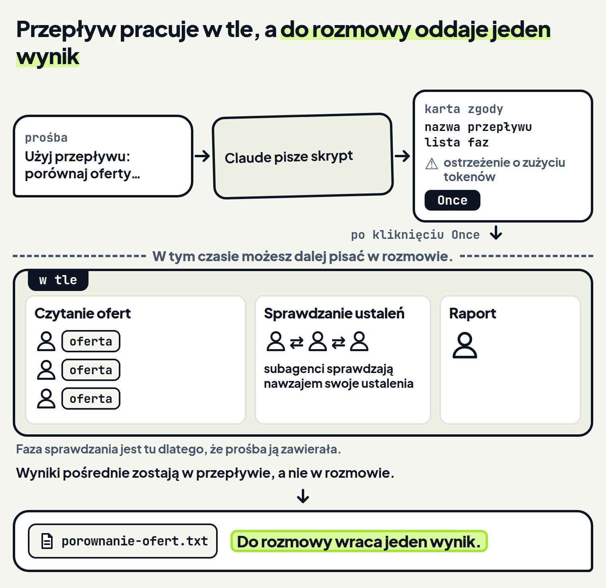
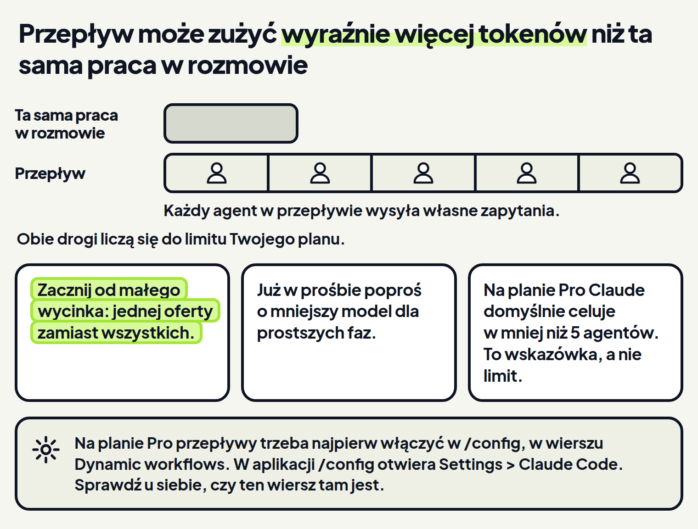
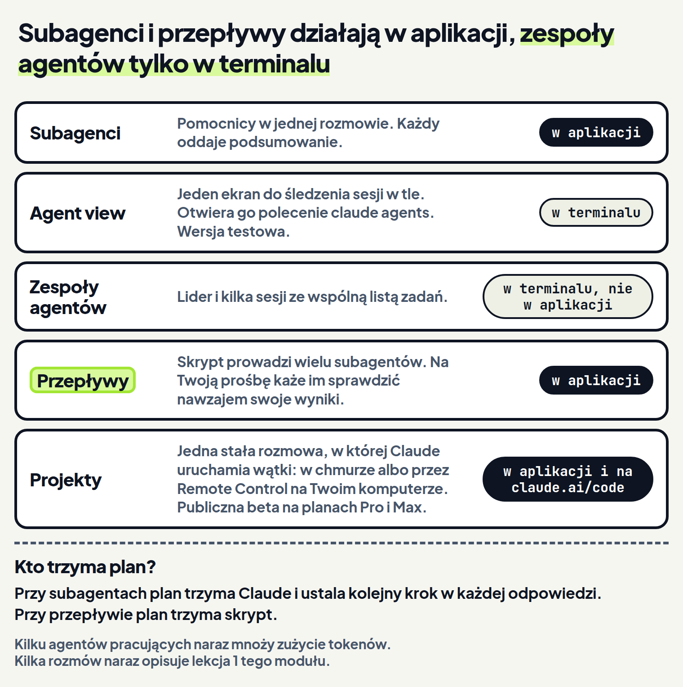

<em>Przewodnik po Claude Code · Moduł 9: Kilka zadań naraz · Lekcja 4 z 4</em>

# Duże zadanie podzielone między subagentów

Porównujesz oferty trzech szkół pływania i chcesz raportu, któremu możesz zaufać. Przepływ dzieli takie zadanie między subagentów, czyli pomocników, którzy robią swoją część i oddają podsumowanie. <!-- fakt: przeplyw-skrypt-wielu-subagentow-w-tle --> <!-- fakt: sposob-subagenci-w-jednej-sesji --> Przepływ to skrypt, który pisze Claude, a program wykonuje w tle. <!-- fakt: przeplyw-skrypt-wielu-subagentow-w-tle --> Przepływ może kazać jednym subagentom sprawdzić ustalenia innych. <!-- fakt: przeplyw-sprawdzanie-nawzajem -->

W ćwiczeniu poprosisz o przepływ i zobaczysz:

- kartę zgody,
- pracę w tle,
- jeden raport.

<!-- cwiczenie: cw1 -->

## Co tu się stało?

<!-- kolumny -->

#### W rozmowie

1. Po prośbie „Użyj przepływu” Claude napisał przepływ do tego zadania. <!-- fakt: przeplyw-prosba-wlasnymi-slowami --> <!-- fakt: przeplyw-skrypt-pisze-claude -->
2. Karta zgody pokazała nazwę przepływu i jego fazy. Pokazała też ostrzeżenie o zużyciu tokenów; w ćwiczeniu oznacza je znak ⚠. <!-- fakt: przeplyw-aplikacja-karta-zgody -->
3. Postęp przepływu widać w panelu Background tasks (zadania w tle). <!-- fakt: przeplyw-aplikacja-postep-w-panelu-background-tasks -->
4. W tym czasie możesz dalej pisać w rozmowie. <!-- fakt: przeplyw-skrypt-wielu-subagentow-w-tle -->

#### W pliku

<!-- podglad: cw1 przeplyw -->

1. Do rozmowy wraca jeden wynik; wyniki pośrednie zostają w przepływie. <!-- fakt: przeplyw-kontekst-tylko-wynik-koncowy --> <!-- fakt: subagent-podsumowanie-przeplyw-jeden-wynik -->
2. Pliki czytają i zapisują agenci przepływu, a skrypt tylko nimi kieruje. <!-- fakt: przeplyw-agenci-czytaja-zapisuja-uruchamiaja -->
3. Ostatnia linijka raportu to skutek prośby o sprawdzenie ustaleń. <!-- fakt: przeplyw-sprawdzanie-nawzajem -->

<!-- /kolumny -->

## Przepływ: plan w skrypcie

Sięgasz po przepływ, gdy zadanie potrzebuje więcej agentów, niż pokieruje jedna rozmowa. <!-- fakt: przeplyw-kiedy-siegac --> Drugi powód: chcesz, żeby ustalenia zostały sprawdzone nawzajem, zanim je zobaczysz. <!-- fakt: przeplyw-gdy-przerasta-kilku-subagentow -->

Claude pisze skrypt przepływu do zadania, które opisujesz. Ty go nie piszesz. <!-- fakt: przeplyw-skrypt-pisze-claude --> Wystarczy prośba własnymi słowami, na przykład „Użyj przepływu”. <!-- fakt: przeplyw-prosba-wlasnymi-slowami --> Dokumentacja podaje przykład podobny do Twojego zadania: przepływ naraz czyta materiały trzech konkurentów, a potem porównuje ich podejścia. <!-- fakt: przeplyw-przyklad-trzech-konkurentow -->

Przepływ różni się od kilku subagentów tym, kto trzyma plan. Przy subagentach o kolejnym kroku decyduje Claude, tura po turze, czyli w każdej kolejnej odpowiedzi. W przepływie decyduje skrypt. <!-- fakt: przeplyw-kto-decyduje-o-kolejnym-kroku --> Skrypt trzyma też wyniki pośrednie, więc w kontekście Claude zostaje tylko wynik końcowy. <!-- fakt: przeplyw-kontekst-tylko-wynik-koncowy --> Okno kontekstu omawia moduł 6.

Przepływ różni się od subagentów też skalą. Przy subagentach Claude zleca kilka zadań na turę. Przepływ może objąć od kilkudziesięciu do kilkuset agentów w jednym przebiegu. <!-- fakt: przeplyw-skala-wobec-subagentow --> Przebieg to jedno uruchomienie przepływu. Tak duży przepływ jest możliwy, ale nie jest domyślny. <!-- fakt: przeplyw-skala-wobec-subagentow --> <!-- fakt: przeplyw-rozmiar-domyslny-pro-small --> Domyślny rozmiar opisuje część „Ile kosztuje przepływ”.

Dzięki planowi w skrypcie przepływ może kazać niezależnym agentom sprawdzić nawzajem ustalenia, zanim trafią do raportu. <!-- fakt: przeplyw-sprawdzanie-nawzajem --> <!-- fakt: sposob-przeplyw-sprawdza-wyniki --> Może też przygotować plan z kilku stron i porównać warianty. <!-- fakt: przeplyw-sprawdzanie-nawzajem --> Agenci pracują w tle, w fazach, a do rozmowy wraca jeden wynik, nie wynik każdego kroku. <!-- fakt: przeplyw-skrypt-wielu-subagentow-w-tle --> <!-- fakt: przeplyw-aplikacja-karta-zgody --> <!-- fakt: subagent-podsumowanie-przeplyw-jeden-wynik --> <!-- fakt: przeplyw-kontekst-tylko-wynik-koncowy -->

<!-- analogia: Przepływ działa jak brygadzista z ekipą. Dajesz jedno zlecenie, on rozdziela robotę, a Ty dostajesz jeden protokół odbioru. -->

Dzięki temu w rozmowie możesz dalej pisać. <!-- fakt: przeplyw-skrypt-wielu-subagentow-w-tle --> Raport jest też bardziej wiarygodny niż po jednym przejściu, bez sprawdzania. <!-- fakt: przeplyw-sprawdzanie-nawzajem -->

### Na co uważać

- W trakcie przebiegu nic do przepływu nie dopiszesz. Przepływ zatrzymuje się sam tylko wtedy, gdy agent pyta o zgodę albo gdy dojdzie do limitu zużycia i musi czekać. <!-- fakt: przeplyw-bez-wejscia-w-trakcie -->
- Chcesz zatwierdzać kolejne etapy? Uruchom każdy etap jako osobny przepływ. <!-- fakt: przeplyw-bez-wejscia-w-trakcie -->
- Sprawdzanie nawzajem jest tylko możliwością. Napisz w prośbie wprost, że ustalenia mają być sprawdzone. <!-- fakt: przeplyw-sprawdzanie-nawzajem -->
- Słowo `ultracode` też wybiera przepływ, ale dokumentacja nie wymienia aplikacji Claude na komputer wśród miejsc, w których działa. W aplikacji proś o przepływ słowami. <!-- fakt: przeplyw-ultracode-gdzie-dziala -->
- W bieżącym układzie aplikacji poziom wysiłku wybierasz w wyborze modelu, pod Effort. <!-- fakt: aplikacja-wysilek-pod-effort-w-wyborze-modelu --> W tym podmenu, pod poziomami, jest też pozycja Ultracode. <!-- napis: Ultracode --> To co innego niż słowo `ultracode` w prośbie: to ustawienie, a nie poziom wysiłku. <!-- fakt: przeplyw-ultracode-ustawienie-sesji --> Gdy jest włączone, Claude sam planuje przepływ przy każdym większym zadaniu, nie czekając na prośbę. <!-- fakt: przeplyw-ultracode-planuje-bez-prosby --> Każda prośba zużywa wtedy więcej tokenów i szybciej zbliża Cię do limitu. <!-- fakt: przeplyw-ultracode-wiecej-tokenow -->

## Karta zgody i postęp

Jeden przebieg przepływu może zużyć wyraźnie więcej tokenów niż ta sama praca w rozmowie. <!-- fakt: przeplyw-wiecej-tokenow-limit-planu --> Dlatego przed zgodą warto zobaczyć, co przepływ ma zrobić.

Gdy aplikacja pyta o zgodę na przepływ, pokazuje kartę zgody, a na niej: <!-- fakt: przeplyw-aplikacja-karta-zgody -->

- nazwę przepływu,
- listę faz,
- ostrzeżenie o zużyciu tokenów.

Na karcie klikasz Once (raz). <!-- fakt: przeplyw-aplikacja-karta-zgody --> Gdy przepływ ruszy, pracuje w tle, a postęp widać w panelu Background tasks. <!-- fakt: przeplyw-skrypt-wielu-subagentow-w-tle --> <!-- fakt: przeplyw-aplikacja-postep-w-panelu-background-tasks --> Panel otwierasz przez menu z trzema kropkami na pasku tytułu. Pozycja Background tasks jest w tym menu, gdy sesja ma pracę w tle. <!-- fakt: aplikacja-panel-zadan-w-tle-co-pokazuje --> <!-- fakt: aplikacja-menu-paska-panele-bez-przycisku -->

Dzięki temu decydujesz, zanim agenci zaczną pracę, a gdy już pracują, piszesz dalej w rozmowie. <!-- fakt: przeplyw-aplikacja-karta-zgody --> <!-- fakt: przeplyw-skrypt-wielu-subagentow-w-tle -->

Agenci przepływu korzystają z Twoich reguł uprawnień, a tryb dostają jak inni subagenci. <!-- fakt: przeplyw-agenci-twoje-reguly-uprawnien --> Gdy rozmowa jest w trybie Accept edits (przyjmowanie zmian), pracują w tym samym trybie. <!-- fakt: subagent-pracuje-w-trybie-rozmowy --> Tworzą więc i zmieniają pliki w folderze bez pytania. <!-- fakt: accept-edits-edycje-w-folderze-bez-pytania -->

W drugim ćwiczeniu porównasz dwie drogi: trzech subagentów na trzech ofertach i przepływ na małym wycinku, czyli na jednej ofercie. Patrz, kto ustala kolejne kroki i co wraca do rozmowy.

<!-- cwiczenie: cw2 -->

## Co tu się stało?

<!-- kolumny -->

#### Trzech subagentów

<!-- podglad: cw2 subagenci -->

1. O kolejnym kroku decydował Claude, tura po turze. <!-- fakt: przeplyw-kto-decyduje-o-kolejnym-kroku --> Wyniki trzech subagentów wróciły do rozmowy. <!-- fakt: subagent-wyniki-wracaja-do-rozmowy -->
2. Claude zlecił im pracę i nie czekał na nich. <!-- fakt: subagent-domyslnie-w-tle --> <!-- fakt: subagent-aplikacja-claude-nie-czeka-przy-trybie-fork --> Wyniki przyszły w późniejszej odpowiedzi. <!-- fakt: subagent-w-tle-wynik-w-pozniejszej-turze -->
3. W tej prośbie nikt nie miał sprawdzać ustaleń.

#### Przepływ na małym wycinku

<!-- podglad: cw2 wycinek -->

1. O kolejnym kroku decydował skrypt. <!-- fakt: przeplyw-kto-decyduje-o-kolejnym-kroku --> Do rozmowy wrócił jeden wynik. <!-- fakt: subagent-podsumowanie-przeplyw-jeden-wynik -->
2. Przepływ na jednej ofercie też zaczął się od karty zgody z fazami. <!-- fakt: przeplyw-aplikacja-karta-zgody -->
3. Drugi subagent sprawdził ustalenia pierwszego, bo tak brzmiała prośba. <!-- fakt: przeplyw-sprawdzanie-nawzajem -->

<!-- /kolumny -->

Odpowiedzi Claude w ćwiczeniu to przykład. U Ciebie mogą brzmieć inaczej.

## Ile kosztuje przepływ

Przepływ uruchamia wielu agentów, więc jeden przebieg może zużyć wyraźnie więcej tokenów niż ta sama praca w rozmowie. Przebiegi liczą się do limitów Twojego planu. <!-- fakt: przeplyw-wiecej-tokenow-limit-planu -->

Każdy agent przepływu wysyła własne zapytania, oprócz zapytań głównej rozmowy. <!-- fakt: koszt-agenci-przeplywu-wlasne-zapytania --> Kilka agentów pracujących naraz mnoży więc zużycie tokenów. <!-- fakt: kilka-sesji-albo-subagentow-mnozy-zuzycie -->

Jak ograniczyć koszt:

- Zacznij od małego wycinka, na przykład od wąskiego pytania zamiast szerokiego. W ćwiczeniu wycinkiem była jedna oferta. <!-- fakt: przeplyw-najpierw-maly-wycinek -->
- Gdy opisujesz zadanie, poproś o mniejszy model dla etapów, które nie potrzebują najmocniejszego. <!-- fakt: przeplyw-mniejszy-model-dla-prostych-faz -->

Dzięki małemu wycinkowi sprawdzasz koszt na próbie, zanim zlecisz całe zadanie. <!-- fakt: przeplyw-najpierw-maly-wycinek -->

Na planie Pro Claude domyślnie celuje w mniej niż 5 agentów, na innych planach w mniej niż 10. <!-- fakt: przeplyw-rozmiar-domyslny-pro-small --> To wskazówka, nie limit: prośba o inną skalę ma pierwszeństwo. <!-- fakt: przeplyw-rozmiar-to-wskazowka --> Jak sprawdzić, ile zostało z limitu planu, pokazuje lekcja 4 modułu 6.

## Gdzie działa przepływ

Claude Code ma pięć sposobów pracy nad kilkoma zadaniami naraz. Różnią się tym, jak bardzo się angażujesz, i tym, czy praca idzie na Twoim komputerze, czy w chmurze. <!-- fakt: piec-sposobow-kilku-zadan-naraz --> Gdy wiesz, gdzie działa przepływ, nie szukasz w aplikacji sposobów, które działają gdzie indziej.

- Subagenci: pomocnicy w jednej sesji, którzy oddają podsumowanie. <!-- fakt: sposob-subagenci-w-jednej-sesji -->
- Agent view (wersja testowa): jeden ekran do śledzenia sesji w tle, otwierany poleceniem `claude agents`. <!-- fakt: sposob-agent-view-claude-agents -->
- Zespoły agentów: kilka sesji prowadzonych przez lidera, ze wspólną listą zadań; funkcja eksperymentalna. <!-- fakt: sposob-zespoly-agentow -->
- Przepływy: skrypt, który uruchamia wielu subagentów i sprawdza nawzajem ich wyniki. <!-- fakt: sposob-przeplyw-sprawdza-wyniki -->
- Projekty: jedna stała rozmowa, a w niej wątki w chmurze albo przez Remote Control; publiczna beta na planach Pro i Max. <!-- fakt: sposob-projekty-watki -->

Przepływy działają w aplikacji Claude na komputer. <!-- fakt: przeplyw-dziala-w-aplikacji --> Zespoły agentów działają w terminalu, nie w aplikacji. Do pracy wielu agentów w jednej sesji aplikacja ma przepływy. <!-- fakt: aplikacja-zespoly-agentow-tylko-cli -->

Przepływy są na wszystkich płatnych planach. Na planie Pro najpierw włącz je w `/config`, w wierszu Dynamic workflows. <!-- fakt: przeplyw-platne-plany-pro-wlacz --> W aplikacji `/config` otwiera Settings > Claude Code (ustawienia). <!-- fakt: aplikacja-config-otwiera-settings-claude-code --> Dokumentacja aplikacji nie pokazuje, czy ten wiersz tam jest i jak się nazywa, więc sprawdź u siebie.

Dzięki temu wiesz, że na planie Pro trzeba najpierw włączyć przepływy, i wiesz, które sposoby masz w aplikacji. <!-- fakt: przeplyw-platne-plany-pro-wlacz --> <!-- fakt: przeplyw-dziala-w-aplikacji --> <!-- fakt: aplikacja-zespoly-agentow-tylko-cli -->

## Kiedy uruchamiać przepływ, a kiedy nie

<!-- kolumny -->

#### Przepływ

- Praca przerasta kilku subagentów. <!-- fakt: przeplyw-gdy-przerasta-kilku-subagentow -->
- Ustalenia mają być sprawdzone nawzajem, zanim je zobaczysz. <!-- fakt: przeplyw-gdy-przerasta-kilku-subagentow -->
- Zadanie jest większe, niż jeden agent zmieści w kontekście, albo ten sam krok trzeba wykonać na wielu elementach. <!-- fakt: przeplyw-kiedy-pasuje-najlepiej -->
- Nie wiesz, ile tokenów zużyje przepływ: najpierw uruchom go na małym wycinku. <!-- fakt: przeplyw-najpierw-maly-wycinek -->

#### Wystarczy coś innego

- Szybkie pytanie, sprawdzenie jednego twierdzenia albo przejrzenie pliku: jeden subagent. <!-- fakt: subagent-szybki-skupiony-pomocnik -->
- Kilka niezależnych tematów bez sprawdzania: kilku subagentów, jak w ćwiczeniu 2. <!-- fakt: subagenty-rownolegle-niezalezne-tematy -->
- Chcesz zatwierdzać każdy etap: osobny przepływ na każdy etap. <!-- fakt: przeplyw-bez-wejscia-w-trakcie -->

<!-- /kolumny -->

## U siebie w aplikacji

1. Na planie Pro wpisz `/config`. Otworzy się Settings > Claude Code. <!-- fakt: aplikacja-config-otwiera-settings-claude-code --> Poszukaj tam wiersza Dynamic workflows. <!-- fakt: przeplyw-platne-plany-pro-wlacz --> Czy tam jest, dokumentacja aplikacji nie mówi, więc sprawdź u siebie.
2. Napisz „Użyj przepływu:” i opisz zadanie. <!-- fakt: przeplyw-prosba-wlasnymi-slowami -->
3. Poproś wprost, żeby inni subagenci sprawdzili ustalenia. <!-- fakt: przeplyw-sprawdzanie-nawzajem -->
4. Przy dużym zadaniu zacznij od małego wycinka. <!-- fakt: przeplyw-najpierw-maly-wycinek -->
5. Wyślij prośbę klawiszem <kbd>Enter</kbd>. <!-- fakt: aplikacja-enter-wysyla-zadanie -->
6. Przeczytaj kartę zgody. Kliknij Once. <!-- fakt: przeplyw-aplikacja-karta-zgody -->
7. Postęp sprawdzisz w panelu Background tasks: otwórz menu z trzema kropkami na pasku tytułu. <!-- fakt: przeplyw-aplikacja-postep-w-panelu-background-tasks --> <!-- fakt: aplikacja-panel-zadan-w-tle-co-pokazuje -->
8. Do rozmowy wróci jeden wynik. <!-- fakt: subagent-podsumowanie-przeplyw-jeden-wynik --> Kliknij w odpowiedzi Claude ścieżkę pliku, żeby otworzyć ten plik. <!-- fakt: aplikacja-klik-sciezki-w-rozmowie-otwiera-plik -->

## Źródła

- [Przepływy z wieloma subagentami](https://code.claude.com/docs/en/workflows)
- [Praca kilku agentów naraz](https://code.claude.com/docs/en/agents)
- [Aplikacja Claude na komputer](https://code.claude.com/docs/en/desktop)
- [Rozszerz Claude Code](https://code.claude.com/docs/en/features-overview)
- [Koszty i limity](https://code.claude.com/docs/en/costs)
- [Własne subagenty](https://code.claude.com/docs/en/sub-agents)
- [Tryby uprawnień](https://code.claude.com/docs/en/permission-modes)

Sprawdzone 26.10.2026, Claude Code 2.1.310.
