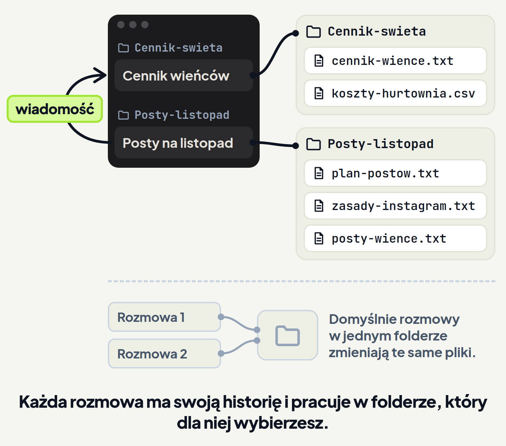
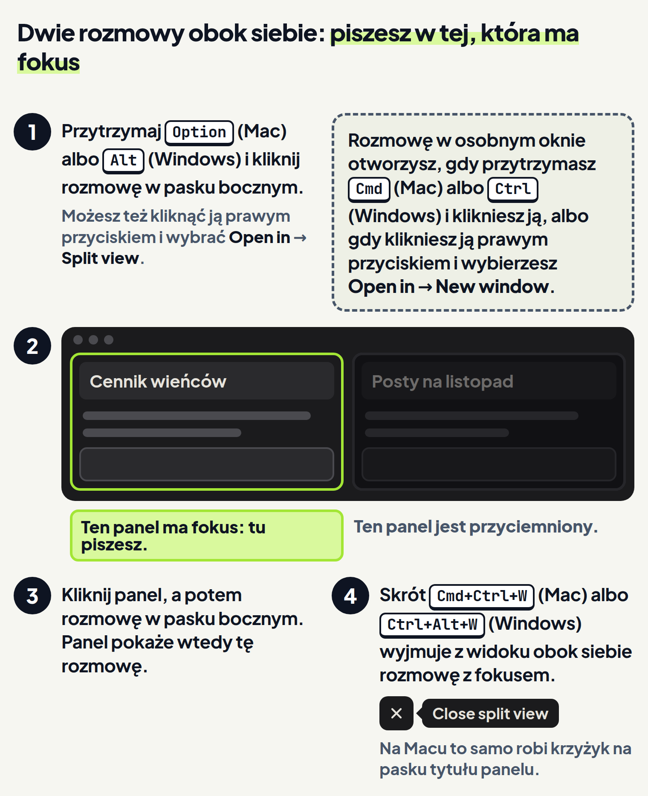
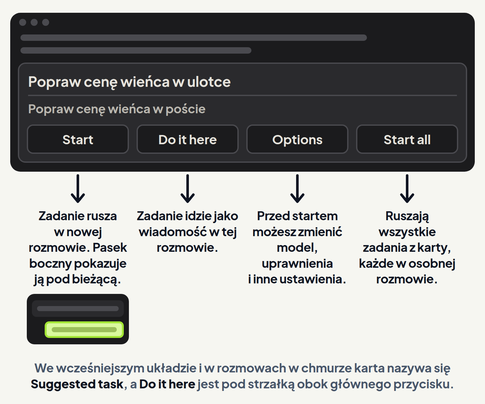

<em>Przewodnik po Claude Code · Moduł 9: Kilka zadań naraz · Lekcja 1 z 4</em>

# Kilka rozmów obok siebie

Prowadzisz kwiaciarnię i przed Wszystkimi Świętymi masz dwie sprawy. Hurtownia podniosła ceny chryzantem, więc z Claude liczysz nowy cennik wieńców. Do tego chcesz napisać posty na Instagram o promocji wieńców.

Gdy obie sprawy prowadzisz w jednej rozmowie, ustalenia z cennika mieszają się z postami. Gdy prowadzisz je w dwóch rozmowach, a cena się zmieni, przepisujesz ją ręcznie z jednej do drugiej. Albo zapominasz i posty wychodzą ze starą ceną.

W aplikacji Claude możesz prowadzić kilka rozmów naraz. Pasek boczny wymienia Twoje rozmowy. <!-- fakt: aplikacja-pasek-boczny-lista-sesji --> Aplikacja nazywa rozmowę sesją. Każda rozmowa ma własną historię i własny folder, niezależne od innych rozmów. <!-- fakt: aplikacja-kazda-rozmowa-to-sesja --> Claude w jednej rozmowie potrafi też przeczytać ustalenia z drugiej i wysłać do niej wiadomość. <!-- fakt: aplikacja-claude-czyta-inne-sesje-zwykla-prosba -->

W ćwiczeniu otwarta jest rozmowa o cenniku. Zaczniesz drugą rozmowę, o postach. Zobaczysz, że nowa rozmowa dostaje własny folder, zanim wyślesz pierwszą prośbę. Claude zapisze plik tylko w tym folderze, a nowa rozmowa pojawi się w pasku bocznym w osobnej grupie. Gdy wrócisz do rozmowy o cenniku, zastaniesz jej historię i jej folder bez zmian.

<!-- cwiczenie: cw1 -->

## Co tu się stało?

<!-- kolumny -->

#### W rozmowie i w pasku bocznym

<!-- podglad: cw1 druga -->

1. Kliknięcie rozmowy w grupie Cennik-swieta w pasku bocznym otworzyło ją z całą historią. <!-- fakt: aplikacja-powrot-do-sesji-klik-w-pasku-bocznym -->
2. Wcześniej przycisk + New otworzył nową rozmowę. <!-- fakt: aplikacja-nowa-sesja-new-albo-cmd-n --> Przed pierwszą prośbą w kontrolce folderu w rzędzie pod polem wiadomości pojawił się folder Posty-listopad. <!-- fakt: aplikacja-rzad-pod-polem-srodowisko-folder-tryb-model --> <!-- fakt: aplikacja-kontrolka-folderu-obok-selektora -->
3. Po pierwszej prośbie nowa rozmowa pojawiła się w pasku bocznym w grupie folderu Posty-listopad. Dwie wcześniejsze rozmowy są w grupie Cennik-swieta. <!-- fakt: aplikacja-pasek-boczny-grupa-folderu -->

#### W folderze

1. Claude przeczytał plan i zasady z folderu Posty-listopad i zapisał w nim nowy plik posty-wience.txt. <!-- fakt: aplikacja-kontrolka-folderu-obok-selektora --> <!-- fakt: claude-code-tworzy-nowe-pliki -->
2. W folderze Cennik-swieta nic się nie zmieniło.
3. Gdy znów otworzyła się rozmowa o cenniku, ciemna etykieta z zielonym napisem pod oknem pokazała Cennik-swieta, bo to folder tej rozmowy. <!-- fakt: aplikacja-kazda-rozmowa-to-sesja -->

<!-- /kolumny -->

## Kilka rozmów naraz

### Po co są osobne rozmowy

Cennik i posty to dwie sprawy z osobnymi plikami. Gdy każda ma swoją rozmowę, ustalenia z jednej nie mieszają się z ustaleniami z drugiej. Aplikacja pozwala w ten sposób pracować nad kilkoma zadaniami równolegle. <!-- fakt: aplikacja-nowa-sesja-new-albo-cmd-n -->

### Jak działają

W zakładce Code każda rozmowa to sesja. Ma własną historię i własny folder, niezależne od innych rozmów. <!-- fakt: aplikacja-kazda-rozmowa-to-sesja -->

Pod polem wiadomości jest rząd przycisków. Zanim wyślesz pierwszą prośbę, wybierasz w nim: <!-- fakt: aplikacja-rzad-pod-polem-srodowisko-folder-tryb-model -->

- miejsce pracy Claude: to pierwszy przycisk w rzędzie, w ćwiczeniu z ikoną komputera, <!-- fakt: aplikacja-selektor-srodowiska-pierwsza-kontrolka -->
- folder,
- tryb,
- model.

Krok po kroku:

1. Nową rozmowę zaczynasz przyciskiem + New w pasku bocznym albo skrótem Cmd+N na Macu, Ctrl+N na Windows. <!-- fakt: aplikacja-nowa-sesja-new-albo-cmd-n -->
2. Zanim wyślesz pierwszą prośbę, w rzędzie pod polem wiadomości wybierasz folder. <!-- fakt: aplikacja-rzad-pod-polem-srodowisko-folder-tryb-model --> We wcześniejszym układzie folder wybierasz nad polem wiadomości (lekcja 0.1). <!-- fakt: aplikacja-wczesniejszy-uklad-srodowisko-i-folder-nad-polem -->
3. Folder wybierasz kontrolką folderu obok przycisku wyboru miejsca pracy Claude. Claude pracuje w folderze, który tam wskażesz. <!-- fakt: aplikacja-kontrolka-folderu-obok-selektora --> Na zrzucie aplikacji ta kontrolka ma ikonę folderu i jego nazwę. <!-- fakt: aplikacja-rzad-pod-polem-folder-z-nazwa-kadr -->
4. Do rozmowy wracasz, klikając ją w pasku bocznym. <!-- fakt: aplikacja-powrot-do-sesji-klik-w-pasku-bocznym --> Skrótami Ctrl+Tab i Ctrl+Shift+Tab przechodzisz po kolei między rozmowami z paska bocznego. <!-- fakt: aplikacja-ctrl-tab-przelacza-sesje -->

Przy domyślnym grupowaniu paska bocznego rozmowę znajdziesz w grupie folderu, w którym pracuje. <!-- fakt: aplikacja-pasek-boczny-grupa-folderu --> Na zrzucie aplikacji każda grupa ma nagłówek, a pod nim stoją rozmowy tej grupy. <!-- fakt: aplikacja-pasek-boczny-grupy-z-naglowkami-kadr --> Tak było w ćwiczeniu: dwie rozmowy były w grupie Cennik-swieta, a nowa rozmowa o postach w grupie Posty-listopad. O tym, jak zmienić grupowanie i nadać rozmowie nazwę, przeczytasz w lekcji 6.2.

### Co Ci to daje

Cennik i posty mają osobne historie i osobne foldery. Z jednej rozmowy do drugiej przechodzisz jednym kliknięciem w pasku bocznym. <!-- fakt: aplikacja-powrot-do-sesji-klik-w-pasku-bocznym -->

### Na co uważać

- **Dwie rozmowy w jednym folderze zmieniają te same pliki.** Git to program, który zapisuje historię zmian w folderze. Domyślnie Claude pracuje wprost w folderze projektu, więc dwie rozmowy w jednym folderze zmieniają te same pliki. <!-- fakt: aplikacja-worktree-domyslnie-wylaczony --> Osobną kopię folderu dla rozmowy aplikacja robi tylko z gitem. <!-- fakt: aplikacja-izolacja-sesji-wymaga-gita --> Dlatego w ćwiczeniu każda rozmowa ma swój folder i git nie jest potrzebny.
- **W folderze dodanym w trakcie rozmowy Claude też pracuje wprost.** W trwającej rozmowie folder dodasz przyciskiem + obok pola wiadomości i pozycją Add folder (dodaj folder). Claude pracuje wtedy wprost w tym folderze, bez osobnej kopii. <!-- fakt: aplikacja-dodaj-folder-w-sesji --> Ćwiczenie tego nie pokazuje.
- **Kilka rozmów naraz zużywa więcej tokenów.** Kilka rozmów pracujących naraz mnoży zużycie tokenów. <!-- fakt: kilka-sesji-albo-subagentow-mnozy-zuzycie --> Co to znaczy dla limitu Twojego abonamentu, wyjaśnia moduł 6 (lekcja 6.4).

## Obok siebie albo w osobnym oknie

### Po co jest widok obok siebie

W rozmowie o cenniku Claude liczy ceny, a Ty w tym czasie piszesz w rozmowie o postach. Chcesz widzieć obie naraz, a nie przełączać się co chwilę.

### Jak działa

Ćwiczenie nie pokazuje tego widoku, więc kroki są na rysunku niżej.

1. Przytrzymaj Option na Macu albo Alt na Windows i kliknij rozmowę w pasku bocznym. Możesz też kliknąć ją prawym przyciskiem i wybrać Open in (otwórz w), a potem Split view (widok obok siebie). Druga rozmowa otworzy się obok bieżącej. <!-- fakt: aplikacja-sesja-obok-split-view --> Każda rozmowa ma wtedy swój panel. <!-- fakt: aplikacja-split-view-dwa-panele-kadr -->
2. Fokus ma panel otwarty albo kliknięty ostatnio, a drugi panel jest przyciemniony. <!-- fakt: aplikacja-split-view-fokus-przyciemnienie --> Panel z fokusem to ten, w którym piszesz. Klikasz w panel, w którym chcesz pisać. <!-- fakt: aplikacja-split-view-fokus-przyciemnienie -->
3. Żeby panel pokazał inną rozmowę, kliknij w ten panel, a potem w rozmowę w pasku bocznym. <!-- fakt: aplikacja-split-view-zmiana-sesji-w-panelu -->
4. Rozmowę z fokusem wyjmiesz z widoku skrótem Cmd+Ctrl+W na Macu albo Ctrl+Alt+W na Windows. <!-- fakt: aplikacja-split-view-wyjmij-skrotem --> Na nagraniu aplikacji na Macu jest też krzyżyk na pasku tytułu panelu. Jego dymek to Close split view (zamknij widok obok siebie) z tym samym skrótem. <!-- fakt: aplikacja-split-view-krzyzyk-close-split-view -->

Na oficjalnym nagraniu dwie rozmowy stoją obok siebie w jednym oknie. Każda ma własne: <!-- fakt: aplikacja-split-view-dwa-panele-kadr -->

- pasek tytułu,
- pole wiadomości,
- tryb.

Rozmowę otworzysz też w osobnym oknie. Przytrzymaj Cmd na Macu albo Ctrl na Windows i kliknij rozmowę. Możesz też kliknąć ją prawym przyciskiem i wybrać Open in, a potem New window (nowe okno). <!-- fakt: aplikacja-sesja-w-osobnym-oknie -->

### Co Ci to daje

Widzisz, co robi druga rozmowa, i piszesz w tej, która ma fokus. <!-- fakt: aplikacja-split-view-fokus-przyciemnienie -->

### Na co uważać

Nie musisz pilnować każdej rozmowy na ekranie. Gdy rozmowa skończy zadanie, a Ty akurat na nią nie patrzysz, aplikacja wyśle powiadomienie systemowe. <!-- fakt: aplikacja-powiadomienie-o-koncu-zadania --> Powiadomienia poznasz w lekcji 7.1.

W drugim ćwiczeniu Claude w rozmowie o cenniku policzył już nową cenę wieńca, a otwarta jest rozmowa o postach. Zapytasz w niej Claude o cenę z cennika i poprosisz, żeby dał znać w rozmowie o cenniku. Zobaczysz, że Claude sam czyta ustalenia z drugiej rozmowy. Wiadomość, o którą poprosisz, pojawi się w rozmowie o cenniku jako karta z tytułem rozmowy, która ją wysłała.

<!-- cwiczenie: cw2 -->

## Co tu się stało?

<!-- kolumny -->

#### W rozmowie Posty na listopad

1. Wystarczyło zwykłe pytanie. Claude przeczytał rozmowę Cennik wieńców i podał nową cenę. <!-- fakt: aplikacja-claude-czyta-inne-sesje-zwykla-prosba -->
2. Gdy Claude szukał ceny, w folderze pod oknem nie podświetlił się żaden plik: Claude sprawdził, co robiła rozmowa o cenniku. <!-- fakt: aplikacja-claude-czyta-inne-sesje-zwykla-prosba -->
3. Na prośbę „daj znać w rozmowie Cennik wieńców” Claude poprawił posty i wysłał wiadomość do tamtej rozmowy. <!-- fakt: aplikacja-claude-czyta-inne-sesje-zwykla-prosba -->

#### W rozmowie Cennik wieńców

<!-- podglad: cw2 wiadomosc -->

1. W rozmowie pojawiła się karta z tytułem rozmowy, która wysłała wiadomość: Posty na listopad. <!-- fakt: aplikacja-wiadomosc-karta-z-tytulem-nadawcy -->
2. Karta podaje rozmowę, która wysłała wiadomość. Wiadomość nie przyszła od Ciebie. <!-- fakt: aplikacja-wiadomosc-karta-z-tytulem-nadawcy -->
3. Strzałka na karcie otworzyła rozmowę Posty na listopad. <!-- fakt: aplikacja-wiadomosc-karta-z-tytulem-nadawcy -->

<!-- /kolumny -->

Karta trafia nie tylko do Ciebie. Claude w rozmowie o cenniku może na nią odpisać, a aplikacja dostarczy odpowiedź z powrotem. <!-- fakt: aplikacja-odbiorca-moze-odpisac --> W ćwiczeniu tej odpowiedzi nie ma. Wygląd karty w ćwiczeniu jest uproszczony: dokumentacja podaje tylko tytuł rozmowy, która wysłała wiadomość, i odnośnik do niej. <!-- fakt: aplikacja-wiadomosc-karta-z-tytulem-nadawcy -->

## Claude sprawdza inne rozmowy

### Po co

Cena ustalona w rozmowie o cenniku jest potrzebna w postach. Bez tej funkcji kopiujesz ją ręcznie z rozmowy do rozmowy.

### Jak działa

Claude może wypisać Twoje inne rozmowy z zakładki Code i przeczytać, co robiła każda z nich. <!-- fakt: aplikacja-claude-czyta-inne-sesje-zwykla-prosba --> Prosisz o to zwykłymi słowami, na przykład: „Co ustaliła rozmowa Cennik wieńców?”. <!-- fakt: aplikacja-claude-czyta-inne-sesje-zwykla-prosba -->

### Co Ci to daje

Ustalenia z drugiej rozmowy dostajesz w tej, w której pracujesz. Niczego nie przepisujesz.

### Na co uważać

Tą drogą Claude nie widzi wszystkich rozmów:

- widzi tylko rozmowy, które prowadzi sama aplikacja w zakładce Code, <!-- fakt: aplikacja-claude-widzi-tylko-sesje-aplikacji -->
- nie widzi rozmów w chmurze ani rozmów zaczętych w terminalu, <!-- fakt: aplikacja-claude-widzi-tylko-sesje-aplikacji -->
- nie wymienia rozmowy, z której pytasz, <!-- fakt: aplikacja-claude-nie-wymienia-biezacej-sesji -->
- domyślnie widzi 20 ostatnio aktywnych rozmów, a zarchiwizowane tylko wtedy, gdy o nie poprosisz. <!-- fakt: aplikacja-claude-widzi-20-ostatnich-sesji -->

## Wiadomość między rozmowami

### Po co

Strona dokumentacji o wiadomościach między sesjami, czyli rozmowami, dotyczy całego Claude Code, także pracy w terminalu. Aplikacja działa na tym samym silniku. <!-- fakt: aplikacja-ten-sam-silnik-co-w-terminalu --> Ta strona podaje dwa powody, żeby rozmowy wymieniały wiadomości: <!-- fakt: wiadomosc-miedzy-sesjami-po-co -->

- Zmiana w jednej rozmowie psuje to, na czym opiera się druga. Claude może ostrzec tamtą rozmowę, zanim to zauważysz.
- Jedna rozmowa rozstrzyga sprawę, na którą czeka druga. Claude może przesłać do niej odpowiedź.

W takiej sytuacji Claude streszcza ustalenie dla drugiej rozmowy, więc nie musisz tłumaczyć go tam od nowa. <!-- fakt: wiadomosc-miedzy-sesjami-przekazanie-ustalenia --> <!-- fakt: aplikacja-ten-sam-silnik-co-w-terminalu -->

### Jak działa

W aplikacji prosisz Claude zwykłymi słowami, żeby dał znać w drugiej rozmowie, tak jak w ćwiczeniu. <!-- fakt: aplikacja-claude-czyta-inne-sesje-zwykla-prosba --> Według strony o wiadomościach treść wiadomości pisze sam Claude, więc jej brzmienie możesz zostawić jemu. <!-- fakt: wiadomosc-miedzy-sesjami-tresc-pisze-claude --> <!-- fakt: aplikacja-ten-sam-silnik-co-w-terminalu --> Ta sama strona mówi, że Claude może też wysłać wiadomość sam, gdy widzi potrzebę, na przykład po zmianie, która dotyczy pracy w innej rozmowie. <!-- fakt: wiadomosc-miedzy-sesjami-sam-albo-na-prosbe --> <!-- fakt: aplikacja-ten-sam-silnik-co-w-terminalu -->

Co dzieje się w drugiej rozmowie:

- Aplikacja pokazuje wiadomość jako kartę z tytułem rozmowy, która ją wysłała, i z odnośnikiem do niej. Dzięki temu zawsze widać, skąd przyszła wiadomość. <!-- fakt: aplikacja-wiadomosc-karta-z-tytulem-nadawcy -->
- Aplikacja cytuje każdą wiadomość i przypisuje ją rozmowie, która ją wysłała. Claude, działając według wiadomości, dalej trzyma się uprawnień rozmowy, która ją dostała. <!-- fakt: aplikacja-wiadomosc-cytowana-uprawnienia-odbiorcy -->
- Gdy Claude w drugiej rozmowie akurat pracuje, aplikacja wstrzymuje wiadomość. Claude przeczyta ją, gdy skończy bieżącą pracę. <!-- fakt: aplikacja-wiadomosc-czeka-gdy-odbiorca-pracuje -->
- Claude w rozmowie, która dostała wiadomość, może odpisać. Aplikacja dostarczy odpowiedź z powrotem. <!-- fakt: aplikacja-odbiorca-moze-odpisac -->

### Co Ci to daje

Claude w rozmowie o cenniku wie, że posty mają już nową cenę, a Ty niczego nie przepisujesz.

### Na co uważać

W aplikacji:

- **Wiadomość nie dojdzie do zarchiwizowanej rozmowy.** Claude powie Ci, gdy wiadomość nie doszła. <!-- fakt: aplikacja-wiadomosc-nie-dojdzie-do-archiwum -->
- **W drugiej rozmowie obowiązują jej własne uprawnienia.** Gdy Claude działa według wiadomości, trzyma się ustawień uprawnień rozmowy, która ją dostała. <!-- fakt: aplikacja-wiadomosc-cytowana-uprawnienia-odbiorcy -->

Strona dokumentacji o wiadomościach między sesjami opisuje jeszcze kilka zasad takich wiadomości w Claude Code: <!-- fakt: aplikacja-ten-sam-silnik-co-w-terminalu -->

- Wiadomość z innej rozmowy nigdy nie jest Twoją zgodą. Nie odpowie więc za Ciebie na pytanie o zgodę. <!-- fakt: wiadomosc-miedzy-sesjami-nie-zatwierdza -->
- Gdy działanie według wiadomości wymaga uprawnienia, którego rozmowa nie ma, zobaczysz to samo pytanie o zgodę co przy każdej innej pracy. <!-- fakt: wiadomosc-miedzy-sesjami-pytania-o-zgode-zostaja -->
- Claude ma nie prosić innej rozmowy o działanie, którego mu odmówiono albo które zablokowano w jego rozmowie. Taką pracę oddaje Tobie. <!-- fakt: wiadomosc-miedzy-sesjami-granice-uprawnien -->
- Dostarczona wiadomość liczy się do zużycia tak jak prośba, którą wpisujesz w polu wiadomości (lekcja 6.4). <!-- fakt: wiadomosc-miedzy-sesjami-liczy-sie-do-zuzycia -->
- Pętla wiadomości między dwiema rozmowami zatrzymuje się sama. <!-- fakt: wiadomosc-miedzy-sesjami-petla-sama-sie-zatrzymuje -->

## Zadanie, które Claude proponuje

### Po co

W trakcie pracy Claude może zauważyć sprawę poboczną. Na przykład w rozmowie o postach widzi, że w ulotce stoi stara cena wieńca. Gdyby od razu poprawił ulotkę, przerwałby bieżącą pracę.

### Jak działa

Gdy Claude zauważy coś do poprawy poza bieżącym zadaniem, proponuje to jako zadanie. <!-- fakt: aplikacja-zadanie-proponowane-karta-w-rozmowie --> W bieżącym układzie aplikacji, w rozmowach lokalnych i SSH, propozycja to karta z przyciskami w rozmowie. <!-- fakt: aplikacja-zadanie-proponowane-karta-w-rozmowie --> Tej karty nie ma w ćwiczeniu, pokazuje ją rysunek niżej. Przyciski karty:

- **Start** (zacznij) zaczyna zadanie w innej rozmowie, domyślnie w tym samym miejscu pracy Claude. Karta pokazuje potem stan tej rozmowy, a pasek boczny wymienia ją pod bieżącą. <!-- fakt: aplikacja-zadanie-proponowane-start -->
- **Do it here** (zrób to tutaj) wysyła zadanie do bieżącej rozmowy jako wiadomość. <!-- fakt: aplikacja-zadanie-proponowane-do-it-here -->
- **Options** (opcje) pozwala przed kliknięciem Start przejrzeć albo zmienić ustawienia, na przykład miejsce pracy Claude, model i uprawnienia. <!-- fakt: aplikacja-zadanie-proponowane-options -->
- **Start all** (zacznij wszystkie): gdy karta wymienia kilka zadań, ten przycisk zaczyna każde w osobnej rozmowie, bez czekania, aż skończy się poprzednie. <!-- fakt: aplikacja-zadanie-proponowane-start-all -->

Tytuły zadań na rysunku, „Popraw cenę wieńca w ulotce” i „Popraw cenę wieńca w poście”, to przykład z kwiaciarni.

### Co Ci to daje

Druga rozmowa powstaje jednym kliknięciem Start, a Claude w bieżącej rozmowie zostaje przy swoim zadaniu. <!-- fakt: aplikacja-zadanie-proponowane-start -->

### Na co uważać

- **Wcześniejszy układ ma inną kartę.** Jeśli pod polem wiadomości nie ma przycisku wyboru miejsca pracy Claude, masz wcześniejszy układ aplikacji. <!-- fakt: aplikacja-wczesniejszy-uklad-brak-selektora --> W nim, a także w rozmowach w chmurze, propozycja to karta Suggested task (proponowane zadanie). Do it here znajdziesz pod strzałką obok głównego przycisku. <!-- fakt: aplikacja-zadanie-proponowane-wczesniejszy-uklad -->
- **Start all to kilka rozmów naraz.** Kilka rozmów pracujących naraz mnoży zużycie tokenów. <!-- fakt: kilka-sesji-albo-subagentow-mnozy-zuzycie -->

## Kiedy otwierać drugą rozmowę, a kiedy nie

<!-- kolumny -->

#### Druga rozmowa

1. Masz osobne zadanie z osobnymi plikami, jak posty obok cennika. Każda rozmowa dostaje wtedy swoją historię i swój folder. <!-- fakt: aplikacja-kazda-rozmowa-to-sesja -->
2. Praca ma długo trwać równolegle albo nie zmieści się w jednym oknie kontekstu (o oknie kontekstu mówi lekcja 9.2). Claude przekaże wtedy ustalenia między rozmowami. <!-- fakt: subagent-praca-ponad-okno-osobne-sesje -->

#### Ta sama rozmowa

1. Potrzebujesz ustaleń z historii tej rozmowy. Druga rozmowa ma własną historię i tych ustaleń w niej nie ma. <!-- fakt: aplikacja-kazda-rozmowa-to-sesja -->
2. Claude w drugiej rozmowie pracowałby w tym samym folderze i zmieniałby te same pliki. <!-- fakt: aplikacja-worktree-domyslnie-wylaczony -->

<!-- /kolumny -->

Gdy poboczna praca zalałaby rozmowę treścią wielu plików, robi ją pomocnik we własnym kontekście i oddaje samo podsumowanie. <!-- fakt: subagent-poboczne-zadanie-oddaje-podsumowanie --> Pomocnika do takiej pracy poznasz w lekcji 9.2.

## Źródła

- [Aplikacja Claude na komputer](https://code.claude.com/docs/en/desktop)
- [Wiadomości między sesjami](https://code.claude.com/docs/en/cross-session-messaging)
- [Praca kilku agentów naraz](https://code.claude.com/docs/en/agents)
- [Własne subagenty](https://code.claude.com/docs/en/sub-agents)
- [Pierwsze kroki w aplikacji](https://code.claude.com/docs/en/desktop-quickstart)
- [Jak działa Claude Code](https://code.claude.com/docs/en/how-claude-code-works)
- [Co nowego, tydzień 37: nagranie widoku obok siebie](https://code.claude.com/docs/en/whats-new/2026-w37)
- [Zgłoszenie na GitHubie z nagraniem aplikacji: krzyżyk Close split view](https://github.com/anthropics/claude-code/issues/94831)
- [Zgłoszenie na GitHubie ze zrzutem aplikacji: kontrolka folderu pod polem wiadomości](https://github.com/anthropics/claude-code/issues/102210)
- [Zgłoszenie na GitHubie ze zrzutem aplikacji: grupy w pasku bocznym](https://github.com/anthropics/claude-code/issues/102731)

Sprawdzone 24–26.10.2026, Claude Code 2.1.310.
