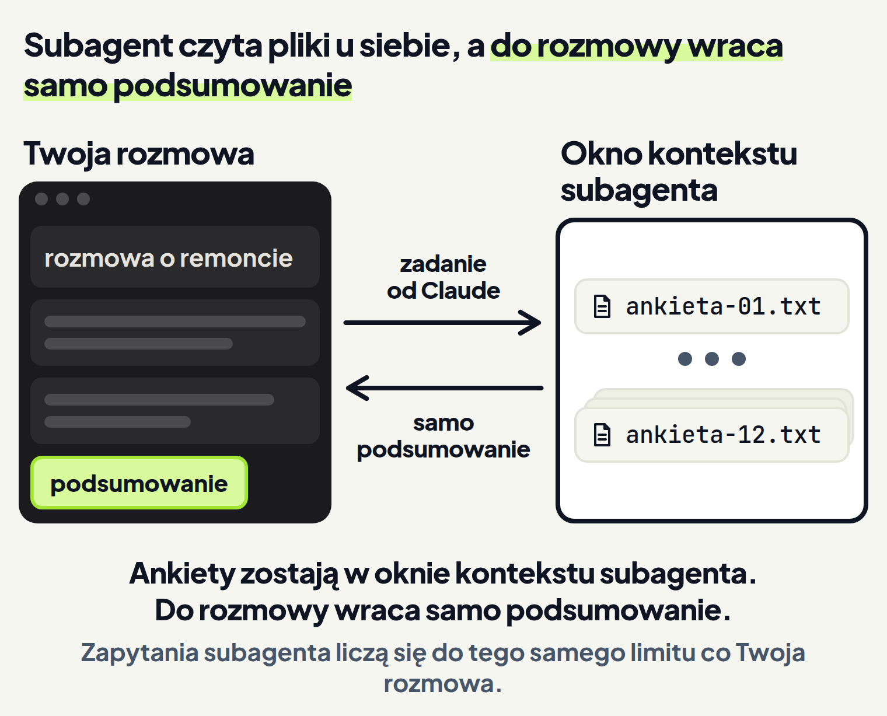
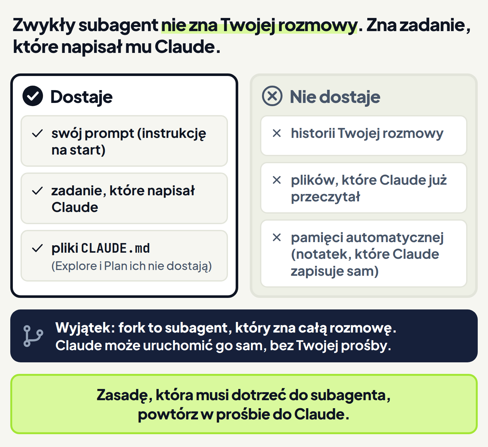

<em>Przewodnik po Claude Code · Moduł 9: Kilka zadań naraz · Lekcja 2 z 4</em>

# Subagent: pomocnik do zbierania informacji

Po sezonie masz 12 ankiet od gości pensjonatu. Chcesz wiedzieć, na co goście narzekają. Potem chcesz dalej rozmawiać z Claude o listopadowym remoncie łazienek.

Gdy Claude czyta ankiety w Twojej rozmowie, każda przeczytana ankieta w niej zostaje. <!-- fakt: kontekst-kazdy-przeczytany-plik-dodaje --> Rozmowa o remoncie dźwiga wtedy 12 ankiet, do których już nie wrócisz. <!-- fakt: subagent-poboczne-zadanie-oddaje-podsumowanie -->

Na taką poboczną pracę jest subagent, czyli pomocnik, który pracuje w osobnym oknie kontekstu. <!-- fakt: subagent-wlasne-okno-kontekstu --> Subagent czyta pliki u siebie i oddaje samo podsumowanie. <!-- fakt: subagent-poboczne-zadanie-oddaje-podsumowanie -->

Karta Context (kontekst) w panelu obok rozmowy pokazuje, ile miejsca zajmuje rozmowa. W bieżącym układzie aplikacji nagłówek karty podaje w procentach, jak pełne jest okno kontekstu. <!-- fakt: aplikacja-karta-context-procent-w-naglowku --> <!-- fakt: aplikacja-panel-szczegolow-sesji-karty-obok-czatu -->

Wyślij tę samą prośbę dwa razy: raz ankiety czyta sam Claude, raz subagent. Zobaczysz, że w obu drogach powstaje ten sam plik z uwagami. Procent na karcie Context rośnie jednak mocno, gdy ankiety czyta sam Claude, a tylko trochę, gdy czyta je subagent.

<!-- cwiczenie: cw1 -->

## Co tu się stało?

<!-- kolumny -->

#### Claude czyta sam

<!-- podglad: cw1 sam -->

1. Claude przeczytał 12 ankiet w tej rozmowie. Każda ankieta w niej została. <!-- fakt: kontekst-kazdy-przeczytany-plik-dodaje -->
2. Dlatego procent na karcie Context mocno urósł. <!-- fakt: aplikacja-karta-context-procent-w-naglowku -->
3. Claude zapisał uwagi gości w nowym pliku uwagi-gosci.txt. <!-- fakt: claude-code-tworzy-nowe-pliki -->

#### Przez subagenta

<!-- podglad: cw1 subagent -->

1. Claude oddał czytanie subagentowi, który pracował w tle. <!-- fakt: subagent-domyslnie-w-tle -->
2. Ankiety zostały w oknie subagenta. Do rozmowy wróciło samo podsumowanie. <!-- fakt: kontekst-subagent-duze-odczyty-poza-twoim-oknem -->
3. Podsumowanie też zajmuje miejsce, więc procent urósł, ale tylko trochę. <!-- fakt: subagent-wyniki-wracaja-do-rozmowy -->

<!-- /kolumny -->

Plik z uwagami jest w obu drogach taki sam. Różnica jest w tym, co zostało w Twojej rozmowie. Liczby na karcie w ćwiczeniu są przykładowe.

## Subagent: pomocnik z własnym oknem kontekstu

### Po co jest subagent

Subagent przydaje się, gdy poboczne zadanie zalałoby rozmowę treścią plików, do których nie wrócisz. <!-- fakt: subagent-poboczne-zadanie-oddaje-podsumowanie --> Pomaga też wtedy, gdy okno kontekstu się zapełnia. <!-- fakt: subagent-gdy-okno-sie-zapelnia --> Subagent może przeczytać dziesiątki plików, a Twoja rozmowa dostaje tylko podsumowanie. <!-- fakt: subagent-gdy-okno-sie-zapelnia -->

### Jak działa subagent

Każdy subagent pracuje we własnym oknie kontekstu. Ma też własne:

- prompt (instrukcję na start),
- narzędzia,
- uprawnienia. <!-- fakt: subagent-wlasne-okno-kontekstu -->

Pracę robi osobno, a do rozmowy wraca tylko podsumowanie. <!-- fakt: subagent-osobne-okno-wraca-podsumowanie -->

<!-- wyjasnienie: obrazy/okno-rozmowy-i-subagenta-wyjasnienie.png | Gdy Claude czyta sam, ankiety zapychają rozmowę; przez subagenta ankiety zostają w jego oknie, a do rozmowy wraca samo podsumowanie. -->
<!-- analogia: Subagent działa jak stażysta wysłany do archiwum. Przegląda sto teczek u siebie, a Tobie przynosi jedną kartkę z wnioskami. -->

O subagenta prosisz zwykłymi słowami. <!-- fakt: subagent-oddaj-duzo-danych-wraca-podsumowanie --> W ćwiczeniu prośba zaczynała się od słów „Użyj subagenta”.

Czasem nie musisz prosić. Gdy zadanie pasuje do opisu któregoś subagenta, Claude sam mu je przekazuje. Subagent pracuje wtedy samodzielnie i oddaje wynik. <!-- fakt: subagent-claude-przekazuje-pasujace-zadanie -->

Claude Code ma kilku wbudowanych subagentów i Claude sam ich używa, gdy pasują do zadania. <!-- fakt: subagenty-wbudowane-claude-uzywa-sam --> Trzech z nich:

- **Explore** (przeszukiwanie) tylko czyta. Szuka i analizuje, a zapis i zmianę plików ma zablokowane. <!-- fakt: subagent-explore-tylko-czyta -->
- **general-purpose** (ogólny) bierze złożone zadania w wielu krokach, w których trzeba i szukać, i działać. <!-- fakt: subagent-general-purpose-szuka-i-dziala -->
- **Plan** pracuje w trybie planowania (lekcja 1.3). Claude oddaje mu wtedy szukanie, żeby wyniki zostały w osobnym oknie kontekstu. <!-- fakt: subagent-plan-w-trybie-planowania -->

Strona dokumentacji o subagentach opisuje głównie Claude Code w terminalu. Aplikacja działa na tym samym silniku. <!-- fakt: aplikacja-ten-sam-silnik-co-w-terminalu -->

### Co Ci to daje

Duże odczyty plików zostają w oknie subagenta, poza oknem Twojej rozmowy. <!-- fakt: kontekst-subagent-duze-odczyty-poza-twoim-oknem --> W rozmowie o remoncie zostaje podsumowanie ankiet, a nie 12 ankiet.

### Na co uważać

- **Podsumowanie też zajmuje miejsce.** Wyniki subagentów wracają do rozmowy. Wielu subagentów ze szczegółowymi wynikami może zająć dużo kontekstu. <!-- fakt: subagent-wyniki-wracaja-do-rozmowy --> Dlatego w ćwiczeniu procent urósł trochę, a nie stał w miejscu.
- **Subagent zużywa ten sam limit.** Subagent wysyła własne zapytania, a one liczą się do tego samego limitu co Twoja rozmowa. <!-- fakt: subagent-ten-sam-limit-co-rozmowa --> Kilku subagentów pracujących naraz mnoży zużycie. <!-- fakt: kilka-sesji-albo-subagentow-mnozy-zuzycie --> O limicie abonamentu mówi lekcja 6.4.
- **Wbudowani subagenci mają Twoje uprawnienia.** Przejmują reguły uprawnień Twojej rozmowy. <!-- fakt: subagenty-wbudowane-claude-uzywa-sam -->

## Co subagent dostaje na start

### Po co to wiedzieć

Ustalasz coś w rozmowie, a potem prosisz o subagenta. Musisz wiedzieć, co z tej rozmowy do niego dotrze, a co trzeba powtórzyć w prośbie.

### Co dostaje, a czego nie

Zwykły subagent startuje ze świeżym oknem kontekstu. Nie widzi historii Twojej rozmowy, skilli, których już użyto, ani plików, które Claude już przeczytał. <!-- fakt: subagent-swieze-okno-bez-historii-rozmowy -->

Zadanie dla subagenta pisze Claude. Streszcza w nim Twoją prośbę, a subagent od tego zaczyna pracę. <!-- fakt: subagent-zadanie-pisze-claude --> Ty piszesz prośbę do Claude, nie do subagenta.

Na start zwykły subagent dostaje:

- swój prompt (instrukcję na start), a nie prompt Claude Code, <!-- fakt: subagent-wlasny-prompt-nie-prompt-claude-code -->
- zadanie, które napisał Claude, <!-- fakt: subagent-zadanie-pisze-claude -->
- pliki CLAUDE.md, które wczytuje Twoja rozmowa (lekcja 2.2). Explore i Plan ich nie dostają. <!-- fakt: subagent-dostaje-claude-md-poza-explore-i-plan -->

Do zwykłego subagenta nie trafia pamięć automatyczna Twojej rozmowy, czyli notatki, które Claude zapisuje sam. <!-- fakt: subagent-bez-pamieci-automatycznej --> <!-- fakt: pamiec-automatyczna-notatki-claude -->

### Co Ci to daje

Wiesz, co dopisać do prośby. Większości zasad z CLAUDE.md nie musisz powtarzać: rozmowa ma cały CLAUDE.md, gdy czyta wynik subagenta. <!-- fakt: subagent-zasade-powtorz-w-prosbie --> Zasadę, która musi dotrzeć do subagenta, powtórz w prośbie do Claude. <!-- fakt: subagent-zasade-powtorz-w-prosbie --> Nie piszesz też zadania dla subagenta, bo robi to Claude. <!-- fakt: subagent-zadanie-pisze-claude -->

### Wyjątek: fork

Fork to subagent, który dziedziczy całą dotychczasową rozmowę, zamiast zaczynać od zera. <!-- fakt: subagent-fork-zna-cala-rozmowe --> Jego działania i tak zostają poza Twoją rozmową, a wraca tylko końcowy wynik. <!-- fakt: subagent-fork-zna-cala-rozmowe -->

Claude może sam uruchomić fork, bo tryb fork jest domyślnie włączony. <!-- fakt: subagent-fork-claude-uruchamia-sam --> Nie wiesz więc z góry, czy Claude użyje zwykłego subagenta, czy forka. Dlatego ważną zasadę i tak powtórz w prośbie. Z samym trybem fork nic nie musisz robić.

<!-- analogia: Subagent jest jak kurier z kartką. Nie słyszał Twojej rozmowy z klientem, więc ważną uwagę trzeba dopisać na kartce. -->

W kolejnym ćwiczeniu rozmowa zaczyna się od Twojej wiadomości: pokój 4 to apartament Pod Smrekiem. Poprosisz o dwóch subagentów i powtórzysz tę zasadę w prośbie. Zobaczysz, że każdy z dwóch subagentów ma swój wpis w panelu zadań w tle. Po kliknięciu wpisu otworzy się panel subagenta. Zobaczysz w nim zadanie, które napisał Claude, z Twoją zasadą, a pod nim wynik.

<!-- cwiczenie: cw2 -->

## Co tu się stało?

<!-- kolumny -->

#### W rozmowie

<!-- podglad: cw2 panel -->

1. Zasada o pokoju 4 stała w prośbie, bo zwykły subagent nie widzi rozmowy. <!-- fakt: subagent-swieze-okno-bez-historii-rozmowy -->
2. Claude odpowiedział od razu: subagenci pracują w tle. <!-- fakt: subagent-domyslnie-w-tle -->
3. Claude podał wynik później, bez nowej prośby. <!-- fakt: subagent-w-tle-wynik-w-pozniejszej-turze --> Zapisał go w pliku pokoje-opinie.txt. <!-- fakt: claude-code-tworzy-nowe-pliki -->

#### W panelu zadań w tle

1. Menu ⋮ na pasku tytułu miało pozycję Background tasks (zadania w tle). <!-- fakt: aplikacja-panel-zadan-w-tle-co-pokazuje -->
2. W panelu, w grupie Running (w toku), każdy subagent miał swój wpis z tytułem zadania. <!-- fakt: aplikacja-panel-zadan-grupa-running-wpis-agent -->
3. Kliknięcie wpisu otworzyło panel subagenta. <!-- fakt: aplikacja-wpis-w-tle-wynik-w-panelu-subagenta --> W szarym polu stało zadanie, które napisał Claude, a pod nim wynik. <!-- fakt: aplikacja-wiersz-subagenta-i-panel-subagenta --> <!-- fakt: subagent-zadanie-pisze-claude -->

<!-- /kolumny -->

W ćwiczeniu zasada z prośby trafiła do zadania od Claude, a subagent użył nazwy apartamentu w wyniku.

Pod odpowiedzią Claude pojawił się też niebieski odnośnik 2 running tasks (2 zadania w toku). Na zrzutach aplikacji z sieci taki niebieski odnośnik z liczbą zadań w tle (na przykład 19 running tasks) stoi w rozmowie pod ostatnią odpowiedzią. <!-- fakt: aplikacja-link-running-tasks-w-rozmowie -->

## Praca w tle i panel zadań

### Po co jest praca w tle

Subagent czyta ankiety, a Ty nie chcesz czekać bezczynnie. Chcesz też wiedzieć, co się dzieje.

### Jak działa praca w tle

Subagent, którego Claude uruchamia z Twojej rozmowy, domyślnie startuje w tle. <!-- fakt: subagent-domyslnie-w-tle --> Pracuje równocześnie z Tobą, gdy dalej prowadzisz rozmowę. <!-- fakt: subagent-w-tle-pracuje-gdy-ty-pracujesz --> W zakładce Code każda rozmowa to sesja. <!-- fakt: aplikacja-kazda-rozmowa-to-sesja --> W sesjach aplikacji na Twoim komputerze Claude może poczekać na subagenta dopiero po wyłączeniu trybu fork, a ten tryb jest domyślnie włączony. <!-- fakt: subagent-aplikacja-claude-nie-czeka-przy-trybie-fork --> Domyślnie więc Claude na subagenta nie czeka, a Ty możesz pisać dalej. <!-- fakt: subagent-aplikacja-claude-nie-czeka-przy-trybie-fork --> <!-- fakt: subagent-w-tle-pracuje-gdy-ty-pracujesz -->

Wynik subagenta dociera do Claude później, jako powiadomienie o zakończeniu. Zanim poda wynik, Claude czeka na to powiadomienie. <!-- fakt: subagent-w-tle-wynik-w-pozniejszej-turze --> To powiadomienie nie jest wiadomością od Ciebie, tylko zdarzeniem automatycznym. <!-- fakt: subagent-w-tle-raport-jako-zdarzenie-automatyczne --> Dlatego w ćwiczeniach Claude podał wynik bez nowej prośby.

Gdy zapytasz o postęp, zanim subagent skończy, Claude odpowie, że subagent jeszcze pracuje. <!-- fakt: subagent-w-tle-wynik-w-pozniejszej-turze -->

Panel zadań w tle pokazuje pracę w tle bieżącej rozmowy: <!-- fakt: aplikacja-panel-zadan-w-tle-co-pokazuje -->

- subagentów,
- polecenia w tle,
- przepływy (poznasz je w lekcji 9.4).

Panel zadań w tle i panel subagenta to dwa z paneli zakładki Code. <!-- fakt: aplikacja-panele-zakladki-code -->

### Jak zajrzeć do subagenta w aplikacji Claude

1. Gdy rozmowa ma pracę w tle, kliknij ⋮ na pasku tytułu rozmowy. <!-- fakt: aplikacja-panel-zadan-w-tle-co-pokazuje -->
2. Wybierz Background tasks (zadania w tle). Ta pozycja pojawia się w menu dopiero wtedy, gdy rozmowa ma coś do pokazania w tym panelu. <!-- fakt: aplikacja-menu-paska-panele-bez-przycisku -->
3. Kliknij wpis subagenta. Kliknięcie wpisu pokazuje wynik w panelu subagenta albo zatrzymuje tę pracę. <!-- fakt: aplikacja-wpis-w-tle-wynik-w-panelu-subagenta -->

### Co Ci to daje

Dalej piszesz w rozmowie, a subagent w tym czasie czyta. <!-- fakt: subagent-w-tle-pracuje-gdy-ty-pracujesz --> Do jego wyniku zaglądasz w panelu, bez pytania Claude. <!-- fakt: aplikacja-wpis-w-tle-wynik-w-panelu-subagenta -->

### Na co uważać

- **Pytanie o zgodę przyjdzie do Twojej rozmowy.** Gdy subagent w tle dojdzie do działania, które wymaga zgody, pytanie pojawi się w Twojej rozmowie. Zobaczysz w nim nazwę subagenta, który pyta. <!-- fakt: subagent-w-tle-pytanie-o-zgode-w-rozmowie -->
- **Zgoda na dłużej obejmie całą sesję.** Gdy na takie pytanie odpowiesz zgodą do końca sesji, obowiązuje ona w całej sesji, także w głównej rozmowie. <!-- fakt: subagent-w-tle-zgoda-na-sesje-obejmuje-rozmowe -->
- **Panel pokazuje tylko tę rozmowę.** Widać w nim pracę w tle bieżącej rozmowy. <!-- fakt: aplikacja-panel-zadan-w-tle-co-pokazuje --> Inne rozmowy znajdziesz w pasku bocznym (lekcja 9.1). <!-- fakt: aplikacja-pasek-boczny-lista-sesji -->
- **Błąd nie kasuje pracy.** Gdy praca subagenta skończy się błędem, na przykład z powodu limitu, subagent zgłosi to Claude. Subagent w tle jest wtedy oznaczony jako nieudany, a Claude dostaje jego ostatni wynik. Częściowa praca nie ginie. <!-- fakt: subagent-blad-api-wynik-czesciowy-nie-ginie -->
- **Za każdym razem startuje nowy subagent.** Żeby subagent dokończył wcześniejszą pracę, a nie zaczynał od nowa, poproś Claude, żeby go wznowił. <!-- fakt: subagent-wznow-prosba-o-kontynuacje --> Explore i Plan pracują jednorazowo, więc Claude nie może ich wznowić. <!-- fakt: subagent-explore-plan-nie-do-wznowienia -->

## Kiedy oddać zadanie subagentowi, a kiedy nie

Nie każda praca potrzebuje subagenta. Pomocnik kosztuje czas: zwykły subagent zaczyna od zera i może potrzebować chwili, żeby zebrać kontekst. <!-- fakt: subagent-kiedy-glowna-rozmowa --> Kilku subagentów naraz mnoży też zużycie. <!-- fakt: kilka-sesji-albo-subagentow-mnozy-zuzycie -->

<!-- kolumny -->

#### Subagent

1. Zadanie daje dużo treści, a Ty potrzebujesz tylko podsumowania. <!-- fakt: subagent-kiedy-subagent -->
2. Praca jest zamknięta w sobie i może skończyć się podsumowaniem. <!-- fakt: subagent-kiedy-subagent -->
3. Chcesz ograniczyć pomocnikowi narzędzia albo uprawnienia (lekcja 9.3). <!-- fakt: subagent-kiedy-subagent -->

#### Twoja rozmowa

1. Wymieniasz z Claude wiele wiadomości i poprawiasz wynik krok po kroku. <!-- fakt: subagent-kiedy-glowna-rozmowa -->
2. Kolejne etapy pracy dzielą dużo wspólnych ustaleń. <!-- fakt: subagent-kiedy-glowna-rozmowa -->
3. Zmiana jest szybka i punktowa. <!-- fakt: subagent-kiedy-glowna-rozmowa -->
4. Liczy się czas. <!-- fakt: subagent-kiedy-glowna-rozmowa -->

<!-- /kolumny -->

Dzięki temu wybierasz drogę, która nie zapycha rozmowy i nie zużywa limitu bez potrzeby.

Kilku subagentów naraz pasuje do tematów, które od siebie nie zależą. Tak było w ćwiczeniu 2: pokoje chwalone i pokoje krytykowane. Każdy subagent bada swój obszar, a Claude łączy ustalenia. <!-- fakt: subagenty-rownolegle-niezalezne-tematy -->

Są też inne sposoby:

- **/btw** przy pytaniu o coś, co już jest w rozmowie. <!-- fakt: subagent-btw-dla-pytania-o-rozmowe --> W aplikacji wpisujesz /btw w polu wiadomości i otwiera się pytanie z boku, które może czytać wszystko z głównej rozmowy do tej chwili (lekcja 6.1). <!-- fakt: aplikacja-btw-otwiera-boczna-rozmowe --> Nic z niego nie wraca do głównej rozmowy. <!-- fakt: aplikacja-pytanie-z-boku-nic-nie-wraca-do-rozmowy -->
- **Skill**, gdy chcesz powtarzalnych instrukcji, które działają w samej rozmowie, a nie w osobnym oknie subagenta (lekcja 4.3). <!-- fakt: subagent-skill-gdy-praca-w-rozmowie -->
- **Osobne rozmowy**, gdy praca ma długo trwać równolegle albo nie zmieści się w jednym oknie kontekstu. Claude przekaże wtedy ustalenia między rozmowami (lekcja 9.1). <!-- fakt: subagent-praca-ponad-okno-osobne-sesje -->

## Źródła

- [Własne subagenty](https://code.claude.com/docs/en/sub-agents)
- [Aplikacja Claude na komputer](https://code.claude.com/docs/en/desktop)
- [Co rozszerza Claude Code](https://code.claude.com/docs/en/features-overview)
- [Okno kontekstu](https://code.claude.com/docs/en/context-window)
- [Praca kilku agentów naraz](https://code.claude.com/docs/en/agents)

Sprawdzone 26.10.2026, Claude Code 2.1.310.
