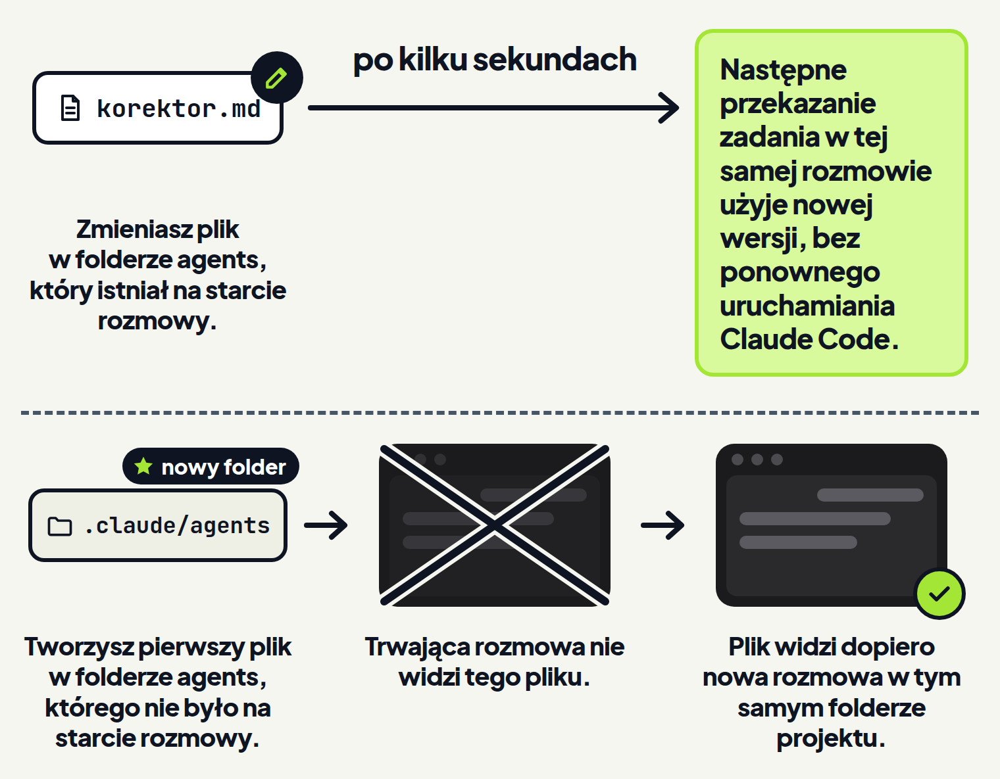

<em>Przewodnik po Claude Code · Moduł 9: Kilka zadań naraz · Lekcja 3 z 4</em>

# Własny subagent do jednego zadania

Co tydzień prosisz Claude o korektę newslettera piekarni według tych samych zasad klienta i za każdym razem podajesz je od nowa. Gdy raz po raz zlecasz pomocnikowi tę samą pracę z tymi samymi instrukcjami, dokumentacja radzi zrobić własnego subagenta. <!-- fakt: subagent-wlasny-gdy-ten-sam-pomocnik --> To pomocnik Claude z własną instrukcją i wybranymi narzędziami. <!-- fakt: subagent-wlasne-okno-instrukcja-narzedzia --> Zapisujesz go raz w pliku, a w nowej rozmowie podajesz jego nazwę. <!-- fakt: subagent-plik-markdown-prosba-albo-recznie --> <!-- fakt: subagent-wolasz-zwyklym-zdaniem-z-nazwa -->

W ćwiczeniu niżej poprosisz Claude o subagenta korektora, który pilnuje zasad z pliku `zasady-klienta.txt`. Zobaczysz jego plik w folderze `.claude/agents` i przeczytasz, co w nim stoi.

<!-- cwiczenie: cw1 -->

## Co tu się stało?

<!-- kolumny -->

#### W rozmowie

1. Prośba mówiła, jaki ma być korektor i gdzie go zapisać: w `.claude/agents/` tego folderu. <!-- fakt: subagent-prosba-opis-i-miejsce-zapisu -->
2. Folder `.claude` jest chroniony, żeby Claude przypadkiem nie uszkodził własnych ustawień. <!-- fakt: sciezki-chronione-czym-sa -->
3. W trybach Manual (ręczny) i Accept edits zapis w nim wymaga Twojej zgody, więc Claude zapisał plik dopiero po kliknięciu ptaszka. <!-- fakt: accept-edits-sciezki-chronione-pytaja --> <!-- fakt: aplikacja-ten-sam-silnik-co-w-terminalu -->

#### W pliku

<!-- podglad: cw1 korektor -->

1. Między liniami `---` stoi nagłówek z polami `name`, `description`, `tools` i `model`. <!-- fakt: subagent-claude-zapisuje-name-description-tools-model-instrukcje -->
2. Pod nagłówkiem stoi instrukcja korektora: zasady klienta przepisane z pliku. <!-- fakt: subagent-tresc-pliku-to-jego-instrukcja -->

<!-- /kolumny -->

## Własny subagent

Każdy subagent pracuje we własnym oknie kontekstu. <!-- fakt: subagent-wlasne-okno-instrukcja-narzedzia --> Okno kontekstu omawia moduł 6. Subagent zaczyna ze świeżym, osobnym oknem, więc nie widzi historii Twojej rozmowy. <!-- fakt: subagent-swieze-okno-bez-historii-rozmowy --> Własna instrukcja skupia go na jednej dziedzinie. <!-- fakt: subagent-po-co-narzedzia-ponowne-uzycie-koszt --> Dokumentacja pokazuje też subagenta do pracy poza programowaniem. <!-- fakt: subagent-takze-poza-programowaniem -->

Własnego subagenta zapisujesz jako plik tekstowy z końcówką `.md` i z nagłówkiem. Poproś Claude, żeby go napisał, jak w ćwiczeniu, albo napisz go sam. <!-- fakt: subagent-plik-markdown-prosba-albo-recznie --> W prośbie opisz, jakiego subagenta chcesz i gdzie Claude ma go zapisać. <!-- fakt: subagent-prosba-opis-i-miejsce-zapisu -->

Dzięki temu zasady klienta zapisujesz raz. W rozmowie w tym folderze podajesz potem nazwę korektora, a zasady korektor bierze ze swojego pliku. <!-- fakt: subagent-wolasz-zwyklym-zdaniem-z-nazwa --> <!-- fakt: subagent-tresc-pliku-to-jego-instrukcja --> <!-- fakt: subagent-zakres-projekt-i-uzytkownik -->

Polecenie `/agents` nie otwiera już okna do tworzenia subagentów. Według spisu poleceń wypisuje tylko przypomnienie: poproś Claude o utworzenie albo zmianę subagenta albo zmień jego plik sam. <!-- fakt: polecenie-agents-przypomina-o-plikach -->

## Plik subagenta

Gdy subagent robi nie to, co trzeba, poprawiasz jego plik. To krótki tekst, który przeczytasz i zmienisz bez programowania. Pola nagłówka korektora:

- `name` to niepowtarzalna nazwa, po której wołasz subagenta. Nazwa pliku nie musi się z nią zgadzać. <!-- fakt: subagent-pole-name --> <!-- fakt: subagent-wolasz-zwyklym-zdaniem-z-nazwa -->
- `description` mówi, kiedy Claude ma przekazać zadanie temu subagentowi. <!-- fakt: subagent-pole-description-kiedy-przekazac --> Pisz ten opis jasno, bo po nim Claude decyduje o przekazaniu. <!-- fakt: subagent-opis-decyduje-o-przekazaniu -->
- `tools` wymienia narzędzia, których subagent może używać. Bez tego pola subagent dostaje wszystkie narzędzia dostępne subagentom. <!-- fakt: subagent-pole-tools -->
- `model` wybiera model subagenta: między innymi `sonnet`, `opus`, `haiku`, `fable` albo `inherit`, czyli ten sam model co rozmowa. <!-- fakt: subagent-pole-model --> Tańszy i szybszy model, taki jak Haiku, obniża koszt pracy subagenta. <!-- fakt: subagent-po-co-narzedzia-ponowne-uzycie-koszt -->

Wymagane są tylko `name` i `description`. <!-- fakt: subagent-wymagane-tylko-name-i-description -->

Korektor ma w polu `tools` dwa narzędzia:

- `Read` czyta pliki, <!-- fakt: narzedzie-read-czyta-pliki -->
- `Edit` robi w plikach punktowe zmiany. <!-- fakt: narzedzie-edit-punktowe-zmiany -->

Nie ma tam `Write`, które tworzy pliki albo zapisuje je od nowa. <!-- fakt: narzedzie-write-tworzy-lub-nadpisuje --> Korektor robi więc w plikach tylko punktowe zmiany. <!-- fakt: subagent-tools-lista-dozwolonych --> <!-- fakt: narzedzie-edit-punktowe-zmiany -->

Treść pod nagłówkiem to instrukcja subagenta. Jako instrukcję subagent dostaje tylko ją i podstawowe dane o środowisku, na przykład folder roboczy, a nie instrukcję samego Claude Code. <!-- fakt: subagent-tresc-pliku-to-jego-instrukcja -->

<!-- analogia: Pliki subagentów są jak wizytówki specjalistów w szufladzie. Claude czyta opis na wizytówce i po nim wybiera, do kogo zadzwonić. -->

### Na co uważać

Claude Code pomija plik subagenta bez żadnego komunikatu, gdy: <!-- fakt: subagent-plik-pominiety-bez-komunikatu -->

- w nagłówku brakuje `name`,
- jest `name`, ale brakuje `description`,
- otwierająca linia `---` nie jest pierwszą linią pliku,
- nagłówka nie da się odczytać, bo ma błąd w zapisie.

Nazwy pól zostaw po angielsku. Pole o nieznanej nazwie, na przykład przetłumaczonej na polski, Claude Code też pomija bez komunikatu o błędzie. <!-- fakt: subagent-nieznane-pole-pomijane-bez-bledu -->

Plik może też ustawiać tryb pracy subagenta. W pliku korektora trybu nie ma i w tej lekcji go nie dopisujesz. Subagent bez własnego trybu pracuje w tym samym trybie co rozmowa. W trybach Accept edits i Auto (automatyczny) robi tak zawsze, nawet gdy jego plik ustawia inny tryb. <!-- fakt: subagent-pracuje-w-trybie-rozmowy --> W trybie Accept edits korektor zmieni więc plik z newsletterem bez pytania. <!-- fakt: subagent-pracuje-w-trybie-rozmowy --> <!-- fakt: accept-edits-edycje-w-folderze-bez-pytania -->

W drugim ćwiczeniu zaczniesz nową rozmowę w tym samym folderze i poprosisz o korektę, podając nazwę subagenta. Patrz, skąd korektor weźmie zasady klienta.

<!-- cwiczenie: cw2 -->

## Co tu się stało?

<!-- kolumny -->

#### W rozmowie

1. Korektor wziął zasady klienta z instrukcji w swoim pliku, choć w tej rozmowie nikt ich nie podał. <!-- fakt: subagent-tresc-pliku-to-jego-instrukcja -->
2. Wystarczyło zwykłe zdanie z nazwą korektora: Claude zwykle przekazuje wtedy zadanie, ale decyduje sam. <!-- fakt: subagent-wolasz-zwyklym-zdaniem-z-nazwa -->
3. Korektor domyślnie pracował w tle, a Claude na niego nie czekał: wynik przyszedł w późniejszej odpowiedzi. <!-- fakt: subagent-z-rozmowy-startuje-w-tle --> <!-- fakt: subagent-aplikacja-claude-nie-czeka --> <!-- fakt: subagent-wynik-w-pozniejszej-turze -->

#### W pliku

<!-- podglad: cw2 nowa -->

1. Zasady klienta widać w newsletterze: nazwy pieczywa mają wielkie litery, a słowa „tani” nie ma.
2. Newsletter zmienił się bez pytania o zgodę, bo korektor pracował w tym samym trybie co rozmowa, czyli w Accept edits. <!-- fakt: subagent-pracuje-w-trybie-rozmowy --> <!-- fakt: accept-edits-edycje-w-folderze-bez-pytania -->

<!-- /kolumny -->

Odpowiedzi Claude w ćwiczeniu to przykład. U Ciebie mogą brzmieć inaczej.

## Ten folder czy wszystkie projekty

Korektor piekarni nie powinien poprawiać tekstów innego klienta według zasad piekarni. Dlatego wybierasz miejsce zapisu: <!-- fakt: subagent-zakres-projekt-i-uzytkownik -->

- subagent z `.claude/agents/` w folderze działa w tym projekcie, czyli w tym folderze,
- subagent z `~/.claude/agents/`, czyli z Twojego folderu domowego, działa we wszystkich Twoich projektach. <!-- fakt: subagent-uzytkownika-wszedzie-projektu-w-jednym --> <!-- fakt: aplikacja-ten-sam-silnik-co-w-terminalu -->

W obu miejscach tworzysz subagenta prośbą do Claude albo ręcznie. <!-- fakt: subagent-zakres-projekt-i-uzytkownik --> Każdy klient może mieć więc swojego korektora, a ogólnego subagenta zapiszesz raz dla wszystkich projektów. <!-- fakt: subagent-po-co-narzedzia-ponowne-uzycie-koszt -->

Gdy subagent o tej samej nazwie leży w obu miejscach, wygrywa ten z folderu projektu. <!-- fakt: subagent-ta-sama-nazwa-wygrywa-wyzszy-priorytet -->

Folder `~/.claude` też jest chroniony. W trybach Manual (ręczny) i Accept edits zapis w nim, poza kilkoma wyjątkami, wymaga Twojej zgody. <!-- fakt: sciezki-chronione-czym-sa --> <!-- fakt: accept-edits-sciezki-chronione-pytaja --> <!-- fakt: aplikacja-ten-sam-silnik-co-w-terminalu -->

Subagentów dodają też wtyczki, które znasz z modułu 4. Tacy subagenci działają tam, gdzie wtyczka jest włączona, i mają najniższy priorytet. <!-- fakt: subagent-z-wtyczki-najnizszy-priorytet -->

## Kiedy nowy subagent zadziała

Ta część wyjaśnia, kiedy Claude Code wykrywa nowy plik subagenta. Dzięki temu nie będziesz szukać błędu w pliku, gdy Claude Code po prostu jeszcze go nie wykrył.

Claude Code obserwuje foldery `.claude/agents/` i `~/.claude/agents/`. <!-- fakt: subagent-zmiana-pliku-dziala-bez-restartu --> <!-- fakt: aplikacja-ten-sam-silnik-co-w-terminalu --> Gdy folder `.claude/agents` był już na starcie rozmowy, dodany albo zmieniony plik subagenta Claude Code wykryje w kilka sekund. Po poprawieniu pliku korektora następne przekazanie zadania użyje więc nowej wersji, bez ponownego uruchamiania Claude Code. <!-- fakt: subagent-zmiana-pliku-dziala-bez-restartu --> <!-- fakt: subagent-nowy-katalog-agents-wymaga-restartu --> <!-- fakt: aplikacja-kazda-rozmowa-to-sesja --> <!-- fakt: aplikacja-ten-sam-silnik-co-w-terminalu -->

W aplikacji każda rozmowa to osobna sesja. <!-- fakt: aplikacja-kazda-rozmowa-to-sesja --> Claude Code obserwuje jednak tylko foldery `agents`, które były na starcie sesji. Działająca sesja nie widzi pierwszego subagenta w nowym folderze `agents`, więc dokumentacja każe wtedy uruchomić Claude Code ponownie. <!-- fakt: subagent-nowy-katalog-agents-wymaga-restartu --> <!-- fakt: aplikacja-ten-sam-silnik-co-w-terminalu --> Claude Code szuka subagentów projektu od folderu, w którym pracujesz. <!-- fakt: subagent-projektu-szukany-od-folderu-roboczego --> <!-- fakt: aplikacja-ten-sam-silnik-co-w-terminalu --> Nowa rozmowa w tym samym folderze jest nową sesją, więc widzi folder `.claude/agents` od startu. Dlatego w drugim ćwiczeniu wołasz korektora w nowej rozmowie. <!-- fakt: subagent-nowy-katalog-agents-wymaga-restartu --> <!-- fakt: aplikacja-kazda-rozmowa-to-sesja --> <!-- fakt: aplikacja-ten-sam-silnik-co-w-terminalu -->

### Jak wołać subagenta

Subagenta wołasz zwykłym zdaniem z jego nazwą, bez specjalnych znaków. Claude zwykle przekazuje mu wtedy zadanie, ale sam decyduje, czy to zrobić. <!-- fakt: subagent-wolasz-zwyklym-zdaniem-z-nazwa -->

Claude przekazuje zadania także automatycznie. Decyduje na podstawie:

- Twojej prośby,
- pola `description`,
- tego, co już jest w rozmowie. <!-- fakt: subagent-use-proactively-w-opisie -->

Żeby zachęcić Claude do przekazywania zadań, dopisz w `description` zwrot „use proactively” (używaj z własnej inicjatywy). <!-- fakt: subagent-use-proactively-w-opisie -->

Gdy praca ma kilka kroków, poproś Claude, żeby użył kilku subagentów po kolei. Każdy oddaje wynik Claude, a Claude przekazuje potrzebne informacje następnemu. <!-- fakt: subagent-kilku-po-kolei -->

Dokumentacja radzi: <!-- fakt: subagent-dobre-praktyki -->

- jeden subagent do jednego zadania,
- opis, po którym Claude odróżni jednego subagenta od innych,
- tylko te narzędzia, których subagent potrzebuje.

## Kiedy tworzyć własnego subagenta, a kiedy nie

<!-- kolumny -->

#### Własny subagent

- Gdy raz po raz zlecasz subagentowi tę samą pracę z tymi samymi instrukcjami. <!-- fakt: subagent-wlasny-gdy-ten-sam-pomocnik -->
- Gdy praca ma iść osobno, a do rozmowy ma wrócić samo podsumowanie. <!-- fakt: skill-a-subagent-roznica -->
- Gdy chcesz ograniczyć narzędzia subagenta. <!-- fakt: subagent-po-co-narzedzia-ponowne-uzycie-koszt -->

#### Wystarczy coś innego

- Szybka, punktowa zmiana: zwykła prośba w głównej rozmowie. <!-- fakt: subagent-kiedy-glowna-rozmowa -->
- Instrukcja, która ma działać w tej rozmowie: skill z lekcji „Twój pierwszy skill” w module 4. <!-- fakt: skill-zamiast-subagenta-w-glownej-rozmowie --> Treść skilla trafia do głównej rozmowy. <!-- fakt: skill-a-subagent-roznica -->
- Pytanie o to, co już jest w rozmowie: `/btw` z modułu 6. <!-- fakt: subagent-btw-dla-pytania-o-rozmowe --> Otwiera boczną rozmowę, która widzi tę główną. <!-- fakt: aplikacja-btw-otwiera-boczna-rozmowe -->

<!-- /kolumny -->

## U siebie w aplikacji

1. Otwórz rozmowę w folderze klienta.
2. Poproś Claude o subagenta i podaj w prośbie jego nazwę. <!-- fakt: subagent-prosba-opis-i-miejsce-zapisu -->
3. Napisz, co subagent ma robić. <!-- fakt: subagent-prosba-opis-i-miejsce-zapisu -->
4. Wskaż miejsce zapisu: `.claude/agents/`. <!-- fakt: subagent-prosba-opis-i-miejsce-zapisu -->
5. Wyślij prośbę klawiszem <kbd>Enter</kbd>. <!-- fakt: aplikacja-enter-wysyla-zadanie -->
6. Zatwierdź zapis w folderze `.claude`. <!-- fakt: accept-edits-sciezki-chronione-pytaja --> <!-- fakt: aplikacja-ten-sam-silnik-co-w-terminalu -->
7. Kliknij ścieżkę pliku w odpowiedzi Claude. <!-- fakt: aplikacja-klik-sciezki-w-rozmowie-otwiera-plik --> Sprawdź, czy nagłówek zgadza się z Twoją prośbą. <!-- fakt: subagent-po-zapisie-sprawdz-naglowek -->
8. Zacznij nową rozmowę przyciskiem + New w pasku bocznym. <!-- fakt: aplikacja-nowa-sesja-new-albo-cmd-n --> Zanim wyślesz prośbę, wybierz ten sam folder. <!-- fakt: aplikacja-rzad-pod-polem-srodowisko-folder-tryb-model --> <!-- fakt: aplikacja-kontrolka-folderu-obok-selektora -->
9. Napisz: „Użyj subagenta <nazwa>, żeby poprawił <plik>”. <!-- fakt: subagent-wolasz-zwyklym-zdaniem-z-nazwa -->

## Źródła

- [Własne subagenty](https://code.claude.com/docs/en/sub-agents)
- [Rozszerz Claude Code](https://code.claude.com/docs/en/features-overview)
- [Polecenia](https://code.claude.com/docs/en/commands)
- [Tryby uprawnień](https://code.claude.com/docs/en/permission-modes)
- [Narzędzia Claude Code](https://code.claude.com/docs/en/tools-reference)
- [Aplikacja Claude na komputer](https://code.claude.com/docs/en/desktop)

Sprawdzone 26.10.2026, Claude Code 2.1.310.
