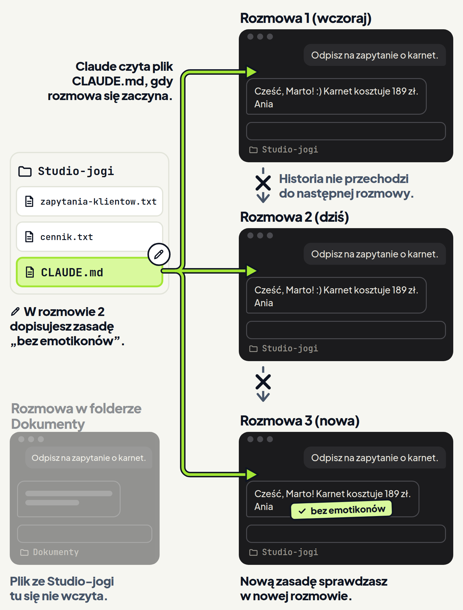

<em>Przewodnik po Claude Code · Moduł 2: Claude zna Twoją firmę · Lekcja 2 z 4</em>

# CLAUDE.md: zasady firmy w jednym pliku

Prowadzisz studio jogi i odpisujesz klientkom z pomocą Claude. Studio pisze do klientek na Ty, krótko i z podpisem „Ania”.

W zakładce Code każda rozmowa ma własną historię, niezależną od innych rozmów. <!-- fakt: aplikacja-rozmowa-to-sesja-z-wlasna-historia --> <!-- fakt: sesje-niezalezne-zasady-w-claude-md --> <!-- fakt: aplikacja-ten-sam-silnik-co-w-terminalu --> Dlatego w każdej nowej rozmowie tłumaczysz od nowa, jak studio pisze do klientek.

Ten problem rozwiązuje plik CLAUDE.md. To zwykły plik tekstowy z zasadami. <!-- fakt: claude-md-zwykly-tekst-piszesz-ty --> Leży w głównym folderze, w którym pracujesz z Claude. <!-- fakt: claude-md-w-glownym-katalogu-projektu --> Claude czyta go na początku każdej rozmowy, więc zasady zapisujesz tylko raz. <!-- fakt: claude-md-czytany-na-start-sesji --> <!-- fakt: aplikacja-uzywa-claude-md-z-projektu --> <!-- fakt: aplikacja-ten-sam-silnik-co-w-terminalu --> <!-- fakt: claude-md-zapisuje-konwencje-na-start-sesji -->

Warto go znać: CLAUDE.md to jeden z dwóch plików, które edytuje większość użytkowników Claude Code. Drugi to plik settings.json. <!-- fakt: claude-md-wiekszosc-edytuje-tylko-ten-plik -->

Claude napisał zbyt sztywną odpowiedź do klientki Twojego studia. Poproś o plik z zasadami i otwórz go.

<!-- cwiczenie: cw1 -->

## Co tu się stało?

<!-- kolumny -->

#### Prośba

1. W prośbie padła nazwa pliku CLAUDE.md i cztery zasady studia.
2. Claude zapisał je w nowym pliku w folderze Studio-jogi. <!-- fakt: claude-md-prosba-o-zapis --> <!-- fakt: claude-code-tworzy-nowe-pliki -->
3. W trybie Accept edits (przyjmowanie zmian) Claude tworzy pliki w folderze bez pytania, więc plik powstał od razu. <!-- fakt: accept-edits-edycje-w-folderze-bez-pytania --> W trybie Manual (ręcznym) Claude najpierw pyta o zgodę. <!-- fakt: aplikacja-manual-podglad-i-przyciski --> <!-- fakt: tryb-manual-aplikacja-czeka-na-zatwierdzenie -->

#### Plik w folderze

<!-- podglad: cw1 zapis -->

1. Kliknięcie ścieżki w odpowiedzi Claude otwiera plik. <!-- fakt: aplikacja-klik-sciezki-w-rozmowie-otwiera-plik -->
2. To zwykły plik tekstowy: na górze nagłówek, pod nim zasady w punktach. <!-- fakt: claude-md-zwykly-tekst-piszesz-ty --> <!-- fakt: claude-md-naglowki-i-punkty -->
3. W folderze pod oknem pojawiła się karta CLAUDE.md, obok plików studia.

<!-- /kolumny -->

## Czym jest plik CLAUDE.md

### Kto pisze plik CLAUDE.md i co w nim jest

Najprościej poprosić Claude, żeby go napisał, tak jak w ćwiczeniu. <!-- fakt: claude-md-prosba-o-zapis --> Gotowy plik poprawisz potem sam, zwykłym tekstem, w panelu plików (niżej). <!-- fakt: claude-md-zwykly-tekst-piszesz-ty --> <!-- fakt: aplikacja-reczna-edycja-pliku-w-panelu-files -->

W ćwiczeniu plik leży w folderze Studio-jogi, obok zapytań klientek i cennika. To folder rozmowy: folder, który wybierasz dla rozmowy i w którym pracuje Claude. <!-- fakt: aplikacja-kontrolka-folderu-obok-selektora --> Claude Code wczytuje plik o nazwie CLAUDE.md z folderu rozmowy. <!-- fakt: claude-md-w-glownym-katalogu-projektu --> <!-- fakt: claude-md-folder-roboczy-i-foldery-nad-nim --> <!-- fakt: aplikacja-ten-sam-silnik-co-w-terminalu -->

Wpisujesz do niego zasady, którymi Claude ma się kierować. <!-- fakt: claude-md-gdy-chcesz-pokierowac-zachowaniem -->

Plik nie ma wymaganego formatu. Ma być czytelny dla człowieka. <!-- fakt: claude-md-bez-wymaganego-formatu --> Claude łatwiej stosuje zasady, gdy stoją w punktach pod nagłówkiem, a trudniej, gdy są zbite w długie akapity. <!-- fakt: claude-md-naglowki-i-punkty -->

Z plików CLAUDE.md w projekcie korzystają i aplikacja na komputer, i Claude Code w terminalu. <!-- fakt: aplikacja-uzywa-claude-md-z-projektu --> <!-- fakt: claude-md-dziala-na-kazdej-powierzchni --> Gdy czytasz o CLAUDE.md w poradniku do terminala, chodzi o ten sam plik.

### Co Ci daje plik CLAUDE.md

Dzięki plikowi w prośbie piszesz już tylko o samej sprawie, na przykład o zapytaniu o karnet, bez słowa o tonie i podpisie. <!-- fakt: claude-md-zapisuje-konwencje-na-start-sesji --> <!-- fakt: claude-md-czytany-na-start-sesji --> <!-- fakt: aplikacja-uzywa-claude-md-z-projektu --> <!-- fakt: aplikacja-ten-sam-silnik-co-w-terminalu -->

### Czego plik nie zrobi

Claude traktuje CLAUDE.md jako kontekst, czyli tło do pracy, a nie jako ustawienie, które wymusza zasady. <!-- fakt: claude-md-kontekst-nie-wymuszenie --> Claude stara się stosować zasady z pliku, ale nie ma gwarancji, że zastosuje każdą. <!-- fakt: claude-md-bez-gwarancji-stosowania --> <!-- fakt: aplikacja-ten-sam-silnik-co-w-terminalu --> Dlatego to, czy plik działa, poznasz po odpowiedziach Claude: czy trzymają się zasad z pliku. <!-- fakt: claude-md-sprawdz-zmiane-obserwujac-zachowanie --> Tak zrobisz w ćwiczeniu 2.

Zasady w pliku kierują tym, co Claude próbuje zrobić. Nie zmieniają uprawnień, czyli tego, na co pozwala mu Claude Code. <!-- fakt: uprawnienia-egzekwuje-program-nie-model --> Uprawnienia i tryby pracy omawia moduł 1.

## Jak poprosić o plik i jak go poprawić

Nie musisz zakładać pliku w innym programie ani znać żadnego formatu. O plik z zasadami prosisz w rozmowie, tak jak o każdy inny dokument. <!-- fakt: aplikacja-przyklad-prosby-utworz-claude-md -->

### Prośba w polu wiadomości

1. W polu wiadomości napisz, że chcesz plik CLAUDE.md, i podaj zasady własnymi słowami. Naciśnij <kbd>Enter</kbd>. <!-- fakt: aplikacja-enter-wysyla-zadanie --> Dokumentacja aplikacji podaje podobny przykład prośby: utwórz plik CLAUDE.md z zasadami dla tego projektu. <!-- fakt: aplikacja-przyklad-prosby-utworz-claude-md -->
2. Claude tworzy nowy plik w folderze rozmowy. <!-- fakt: claude-code-tworzy-nowe-pliki --> W trybie Accept edits robi to bez pytania o zgodę. <!-- fakt: accept-edits-edycje-w-folderze-bez-pytania --> W trybie Manual najpierw pyta o zgodę. Tryby omawia moduł 1. <!-- fakt: aplikacja-manual-podglad-i-przyciski --> <!-- fakt: tryb-manual-aplikacja-czeka-na-zatwierdzenie -->
3. Kliknij ścieżkę CLAUDE.md w odpowiedzi Claude, a otworzysz plik. <!-- fakt: aplikacja-klik-sciezki-w-rozmowie-otwiera-plik -->
4. Nową zasadę dopiszesz kolejną prośbą, na przykład: „Dopisz do CLAUDE.md, że nie używam emotikonów”. <!-- fakt: claude-md-prosba-o-zapis -->

Poproś wprost o zapis w pliku CLAUDE.md i nazwij ten plik w prośbie. Tak radzi dokumentacja Claude Code. <!-- fakt: claude-md-prosba-o-zapis --> Claude Code ma też notatki, które Claude zapisuje sam, na podstawie Twoich poprawek i preferencji. <!-- fakt: claude-md-a-notatki-claude-dwa-mechanizmy --> Ta lekcja ich nie omawia. To osobny mechanizm: zasady w CLAUDE.md ustalasz Ty. <!-- fakt: claude-md-a-notatki-claude-dwa-mechanizmy -->

### Poprawka w panelu plików

Gdy chcesz zmienić jedno słowo w zasadzie, szybciej poprawisz je sam, bez prośby do Claude. W aplikacji robisz to tak:

1. Na pasku tytułu rozmowy kliknij przycisk Files (pliki). Przyciski na tym pasku mają ikony, a nazwę każdego zobaczysz po najechaniu myszą. <!-- fakt: aplikacja-panel-plikow-files-na-pasku-tytulu -->
2. W panelu plików popraw tekst w CLAUDE.md. Gdy Claude pracuje na Twoim komputerze, poprawisz tam pliki z folderu rozmowy. Kilku plików tylko do odczytu nie da się tam zmienić. <!-- fakt: aplikacja-reczna-edycja-pliku-w-panelu-files --> <!-- fakt: aplikacja-local-dziala-na-twoim-komputerze -->
3. Domyślnie zmiany zapisują się same, dlatego panel nie pokazuje przycisku Save (zapisz). <!-- fakt: aplikacja-panel-plikow-zapisuje-sam -->

Dzięki temu każdą zasadę dopiszesz lub poprawisz jedną prośbą do Claude albo sam w panelu plików. Nie wychodzisz przy tym z aplikacji.

## Jak otworzyć nową rozmowę w folderze z plikiem CLAUDE.md

Plik z zasadami już leży w folderze. Czy działa, sprawdzisz w nowej rozmowie: prośbą o odpowiedź na to samo zapytanie o karnet, bez słowa o tonie. <!-- fakt: claude-md-sprawdz-zmiane-obserwujac-zachowanie -->

1. Nową rozmowę otworzysz przyciskiem + New na pasku bocznym albo skrótem <kbd>Cmd</kbd>+<kbd>N</kbd> (w Windows <kbd>Ctrl</kbd>+<kbd>N</kbd>). <!-- fakt: aplikacja-nowa-rozmowa-plus-new-lub-cmd-n --> <!-- fakt: aplikacja-cmd-n-nowa-sesja -->
2. Zanim wyślesz pierwszą prośbę, spójrz na rząd przycisków pod polem wiadomości. <!-- fakt: aplikacja-rzad-pod-polem-srodowisko-folder-tryb-model --> Kontrolką folderu, obok wyboru środowiska, wybierasz folder, w którym Claude pracuje. Wybierz ten sam folder co wcześniej. <!-- fakt: aplikacja-kontrolka-folderu-obok-selektora -->
3. Napisz prośbę i naciśnij <kbd>Enter</kbd>. <!-- fakt: aplikacja-enter-wysyla-zadanie -->

Nowa rozmowa ma własną historię, niezależną od poprzedniej. <!-- fakt: aplikacja-rozmowa-to-sesja-z-wlasna-historia --> Jeśli odpowiedź trzyma się zasad studia, Claude nie wziął ich z historii poprzedniej rozmowy.

W ćwiczeniu 2 otwierasz nową rozmowę w folderze Studio-jogi. Prosisz w niej o odpowiedź na to samo zapytanie, bez słowa o tonie. Patrz, który plik w folderze pod oknem zaświeci jako pierwszy.

<!-- cwiczenie: cw2 -->

## Co tu się stało?

<!-- kolumny -->

#### Zasady z pliku

<!-- podglad: cw1 zapis -->

1. Najpierw zaświeciła karta CLAUDE.md, potem pliki wskazane w prośbie.
2. Aplikacja korzysta z pliku CLAUDE.md w folderze projektu. Claude czyta go na początku każdej rozmowy. <!-- fakt: aplikacja-uzywa-claude-md-z-projektu --> <!-- fakt: claude-md-czytany-na-start-sesji --> <!-- fakt: aplikacja-rozmowa-to-sesja-z-wlasna-historia --> <!-- fakt: aplikacja-ten-sam-silnik-co-w-terminalu -->

#### Odpowiedź w nowej rozmowie

<!-- podglad: cw2 nowa -->

1. Tym razem odpowiedź jest na Ty, ma trzy krótkie zdania i podpis „Ania”. W prośbie nie było słowa o tonie.
2. Nie ma w niej obietnic zdrowotnych. Widać w niej wszystkie cztery zasady.
3. Nowa rozmowa nie ma historii poprzedniej. <!-- fakt: aplikacja-rozmowa-to-sesja-z-wlasna-historia --> Claude nie wziął więc zasad z historii rozmowy z ćwiczenia 1.

<!-- /kolumny -->

## Kiedy Claude czyta plik

<!-- analogia: To jak kartka z zasadami na drzwiach biura. Pracownik czyta ją rano przy wejściu, więc dopisek przeczyta dopiero przy następnym wejściu. Ktoś w innym biurze tej kartki nie widzi. -->

Claude czyta plik CLAUDE.md na początku każdej rozmowy, a rozmowa zaczyna się, gdy wysyłasz pierwszą prośbę. <!-- fakt: claude-md-czytany-na-start-sesji --> <!-- fakt: claude-md-i-notatki-wczytane-na-start-rozmowy --> <!-- fakt: aplikacja-wpisz-zadanie-i-nacisnij-enter-zeby-zaczac --> <!-- fakt: aplikacja-rzad-pod-polem-srodowisko-folder-tryb-model --> <!-- fakt: aplikacja-ten-sam-silnik-co-w-terminalu --> Dlatego w ćwiczeniu karta CLAUDE.md zaświeciła zaraz po wysłaniu prośby, jeszcze przed plikami zapytań i cennika.

Świecące karty pokazuje tylko ćwiczenie. W prawdziwej aplikacji działanie pliku poznasz po odpowiedzi Claude, jak w ćwiczeniu 2. <!-- fakt: claude-md-sprawdz-zmiane-obserwujac-zachowanie -->

Historia jednej rozmowy nie przechodzi do następnej. <!-- fakt: aplikacja-rozmowa-to-sesja-z-wlasna-historia --> Stałe zasady zapisujesz więc w pliku, zamiast podawać je w każdej rozmowie. <!-- fakt: sesje-niezalezne-zasady-w-claude-md -->

### Na co uważać

- **Plik musi leżeć w folderze rozmowy.** Claude Code wczytuje pliki CLAUDE.md z folderu, w którym pracuje Claude. <!-- fakt: claude-md-folder-roboczy-i-foldery-nad-nim --> <!-- fakt: aplikacja-ten-sam-silnik-co-w-terminalu --> Gdy Claude nie trzyma się zasad, sprawdź, czy plik leży w miejscu, z którego Claude wczytuje pliki CLAUDE.md w tej rozmowie. <!-- fakt: claude-md-sprawdz-czy-plik-w-wczytywanym-miejscu --> Folder rozmowy wybierasz w rzędzie pod polem wiadomości, zanim wyślesz pierwszą prośbę. <!-- fakt: aplikacja-rzad-pod-polem-srodowisko-folder-tryb-model -->
- **Nową zasadę sprawdzasz w nowej rozmowie.** Claude czyta plik na początku rozmowy, więc po dopisaniu zasady otwórz nową rozmowę w tym samym folderze. <!-- fakt: claude-md-czytany-na-start-sesji --> Wyślij w niej zwykłą prośbę, na przykład znów o odpowiedź na zapytanie o karnet, i zobacz, czy Claude trzyma się nowej zasady. <!-- fakt: claude-md-sprawdz-zmiane-obserwujac-zachowanie -->

## Kiedy zapisywać zasadę w CLAUDE.md, a kiedy nie

Gdy plik już działa, łatwo dopisywać do niego wszystko: cennik, grafik zajęć, regulamin. Plik rośnie, a gdy zmienią się ceny albo grafik, w pliku zostają stare.

CLAUDE.md wczytuje się w każdej rozmowie. <!-- fakt: claude-md-tylko-to-co-dotyczy-wszystkiego --> Trzymasz w nim więc tylko to, co Claude ma znać w każdej rozmowie i co dotyczy całej pracy, nie pojedynczej sprawy. <!-- fakt: claude-md-fakty-na-kazda-sesje --> <!-- fakt: claude-md-tylko-to-co-dotyczy-wszystkiego -->

<!-- kolumny -->

#### Zapisz

1. To, co bez pliku tłumaczysz od nowa w każdej rozmowie. <!-- fakt: claude-md-kiedy-dopisac -->
2. Poprawkę, gdy Claude drugi raz robi ten sam błąd, na przykład znów pisze do klientki „Szanowna Pani”. <!-- fakt: claude-md-kiedy-dopisac -->
3. Reguły w rodzaju „zawsze rób X”, na przykład „zawsze podpisuj się Ania”. <!-- fakt: claude-md-fakty-na-kazda-sesje -->

#### Pomiń

1. Informacje, które często się zmieniają, na przykład cennik. <!-- fakt: claude-md-nie-wpisuj-zmiennych-informacji --> W ćwiczeniu ceny leżą w osobnym pliku cennik.txt, a prośba wskazuje go znakiem @.
2. Długie wyjaśnienia i samouczki, na przykład całą instrukcję obsługi systemu rezerwacji. <!-- fakt: claude-md-nie-wpisuj-dlugich-wyjasnien -->
3. Oczywiste zasady w rodzaju „pisz starannie”. <!-- fakt: claude-md-nie-wpisuj-oczywistych-praktyk -->

<!-- /kolumny -->

Dzięki temu plik zostaje krótki i aktualny. Claude bierze ceny z pliku cennik.txt wtedy, gdy prośba go wskazuje. <!-- fakt: aplikacja-at-dodaje-plik-do-rozmowy -->

Co zapisać w CLAUDE.md, a co w skillu, czyli przepisie na jedno zadanie, rozstrzygniesz w module 4.

## Co dalej

Lekcja 3 uczy, jak pisać zasady, żeby Claude stosował je spójniej. Lekcja 4 pokazuje, jak trzymać zasady wspólne i zasady jednego klienta w osobnych plikach CLAUDE.md.

## Źródła

- [Jak Claude pamięta Twój projekt](https://code.claude.com/docs/en/memory)
- [Dobre praktyki](https://code.claude.com/docs/en/best-practices)
- [Aplikacja Claude na komputer](https://code.claude.com/docs/en/desktop)
- [Pierwsze kroki w aplikacji](https://code.claude.com/docs/en/desktop-quickstart)
- [Jak działa Claude Code](https://code.claude.com/docs/en/how-claude-code-works)
- [Przegląd Claude Code](https://code.claude.com/docs/en/overview)
- [Biblioteka promptów](https://code.claude.com/docs/en/prompt-library)
- [Folder .claude](https://code.claude.com/docs/en/claude-directory)
- [Tryby uprawnień](https://code.claude.com/docs/en/permission-modes)
- [Uprawnienia](https://code.claude.com/docs/en/permissions)

Sprawdzone 26.10.2026, Claude Code 2.1.310.
