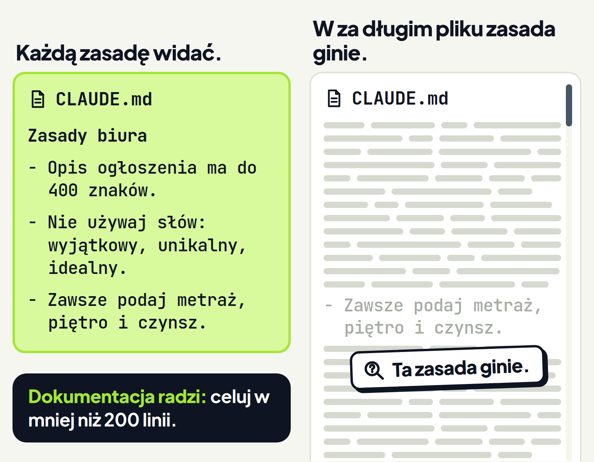
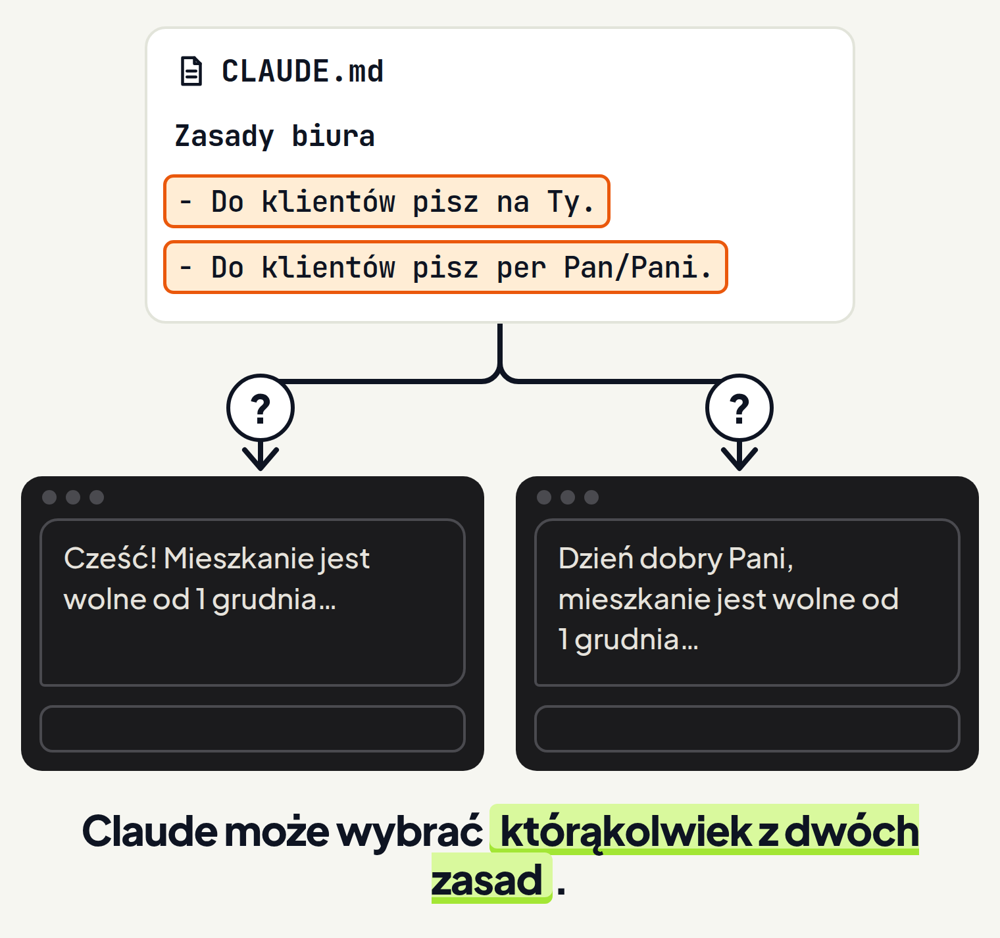

<em>Przewodnik po Claude Code · Moduł 2: Claude zna Twoją firmę · Lekcja 3 z 4</em>

# Zasady, które działają: konkretne i krótkie

Prowadzisz biuro nieruchomości i ogłoszenia o mieszkaniach na wynajem piszesz z pomocą Claude. W pliku CLAUDE.md masz już zasadę „Pisz ładnie i profesjonalnie”. A ogłoszenia od Claude i tak wychodzą długie, z pustymi przymiotnikami, bez piętra i czynszu.

Plik leży na miejscu i Claude go czyta, a wynik wciąż Ci nie pasuje. Claude stara się stosować zasady z pliku, ale nie ma gwarancji, że zastosuje każdą. <!-- fakt: claude-md-bez-gwarancji-stosowania --> <!-- fakt: aplikacja-ten-sam-silnik-co-w-terminalu --> Dotyczy to zwłaszcza zasad mglistych i zasad, które sobie przeczą. <!-- fakt: claude-md-brak-gwarancji-zwlaszcza-mgliste-i-sprzeczne --> <!-- fakt: aplikacja-ten-sam-silnik-co-w-terminalu -->

Claude traktuje plik CLAUDE.md jako kontekst rozmowy, a nie jako ustawienie, które wymusza zasady. <!-- fakt: claude-md-kontekst-nie-wymuszenie --> <!-- fakt: aplikacja-ten-sam-silnik-co-w-terminalu --> Dlatego to, jak piszesz zasady, wpływa na to, jak niezawodnie Claude je stosuje. <!-- fakt: claude-md-jak-piszesz-tak-stosuje --> <!-- fakt: aplikacja-ten-sam-silnik-co-w-terminalu -->

O tym jest ta lekcja. Im konkretniejsze i krótsze zasady, tym spójniej Claude ich przestrzega. <!-- fakt: claude-md-konkretne-i-zwiezle-stosowane-spojniej --> <!-- fakt: aplikacja-ten-sam-silnik-co-w-terminalu --> Stąd tytuł: zasady mają być konkretne, a plik krótki.

W ćwiczeniach pracujesz w folderze Biuro-nieruchomosci. Leżą w nim dwa pliki: CLAUDE.md z zasadami biura i dane-mieszkania.txt. Plik z danymi opisuje mieszkanie:

- 2 pokoje, 46 m², 3. piętro, Mokotów,
- czynsz 2 900 zł miesięcznie, wolne od 1 grudnia,
- jasne, 5 minut pieszo od metra,
- osobna kuchnia, balkon i miejsce w garażu.

Najpierw zobacz zasadę w pliku i ogłoszenie, które z niej wyszło. Potem zamień tę zasadę na trzy, które da się sprawdzić.

<!-- cwiczenie: cw1 -->

## Co tu się stało?

<!-- kolumny -->

#### Zasada ogólna

<!-- podglad: cw1 ogolne -->

1. W pliku była jedna zasada: „Pisz ładnie i profesjonalnie”. Nie mówi, czego pilnować.
2. W tym przykładzie ogłoszenie wyszło długie i ma słowa w rodzaju „wyjątkowy”.
3. Nie ma metrażu, piętra ani czynszu, choć są w pliku dane-mieszkania.txt.

#### Zasady konkretne

<!-- podglad: cw1 popraw -->

1. Każdą z trzech zasad da się sprawdzić w gotowym ogłoszeniu.
2. Dokumentacja radzi pisać zasady tak, żeby dało się je sprawdzić. <!-- fakt: claude-md-zasady-konkretne-do-sprawdzenia --> <!-- fakt: aplikacja-ten-sam-silnik-co-w-terminalu -->
3. Pod polem wiadomości stoi tryb Accept edits (przyjmowanie zmian). <!-- fakt: aplikacja-rzad-pod-polem-srodowisko-folder-tryb-model --> W tym trybie Claude zmienia pliki w folderze bez pytania, więc CLAUDE.md zmienił się od razu. <!-- fakt: accept-edits-edycje-w-folderze-bez-pytania -->

<!-- /kolumny -->

## Zasada, którą da się sprawdzić

### Po co: ogólna zasada nie mówi, czego pilnować

Zasada „Pisz ładnie i profesjonalnie” brzmi rozsądnie. Kłopot w tym, że nie da się jej sprawdzić. Po przeczytaniu ogłoszenia z ćwiczenia nie powiesz, czy jest „ładne”, czy nie.

Gdy Claude nie stosuje się do pliku CLAUDE.md, dokumentacja radzi między innymi pisać zasady konkretniej. <!-- fakt: claude-md-nie-dziala-popraw-konkretnosc --> <!-- fakt: aplikacja-ten-sam-silnik-co-w-terminalu -->

### Jak działa: zasada mówi, po czym poznasz wynik

Dokumentacja radzi pisać zasady tak, żeby dało się je sprawdzić. <!-- fakt: claude-md-zasady-konkretne-do-sprawdzenia --> <!-- fakt: aplikacja-ten-sam-silnik-co-w-terminalu --> Konkretna zasada mówi, co dokładnie ma być w tekście albo czego ma w nim nie być.

Trzy zasady biura z ćwiczenia sprawdzasz tak:

- „Opis ogłoszenia ma do 400 znaków”: liczysz znaki,
- „Nie używaj słów: wyjątkowy, unikalny, idealny”: szukasz tych słów w tekście,
- „Zawsze podaj metraż, piętro i czynsz”: szukasz tych trzech danych.

Ogólną zasadę zamienisz na konkretną jednym pytaniem: po czym poznam, że zasada jest spełniona? W przykładzie biura z odpowiedzi powstały trzy zasady z listy wyżej. Te odpowiedzi wpisujesz do pliku zamiast słów „ładnie” i „profesjonalnie”.

Dokumentacja podaje przykłady z pracy programistów. Zasady biura i limit 400 znaków to nasz przykład, a nie rada z dokumentacji.

### Dzięki temu: wynik sprawdzisz od ręki

Każdą konkretną zasadę sprawdzisz w gotowym tekście. Od razu widzisz, której zasady Claude nie spełnił. Nie musisz oceniać, czy tekst jest „profesjonalny”.

Druga korzyść: im konkretniejsze i krótsze zasady, tym spójniej Claude ich przestrzega. <!-- fakt: claude-md-konkretne-i-zwiezle-stosowane-spojniej --> <!-- fakt: aplikacja-ten-sam-silnik-co-w-terminalu -->

### Ograniczenia: konkretna zasada nie daje pewności

Konkretna zasada nie gwarantuje wyniku. Claude czyta plik i stara się go stosować, ale nie ma gwarancji ścisłego stosowania, zwłaszcza przy zasadach mglistych. <!-- fakt: claude-md-brak-gwarancji-zwlaszcza-mgliste-i-sprzeczne --> <!-- fakt: aplikacja-ten-sam-silnik-co-w-terminalu --> Konkretna zasada nie jest mglista, ale wynik i tak sprawdzasz, tak jak w ćwiczeniu 2.

Zwróć uwagę na pytania Claude. Gdy Claude pyta o coś, na co odpowiada CLAUDE.md, zasada może być niejasno napisana. <!-- fakt: claude-md-pytania-o-tresc-pliku-znak-niejasnej-zasady --> <!-- fakt: aplikacja-ten-sam-silnik-co-w-terminalu --> Wtedy popraw jej brzmienie tak, żeby dało się ją sprawdzić.

## Krótki plik: celuj w mniej niż 200 linii

### Po co: w długim pliku zasada ginie

Gdy plik z zasadami już działa, łatwo dopisywać do niego dalej: każdą uwagę, wyjątek i poprawkę. Plik rośnie. Dokumentacja ostrzega przed skutkami:

- rozdęty plik CLAUDE.md sprawia, że Claude pomija Twoje właściwe zasady, <!-- fakt: claude-md-rozdety-plik-pomija-zasady --> <!-- fakt: aplikacja-ten-sam-silnik-co-w-terminalu -->
- gdy plik jest za długi, Claude ignoruje jego połowę, bo ważne zasady giną w szumie, <!-- fakt: claude-md-za-dlugi-claude-pomija-polowe --> <!-- fakt: aplikacja-ten-sam-silnik-co-w-terminalu -->
- gdy Claude dalej robi coś wbrew zasadzie, plik jest zapewne za długi, a zasada w nim ginie. <!-- fakt: claude-md-zasada-ginie-w-za-dlugim-pliku --> <!-- fakt: aplikacja-ten-sam-silnik-co-w-terminalu -->

<!-- analogia: To jak gruby regulamin, w którym łatwo przeoczyć ważny punkt, i trzy zasady przyklejone nad biurkiem, które każdy widzi codziennie. -->

### Jak działa: plik zajmuje miejsce w kontekście

W kontekście Claude mieści się między innymi historia rozmowy, treść plików i zasady z CLAUDE.md; w trakcie pracy kontekst się zapełnia. <!-- fakt: kontekst-okno-miesci-rozmowe-pliki-i-claude-md --> <!-- fakt: aplikacja-ten-sam-silnik-co-w-terminalu --> Więcej o kontekście powiemy w module 6.

Plik CLAUDE.md nie ma wymaganego formatu, ale dokumentacja radzi, żeby był krótki i czytelny dla człowieka. <!-- fakt: claude-md-bez-wymaganego-formatu --> <!-- fakt: aplikacja-ten-sam-silnik-co-w-terminalu -->

Podaje też miarę: celuj w mniej niż 200 linii na plik CLAUDE.md. Dłuższy plik zużywa więcej kontekstu i obniża stosowanie zasad. <!-- fakt: claude-md-do-200-linii --> <!-- fakt: aplikacja-ten-sam-silnik-co-w-terminalu -->

### Jak skracać: test każdej linii

Przy każdej linii zapytaj: czy bez niej Claude popełni błąd? Jeśli nie, wytnij ją. <!-- fakt: claude-md-test-kazdej-linii --> <!-- fakt: aplikacja-ten-sam-silnik-co-w-terminalu -->

Gdy Claude już robi coś dobrze bez zasady, skreśl tę zasadę. <!-- fakt: claude-md-skresl-zasade-ktora-claude-spelnia-bez-niej --> <!-- fakt: aplikacja-ten-sam-silnik-co-w-terminalu -->

Przytnij też to, co nie jest potrzebne w każdej rozmowie. <!-- fakt: claude-md-ponad-200-linii-przytnij-co-niepotrzebne --> <!-- fakt: aplikacja-rozmowa-to-sesja-z-wlasna-historia --> <!-- fakt: aplikacja-ten-sam-silnik-co-w-terminalu -->

### Dzięki temu: każda zasada jest widoczna

Krótki plik zużywa mniej kontekstu, a im konkretniejsze i krótsze zasady, tym spójniej Claude ich przestrzega. <!-- fakt: claude-md-do-200-linii --> <!-- fakt: claude-md-konkretne-i-zwiezle-stosowane-spojniej --> <!-- fakt: aplikacja-ten-sam-silnik-co-w-terminalu --> Plik biura z ćwiczenia ma cztery linie: nagłówek i trzy zasady.

Przycinanie to nie jednorazowe sprzątanie. Dokumentacja radzi przeglądać plik, gdy coś idzie źle, i regularnie go przycinać. <!-- fakt: claude-md-przegladaj-gdy-cos-idzie-zle-i-przycinaj --> <!-- fakt: aplikacja-ten-sam-silnik-co-w-terminalu -->

### Ograniczenia: 200 linii to cel

Dokumentacja pisze „celuj w mniej niż 200 linii”. <!-- fakt: claude-md-do-200-linii --> <!-- fakt: aplikacja-ten-sam-silnik-co-w-terminalu --> To cel, a nie twarda granica, po której plik przestaje działać. Dokumentacja nie podaje, po ilu liniach Claude zaczyna pomijać zasady. Plik o 150 liniach pełen zbędnych zasad też warto przyciąć testem każdej linii. <!-- fakt: claude-md-test-kazdej-linii --> <!-- fakt: aplikacja-ten-sam-silnik-co-w-terminalu -->

## Kiedy skreślić zasadę, a kiedy nie

<!-- kolumny -->

#### Zostaw

1. Gdy bez niej Claude popełni błąd. <!-- fakt: claude-md-test-kazdej-linii --> <!-- fakt: aplikacja-ten-sam-silnik-co-w-terminalu -->
2. Przykład biura: „Zawsze podaj metraż, piętro i czynsz”.

#### Skreśl

1. Gdy Claude robi to dobrze bez zasady. <!-- fakt: claude-md-skresl-zasade-ktora-claude-spelnia-bez-niej --> <!-- fakt: aplikacja-ten-sam-silnik-co-w-terminalu -->
2. Gdy nie jest potrzebna w każdej rozmowie. <!-- fakt: claude-md-ponad-200-linii-przytnij-co-niepotrzebne --> <!-- fakt: aplikacja-rozmowa-to-sesja-z-wlasna-historia --> <!-- fakt: aplikacja-ten-sam-silnik-co-w-terminalu -->
3. Gdy jest nieaktualna albo przeczy innej zasadzie. <!-- fakt: claude-md-przegladaj-i-usuwaj-nieaktualne-i-sprzeczne --> <!-- fakt: aplikacja-ten-sam-silnik-co-w-terminalu -->
4. Przykład biura: zasada dla klientki, z którą biuro już nie pracuje.

<!-- /kolumny -->

## Bez sprzeczności

### Po co: dwie zasady w jednej sprawie

Po miesiącu w pliku biura stoi zasada „Do klientów pisz na Ty”. Niżej ktoś dopisał dla jednej klientki „Do klientów pisz per Pan/Pani”. Obie dotyczą tej samej sprawy i mówią co innego.

### Jak działa: Claude może wybrać którąkolwiek

Gdy dwie zasady sobie przeczą, Claude może wybrać którąkolwiek z nich. <!-- fakt: claude-md-sprzeczne-zasady-wybor-dowolny --> <!-- fakt: aplikacja-ten-sam-silnik-co-w-terminalu --> Nie wiesz z góry, którą wybierze. Dokumentacja tego nie mówi.

Dokumentacja wymienia sprzeczne zasady obok mglistych: zwłaszcza przy nich nie ma gwarancji ścisłego stosowania. <!-- fakt: claude-md-brak-gwarancji-zwlaszcza-mgliste-i-sprzeczne --> <!-- fakt: aplikacja-ten-sam-silnik-co-w-terminalu --> Dlatego plik ma być nie tylko krótki, ale i spójny: bez zasad, które sobie przeczą. <!-- fakt: claude-md-przegladaj-i-usuwaj-nieaktualne-i-sprzeczne --> <!-- fakt: aplikacja-ten-sam-silnik-co-w-terminalu -->

### Dzięki temu: przegląd usuwa sprzeczności

Dokumentacja radzi co jakiś czas przeglądać pliki CLAUDE.md i usuwać zasady nieaktualne albo sprzeczne. <!-- fakt: claude-md-przegladaj-i-usuwaj-nieaktualne-i-sprzeczne --> <!-- fakt: aplikacja-ten-sam-silnik-co-w-terminalu --> Przy przeglądzie zdecyduj, która zasada obowiązuje, i usuń drugą. Zajrzyj do pliku także wtedy, gdy coś idzie źle, na przykład gdy ogłoszenia raz są na Ty, a raz per Pan/Pani. <!-- fakt: claude-md-przegladaj-gdy-cos-idzie-zle-i-przycinaj --> <!-- fakt: aplikacja-ten-sam-silnik-co-w-terminalu -->

Po przeglądzie wynik nie zależy już od tego, którą z dwóch zasad Claude akurat wybierze.

### Ograniczenia: tylko w jednym pliku

Ta część dotyczy sprzeczności w jednym pliku. Gdy zasady są w kilku plikach CLAUDE.md, mogą przeczyć sobie także między plikami. <!-- fakt: claude-md-sprzeczne-miedzy-plikami --> <!-- fakt: aplikacja-ten-sam-silnik-co-w-terminalu --> To omówimy w lekcji 4.

Przegląd nie daje też pewności. <!-- fakt: claude-md-bez-gwarancji-stosowania --> <!-- fakt: aplikacja-ten-sam-silnik-co-w-terminalu --> Po nim w jednej sprawie stoi już tylko jedna zasada, a gotowe ogłoszenie i tak sprawdzasz.

## Jak sprawdzić, czy poprawka działa

Dokumentacja radzi sprawdzać zmiany w CLAUDE.md, obserwując, czy zachowanie Claude faktycznie się zmienia. <!-- fakt: claude-md-sprawdz-zmiane-obserwujac-zachowanie --> <!-- fakt: aplikacja-ten-sam-silnik-co-w-terminalu --> Nie wystarczy, że plik wygląda dobrze. Liczy się nowy wynik.

Claude czyta plik CLAUDE.md na początku rozmowy. <!-- fakt: claude-md-czytany-na-start-sesji --> <!-- fakt: aplikacja-rozmowa-to-sesja-z-wlasna-historia --> <!-- fakt: aplikacja-uzywa-claude-md-z-projektu --> <!-- fakt: aplikacja-ten-sam-silnik-co-w-terminalu --> Dlatego nowe zasady sprawdzasz w nowej rozmowie w tym samym folderze. W aplikacji Claude robisz to tak:

1. Kliknij + New na pasku bocznym albo naciśnij <kbd>Cmd</kbd>+<kbd>N</kbd> (w Windows <kbd>Ctrl</kbd>+<kbd>N</kbd>). <!-- fakt: aplikacja-nowa-rozmowa-plus-new-lub-cmd-n --> <!-- fakt: aplikacja-cmd-n-nowa-sesja -->
2. W rzędzie pod polem wiadomości kliknij kontrolkę folderu i wybierz ten sam folder. <!-- fakt: aplikacja-kontrolka-folderu-obok-selektora --> <!-- fakt: aplikacja-rzad-pod-polem-srodowisko-folder-tryb-model -->
3. Wpisz tę samą prośbę co wcześniej, bez słowa o zasadach, i naciśnij <kbd>Enter</kbd>. <!-- fakt: aplikacja-enter-wysyla-zadanie -->
4. Porównaj nowe ogłoszenie ze starym i sprawdź w nim trzy zasady biura.

Nowa rozmowa ma własną historię, niezależną od poprzedniej. <!-- fakt: aplikacja-rozmowa-to-sesja-z-wlasna-historia --> Nie ma w niej Twojej prośby o zmianę zasad ani poprzedniego ogłoszenia.

Jedno dobre ogłoszenie nie daje pewności, że następne też będzie zgodne z zasadami. <!-- fakt: claude-md-bez-gwarancji-stosowania --> <!-- fakt: aplikacja-ten-sam-silnik-co-w-terminalu -->

W ćwiczeniu niżej nowa rozmowa jest już otwarta, a prośba o ogłoszenie wysłana. Zobacz, co wyjdzie według trzech zasad, a potem, co zrobić, gdy Claude jedną zasadę pominie.

<!-- cwiczenie: cw2 -->

## Co tu się stało?

1. W prośbie nie było ani słowa o zasadach.
2. Nowa rozmowa nie ma historii poprzedniej rozmowy. <!-- fakt: aplikacja-rozmowa-to-sesja-z-wlasna-historia -->
3. Zaraz po wysłaniu prośby zaświeciła karta CLAUDE.md: Claude czyta ten plik na początku rozmowy. <!-- fakt: claude-md-czytany-na-start-sesji --> <!-- fakt: aplikacja-rozmowa-to-sesja-z-wlasna-historia --> <!-- fakt: aplikacja-uzywa-claude-md-z-projektu --> <!-- fakt: aplikacja-ten-sam-silnik-co-w-terminalu -->

<!-- kolumny -->

#### Ogłoszenie według ogólnej zasady

<!-- podglad: cw1 ogolne -->

1. Ma 469 znaków, a nowe zasady pozwalają na 400.
2. Ma słowa „wyjątkowy”, „idealny”, „unikalny”.
3. Nie ma metrażu, piętra ani czynszu.

#### Ogłoszenie według trzech zasad

<!-- podglad: cw2 nowa -->

1. Ma 215 znaków, mieści się w 400.
2. Nie ma zakazanych słów.
3. Ma metraż, piętro i czynsz. W tym przykładzie Claude zastosował trzy zasady z pliku.

<!-- /kolumny -->

<!-- kolumny -->

#### Zasada pominięta

<!-- podglad: cw2 wyroznij -->

1. Po drugim poleceniu ogłoszenie miało 185 znaków i nie miało czynszu. Tym razem Claude pominął jedną zasadę.
2. Na Twoją prośbę Claude dopisał „WAŻNE” przy tej jednej zasadzie.
3. W trybie Accept edits plik zmienił się bez pytania. <!-- fakt: accept-edits-edycje-w-folderze-bez-pytania -->

#### Co zrobić

1. Gdy Claude wciąż pomija jedną zasadę, wyróżnij tylko tę zasadę, na przykład dopisując do niej słowo „WAŻNE”. <!-- fakt: claude-md-wazne-tylko-przy-jednej-zasadzie --> <!-- fakt: aplikacja-ten-sam-silnik-co-w-terminalu -->
2. Sprawdź w nowej rozmowie, czy ogłoszenie się zmieniło. <!-- fakt: claude-md-sprawdz-zmiane-obserwujac-zachowanie --> <!-- fakt: aplikacja-ten-sam-silnik-co-w-terminalu -->

<!-- /kolumny -->

## Gdy Claude dalej pomija zasadę

### Po co: zanim uznasz, że plik nie działa

Plik jest krótki, zasady konkretne, a Claude w kolejnym ogłoszeniu znów pomija czynsz. Łatwo wtedy uznać, że CLAUDE.md nie działa. Zamiast zgadywać, przejdź po kolei krótką listę sprawdzeń.

### Jak działa: pięć sprawdzeń po kolei

1. **Plik leży w folderze rozmowy.** CLAUDE.md to plik w głównym folderze projektu, który Claude czyta na początku każdej rozmowy. <!-- fakt: claude-md-w-glownym-katalogu-projektu --> <!-- fakt: aplikacja-rozmowa-to-sesja-z-wlasna-historia --> <!-- fakt: aplikacja-ten-sam-silnik-co-w-terminalu --> Aplikacja korzysta z pliku CLAUDE.md w folderze projektu. <!-- fakt: aplikacja-uzywa-claude-md-z-projektu --> Folder rozmowy wybierasz kontrolką folderu pod polem wiadomości. <!-- fakt: aplikacja-kontrolka-folderu-obok-selektora --> <!-- fakt: aplikacja-rzad-pod-polem-srodowisko-folder-tryb-model -->
2. **Zasada jest konkretna.** Zapytaj, po czym poznasz, że jest spełniona. Gdy Claude nie stosuje się do pliku, dokumentacja radzi między innymi pisać zasady konkretniej. <!-- fakt: claude-md-nie-dziala-popraw-konkretnosc --> <!-- fakt: aplikacja-ten-sam-silnik-co-w-terminalu --> Gdy Claude pyta o coś, co stoi w pliku, zasada może być niejasno napisana. <!-- fakt: claude-md-pytania-o-tresc-pliku-znak-niejasnej-zasady --> <!-- fakt: aplikacja-ten-sam-silnik-co-w-terminalu -->
3. **Plik nie jest za długi.** Gdy Claude dalej robi coś wbrew zasadzie, plik jest zapewne za długi, a zasada w nim ginie. <!-- fakt: claude-md-zasada-ginie-w-za-dlugim-pliku --> <!-- fakt: aplikacja-ten-sam-silnik-co-w-terminalu --> Przytnij go testem każdej linii.
4. **W pliku nie ma sprzeczności.** Gdy dwie zasady sobie przeczą, Claude może wybrać którąkolwiek z nich. <!-- fakt: claude-md-sprzeczne-zasady-wybor-dowolny --> <!-- fakt: aplikacja-ten-sam-silnik-co-w-terminalu --> Sprzeczności między kilkoma plikami omówimy w lekcji 4.
5. **Pomijana zasada jest wyróżniona.** Gdy Claude wciąż pomija jedną zasadę, wyróżnij tylko tę zasadę, na przykład dopisując do niej słowo „WAŻNE”. <!-- fakt: claude-md-wazne-tylko-przy-jednej-zasadzie --> <!-- fakt: aplikacja-ten-sam-silnik-co-w-terminalu -->

Po każdej poprawce sprawdź wynik w nowej rozmowie, tak jak w ćwiczeniu 2. <!-- fakt: claude-md-sprawdz-zmiane-obserwujac-zachowanie --> <!-- fakt: claude-md-czytany-na-start-sesji --> <!-- fakt: aplikacja-ten-sam-silnik-co-w-terminalu -->

### Dzięki temu: kolejność zamiast zgadywania

Masz listę, którą przechodzisz za każdym razem, gdy coś nie gra. Najpierw sprawdzasz rzeczy proste, od folderu po długość pliku. Wyróżnienie zostawiasz na koniec, dla jednej zasady.

### Ograniczenia: plik nie wymusza zasad

Nawet po pięciu sprawdzeniach Claude może jeszcze pominąć zasadę. Claude stara się stosować zasady z pliku, ale nie ma gwarancji, że zastosuje każdą. <!-- fakt: claude-md-bez-gwarancji-stosowania --> <!-- fakt: claude-md-kontekst-nie-wymuszenie --> <!-- fakt: aplikacja-ten-sam-silnik-co-w-terminalu --> Dlatego gotowe ogłoszenie i tak czytasz przed publikacją.

## Kiedy wyróżnić zasadę, a kiedy nie

<!-- kolumny -->

#### Wyróżnij

1. Gdy Claude wciąż pomija jedną zasadę. <!-- fakt: claude-md-wazne-tylko-przy-jednej-zasadzie --> <!-- fakt: aplikacja-ten-sam-silnik-co-w-terminalu -->
2. Tylko tę zasadę, na przykład dopisując do niej słowo „WAŻNE”. Dokumentacja podaje angielski przykład „IMPORTANT”. <!-- fakt: claude-md-wazne-tylko-przy-jednej-zasadzie --> <!-- fakt: aplikacja-ten-sam-silnik-co-w-terminalu -->

#### Nie wyróżniaj

1. Wielu zasad naraz. Gdy wyróżnisz wiele, żadna się nie wyróżni. <!-- fakt: claude-md-wazne-tylko-przy-jednej-zasadzie --> <!-- fakt: aplikacja-ten-sam-silnik-co-w-terminalu -->
2. Zasady, której Claude nie pomija.

<!-- /kolumny -->

Wyróżnienie też nie daje pewności. <!-- fakt: claude-md-bez-gwarancji-stosowania --> <!-- fakt: aplikacja-ten-sam-silnik-co-w-terminalu -->

Gdy Claude ma czegoś na pewno nie zrobić, sama zasada w pliku nie wystarczy. <!-- fakt: claude-md-kontekst-nie-wymuszenie --> <!-- fakt: aplikacja-ten-sam-silnik-co-w-terminalu --> Zasady w pliku nie zmieniają tego, na co pozwala program, na przykład czy Claude pyta o zgodę przed zmianą pliku. <!-- fakt: uprawnienia-egzekwuje-program-nie-model --> <!-- fakt: aplikacja-ten-sam-silnik-co-w-terminalu --> Pisaliśmy o tym w module 1. W module 7 pokażemy, jak program może pilnować zasad.

## Co dalej

Im konkretniejsze i krótsze zasady, tym spójniej Claude ich przestrzega. <!-- fakt: claude-md-konkretne-i-zwiezle-stosowane-spojniej --> <!-- fakt: aplikacja-ten-sam-silnik-co-w-terminalu --> W lekcji 4 zobaczysz, jak trzymać zasady wspólne i zasady jednego klienta w osobnych plikach.

## Źródła

- [Jak Claude pamięta Twój projekt](https://code.claude.com/docs/en/memory)
- [Dobre praktyki](https://code.claude.com/docs/en/best-practices)
- [Aplikacja Claude na komputer](https://code.claude.com/docs/en/desktop)
- [Jak działa Claude Code](https://code.claude.com/docs/en/how-claude-code-works)
- [Przegląd Claude Code](https://code.claude.com/docs/en/overview)
- [Tryby uprawnień](https://code.claude.com/docs/en/permission-modes)
- [Uprawnienia](https://code.claude.com/docs/en/permissions)

Sprawdzone 26.10.2026, Claude Code 2.1.310.
