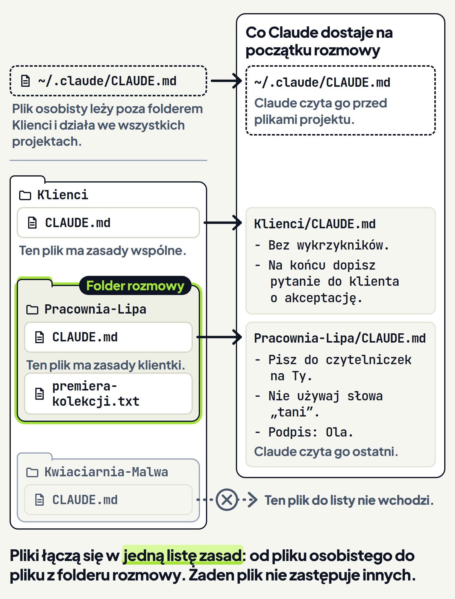

<em>Przewodnik po Claude Code · Moduł 2: Claude zna Twoją firmę · Lekcja 4 z 4</em>

# Zasady wspólne i zasady dla jednego klienta

Piszesz posty na Instagram dla kilku klientów. Część zasad dotyczy ich wszystkich, na przykład: bez wykrzykników i z pytaniem o akceptację na końcu. Część dotyczy tylko jednej klientki: do jej czytelniczek piszesz na Ty, a posty kończysz podpisem „Ola”.

Gdzie zapisać jedne i drugie? Claude czyta plik CLAUDE.md na początku każdej rozmowy. <!-- fakt: claude-md-czytany-na-start-sesji --> <!-- fakt: aplikacja-uzywa-claude-md-z-projektu --> <!-- fakt: aplikacja-ten-sam-silnik-co-w-terminalu --> Gdyby zasady wszystkich klientów stały w jednym pliku, Claude miałby je wszystkie przed sobą w każdej rozmowie, także przy poście dla zupełnie innego klienta. <!-- fakt: claude-md-czytany-na-start-sesji --> <!-- fakt: aplikacja-ten-sam-silnik-co-w-terminalu -->

Ta lekcja pokazuje inne wyjście: dwa pliki CLAUDE.md w dwóch folderach. Claude Code wczytuje pliki CLAUDE.md z folderu, w którym pracuje Claude, i ze wszystkich folderów nad nim. <!-- fakt: claude-md-folder-roboczy-i-foldery-nad-nim --> <!-- fakt: aplikacja-ten-sam-silnik-co-w-terminalu --> Zasady wspólne zapisujesz więc w folderze, w którym leżą foldery wszystkich klientów, a zasady klientki w jej własnym folderze. Zasady z obu plików łączą się, a nie zastępują. <!-- fakt: claude-md-pliki-lacza-sie-nie-nadpisuja --> <!-- fakt: aplikacja-ten-sam-silnik-co-w-terminalu -->

Dokumentacja opisuje to dla Claude Code. Aplikacja na komputer działa na tym samym silniku co Claude Code w terminalu. <!-- fakt: aplikacja-ten-sam-silnik-co-w-terminalu --> Dlatego te zasady wczytywania dotyczą też rozmów w aplikacji. <!-- fakt: aplikacja-ten-sam-silnik-co-w-terminalu -->

W ćwiczeniach pracujesz w folderze Klienci. Leżą w nim:

- plik CLAUDE.md z zasadami wspólnymi,
- folder Pracownia-Lipa z plikiem CLAUDE.md klientki i z plikiem premiera-kolekcji.txt, który opisuje jej nową kolekcję swetrów,
- folder Kwiaciarnia-Malwa z plikiem CLAUDE.md drugiej klientki.

Zasady w dwóch plikach, których używają ćwiczenia, to nasz przykład:

<!-- kolumny -->

#### CLAUDE.md w folderze Klienci

1. Bez wykrzykników.
2. Na końcu dopisz pytanie do klienta o akceptację.

#### CLAUDE.md w folderze Pracownia-Lipa

1. Pisz do czytelniczek na Ty.
2. Nie używaj słowa „tani”.
3. Podpis: Ola.

<!-- /kolumny -->

W ćwiczeniu 1 rozmowa jest otwarta w folderze klientki, Pracownia-Lipa, a prośba o post jest już wysłana. Kliknij polecenie i patrz, które pliki CLAUDE.md zaświecą w folderze pod oknem. Potem otwórz post i znajdź w nim zasady z obu plików.

<!-- cwiczenie: cw1 -->

## Co tu się stało?

<!-- kolumny -->

#### Post

<!-- podglad: cw1 post -->

1. Bez wykrzykników, z pytaniem do klientki o akceptację na końcu: tak każą zasady wspólne.
2. Na Ty, z podpisem „Ola” i bez słowa „tani” w żadnej formie: tak każą zasady klientki.
3. W prośbie nie było ani słowa o zasadach.

#### Dwa pliki z zasadami

1. W aplikacji wybierasz folder, w którym Claude pracuje. To folder rozmowy. <!-- fakt: aplikacja-kontrolka-folderu-obok-selektora --> <!-- fakt: aplikacja-sesja-ma-folder-roboczy -->
2. Na początku rozmowy Claude wczytuje pliki CLAUDE.md z tego folderu i ze wszystkich folderów nad nim. <!-- fakt: claude-md-folder-roboczy-i-foldery-nad-nim --> <!-- fakt: claude-md-czytany-na-start-sesji --> <!-- fakt: aplikacja-ten-sam-silnik-co-w-terminalu --> Rozmowa zaczyna się, gdy wysyłasz pierwszą prośbę. <!-- fakt: aplikacja-wpisz-zadanie-i-nacisnij-enter-zeby-zaczac -->
3. Dlatego zaraz po wysłaniu prośby zaświeciły oba pliki CLAUDE.md: plik klientki i plik wspólny z folderu Klienci (w podglądzie to karta pod folderami klientek). Razem z nimi zaświecił plik premiera-kolekcji.txt, wskazany w prośbie znakiem @. <!-- fakt: aplikacja-at-dodaje-plik-do-rozmowy -->
4. Plik drugiej klientki, z folderu Kwiaciarnia-Malwa, nie zaświecił: ten folder leży obok folderu rozmowy. <!-- fakt: claude-md-folder-roboczy-i-foldery-nad-nim -->

<!-- /kolumny -->

Świecące karty pokazuje tylko ćwiczenie. W prawdziwej aplikacji działanie plików z zasadami poznasz po wyniku, tak jak tu po treści posta. <!-- fakt: claude-md-sprawdz-zmiane-obserwujac-zachowanie --> <!-- fakt: aplikacja-ten-sam-silnik-co-w-terminalu -->

## Jak Claude łączy pliki CLAUDE.md

<!-- analogia: To jak Twoje własne nawyki, zasady firmy dla wszystkich klientów i umowa z jedną klientką: pracownik stosuje je naraz. Umowy innej klientki z sąsiedniej teczki nie czyta. -->

### Po co: każda grupa zasad w swoim miejscu

Zasada wspólna dotyczy każdego posta. Zasada klientki dotyczy tylko jej postów. Gdy każda grupa leży w osobnym pliku, każdą poprawiasz w jednym miejscu i nie mieszasz zasad różnych klientów.

Claude Code na to pozwala, bo wczytuje pliki CLAUDE.md z folderu rozmowy i ze wszystkich folderów nad nim. <!-- fakt: claude-md-folder-roboczy-i-foldery-nad-nim --> <!-- fakt: aplikacja-ten-sam-silnik-co-w-terminalu --> Folder Klienci obejmuje wszystkich klientów, a folder Pracownia-Lipa tylko jedną klientkę.

### Jak działa: jedna lista zasad z kilku plików

W ćwiczeniu 1 Claude wczytał dwa pliki: z folderu Pracownia-Lipa, czyli folderu rozmowy, i z folderu Klienci nad nim. <!-- fakt: claude-md-folder-roboczy-i-foldery-nad-nim --> <!-- fakt: aplikacja-ten-sam-silnik-co-w-terminalu -->

Wszystkie znalezione pliki trafiają do kontekstu razem, a nie nadpisują się nawzajem. <!-- fakt: claude-md-pliki-lacza-sie-nie-nadpisuja --> <!-- fakt: aplikacja-ten-sam-silnik-co-w-terminalu --> Kontekst to wszystko, co Claude ma przed sobą w rozmowie. Mieści między innymi historię rozmowy, treść plików i zasady z CLAUDE.md. <!-- fakt: kontekst-okno-miesci-rozmowe-pliki-i-claude-md --> <!-- fakt: aplikacja-ten-sam-silnik-co-w-terminalu -->

Pliki wczytane na początku rozmowy trafiają do kontekstu w ustalonej kolejności: od najwyższego folderu na dysku w dół, do folderu rozmowy. Plik bliżej folderu rozmowy Claude czyta ostatni. <!-- fakt: claude-md-blizszy-plik-czytany-ostatni --> <!-- fakt: aplikacja-ten-sam-silnik-co-w-terminalu --> W ćwiczeniu 1 najpierw stoją zasady z folderu Klienci, a po nich zasady z folderu Pracownia-Lipa. To kolejność, nie pierwszeństwo: co się dzieje przy sprzecznych zasadach, opisuje część „Ograniczenia: sprzeczne zasady w dwóch plikach” niżej.

Plik z folderu obok do listy nie wchodzi. Folder Kwiaciarnia-Malwa leży obok folderu rozmowy, a nie nad nim. <!-- fakt: claude-md-folder-roboczy-i-foldery-nad-nim --> Dlatego w ćwiczeniu 1 jego plik CLAUDE.md nie zaświecił.

### Dzięki temu: zasadę wspólną piszesz raz

- Zasadę dla wszystkich klientów zapisujesz raz, w pliku w folderze Klienci. W rozmowie w folderze każdego klienta Claude wczytuje ją razem z jego plikiem. <!-- fakt: claude-md-folder-roboczy-i-foldery-nad-nim --> <!-- fakt: aplikacja-ten-sam-silnik-co-w-terminalu -->
- Zasady jednej klientki leżą przy jej plikach. W rozmowie w folderze drugiej klientki Claude nie wczytuje ich na początku, bo folder pierwszej klientki nie leży nad folderem drugiej. <!-- fakt: claude-md-folder-roboczy-i-foldery-nad-nim -->
- Nowy klient dostaje własny folder i krótki plik CLAUDE.md tylko o sobie. Zasad wspólnych nie przepisujesz.

### Ograniczenia: sprzeczne zasady w dwóch plikach

Gdy dwa pliki CLAUDE.md dają różne wskazówki w tej samej sprawie, Claude może wybrać jedną dowolnie. <!-- fakt: claude-md-sprzeczne-miedzy-plikami --> <!-- fakt: aplikacja-ten-sam-silnik-co-w-terminalu --> Przykład: plik wspólny mówi „pisz per Pani”, a plik klientki „pisz na Ty”. Nie wiesz z góry, którą zasadę wybierze Claude.

Dlatego w ćwiczeniu zasady klientki dotyczą innych spraw niż zasady wspólne: uzupełniają je, a nie poprawiają. Gdy jedna klientka chce czegoś innego w sprawie, którą ustala plik wspólny, zasada w tej sprawie przestaje być wspólna. Wtedy usuń ją z pliku wspólnego i zapisz w pliku każdego klienta, w wersji dla niego.

Dokumentacja radzi co jakiś czas przeglądać pliki CLAUDE.md, także te w podfolderach, i usuwać zasady nieaktualne albo sprzeczne. <!-- fakt: claude-md-przegladaj-i-usuwaj-nieaktualne-i-sprzeczne --> <!-- fakt: aplikacja-ten-sam-silnik-co-w-terminalu --> Jak pisać zasady bez sprzeczności w jednym pliku, uczy lekcja 3.

Claude stara się stosować zasady z obu plików, ale nie ma gwarancji, że zastosuje każdą. <!-- fakt: claude-md-bez-gwarancji-stosowania --> <!-- fakt: aplikacja-ten-sam-silnik-co-w-terminalu --> Gotowy post i tak czytasz przed publikacją.

## Jak wybrać folder rozmowy

### Po co: od folderu zależą zasady

Każda rozmowa w zakładce Code ma własną historię i własny folder projektu, niezależne od innych rozmów. <!-- fakt: aplikacja-rozmowa-to-sesja-z-wlasna-historia --> Folder projektu to folder, w którym Claude pracuje, czyli folder rozmowy. <!-- fakt: aplikacja-kontrolka-folderu-obok-selektora --> <!-- fakt: aplikacja-sesja-ma-folder-roboczy --> Od niego liczysz foldery „nad nim” i „wewnątrz niego”.

Od folderu rozmowy zależy, które pliki CLAUDE.md Claude wczyta na początku. <!-- fakt: claude-md-folder-roboczy-i-foldery-nad-nim --> <!-- fakt: aplikacja-ten-sam-silnik-co-w-terminalu --> Rozmowa w folderze Pracownia-Lipa i rozmowa w folderze Klienci to dwie różne sytuacje. Pierwszą pokazało ćwiczenie 1, drugą pokaże ćwiczenie 2.

### Jak działa: kroki w aplikacji Claude

Zanim wyślesz pierwszą prośbę, w rzędzie przycisków pod polem wiadomości wybierasz: <!-- fakt: aplikacja-rzad-pod-polem-srodowisko-folder-tryb-model -->

- środowisko,
- folder projektu,
- tryb,
- model.

Nową rozmowę w wybranym folderze otwierasz tak:

1. Kliknij + New na pasku bocznym albo naciśnij <kbd>Cmd</kbd>+<kbd>N</kbd> (w systemie Windows <kbd>Ctrl</kbd>+<kbd>N</kbd>). Otworzy się nowa rozmowa. <!-- fakt: aplikacja-nowa-rozmowa-plus-new-lub-cmd-n --> <!-- fakt: aplikacja-cmd-n-nowa-sesja -->
2. Spójrz na rząd przycisków pod polem wiadomości. Kliknij selektor środowiska, pierwszy przycisk w tym rzędzie. Gdy pracujesz na swoim komputerze, ma napis This computer. <!-- fakt: aplikacja-rzad-pod-polem-folder-z-nazwa-kadr --> Wybierz w nim pierwszą pozycję z grupy Local (Twój komputer). <!-- fakt: aplikacja-open-folder-wybor-folderu --> <!-- fakt: aplikacja-local-dziala-na-twoim-komputerze --> Potem kliknij przycisk folderu projektu, obok selektora środowiska, wybierz Open folder… (otwórz folder) i wskaż folder, na przykład Pracownia-Lipa. <!-- fakt: aplikacja-open-folder-wybor-folderu -->
3. Napisz prośbę i naciśnij <kbd>Enter</kbd>. Tak zaczyna się rozmowa. <!-- fakt: aplikacja-wpisz-zadanie-i-nacisnij-enter-zeby-zaczac -->

### Dzięki temu: zasady bez wskazywania plików

Jeden wybór przed pierwszą prośbą ustala, które pliki z zasadami Claude wczyta na początku rozmowy. <!-- fakt: claude-md-folder-roboczy-i-foldery-nad-nim --> <!-- fakt: claude-md-czytany-na-start-sesji --> <!-- fakt: aplikacja-ten-sam-silnik-co-w-terminalu --> Tak jak w ćwiczeniu 1, w prośbach nie wskazujesz plików z zasadami ani nie przepisujesz zasad.

### Ograniczenia: folder przed pierwszą prośbą

- Folder rozmowy wybierasz przed wysłaniem pierwszej prośby. <!-- fakt: aplikacja-rzad-pod-polem-srodowisko-folder-tryb-model -->
- Gdy Claude nie trzyma się zasad klienta, dokumentacja radzi sprawdzić, czy plik CLAUDE.md leży w miejscu, z którego Claude wczytuje pliki w Twojej rozmowie. <!-- fakt: claude-md-sprawdz-czy-plik-w-wczytywanym-miejscu --> <!-- fakt: aplikacja-ten-sam-silnik-co-w-terminalu -->
- Na początku rozmowy wczytują się pliki z folderu rozmowy i z folderów nad nim. <!-- fakt: claude-md-folder-roboczy-i-foldery-nad-nim --> <!-- fakt: aplikacja-ten-sam-silnik-co-w-terminalu --> Plik z folderu wewnątrz folderu rozmowy dochodzi dopiero wtedy, gdy Claude przeczyta, zapisze albo zmieni inny plik w tym folderze. <!-- fakt: claude-md-podfolder-wczytany-na-zadanie --> <!-- fakt: aplikacja-ten-sam-silnik-co-w-terminalu --> Tego dotyczy ćwiczenie 2.

W ćwiczeniu 2 rozmowa jest otwarta w folderze Klienci, nad folderem klientki, a prośba z danymi kolekcji jest już wysłana. Najpierw Claude pisze post z samych danych z prośby. Potem, w tej samej rozmowie, prosisz go o przeczytanie pliku z folderu Pracownia-Lipa. Patrz, kiedy zaświeci plik CLAUDE.md klientki.

<!-- cwiczenie: cw2 -->

## Co tu się stało?

<!-- kolumny -->

#### Dane w prośbie

<!-- podglad: cw2 bez-pliku -->

1. Zaraz po wysłaniu prośby zaświecił tylko plik CLAUDE.md z folderu Klienci, czyli z folderu rozmowy. <!-- fakt: claude-md-folder-roboczy-i-foldery-nad-nim --> <!-- fakt: claude-md-czytany-na-start-sesji --> <!-- fakt: aplikacja-ten-sam-silnik-co-w-terminalu -->
2. Claude nie czytał plików z folderu Pracownia-Lipa, więc plik CLAUDE.md klientki nie doszedł. <!-- fakt: claude-md-podfolder-wczytany-na-zadanie --> <!-- fakt: aplikacja-ten-sam-silnik-co-w-terminalu -->
3. Ten post trzyma się tylko zasad wspólnych. Nie jest na Ty, nie ma podpisu „Ola” i ma zakazane słowo „tanie”.

#### Plik z folderu klientki

<!-- podglad: cw2 z-plikiem -->

1. W tej samej rozmowie druga prośba dotyczyła pliku premiera-kolekcji.txt.
2. Claude przeczytał plik z folderu Pracownia-Lipa. Zaraz potem zaświecił plik CLAUDE.md klientki. <!-- fakt: claude-md-podfolder-wczytany-na-zadanie --> <!-- fakt: aplikacja-ten-sam-silnik-co-w-terminalu -->
3. Wtedy doszły zasady klientki: post jest na Ty i ma podpis „Ola”.

<!-- /kolumny -->

Plik CLAUDE.md z folderu Kwiaciarnia-Malwa nie zaświecił po żadnym z dwóch poleceń. W tej rozmowie to także folder wewnątrz folderu rozmowy, ale Claude nie czytał, nie zapisywał ani nie zmieniał w nim plików. <!-- fakt: claude-md-podfolder-wczytany-na-zadanie --> <!-- fakt: aplikacja-ten-sam-silnik-co-w-terminalu -->

## Kiedy dochodzi plik z folderu klientki

<!-- analogia: To jak teczka klienta w szafie: zasady z jej okładki poznajesz dopiero wtedy, gdy wyjmiesz z niej dokument albo włożysz do niej nowy. -->

### Po co: post bez zasad klientki

Czasem pracujesz naraz dla kilku klientów i otwierasz rozmowę w folderze Klienci. Wtedy post dla klientki może wyjść bez jej zasad, jak po poleceniu „Dane w prośbie”. Ta część wyjaśnia, dlaczego tak się dzieje i kiedy zasady klientki dochodzą.

### Jak działa: foldery nad folderem rozmowy od początku, foldery w nim na żądanie

Pliki CLAUDE.md z folderów nad folderem rozmowy wczytują się na początku. Pliki z folderów wewnątrz niego wczytują się dopiero na żądanie. <!-- fakt: claude-md-nad-na-starcie-pod-na-zadanie --> <!-- fakt: aplikacja-ten-sam-silnik-co-w-terminalu -->

Dokumentacja mówi dokładnie, co znaczy „na żądanie”. Plik CLAUDE.md z folderu wewnątrz folderu rozmowy dochodzi dopiero wtedy, gdy Claude przeczyta, zapisze albo zmieni inny plik w tym folderze. <!-- fakt: claude-md-podfolder-wczytany-na-zadanie --> <!-- fakt: aplikacja-ten-sam-silnik-co-w-terminalu --> W przykładzie z lekcji to znaczy, że Claude:

- czyta plik z folderu klientki, jak premiera-kolekcji.txt w ćwiczeniu 2,
- zapisuje w jej folderze nowy plik,
- zmienia plik, który już leży w jej folderze.

Od tej chwili zasady klientki są w kontekście razem z zasadami wspólnymi: pliki łączą się, a nie zastępują. <!-- fakt: claude-md-pliki-lacza-sie-nie-nadpisuja --> <!-- fakt: aplikacja-ten-sam-silnik-co-w-terminalu -->

Dokumentacja Claude Code radzi tak sprawdzać nowy plik CLAUDE.md w podfolderze: najpierw plik zakładasz sam, a nie prosisz Claude, żeby go napisał. Potem prosisz Claude o przeczytanie pliku z tego podfolderu. <!-- fakt: claude-md-podfolder-popros-o-odczyt-pliku --> <!-- fakt: aplikacja-ten-sam-silnik-co-w-terminalu --> W ćwiczeniu plik CLAUDE.md klientki leży w jej folderze od początku, więc druga prośba mówi wprost: „Przeczytaj premiera-kolekcji.txt z folderu Pracownia-Lipa”.

### Dzięki temu: zasady klientki wtedy, gdy pracujesz na jej plikach

- W jednej rozmowie w folderze Klienci zasady klientki dochodzą bez otwierania nowej rozmowy. Wystarczy, że Claude przeczyta plik z jej folderu. <!-- fakt: claude-md-podfolder-wczytany-na-zadanie --> <!-- fakt: aplikacja-ten-sam-silnik-co-w-terminalu -->
- Plik CLAUDE.md klienta nie wchodzi do rozmowy w folderze Klienci, dopóki Claude nie czyta, nie zapisuje ani nie zmienia plików w jego folderze. Tak było z plikiem kwiaciarni w ćwiczeniu 2. <!-- fakt: claude-md-podfolder-wczytany-na-zadanie -->

### Ograniczenia: warunkiem jest praca na pliku

- Po poleceniu „Dane w prośbie” nazwa klientki padła w prośbie, ale Claude nie czytał plików z jej folderu. Jej plik CLAUDE.md nie zaświecił. Warunkiem jest odczyt, zapis albo zmiana pliku w jej folderze. <!-- fakt: claude-md-podfolder-wczytany-na-zadanie --> <!-- fakt: aplikacja-ten-sam-silnik-co-w-terminalu -->
- Czy wystarczy wskazać znakiem @ plik z folderu klientki, dokumentacja nie mówi. Dlatego druga prośba w ćwiczeniu mówi wprost „Przeczytaj”, bez znaku @.
- Gdy w rozmowie w folderze Klienci Claude przeczyta pliki z folderów dwóch klientek, wczyta pliki CLAUDE.md obu. <!-- fakt: claude-md-podfolder-wczytany-na-zadanie --> <!-- fakt: aplikacja-ten-sam-silnik-co-w-terminalu --> Zasady obu klientek będą wtedy w kontekście razem. <!-- fakt: claude-md-pliki-lacza-sie-nie-nadpisuja --> <!-- fakt: aplikacja-ten-sam-silnik-co-w-terminalu -->
- Po wczytaniu pliku klientki Claude stara się stosować jej zasady, ale nie ma gwarancji, że zastosuje każdą. <!-- fakt: claude-md-bez-gwarancji-stosowania --> <!-- fakt: aplikacja-ten-sam-silnik-co-w-terminalu -->

## Kiedy otwierać rozmowę w folderze klienta, a kiedy nie

<!-- kolumny -->

#### W folderze klienta

1. Gdy cała praca w rozmowie dotyczy jednego klienta.
2. Claude wczytuje jego plik i plik wspólny na początku rozmowy. <!-- fakt: claude-md-folder-roboczy-i-foldery-nad-nim --> <!-- fakt: aplikacja-ten-sam-silnik-co-w-terminalu -->
3. Nie musisz prosić o przeczytanie żadnego pliku klienta.

#### W folderze Klienci

1. Gdy pracujesz naraz dla kilku klientów, na przykład układasz plan postów na cały tydzień.
2. Na początku rozmowy Claude wczytuje z plików CLAUDE.md w folderze Klienci tylko plik wspólny. <!-- fakt: claude-md-folder-roboczy-i-foldery-nad-nim --> <!-- fakt: claude-md-nad-na-starcie-pod-na-zadanie --> <!-- fakt: aplikacja-ten-sam-silnik-co-w-terminalu -->
3. Zasady klienta dojdą dopiero wtedy, gdy Claude przeczyta, zapisze albo zmieni plik w jego folderze. <!-- fakt: claude-md-podfolder-wczytany-na-zadanie --> <!-- fakt: aplikacja-ten-sam-silnik-co-w-terminalu -->

<!-- /kolumny -->

## Zasady dla wszystkich projektów: plik osobisty

### Po co: zasady o Tobie

Niektóre zasady nie dotyczą żadnego klienta, tylko Ciebie, na przykład „pisz do mnie po polsku”. To przykład z kursu. Gdyby taka zasada stała w pliku każdego klienta, powtarzałaby się w wielu miejscach.

Pliki CLAUDE.md dają Claude stałe instrukcje dla projektu, dla Twojego sposobu pracy albo dla całej organizacji. <!-- fakt: claude-md-zasieg-projekt-praca-organizacja --> <!-- fakt: aplikacja-ten-sam-silnik-co-w-terminalu --> Zasady o Twoim sposobie pracy mają w Claude Code osobne miejsce. <!-- fakt: claude-md-osobisty-dla-wszystkich-projektow --> <!-- fakt: aplikacja-ten-sam-silnik-co-w-terminalu -->

### Jak działa: plik w Twoim folderze użytkownika

`~/.claude/CLAUDE.md` to Twoje osobiste zasady dla wszystkich projektów. <!-- fakt: claude-md-osobisty-dla-wszystkich-projektow --> <!-- fakt: aplikacja-ten-sam-silnik-co-w-terminalu -->

Pliki w folderze `~/.claude` to osobista konfiguracja, która obowiązuje we wszystkich Twoich projektach. <!-- fakt: folder-claude-osobista-konfiguracja --> <!-- fakt: aplikacja-ten-sam-silnik-co-w-terminalu --> Dokumentacja podaje dla pliku CLAUDE.md dwa zasięgi: projekt i globalny. Zasady z pliku globalnego wczytują się w każdej rozmowie. <!-- fakt: claude-md-zasieg-projekt-i-globalny --> <!-- fakt: aplikacja-ten-sam-silnik-co-w-terminalu -->

Dokumentacja wymienia miejsca plików CLAUDE.md od najszerszego zasięgu do najwęższego, więc zasada projektu stoi w kontekście po zasadzie osobistej. <!-- fakt: claude-md-kolejnosc-od-najszerszego-zasiegu --> <!-- fakt: aplikacja-ten-sam-silnik-co-w-terminalu --> W przykładzie z lekcji plik osobisty stoi przed plikiem z folderu Klienci i przed plikiem z folderu Pracownia-Lipa. Pokazuje to rysunek w części „Jak Claude łączy pliki CLAUDE.md”.

### Dzięki temu: zasadę o sobie piszesz raz

Zasadę o sobie zapisujesz w jednym pliku, a nie u każdego klienta. Claude Code wczytuje ją w każdym projekcie. <!-- fakt: claude-md-osobisty-dla-wszystkich-projektow --> <!-- fakt: claude-md-zasieg-projekt-i-globalny --> <!-- fakt: aplikacja-ten-sam-silnik-co-w-terminalu --> Pliki klientów zostają krótkie i tylko o klientach.

### Ograniczenia: te same reguły łączenia

- Zasady z pliku osobistego łączą się z zasadami z plików projektu, a nie zastępują ich. <!-- fakt: claude-md-pliki-lacza-sie-nie-nadpisuja --> <!-- fakt: aplikacja-ten-sam-silnik-co-w-terminalu -->
- Gdy plik osobisty i plik klienta dają różne wskazówki w tej samej sprawie, Claude może wybrać jedną dowolnie. <!-- fakt: claude-md-sprzeczne-miedzy-plikami --> <!-- fakt: aplikacja-ten-sam-silnik-co-w-terminalu -->
- Plik osobisty leży poza folderem Klienci, więc ćwiczenia go nie pokazują.

### Szczegóły: gdzie leży plik i zapis w nim

- Znak `~` to Twój folder użytkownika, w systemie Windows `%USERPROFILE%`. <!-- fakt: katalog-domowy-windows -->
- Plik leży więc w folderze `.claude` w Twoim folderze użytkownika, a nie w folderze żadnego klienta. <!-- fakt: katalog-domowy-windows -->
- Gdy poprosisz Claude, żeby coś zapisał w folderze `~/.claude`, w trybie Accept edits (przyjmowanie zmian) zapyta o zgodę, poza kilkoma wyjątkami. <!-- fakt: skill-zapis-chroniony --> <!-- fakt: aplikacja-ten-sam-silnik-co-w-terminalu -->
- Folder `.claude` poznasz bliżej w module 7.

## Co dalej

Moduł 2 masz za sobą. Claude zna już Twoją firmę dzięki czterem rzeczom:

1. dobremu zleceniu z celem, materiałami i oczekiwanym wynikiem (lekcja 1),
2. plikowi CLAUDE.md z zasadami firmy (lekcja 2),
3. zasadom konkretnym i krótkim (lekcja 3),
4. zasadom wspólnym i zasadom klienta w osobnych plikach (ta lekcja).

## Źródła

- [Jak Claude pamięta Twój projekt](https://code.claude.com/docs/en/memory)
- [Folder .claude](https://code.claude.com/docs/en/claude-directory)
- [Aplikacja Claude na komputer](https://code.claude.com/docs/en/desktop)
- [Pierwsze kroki w aplikacji](https://code.claude.com/docs/en/desktop-quickstart)
- [Jak działa Claude Code](https://code.claude.com/docs/en/how-claude-code-works)
- [Dobre praktyki](https://code.claude.com/docs/en/best-practices)
- [Tryby uprawnień](https://code.claude.com/docs/en/permission-modes)

Sprawdzone 26.10.2026, Claude Code 2.1.310.
