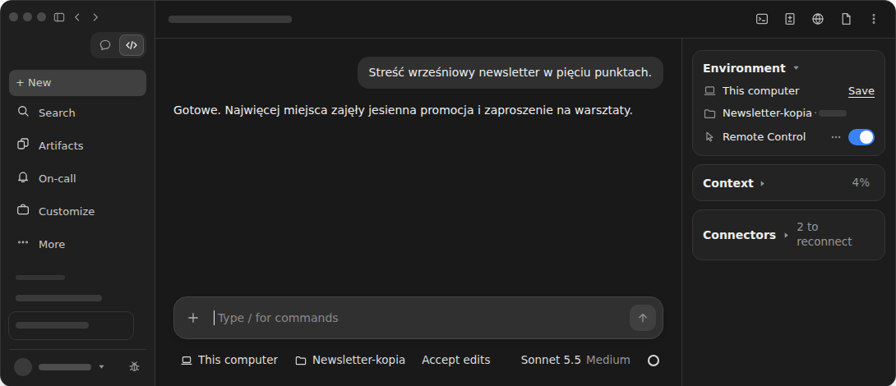
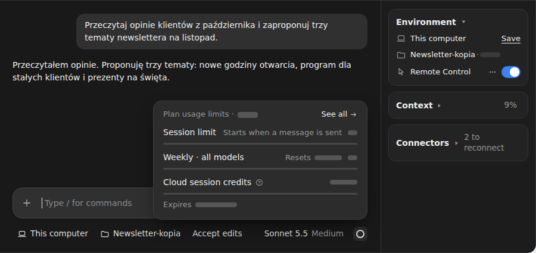
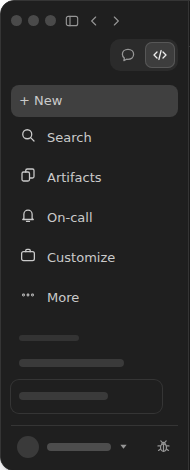
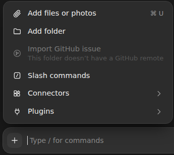
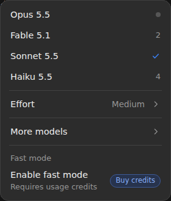
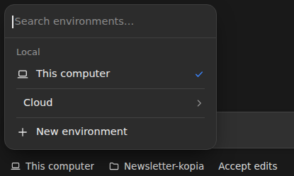
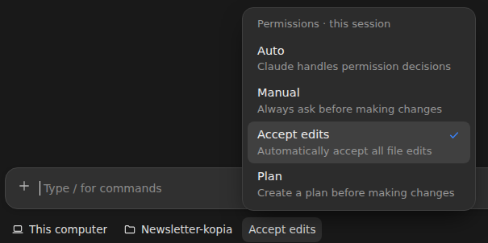
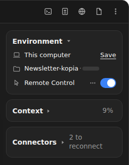

# Aplikacja Claude: co jest gdzie

Otwierasz aplikację Claude na komputerze pierwszy raz. Widzisz okno pełne przycisków, menu i liczników, a napisy są po angielsku. Chcesz zrobić coś prostego: dorzucić plik z opiniami klientów, poprosić Claude najpierw o plan albo sprawdzić, ile zużyto z abonamentu. Nie wiesz, gdzie kliknąć.

Tak zaczyna marketerka, która prowadzi firmowy newsletter. Na komputerze ma folder Newsletter z opiniami klientów i starymi wydaniami. Chce, żeby Claude pomógł jej wybrać tematy na listopad. W tej lekcji okno pokazuje folder Newsletter-kopia. To kopia folderu Newsletter, na której pracujesz w lekcji 0.1.

W aplikacji Claude na komputer Claude Code to zakładka Code. Aplikacja ma też czat i Cowork. <!-- fakt: aplikacja-code-to-zakladka-obok-czatu-i-cowork --> Aplikacja zawiera Claude Code, więc nie instalujesz osobno Claude Code do terminala. <!-- fakt: aplikacja-zawiera-claude-code-bez-nodejs-i-cli --> Terminal to okno, w którym polecenia wpisuje się tekstem. Aplikacja działa na tym samym silniku co Claude Code w terminalu, tylko z oknami i przyciskami. <!-- fakt: aplikacja-ten-sam-silnik-co-w-terminalu -->

Ta lekcja to mapa kursu ułożona według spraw z Twojej pracy. Przy każdej sprawie dowiesz się:

- gdzie w oknie ją załatwisz,
- jak nazywa się przycisk,
- która lekcja kursu uczy jej dokładnie.

W tej lekcji:

1. poznasz pięć miejsc w oknie zakładki Code i sprawy, które w każdym załatwisz,
2. zobaczysz, gdzie wybierasz pracę na swoim komputerze, i przełączysz Claude w tryb Plan, a potem w tryb pracy bez rutynowych pytań o zgodę,
3. odróżnisz dwa liczniki: jeden pokazuje, ile miejsca zajęła rozmowa, a drugi, ile zużyto z abonamentu,
4. dowiesz się, dlaczego Twoje okno może wyglądać trochę inaczej.

Okno ma pięć miejsc i każde z nich ma w tej lekcji własną część:

- pasek boczny,
- pole wiadomości z przyciskiem +,
- rząd pod polem wiadomości,
- panel szczegółów rozmowy,
- okno ustawień Settings.

Na start wystarczą Ci elementy, których używasz w lekcji [0.1 Pierwsze zadanie](pierwsze-zadanie.html):

- pole wiadomości,
- wybór środowiska,
- wybór folderu,
- tryb.

Resztę okna możesz na razie zostawić tak, jak jest.

W pierwszym ćwiczeniu przejdziesz przez pięć spraw z codziennej pracy i zobaczysz, które miejsce okna załatwia każdą z nich:

- do wcześniejszej rozmowy wrócisz na pasku bocznym,
- po plik do rozmowy albo po wtyczkę sięgniesz przyciskiem + przy polu wiadomości,
- wysiłek Claude ustawisz, a zużycie abonamentu sprawdzisz w rzędzie pod polem,
- ile miejsca zajęła rozmowa, sprawdzisz na karcie Context w panelu szczegółów,
- okno Settings (ustawienia) na stronie Claude Code otworzysz poleceniem `/config` w polu wiadomości. <!-- fakt: aplikacja-config-otwiera-settings-claude-code -->

<!-- cwiczenie: cw1 -->

## Co tu się stało?

<!-- kolumny -->

#### Pasek boczny i przycisk +

1. Kliknięcie rozmowy na pasku bocznym otworzyło wcześniejszą rozmowę. <!-- fakt: aplikacja-powrot-do-sesji-klik-w-pasku-bocznym --> Karta Context pokazała wtedy, ile miejsca zajęła ta rozmowa. <!-- fakt: aplikacja-karta-context-procent-w-naglowku -->
2. Przycisk + przy polu wiadomości otworzył menu z plikami, skillami, konektorami i wtyczkami. <!-- fakt: aplikacja-plus-menu-pliki-skille-konektory-wtyczki -->
3. Kliknięcie Plugins, a potem Browse plugins otworzyło przeglądarkę wtyczek. <!-- fakt: aplikacja-przegladarka-wtyczek-z-twoich-katalogow -->

#### Rząd pod polem i dwa liczniki

1. W menu modelu, pod Effort, był wybór poziomu wysiłku. <!-- fakt: aplikacja-wysilek-pod-effort-w-wyborze-modelu --> Po kliknięciu Low przycisk modelu pokazał Sonnet 5.5 Low.
2. Pierścień obok przycisku modelu otworzył okienko zużycia abonamentu. <!-- fakt: aplikacja-pierscien-zuzycie-abonamentu -->
3. Nagłówek karty Context pokazał w procentach, jak pełne jest okno kontekstu tej rozmowy. <!-- fakt: aplikacja-karta-context-procent-w-naglowku --> Kontekst to wszystko, co Claude ma przed oczami w tej rozmowie, między innymi historia rozmowy i zawartość plików. <!-- fakt: claude-code-okno-kontekstu-co-trzyma-zapelnia-sie --> <!-- fakt: aplikacja-ten-sam-silnik-co-w-terminalu -->

<!-- /kolumny -->

Dalej każde z pięciu miejsc ma własną część. Każdy punkt zaczyna się od sprawy z Twojej pracy. Potem mówi, gdzie ją załatwisz, jak nazywa się przycisk i która lekcja uczy jej dokładnie.

## Pasek boczny: gdzie zacząć i jak wrócić do pracy

Pasek boczny to lewa kolumna okna.

- **Gdzie w aplikacji jest Claude Code?** Zakładka Code jest u góry paska bocznego. <!-- fakt: aplikacja-zakladka-code-u-gory-paska-bocznego --> Gdy zakładki pokazują same ikony, najedź na jedną myszą, a zobaczysz jej nazwę. <!-- fakt: aplikacja-zakladki-ikony-nazwa-po-najechaniu --> Po instalacji uruchamiasz aplikację i logujesz się kontem Anthropic. <!-- fakt: aplikacja-uruchomienie-i-logowanie-kontem-anthropic --> Całą drogę od instalacji do pierwszego zadania pokazuje lekcja [0.1 Pierwsze zadanie](pierwsze-zadanie.html).
- **Chcę zacząć nowe zadanie.** Kliknij New (nowa rozmowa) na pasku bocznym. To samo zrobi skrót Cmd+N na Macu albo Ctrl+N w Windows. <!-- fakt: aplikacja-nowa-sesja-new-albo-cmd-n --> Nowa rozmowa zaczyna się bez historii poprzednich rozmów. <!-- fakt: claude-code-sesje-niezalezne-nowa-z-pustym-kontekstem --> <!-- fakt: aplikacja-ten-sam-silnik-co-w-terminalu --> Kiedy zacząć nową rozmowę, a kiedy zostać w starej, uczy lekcja [6.2 Nowa rozmowa czy ta sama](nowa-czy-ta-sama.html).
- **Chcę wrócić do wczorajszej rozmowy.** Kliknij jej nazwę na liście rozmów. <!-- fakt: aplikacja-powrot-do-sesji-klik-w-pasku-bocznym --> W zakładce Code każda rozmowa jest osobna: ma własną historię i własny folder. Dokumentacja Claude Code nazywa taką rozmowę sesją. <!-- fakt: aplikacja-kazda-rozmowa-to-sesja --> Domyślnie lista grupuje rozmowy według ich folderów. <!-- fakt: aplikacja-pasek-boczny-grupa-folderu --> Jak porządkować tę listę, pokazuje lekcja [6.2 Nowa rozmowa czy ta sama](nowa-czy-ta-sama.html).
- **Chcę prowadzić kilka zadań naraz.** Na pasku bocznym widzisz listę swoich rozmów i możesz prowadzić kilka naraz. <!-- fakt: aplikacja-pasek-boczny-lista-sesji --> Jak to robić, pokazuje lekcja [9.1 Kilka rozmów obok siebie](kilka-rozmow.html).
- **Chcę, żeby Claude sam robił coś o stałej porze, na przykład co rano.** Kliknij Scheduled (zaplanowane) na pasku albo w jego menu More (więcej). <!-- fakt: harmonogram-formularz-otwierasz-scheduled --> Zadanie zaplanowane samo zaczyna nową rozmowę o wybranej porze i tak często, jak ustawisz. <!-- fakt: slowniczek-zadanie-zaplanowane-nowa-sesja --> W oknie ćwiczenia Scheduled nie ma na pasku, jest za to More. Pierwsze takie zadanie ustawisz w lekcji [8.1 Zadanie co rano](zadanie-co-rano.html).
- **Chcę zobaczyć w jednym miejscu swoje skille, konektory i wtyczki.** Kliknij Customize (dostosuj). Tu w jednym miejscu zarządzasz konektorami, skillami i wtyczkami. <!-- fakt: aplikacja-customize-konektory-skille-wtyczki --> Czym one są, przeczytasz w następnej części.

Search, Artifacts i On-call kurs nie omawia. More pojawia się w kursie tylko jako miejsce, w którym bywa Scheduled. <!-- fakt: harmonogram-formularz-otwierasz-scheduled -->

Kurs uczy tylko zakładki Code. Pomoc do czatu i Cowork znajdziesz w Centrum pomocy Claude (Claude Help Center). <!-- fakt: aplikacja-pomoc-centrum-pomocy-i-artykuly-o-instalacji -->

## Pole wiadomości i przycisk +: zlecić zadanie i dołożyć materiały

Pole wiadomości jest na dole okna. Przycisk + jest po lewej stronie pola i otwiera menu. Są w nim pliki do dołączenia, skille, konektory i wtyczki. <!-- fakt: aplikacja-plus-menu-pliki-skille-konektory-wtyczki -->

- **Chcę zlecić Claude zadanie.** Wpisz je zwykłymi słowami w polu wiadomości i wyślij klawiszem <kbd>Enter</kbd>. <!-- fakt: aplikacja-enter-wysyla-zadanie --> Potem Claude czyta pliki z folderu, zmienia je i uruchamia polecenia. Robi to zgodnie z trybem wybranym pod polem. <!-- fakt: aplikacja-claude-czyta-pliki-i-zmienia-wedlug-trybu --> Polecenia to tu komendy, które uruchamia Claude, a nie Twoje prośby. <!-- fakt: aplikacja-claude-czyta-pliki-i-zmienia-wedlug-trybu --> Pierwszą wiadomość wyślesz w lekcji [0.1 Pierwsze zadanie](pierwsze-zadanie.html). Jak pisać prośby, żeby Claude zrobił dokładnie to, czego chcesz, uczy lekcja [2.1 Dobre zlecenie](dobre-zlecenie.html).
- **Chcę dorzucić plik do rozmowy, na przykład PDF z opiniami klientów.** Kliknij + i wybierz Add files or photos (dodaj pliki albo zdjęcia). Ten sam skutek da przeciągnięcie pliku do pola. <!-- fakt: aplikacja-plus-i-przeciaganie-dolaczaja-pliki --> Uczy tego lekcja [0.3 Nowy dokument z plików firmy](nowy-dokument.html).
- **Chcę, żeby Claude pracował też w drugim folderze.** W trwającej rozmowie kliknij + i wybierz Add folder (dodaj folder). Claude pracuje wtedy także w tym folderze. <!-- fakt: aplikacja-add-folder-w-trwajacej-sesji-lokalnej --> To też pokazuje lekcja [0.3 Nowy dokument z plików firmy](nowy-dokument.html).
- **Chcę użyć gotowego sposobu pracy, czyli skilla.** Kliknij + i wybierz Slash commands (polecenia z ukośnikiem) albo wpisz / w polu wiadomości. Otworzy się lista skilli. <!-- fakt: skill-aplikacja-menu --> Skill rozszerza to, co Claude potrafi. Claude wczytuje go sam, gdy pasuje do zadania, albo uruchamiasz go wprost. <!-- fakt: aplikacja-skille-rozszerzaja-ladowane-same-albo-wprost --> Skille poznasz w lekcji [4.1 Gotowe skille i lista poleceń](gotowe-skille.html).
- **Chcę, żeby Claude czytał mój kalendarz albo wysyłał wiadomości.** Potrzebny jest konektor, czyli połączenie Claude z Twoim narzędziem. Kliknij +, potem Connectors (konektory) i Browse connectors (przeglądaj konektory). <!-- fakt: aplikacja-add-connectors-otwiera-katalog --> Po połączeniu Claude może na przykład czytać Twój kalendarz, wysyłać wiadomości i działać w Twoich narzędziach wprost. <!-- fakt: aplikacja-konektor-czyta-kalendarz-wysyla-wiadomosci --> Pierwszy konektor podłączysz w lekcji [5.1 Pierwszy konektor](pierwszy-konektor.html).
- **Chcę dodać Claude gotowy zestaw umiejętności.** Kliknij +, potem Plugins (wtyczki) i Browse plugins (przeglądaj wtyczki). Otworzy się przeglądarka wtyczek. <!-- fakt: aplikacja-przegladarka-wtyczek-z-twoich-katalogow --> Wtyczka to gotowy pakiet, który dodaje do Claude Code między innymi skille. W aplikacji instalujesz ją bez terminala. <!-- fakt: aplikacja-wtyczki-dodaja-skille-agentow-hooki-bez-terminala --> Tę drogę pokazało pierwsze ćwiczenie. Wtyczki poznasz w lekcji [4.4 Wtyczki: gotowe zestawy skilli](wtyczki.html).

## Rząd pod polem: gdzie, na czym i jak pracuje Claude

W rzędzie pod polem ustawiasz, gdzie i jak Claude pracuje, zanim wyślesz pierwszą wiadomość. <!-- fakt: aplikacja-rzad-pod-polem-srodowisko-folder-tryb-model --> Marketerka wybierze tu folder newslettera i sposób, w jaki Claude ma pytać o zgodę.

- **Claude ma pracować na moim komputerze, z dostępem do moich plików.** Pierwszy przycisk rzędu to wybór środowiska, czyli miejsca, gdzie Claude pracuje. <!-- fakt: aplikacja-selektor-srodowiska-pierwsza-kontrolka --> W oknie ćwiczenia ma on napis This computer (ten komputer). Na start wybierasz w nim górną pozycję w grupie Local. <!-- fakt: aplikacja-local-gorna-pozycja-w-selektorze --> Środowisko Local działa na Twoim komputerze i ma bezpośredni dostęp do Twoich plików. <!-- fakt: aplikacja-local-dziala-na-twoim-komputerze --> Na nim pracujesz w całym kursie. Środowisko wybierzesz w lekcji [0.1 Pierwsze zadanie](pierwsze-zadanie.html).
- **Claude ma pracować na właściwym folderze.** Obok wyboru środowiska jest przycisk folderu. W oknie ćwiczenia ma napis Newsletter-kopia. Wybierasz nim folder, w którym Claude pracuje. <!-- fakt: aplikacja-kontrolka-folderu-obok-selektora --> Tego też uczy lekcja [0.1 Pierwsze zadanie](pierwsze-zadanie.html).
- **Claude ma pracować dokładniej albo szybciej.** Kliknij przycisk modelu w prawej części rzędu. Tu wybierasz model i możesz go później zmienić. <!-- fakt: aplikacja-model-prawa-czesc-rzedu-zmiana-pozniej --> W oknie ćwiczenia przycisk ma napis Sonnet 5.5 Medium. W tym samym menu, pod Effort (wysiłek), wybierasz poziom wysiłku. <!-- fakt: aplikacja-wysilek-pod-effort-w-wyborze-modelu --> Niższy wysiłek jest szybszy i tańszy przy prostych zadaniach. Wyższy daje głębsze rozumowanie przy trudnych. <!-- fakt: slowniczek-wysilek-steruje-rozumowaniem --> <!-- fakt: aplikacja-ten-sam-silnik-co-w-terminalu --> Kiedy jaki model i wysiłek wybrać, uczy lekcja [6.3 Model i wysiłek](model-i-wysilek.html).
- **Ile zużyto z mojego abonamentu?** Kliknij pierścień zużycia, czyli kółko obok przycisku modelu. Pokaże zużycie abonamentu, wspólne dla wszystkich miejsc, w których używasz Claude Code. <!-- fakt: aplikacja-pierscien-zuzycie-abonamentu --> W okienku ćwiczenia zamiast liczb są szare paski. U siebie zobaczysz w tym miejscu dane swojego konta. Uczy tego lekcja [6.4 Gdzie sprawdzić zużycie abonamentu](limit-abonamentu.html).

### Tryb: ile Claude robi bez pytania

W rzędzie jest też przełącznik trybu. W oknie ćwiczenia ma napis Accept edits (przyjmowanie zmian). Tryb mówi, czy Claude będzie czekać na Twoją zgodę. <!-- fakt: aplikacja-tryb-pod-polem-mowi-czy-claude-czeka-na-zgode --> Zmienisz go w dowolnej chwili. <!-- fakt: aplikacja-przelacznik-pod-polem-wiadomosci -->

W drugim ćwiczeniu najpierw zobaczysz, gdzie wybierasz pracę na swoim komputerze. Potem przełączysz Claude na Plan, a w osobnym kroku na Auto, i zobaczysz, co każdy z tych trybów zmienia w pracy Claude.

<!-- cwiczenie: cw2 -->

## Co tu się stało?

<!-- kolumny -->

#### Środowisko

1. Kliknięcie pierwszego przycisku rzędu otworzyło wybór środowiska. <!-- fakt: aplikacja-selektor-srodowiska-pierwsza-kontrolka -->
2. W grupie Local zaznaczona była górna pozycja, This computer. Tę pozycję wybierasz na start. <!-- fakt: aplikacja-local-gorna-pozycja-w-selektorze -->
3. Środowisko Local działa na Twoim komputerze i ma bezpośredni dostęp do Twoich plików. <!-- fakt: aplikacja-local-dziala-na-twoim-komputerze -->

#### Plan i Auto

1. Kliknięcie przełącznika otworzyło listę trybów. <!-- fakt: aplikacja-tryb-wybierasz-w-przelaczniku -->
2. Po wyborze Plan Claude najpierw proponuje, jak zrobić zadanie, i nie zmienia żadnego pliku. <!-- fakt: plan-aplikacja-bez-zmian-w-plikach -->
3. W trybie Auto strażnik w tle ocenia działania Claude i blokuje ryzykowne, zamiast pytać Ciebie. <!-- fakt: auto-aplikacja-klasyfikator-blokuje-ryzykowne -->

<!-- /kolumny -->

Przełącznikiem trybu załatwisz cztery sprawy:

- **Chcę zatwierdzać każdą zmianę.** Wybierz Manual (ręczny). Claude proponuje wtedy każdą zmianę i czeka na Twoje zatwierdzenie, zanim ją wprowadzi. <!-- fakt: tryb-manual-aplikacja-czeka-na-zatwierdzenie --> Uczy tego lekcja [1.1 Pytania o zgodę: tryb Manual](okno-zgody.html).
- **Ufam zmianom w plikach i chcę pracować szybciej.** Wybierz Accept edits. Dokumentacja radzi ten tryb, gdy ufasz zmianom w plikach i chcesz szybciej poprawiać kolejne wersje. <!-- fakt: accept-edits-aplikacja-kiedy-uzywac --> W tym trybie Claude sam wprowadza zmiany w plikach. <!-- fakt: aplikacja-auto-i-accept-edits-stosuja-zmiany --> Uczy tego lekcja [1.2 Accept edits: Claude sam zmienia pliki](zmiany-bez-pytania.html).
- **Chcę, żeby Claude najpierw rozpisał plan, zanim coś zmieni.** Wybierz Plan. Claude czyta pliki i uruchamia polecenia, żeby zbadać sprawę, a potem proponuje plan bez zmieniania plików. <!-- fakt: plan-aplikacja-opis --> <!-- fakt: plan-aplikacja-bez-zmian-w-plikach --> Tryb Plan obowiązuje tylko w bieżącej rozmowie. <!-- fakt: plan-aplikacja-tylko-biezaca-sesja --> Uczy tego lekcja [1.3 Tryb planowania](tryb-planowania.html).
- **Chcę dać Claude wolną rękę przy długim zadaniu.** Wybierz Auto. Claude pracuje bez rutynowych pytań. Przed niektórymi działaniami, na przykład poleceniami i połączeniami z siecią, strażnik w tle sprawdza, czy zgadzają się z Twoją prośbą. <!-- fakt: auto-aplikacja-opis-trybu --> Dokumentacja wskazuje ten tryb do długich zadań i wtedy, gdy męczą Cię pytania o zgodę. <!-- fakt: auto-do-dlugich-zadan --> <!-- fakt: aplikacja-ten-sam-silnik-co-w-terminalu --> Uczy tego lekcja [1.4 Tryb auto: strażnik zamiast pytań](straznik-zamiast-pytan.html).

Lista trybów nie wszędzie jest taka sama: Auto pojawia się, gdy jest dostępny, a Bypass permissions (pomijanie uprawnień) dopiero po włączeniu. <!-- fakt: aplikacja-dostepne-tryby -->

## Panel szczegółów: co dzieje się w rozmowie

Obok rozmowy stoi panel szczegółów, który w oknie ćwiczenia jest po prawej. To zestaw kart, które pokazują, co dzieje się w rozmowie. <!-- fakt: aplikacja-panel-szczegolow-sesji-karty-obok-czatu --> Nie musisz o to pytać Claude: wystarczy spojrzeć na panel.

- **Czy w tej rozmowie jest jeszcze miejsce?** Spójrz na kartę Context (kontekst). Jej nagłówek pokazuje w procentach, jak pełne jest okno kontekstu tej rozmowy. Po otwarciu karta pokazuje, co zajmuje to okno, z podziałem na kategorie. <!-- fakt: aplikacja-karta-context-procent-w-naglowku --> Gdy kontekst zbliża się do limitu, Claude sam streszcza rozmowę. Szczegółowe instrukcje z początku rozmowy mogą wtedy przepaść. <!-- fakt: claude-code-przy-limicie-kontekstu-streszcza-rozmowe --> Nazw kategorii na start nie potrzebujesz. Co znaczą i jak dbać o miejsce w rozmowie, uczy lekcja [6.1 Kontekst: ile zmieści rozmowa](kontekst-rozmowy.html).
- **Co Claude zmienił w moich plikach?** Na karcie Changes (zmiany) widać liczby zmienionych linijek, na przykład +12 -1. Kliknięcie liczb otwiera widok zmian. <!-- fakt: aplikacja-widok-zmian-liczby-na-karcie-changes --> W ćwiczeniach tej lekcji tej karty nie zobaczysz. Widok zmian poznasz w lekcji [0.2 Sprawdź i cofnij zmiany](sprawdz-i-cofnij.html).
- **Gdzie pracuje ta rozmowa?** Karta Environment (środowisko) pokazuje, gdzie działa rozmowa; w ćwiczeniu to folder Newsletter-kopia. <!-- fakt: aplikacja-panel-szczegolow-sesji-karty-obok-czatu --> Na tej karcie jest też przełącznik Remote Control (zdalne sterowanie). Pokazuje, czy rozmowa jest połączona. <!-- fakt: remote-control-aplikacja-stan-w-karcie-environment --> Jak prowadzić rozmowę dalej na telefonie, pokazuje lekcja [8.4 Rozmowa dalej na telefonie](rozmowa-na-telefonie.html).

Karta Connectors (konektory) pokazuje w ćwiczeniu stan przykładowego konta. Na start nic z nią nie robisz. Konektory poznasz w lekcji [5.1 Pierwszy konektor](pierwszy-konektor.html).

### Dwa liczniki, dwa pytania

Karta Context i pierścień zużycia to dwa różne liczniki:

- karta Context mówi, jak pełne jest okno kontekstu tej jednej rozmowy, <!-- fakt: aplikacja-karta-context-procent-w-naglowku -->
- pierścień pod polem mówi, ile zużyto z abonamentu we wszystkich miejscach, w których używasz Claude Code. <!-- fakt: aplikacja-pierscien-zuzycie-abonamentu -->

Jeden nie zastępuje drugiego. Na końcu czwartej sprawy pierwszego ćwiczenia widać oba naraz. Gdy chcesz wiedzieć, ile jeszcze zmieści ta rozmowa, patrzysz na kartę Context. Gdy chcesz wiedzieć, ile zużyto z abonamentu, klikasz pierścień.

We wcześniejszym układzie aplikacji nie ma panelu szczegółów, a więc i karty Context. <!-- fakt: aplikacja-wczesniejszy-uklad-nie-ma-panelu-szczegolow --> Wtedy klikasz pierścień obok wyboru modelu. Okienko, które się otworzy, pokazuje, ile zajmuje okno kontekstu. <!-- fakt: aplikacja-wczesniejszy-uklad-pierscien-pokazuje-kontekst -->

### Pasek tytułu: zmiany i strony obok rozmowy

- **Chcę obejrzeć zmiany albo stronę obok rozmowy.** Nad panelem szczegółów jest pasek tytułu rozmowy. Cała zakładka Code składa się z paneli, na przykład rozmowy, widoku zmian, przeglądarki i pliku. <!-- fakt: aplikacja-panele-zakladki-code --> Na pasku tytułu są przyciski tych paneli. Nazwę każdego przycisku zobaczysz po najechaniu myszą. Gdy okno jest wąskie, przyciski, które się nie mieszczą, przechodzą do menu z trzema kropkami. <!-- fakt: aplikacja-przyciski-paneli-nazwa-po-najechaniu-menu-przy-waskim-oknie -->

Na pasku tytułu w oknie ćwiczenia są od lewej takie przyciski: <!-- fakt: aplikacja-przyciski-paneli-nazwa-po-najechaniu-menu-przy-waskim-oknie -->

- >_ to Terminal. Kurs go nie omawia.
- ± to Changes (zmiany). Poznasz go w lekcji [0.2 Sprawdź i cofnij zmiany](sprawdz-i-cofnij.html).
- Kula ziemska to Browser (przeglądarka). Poznasz go w lekcji [3.1 Strona oferty](strona-oferty.html).
- Kartka to Files (pliki).
- Trzy kropki otwierają menu z przyciskami, które się nie zmieściły.

### Gdy panelu szczegółów nie widać

- **Nie widzę panelu szczegółów.** Panel szczegółów pojawia się dopiero po rozpoczęciu rozmowy i tylko wtedy, gdy jest na niego dość miejsca. <!-- fakt: aplikacja-panel-szczegolow-sesji-karty-obok-czatu -->
- **Panel zniknął i chcę go z powrotem.** Schowany panel pokażesz przyciskiem Show session rail (pokaż panel) na pasku tytułu albo w menu z trzema kropkami na tym pasku. Przycisk Hide session rail (schowaj panel) chowa go z powrotem. <!-- fakt: aplikacja-panel-szczegolow-ukryj-i-pokaz -->
- **Mam wcześniejszy układ aplikacji.** We wcześniejszym układzie aplikacji panelu nie ma wcale. Co wtedy zrobić, opisuje część „Gdy Twoje okno wygląda inaczej”. <!-- fakt: aplikacja-wczesniejszy-uklad-nie-ma-panelu-szczegolow -->

## Ustawienia: zmiany na wszystkie rozmowy

W oknie Settings (ustawienia) zmieniasz ustawienia aplikacji.

- **Jak otworzyć ustawienia?** Do ustawień prowadzi polecenie `/config`: wpisz je w polu wiadomości. Otworzy się okno Settings na stronie Claude Code. <!-- fakt: aplikacja-config-otwiera-settings-claude-code --> Tę drogę pokazało pierwsze ćwiczenie.
- **Chcę wyłączyć szare podpowiedzi w polu wiadomości.** Wyłączysz je na stronie ustawień Claude Code. Znikną w każdej rozmowie, gdy ją następnym razem uruchomisz albo wznowisz. <!-- fakt: aplikacja-podpowiedz-wylaczenie-w-ustawieniach --> Te podpowiedzi poznasz w lekcji [0.1 Pierwsze zadanie](pierwsze-zadanie.html).
- **Chcę odłączyć konektor.** W ustawieniach, na stronie Connectors, zarządzasz podłączonymi konektorami i je odłączasz. <!-- fakt: aplikacja-konektory-zarzadzasz-w-settings-connectors --> Konektory poznasz w lekcji [5.1 Pierwszy konektor](pierwszy-konektor.html).
- **Chcę, żeby komputer nie zasypiał, gdy na nim nie pracuję.** Włącz Keep computer awake (nie usypiaj komputera) na stronie System w grupie This computer. Zamknięcie klapy laptopa i tak go uśpi. <!-- fakt: harmonogram-keep-computer-awake --> Poznasz to w lekcji [8.1 Zadanie co rano](zadanie-co-rano.html).

Nie każde konto ma te same przełączniki. Przykład z dokumentacji to tryb Bypass permissions (pomijanie uprawnień). Claude działa w nim bez pytań o zgodę, poza kilkoma wyjątkami. <!-- fakt: aplikacja-bypass-tylko-kontenery --> Dokumentacja każe używać go tylko w odizolowanym środowisku, takim jak kontener albo maszyna wirtualna. <!-- fakt: aplikacja-bypass-tylko-kontenery --> Na start go nie potrzebujesz. Na planach Pro i Max włączasz go na stronie Claude Code przełącznikiem Allow bypass permissions mode (pozwól na tryb pomijania uprawnień). Na planach Team i Enterprise tego przełącznika w ustawieniach nie ma, a o tym trybie decyduje polityka organizacji. <!-- fakt: aplikacja-bypass-przelacznik-w-settings-claude-code -->

Innych stron kurs nie omawia.

## Gdy Twoje okno wygląda inaczej

- **Nie ma wyboru środowiska pod polem.** Wtedy masz wcześniejszy układ aplikacji. <!-- fakt: aplikacja-wczesniejszy-uklad-brak-selektora --> W tym układzie środowisko i folder wybierasz nad polem wiadomości, a tryb i model w rzędzie pod nim. <!-- fakt: aplikacja-wczesniejszy-uklad-srodowisko-i-folder-nad-polem --> Ten układ nie ma panelu szczegółów. <!-- fakt: aplikacja-wczesniejszy-uklad-nie-ma-panelu-szczegolow --> Ile zajmuje okno kontekstu, pokaże wtedy pierścień obok wyboru modelu, gdy go klikniesz. <!-- fakt: aplikacja-wczesniejszy-uklad-pierscien-pokazuje-kontekst --> Obecny układ dostaniesz w wersji aplikacji v2.37337.0 lub nowszej. Zaktualizuj aplikację. Na Macu wybierz Claude > Check for Updates… (sprawdź aktualizacje), a w Windows wybierz Help > Check for Updates…. <!-- fakt: aplikacja-wczesniejszy-uklad-aktualizacja -->
- **Pasek boczny ma inne pozycje.** Gdy nie widzisz Scheduled, zajrzyj do menu More. Zamiast Scheduled pasek pokazuje czasem Routines (rutyny). <!-- fakt: harmonogram-formularz-otwierasz-scheduled --> Brak pozycji nie znaczy, że coś jest zepsute. To, czy w ustawieniach jest przełącznik Bypass permissions, zależy od planu. <!-- fakt: aplikacja-bypass-zalezy-od-planu -->
- **Menu + ma Add connectors i Add plugins zamiast Connectors i Plugins.** To ta sama droga, tylko o krok krótsza: Add connectors otwiera katalog konektorów, a Add plugins przeglądarkę wtyczek. <!-- fakt: aplikacja-add-connectors-otwiera-katalog --> <!-- fakt: aplikacja-przegladarka-wtyczek-z-twoich-katalogow -->

## Źródła

- [Aplikacja Claude na komputer](https://code.claude.com/docs/en/desktop)
- [Pierwsze kroki w aplikacji na komputer](https://code.claude.com/docs/en/desktop-quickstart)
- [Zadania według harmonogramu w aplikacji](https://code.claude.com/docs/en/desktop-scheduled-tasks)
- [Tryby uprawnień](https://code.claude.com/docs/en/permission-modes)
- [Jak działa Claude Code](https://code.claude.com/docs/en/how-claude-code-works)
- [Konfiguracja modelu](https://code.claude.com/docs/en/model-config)

Sprawdzone 27.10.2026, Claude Code 2.1.311.
