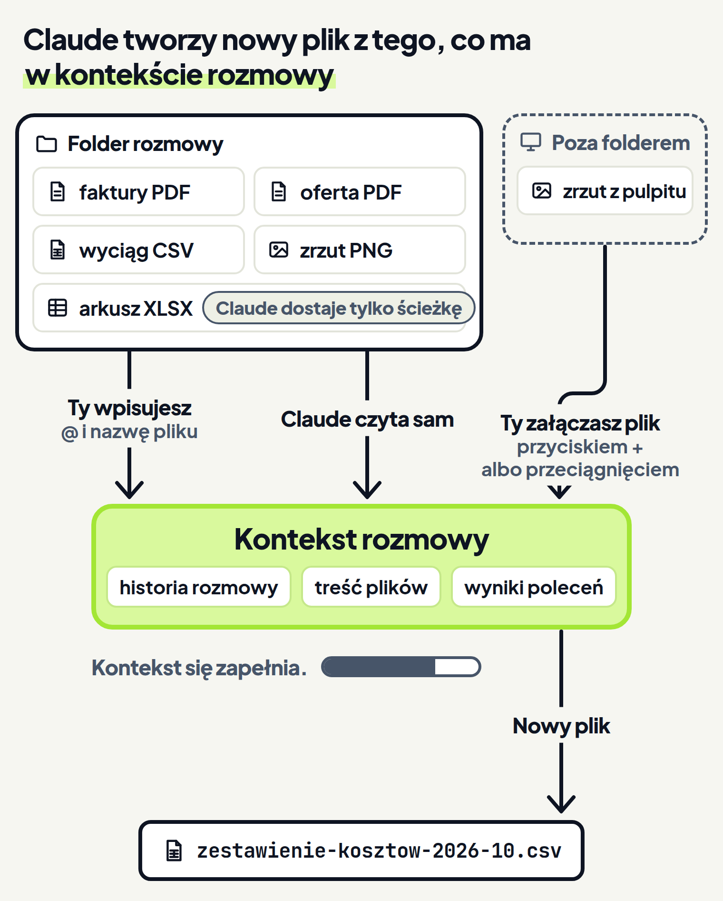
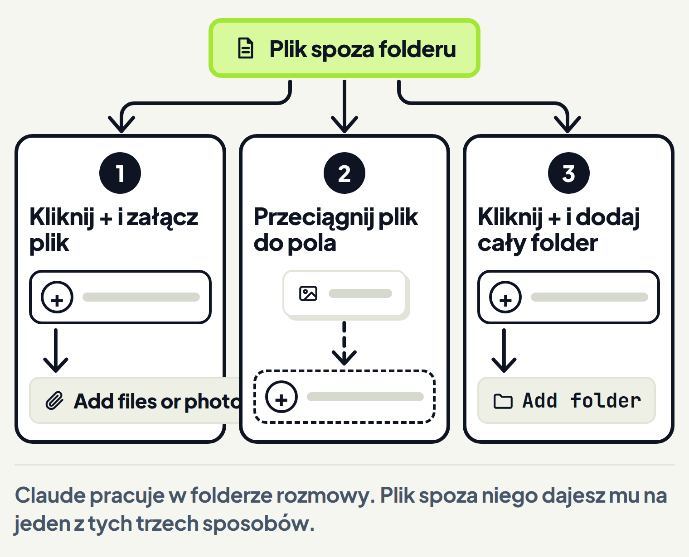
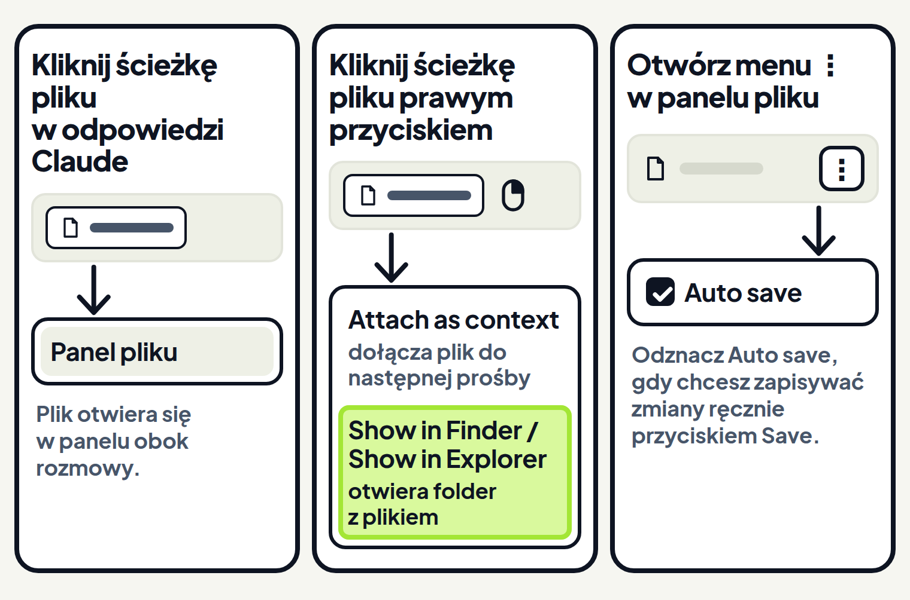

<em>Przewodnik po Claude Code · Moduł 0: Pierwsze kroki w aplikacji Claude · Lekcja 3 z 3</em>

# Nowy dokument z plików firmy

Koniec miesiąca, a księgowa czeka na zestawienie kosztów. Kwoty leżą w kilku różnych plikach. Zwykle przepisujesz je ręcznie do tabelki, kwota po kwocie.

W zakładce Code tę robotę zrobi Claude: z plików firmy złoży nowy dokument. Dokumentacja wymienia pisanie dokumentów (w oryginale writing docs) wśród rzeczy, w których Claude Code pomaga poza kodem. <!-- fakt: claude-code-pomaga-nie-tylko-w-kodzie-writing-docs --> <!-- fakt: aplikacja-ten-sam-silnik-co-w-terminalu -->

Po Twojej prośbie Claude czyta pliki projektu. <!-- fakt: aplikacja-claude-czyta-pliki-i-zmienia-wedlug-trybu --> Wynik umie zapisać w nowym pliku. <!-- fakt: claude-code-tworzy-nowe-pliki --> <!-- fakt: aplikacja-ten-sam-silnik-co-w-terminalu -->

Nowy dokument będzie jednak tyle wart, ile pliki, z których powstał.

Z tej lekcji dowiesz się:

- jak dać Claude właściwe pliki,
- co Claude z nich odczyta,
- jak otworzyć gotowy wynik.

W ćwiczeniu pracujesz na kopii folderu z kosztami za październik. Leżą w nim:

- trzy faktury PDF: za hosting strony, za Canvę i za biuro rachunkowe,
- oferta hostingu na 2027 rok, która nie jest kosztem października,
- wyciąg z banku w pliku CSV (tabela zapisana jako zwykły tekst),
- zrzut ekranu z płatnością za narzędzie do newslettera.

Zobaczysz, że bez wskazania plików Claude sam wybiera, z czego zrobić zestawienie, i bierze też ofertę. Gdy wskażesz pliki znakiem @ przed ich nazwą, w zestawieniu będą tylko trzy faktury.

<!-- cwiczenie: cw1 -->

## Co tu się stało?

<!-- kolumny -->

#### Bez wskazania plików

<!-- podglad: cw1 bez -->

1. Prośba nie wskazywała plików, więc Claude sam przeczytał pliki z folderu. Świeciło pięć kart. <!-- fakt: aplikacja-claude-czyta-pliki-i-zmienia-wedlug-trybu -->
2. Wśród nich była oferta hostingu na 2027, więc trafiła do zestawienia, choć to nie koszt. Karta zrzutu z płatnością za narzędzie do newslettera nie świeciła, więc tej płatności w zestawieniu brakuje.
3. Pod polem wiadomości widać, że włączony jest tryb Accept edits (przyjmowanie zmian). Tryb zmieniasz tam przełącznikiem, tak jak w lekcji 1. <!-- fakt: aplikacja-przelacznik-pod-polem-wiadomosci --> W tym trybie Claude czyta pliki bez pytania. <!-- fakt: accept-edits-odczyty-bez-pytania --> <!-- fakt: aplikacja-ten-sam-silnik-co-w-terminalu --> Nowy plik też tworzy bez pytania o zgodę. <!-- fakt: accept-edits-edycje-w-folderze-bez-pytania --> <!-- fakt: aplikacja-ten-sam-silnik-co-w-terminalu -->

#### Ze wskazaniem @

<!-- podglad: cw1 z -->

1. Prośba wskazywała znakiem @ trzy faktury i wyciąg. Świeciły te cztery karty.
2. Znak @ przed nazwą pliku dodaje ten plik do rozmowy. <!-- fakt: aplikacja-at-dodaje-plik-do-rozmowy -->
3. W zestawieniu są trzy faktury, bez oferty.
4. W obu wersjach nowy plik otworzył się po kliknięciu jego ścieżki w odpowiedzi Claude. <!-- fakt: aplikacja-klik-sciezki-w-rozmowie-otwiera-plik -->

<!-- /kolumny -->

## Skąd Claude bierze informacje

Nowy dokument powstaje z tego, co Claude ma w kontekście. Kontekst to wszystko, co Claude ma przed oczami w tej rozmowie, między innymi historia rozmowy, treść przeczytanych plików i wyniki poleceń. <!-- fakt: claude-code-okno-kontekstu-co-trzyma-zapelnia-sie --> <!-- fakt: aplikacja-ten-sam-silnik-co-w-terminalu --> Polecenia to komendy, które Claude uruchamia sam, na przykład żeby wypisać pliki w folderze. <!-- fakt: read-czyta-pliki-nie-foldery-ls --> <!-- fakt: aplikacja-ten-sam-silnik-co-w-terminalu -->

<!-- analogia: Kontekst działa jak biurko: Claude pracuje tylko na tym, co leży na blacie. Plik z szafy, czyli z folderu, Claude wyjmuje sam albo Ty mu go podajesz. Gdy blat się zapełni, Claude sam robi na nim miejsce i streszcza to, co leży. -->

Pliki trafiają do kontekstu trzema drogami:

1. Claude sam czyta pliki projektu, jak w ćwiczeniu bez wskazania. <!-- fakt: aplikacja-claude-czyta-pliki-i-zmienia-wedlug-trybu -->
2. Wskazujesz plik znakiem @, jak w ćwiczeniu ze wskazaniem. <!-- fakt: aplikacja-dwie-drogi-dac-claude-plik-at-albo-zalacznik -->
3. Załączasz plik w polu wiadomości. Tę drogę opisuje część „Jak dać Claude plik spoza folderu”. <!-- fakt: aplikacja-dwie-drogi-dac-claude-plik-at-albo-zalacznik -->

Każda rozmowa w zakładce Code ma własną historię i własny folder. <!-- fakt: aplikacja-sesja-ma-wlasna-historie-i-folder-projektu --> Folder wybierasz w rzędzie pod polem wiadomości, przed pierwszą wiadomością. <!-- fakt: aplikacja-rzad-pod-polem-srodowisko-folder-tryb-model --> W ćwiczeniu to folder Koszty-pazdziernik-kopia.

W środowisku Local (lokalnie) Claude pracuje na Twoim komputerze i ma bezpośredni dostęp do Twoich plików. <!-- fakt: aplikacja-local-dziala-na-twoim-komputerze --> Widzi pliki w folderze rozmowy i w jego podfolderach. <!-- fakt: claude-code-dostep-do-folderu-i-podfolderow-reszta-za-zgoda --> <!-- fakt: aplikacja-ten-sam-silnik-co-w-terminalu -->

## Nowy dokument bez wskazania plików

### Po co

Nie zawsze wiesz, w którym pliku leży potrzebna kwota. Nie musisz tego wiedzieć. Według dokumentacji nie trzeba podawać Claude, które pliki ma czytać, bo sam to ustala. <!-- fakt: claude-code-nie-trzeba-mowic-ktore-pliki-czytac --> <!-- fakt: aplikacja-ten-sam-silnik-co-w-terminalu -->

### Jak działa

W ćwiczeniu bez wskazania Claude sam przejrzał folder, wybrał pliki, przeczytał je i zapisał wynik w nowym pliku.

Bez narzędzi Claude mógłby tylko odpowiadać tekstem. <!-- fakt: claude-code-bez-narzedzi-tylko-tekst-z-narzedziami-dziala --> <!-- fakt: aplikacja-ten-sam-silnik-co-w-terminalu --> Z narzędziami działa: czyta pliki, zmienia je i uruchamia polecenia. <!-- fakt: claude-code-bez-narzedzi-tylko-tekst-z-narzedziami-dziala --> <!-- fakt: aplikacja-ten-sam-silnik-co-w-terminalu -->

Pracuje w trzech fazach: zbiera kontekst, działa i sprawdza wyniki. <!-- fakt: claude-code-trzy-fazy-zadania --> <!-- fakt: aplikacja-ten-sam-silnik-co-w-terminalu --> Gdy nie wskażesz plików, kontekst z folderu zbiera sam. <!-- fakt: claude-code-nie-trzeba-mowic-ktore-pliki-czytac --> <!-- fakt: aplikacja-ten-sam-silnik-co-w-terminalu --> Ma do tego narzędzia:

1. Wypisuje zawartość folderu poleceniem, takim jak ls, bo narzędzie Read (odczyt) czyta pliki, a nie foldery. <!-- fakt: read-czyta-pliki-nie-foldery-ls --> <!-- fakt: aplikacja-ten-sam-silnik-co-w-terminalu --> Takie polecenie tylko do odczytu idzie bez pytania o zgodę w każdym trybie. <!-- fakt: bash-polecenia-tylko-do-odczytu-bez-pytania --> <!-- fakt: aplikacja-ten-sam-silnik-co-w-terminalu -->
2. Szuka plików po wzorcu nazwy i przeszukuje ich treść. <!-- fakt: claude-code-narzedzia-szukania-pliki-po-wzorcu --> <!-- fakt: aplikacja-ten-sam-silnik-co-w-terminalu -->
3. Czyta pliki narzędziem Read. Dla pliku w folderze rozmowy Read nie pyta o zgodę nawet w trybie Manual (ręczny). <!-- fakt: read-bez-zgody-write-ze-zgoda-w-trybie-manual --> <!-- fakt: aplikacja-ten-sam-silnik-co-w-terminalu -->

Potem działa: wynik zapisuje narzędziem Write (zapis), które tworzy nowy plik. <!-- fakt: write-tworzy-nowy-plik-albo-nadpisuje-nie-dopisuje --> <!-- fakt: aplikacja-ten-sam-silnik-co-w-terminalu --> W trybie Manual Write pyta o zgodę. <!-- fakt: read-bez-zgody-write-ze-zgoda-w-trybie-manual --> <!-- fakt: aplikacja-ten-sam-silnik-co-w-terminalu -->

### Dzięki temu

Claude widzi cały projekt, więc może korzystać z wielu plików naraz. <!-- fakt: claude-code-widzi-caly-projekt-czyta-kilka-plikow --> <!-- fakt: aplikacja-ten-sam-silnik-co-w-terminalu --> Dokumentacja podaje przykład: Claude szuka potrzebnych plików i czyta kilka z nich, żeby zrozumieć kontekst. <!-- fakt: claude-code-widzi-caly-projekt-czyta-kilka-plikow --> <!-- fakt: aplikacja-ten-sam-silnik-co-w-terminalu -->

W ćwiczeniu z pięciu plików powstało jedno zestawienie, bez przepisywania kwot.

### Ograniczenia

- W ćwiczeniu Claude uznał, że pasuje też oferta, i dopisał ją do kosztów.
- Write nie dopisuje treści do pliku. Tworzy nowy plik albo nadpisuje istniejący całą podaną treścią. <!-- fakt: write-tworzy-nowy-plik-albo-nadpisuje-nie-dopisuje --> <!-- fakt: aplikacja-ten-sam-silnik-co-w-terminalu --> Dlatego nowy dokument zapisuj pod nową nazwą, tak jak zestawienie-kosztow-2026-10.csv.
- W prawdziwej aplikacji widok Verbose (szczegółowy) pokaże każdy odczyt pliku. <!-- fakt: aplikacja-widok-rozmowy-transcript-view-verbose --> Na macOS i Windows widoki zmieniasz po kolei skrótem <kbd>Ctrl</kbd>+<kbd>O</kbd>. <!-- fakt: aplikacja-widok-rozmowy-transcript-view-verbose --> Możesz też otworzyć menu pod strzałką obok tytułu rozmowy i wybrać Transcript view (widok zapisu rozmowy). <!-- fakt: aplikacja-widok-rozmowy-transcript-view-verbose -->
- Folder ze świecącymi kartami pokazuje tylko ćwiczenie w kursie, w aplikacji go nie ma. W widoku Normal (zwykłym) aplikacja zwija wywołania narzędzi do streszczeń. <!-- fakt: aplikacja-widok-rozmowy-transcript-view-verbose --> Ćwiczenie tych streszczeń nie pokazuje, więc odczyt pliku widać na kartach i w odpowiedzi Claude.

## Wskazanie plików znakiem @

### Po co

Gdy Claude sam wybiera pliki, może wziąć też taki, który do zadania nie pasuje, jak oferta w ćwiczeniu. Żeby dać Claude konkretny plik, wskazujesz go znakiem @. <!-- fakt: aplikacja-dwie-drogi-dac-claude-plik-at-albo-zalacznik -->

### Jak działa

Wpisujesz w polu wiadomości znak @ i nazwę pliku, a plik trafia do kontekstu rozmowy. <!-- fakt: aplikacja-at-dodaje-plik-do-rozmowy --> <!-- fakt: aplikacja-wiecej-kontekstu-lepszy-wynik --> W ćwiczeniu prośba wskazywała cztery pliki, każdy ze swoim znakiem @: trzy faktury i wyciąg.

W aplikacji Claude:

1. W polu wiadomości wpisz znak @ i początek nazwy pliku.
2. Aplikacja podpowie nazwy plików. <!-- fakt: aplikacja-at-z-autouzupelnianiem --> Ćwiczenie tych podpowiedzi nie pokazuje.
3. Tak jak w ćwiczeniu, każdy plik ma swój znak @.
4. Dopisz prośbę i naciśnij <kbd>Enter</kbd>. <!-- fakt: aplikacja-enter-wysyla-zadanie -->

Plik, którego ścieżka pojawiła się już w rozmowie, dołączysz też prawym przyciskiem myszy. Kliknij ścieżkę prawym przyciskiem i wybierz Attach as context (dołącz jako kontekst). <!-- fakt: aplikacja-prawy-przycisk-na-sciezce-attach-as-context --> Plik trafi do Twojej następnej prośby. <!-- fakt: aplikacja-prawy-przycisk-na-sciezce-attach-as-context --> To samo menu otworzysz na ścieżce w widoku zmian i w panelu pliku. <!-- fakt: aplikacja-prawy-przycisk-na-sciezce-attach-as-context --> Panel pliku to miejsce, w którym możesz samodzielnie poprawić plik. <!-- fakt: aplikacja-panel-pliku-edycja-w-sesji-lokalnej --> Opisuje go część „Jak otworzyć i oddać wynik”.

### Dzięki temu

Claude ma przed oczami pliki, o które Ci chodzi. Według dokumentacji im więcej informacji ma Claude, tym lepsze wyniki. <!-- fakt: aplikacja-wiecej-kontekstu-lepszy-wynik --> Ćwiczenie pokazało jednak, że informacje muszą pasować do zadania: oferta w zestawieniu kosztów tylko przeszkadzała.

### Ograniczenia

- Dokumentacja mówi tylko, że znak @ dodaje plik do rozmowy. <!-- fakt: aplikacja-at-dodaje-plik-do-rozmowy --> Nie obiecuje, że Claude pominie resztę folderu. Dlatego napisz też w prośbie, z których plików ma powstać wynik.
- Nie każdy wskazany plik Claude odczyta. O arkuszach Excela mówi część „Co Claude odczyta z Twoich plików”.
- Kontekst w trakcie pracy się zapełnia. <!-- fakt: claude-code-okno-kontekstu-co-trzyma-zapelnia-sie --> <!-- fakt: aplikacja-ten-sam-silnik-co-w-terminalu --> Gdy kontekst zbliża się do limitu, Claude Code sam streszcza rozmowę. <!-- fakt: claude-code-przy-limicie-kontekstu-streszcza-rozmowe --> <!-- fakt: aplikacja-ten-sam-silnik-co-w-terminalu --> Twoje prośby zostają w streszczeniu, ale szczegółowe instrukcje z początku rozmowy mogą przepaść. <!-- fakt: claude-code-przy-limicie-kontekstu-streszcza-rozmowe --> <!-- fakt: aplikacja-ten-sam-silnik-co-w-terminalu -->
- Nasza rada: wskazuj tylko pliki potrzebne do zadania. Gdy w długiej rozmowie znów potrzebujesz pliku wskazanego na początku, wskaż go jeszcze raz.
- Nowa rozmowa zaczyna się bez historii poprzedniej. <!-- fakt: claude-code-sesje-niezalezne-nowa-z-pustym-kontekstem --> <!-- fakt: aplikacja-ten-sam-silnik-co-w-terminalu --> W nowej rozmowie wskaż pliki od nowa.

Na płatność za narzędzie do newslettera nie masz faktury, tylko zrzut ekranu w folderze. Zobaczysz, że Claude odczyta kwotę ze zrzutu wskazanego znakiem @ i dopisze ją do zestawienia. Karta zestawienia dostanie znacznik zmiany, a nowy plik nie powstanie.

<!-- cwiczenie: cw2 -->

## Co tu się stało?

<!-- kolumny -->

#### Odczyt ze zrzutu

<!-- podglad: cw2 zrzut -->

1. Znak @ dodał do rozmowy zrzut i zestawienie. <!-- fakt: aplikacja-at-dodaje-plik-do-rozmowy --> Świeciły ich karty.
2. Claude odczytał ze zrzutu kwotę 89 zł i dopisał ją jako czwartą pozycję.
3. Zrzut to plik PNG, a pliki PNG Claude widzi jako obraz. <!-- fakt: read-pokazuje-claude-obrazy-png --> <!-- fakt: aplikacja-ten-sam-silnik-co-w-terminalu -->

#### Zmiana, nie nowy plik

1. Zestawienie już leżało w folderze, więc nowy plik nie powstał. Karta zestawienia dostała znacznik zmiany.
2. Do częściowych zmian w istniejącym pliku Claude używa narzędzia Edit (edycja), a nie Write. <!-- fakt: edit-punktowe-zmiany-write-nie-do-czesciowych-zmian --> <!-- fakt: aplikacja-ten-sam-silnik-co-w-terminalu --> Edit robi w pliku punktowe zmiany. <!-- fakt: edit-punktowe-zmiany-write-nie-do-czesciowych-zmian --> <!-- fakt: aplikacja-ten-sam-silnik-co-w-terminalu -->
3. Aplikacja nie pytała o zgodę, bo w trybie Accept edits sama przyjmuje zmiany w plikach. <!-- fakt: accept-edits-aplikacja-pyta-o-inne-polecenia -->
4. Co się zmieniło, widzisz w otwartym pliku: nową linijkę i nową sumę.

<!-- /kolumny -->

## Jak dać Claude plik spoza folderu

### Po co

Nie każdy plik leży w folderze rozmowy. Zrzut z płatnością bywa na pulpicie, a PDF od klienta w folderze Pobrane.

Narzędzia do plików, takie jak Read, pytają o zgodę, zanim otworzą plik spoza folderu rozmowy i folderów do niej dodanych. <!-- fakt: narzedzia-plikowe-pytaja-o-sciezki-poza-folderem-roboczym --> <!-- fakt: aplikacja-ten-sam-silnik-co-w-terminalu -->

### Jak działa

Możesz też samodzielnie dać Claude taki plik na jeden z trzech sposobów:

1. Dołącz plik przyciskiem + obok pola wiadomości. <!-- fakt: aplikacja-plus-i-przeciaganie-dolaczaja-pliki -->
2. Przeciągnij plik do pola wiadomości. <!-- fakt: aplikacja-plus-i-przeciaganie-dolaczaja-pliki -->
3. Gdy potrzebujesz wielu plików z innego folderu, dodaj do rozmowy cały ten folder. Kliknij + obok pola wiadomości i wybierz Add folder (dodaj folder). <!-- fakt: aplikacja-add-folder-w-trwajacej-sesji-lokalnej --> Claude pracuje w tym folderze bezpośrednio. <!-- fakt: aplikacja-add-folder-w-trwajacej-sesji-lokalnej -->

Załączyć możesz obrazy, PDF-y i inne pliki. <!-- fakt: aplikacja-plus-i-przeciaganie-dolaczaja-pliki -->

### Dzięki temu

Zrzut albo PDF od klienta trafia do Claude bez kopiowania do folderu rozmowy. Dokumentacja podaje jako przykłady zrzuty ekranu, makiety projektów i dokumenty pomocnicze. <!-- fakt: aplikacja-plus-i-przeciaganie-dolaczaja-pliki -->

### Ograniczenia

- Add folder wybierzesz w trwającej rozmowie w środowisku Local. <!-- fakt: aplikacja-add-folder-w-trwajacej-sesji-lokalnej -->
- Przycisk + obok pola wiadomości służy też do skilli, konektorów i wtyczek. <!-- fakt: aplikacja-plus-obok-pola-zalaczniki-skille-konektory-wtyczki --> Poznasz je w dalszych modułach kursu.
- Załączania nie ćwiczymy w ćwiczeniu.

## Co Claude odczyta z Twoich plików

### Po co

Pliki firmy mają różne formaty:

- faktury w PDF,
- zrzuty ekranu,
- wyciąg z banku w CSV,
- arkusz z kosztami w Excelu.

Zanim dasz Claude plik, sprawdź, czy go odczyta. Inaczej w zestawieniu zabraknie pozycji.

### Jak działa

Zawartość plików czyta narzędzie Read. <!-- fakt: read-bez-zgody-write-ze-zgoda-w-trybie-manual --> <!-- fakt: aplikacja-ten-sam-silnik-co-w-terminalu --> Radzi sobie z takimi plikami:

- **PDF.** Krótki PDF Claude czyta w całości, dłuższy niż 10 stron zakresami, do 20 stron naraz. <!-- fakt: read-czyta-krotkie-pdf-w-calosci --> <!-- fakt: aplikacja-ten-sam-silnik-co-w-terminalu -->
- **Obrazy.** Pliki PNG, JPEG, GIF i WebP Claude widzi jako obraz. <!-- fakt: read-pokazuje-claude-obrazy-png --> <!-- fakt: aplikacja-ten-sam-silnik-co-w-terminalu -->
- **Pliki tekstowe, w tym CSV.** CSV to tabela zapisana jako zwykły tekst, więc wyciąg z banku w CSV jest plikiem tekstowym. Duży plik tekstowy, na przykład wyciąg z całego roku, Claude potrafi czytać po kawałku. <!-- fakt: read-duzy-plik-tekstowy-czytany-stronami-partial-view --> <!-- fakt: aplikacja-ten-sam-silnik-co-w-terminalu -->

### Dzięki temu

Faktury w PDF, zrzuty ekranu i wyciąg w CSV dajesz Claude takie, jakie są. Nie przepisujesz kwot.

### Ograniczenia

- **Długi PDF.** Odczyt zakresu stron korzysta z programu pdftoppm. <!-- fakt: read-pdf-zakresy-stron-wymagaja-pdftoppm --> <!-- fakt: aplikacja-ten-sam-silnik-co-w-terminalu --> Bez niego kończy się błędem „pdftoppm is not installed” (program pdftoppm nie jest zainstalowany). <!-- fakt: read-pdf-zakresy-stron-wymagaja-pdftoppm --> <!-- fakt: aplikacja-ten-sam-silnik-co-w-terminalu --> Gdy zobaczysz ten błąd przy długim wyciągu w PDF, poproś Claude, żeby pomógł Ci zainstalować ten program.
- **Duży obraz.** Duży zrzut Claude może zobaczyć pomniejszony. <!-- fakt: read-pokazuje-claude-obrazy-png --> <!-- fakt: aplikacja-ten-sam-silnik-co-w-terminalu --> Porównaj więc kwotę w zestawieniu z kwotą na zrzucie. Gdy Claude pominie drobny szczegół, na przykład kwotę małym drukiem, poproś, żeby wyciął ten fragment i przeczytał wycinek. <!-- fakt: read-duzy-obraz-mozna-poprosic-o-wyciecie-fragmentu --> <!-- fakt: aplikacja-ten-sam-silnik-co-w-terminalu -->
- **Arkusz Excela (.xlsx).** Nasza rada: arkusz, który ma trafić do zestawienia, zapisz w Excelu jako CSV. Claude nie otworzy go wprost, bo narzędzie Read odmawia odczytu. <!-- fakt: read-odmawia-xlsx-po-at-claude-dostaje-sciezke --> <!-- fakt: aplikacja-ten-sam-silnik-co-w-terminalu --> Gdy wskażesz taki plik znakiem @, Claude dostanie tylko jego ścieżkę, bez zawartości. <!-- fakt: read-odmawia-xlsx-po-at-claude-dostaje-sciezke --> <!-- fakt: aplikacja-ten-sam-silnik-co-w-terminalu -->

Po odmowie Claude pracuje dalej. <!-- fakt: read-po-odmowie-claude-pracuje-dalej-skill-albo-polecenie --> <!-- fakt: aplikacja-ten-sam-silnik-co-w-terminalu --> Komunikat o błędzie podsuwa mu skill do tego typu pliku, jeśli taki jest, albo polecenie, które czyta ten format. <!-- fakt: read-po-odmowie-claude-pracuje-dalej-skill-albo-polecenie --> <!-- fakt: aplikacja-ten-sam-silnik-co-w-terminalu -->

Skill to plik z instrukcjami, którego Claude używa sam, gdy pasuje do zadania. <!-- fakt: skill-czym-jest --> <!-- fakt: aplikacja-ten-sam-silnik-co-w-terminalu --> Dokumentacja wymienia skill xlsx wśród gotowych skilli Anthropic, a rozmowa w Local wczytuje skille włączone na Twoim koncie claude.ai. <!-- fakt: skill-wbudowane --> <!-- fakt: aplikacja-ten-sam-silnik-co-w-terminalu --> <!-- fakt: aplikacja-sesja-lokalna-laduje-skille-z-konta-claude-ai --> Czy Claude sięgnie po ten skill przy Twoim arkuszu, dokumentacja nie mówi.

## Jak otworzyć i oddać wynik

### Po co

Zestawienie ma trafić do księgowej. Musisz je zobaczyć, czasem poprawić i znaleźć plik na dysku, żeby dołączyć go do maila.

### Jak działa

1. Plik otwierasz tak jak w ćwiczeniach: klikasz jego ścieżkę w odpowiedzi Claude. <!-- fakt: aplikacja-klik-sciezki-w-rozmowie-otwiera-plik -->
2. W środowisku Local ścieżka do pliku HTML, PDF albo wideo otwiera go w panelu Browser (przeglądarka). <!-- fakt: aplikacja-klik-sciezki-do-pdf-html-wideo-otwiera-panel-browser --> <!-- fakt: aplikacja-local-dziala-na-twoim-komputerze -->
3. Plik możesz też poprawić samodzielnie w panelu pliku. <!-- fakt: aplikacja-panel-pliku-edycja-w-sesji-lokalnej --> W Local zmiany zapisują się same. <!-- fakt: aplikacja-panel-pliku-edycja-w-sesji-lokalnej --> <!-- fakt: aplikacja-panel-pliku-auto-save-zapisuje-zmiany-same --> Gdy chcesz zapisywać ręcznie, odznacz Auto save (autozapis) w menu ⋮ panelu. Po każdej zmianie kliknij wtedy Save (zapisz). <!-- fakt: aplikacja-panel-pliku-auto-save-zapisuje-zmiany-same -->
4. Kliknij ścieżkę prawym przyciskiem myszy i wybierz Show in Finder (pokaż w Finderze) na macOS albo Show in Explorer (pokaż w Eksploratorze) na Windows. Otworzy się folder z plikiem. <!-- fakt: aplikacja-prawy-przycisk-na-sciezce-show-in-finder-explorer -->

### Dzięki temu

Wynik widzisz od razu, bez szukania po dysku. Z otwartego folderu dołączysz plik do maila do księgowej. Plik CSV otworzysz też w Excelu albo w innym programie do arkuszy kalkulacyjnych.

### Ograniczenia

- W panelu pliku zmienisz pliki z folderu rozmowy, ale nie wszystkie. Niektóre pliki ustawień, na przykład .claude/settings.json, są tylko do odczytu. <!-- fakt: aplikacja-panel-pliku-edycja-w-sesji-lokalnej -->
- Ćwiczenie otwiera tylko plik CSV z ćwiczeń. Panelu Browser, panelu pliku ani menu prawego przycisku nie pokazuje.

## Kiedy wskazywać pliki, a kiedy nie

<!-- kolumny -->

#### Wskaż pliki

1. Gdy w folderze leżą pliki niepasujące do zadania, na przykład oferta obok faktur.
2. Gdy liczy się dokładność, na przykład w zestawieniu dla księgowej.

#### Nie musisz wskazywać

1. Gdy w folderze jest tylko to, czego trzeba do zadania.
2. Gdy pytanie nie dotyczy żadnego pliku.
3. Gdy Claude weźmie za dużo, wystarczy poprawka w następnej wiadomości, na przykład „bez oferty”. Nie zaczynasz od nowa. <!-- fakt: claude-code-rozmowa-nie-trzeba-idealnej-prosby --> <!-- fakt: aplikacja-ten-sam-silnik-co-w-terminalu -->

<!-- /kolumny -->

## Źródła

- [Aplikacja Claude na komputer](https://code.claude.com/docs/en/desktop)
- [Pierwsze kroki z aplikacją na komputer](https://code.claude.com/docs/en/desktop-quickstart)
- [Narzędzia Claude Code](https://code.claude.com/docs/en/tools-reference)
- [Jak działa Claude Code](https://code.claude.com/docs/en/how-claude-code-works)
- [Tryby uprawnień](https://code.claude.com/docs/en/permission-modes)
- [Uprawnienia](https://code.claude.com/docs/en/permissions)
- [Skille](https://code.claude.com/docs/en/skills)

Sprawdzone 23–26.10.2026, Claude Code 2.1.309–2.1.310.
