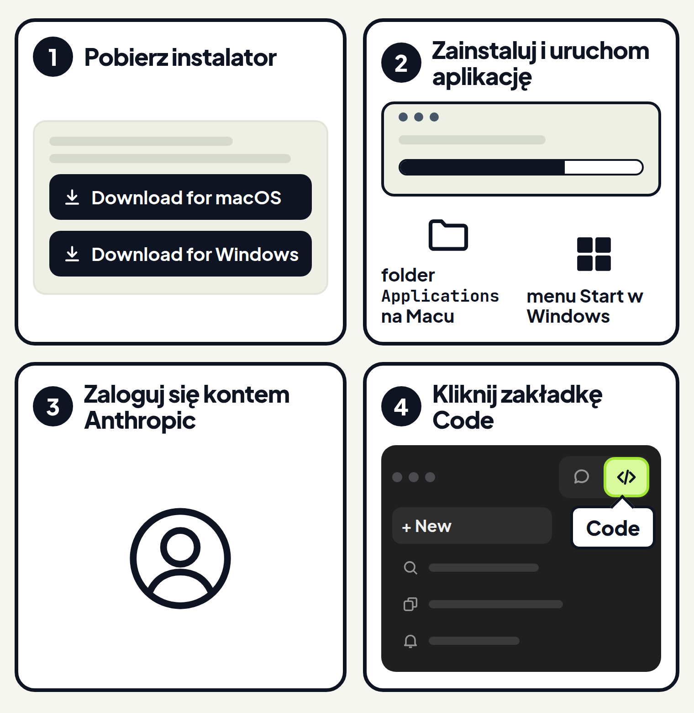
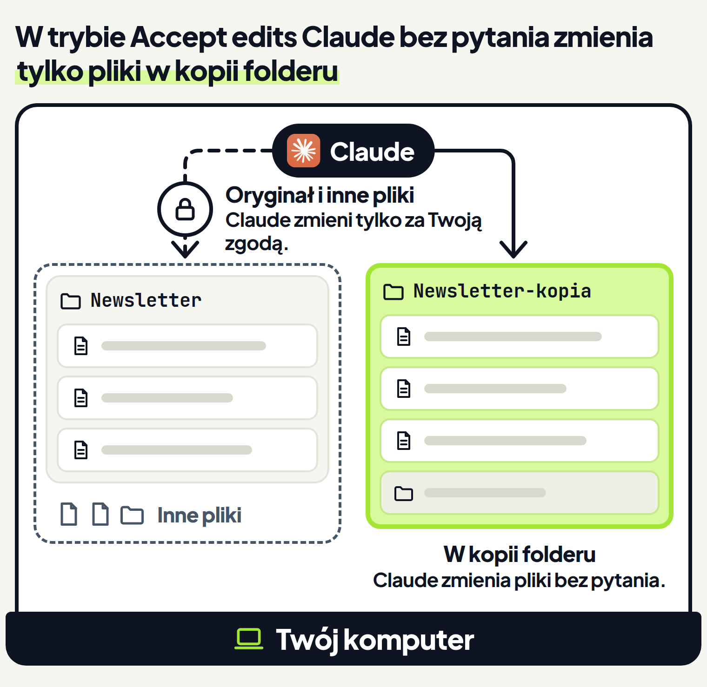
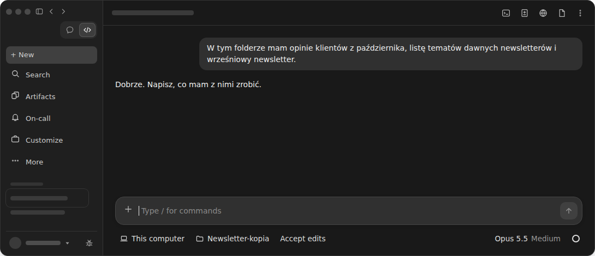
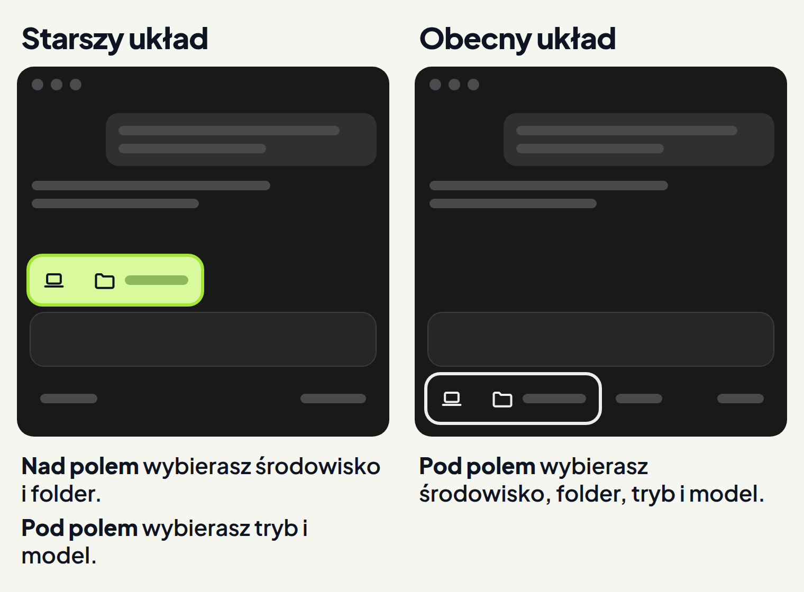
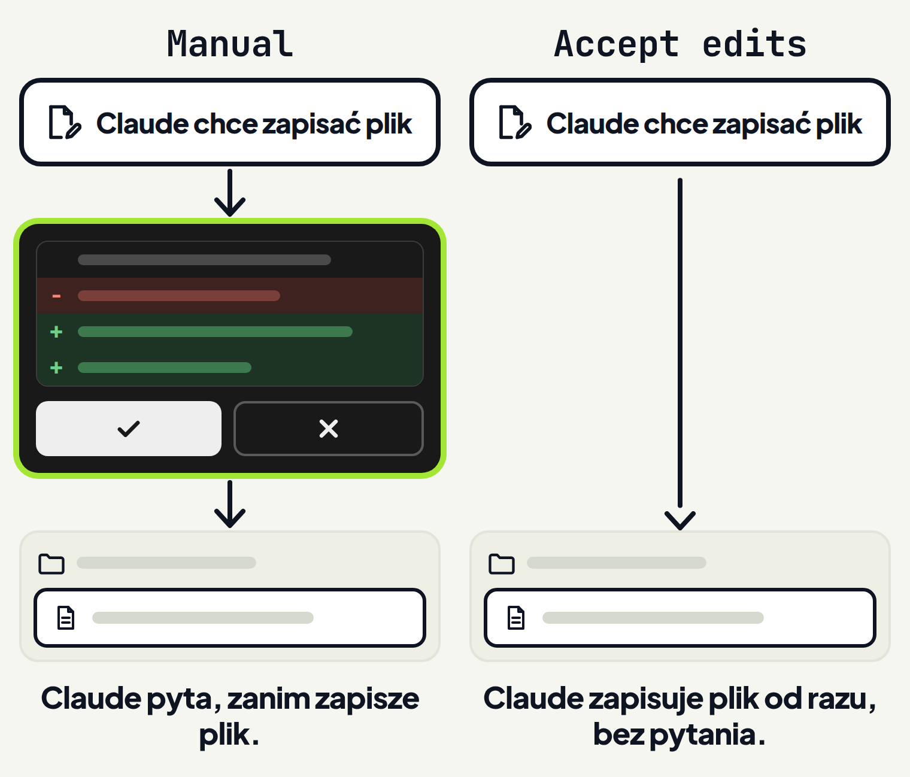
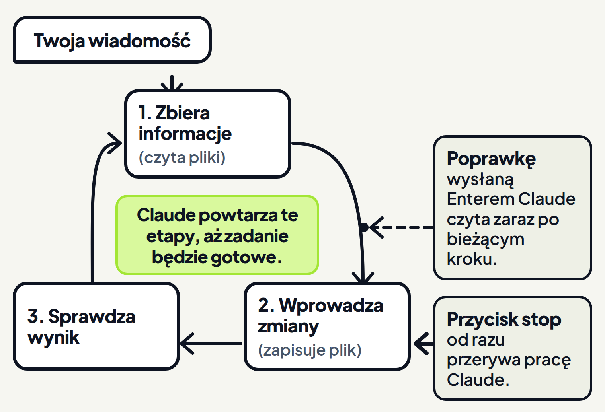
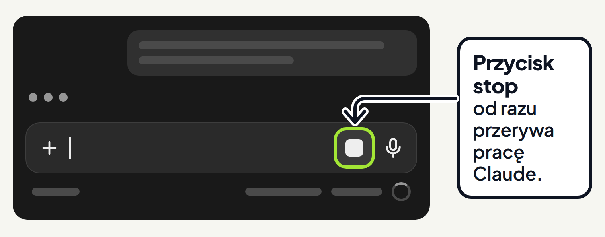
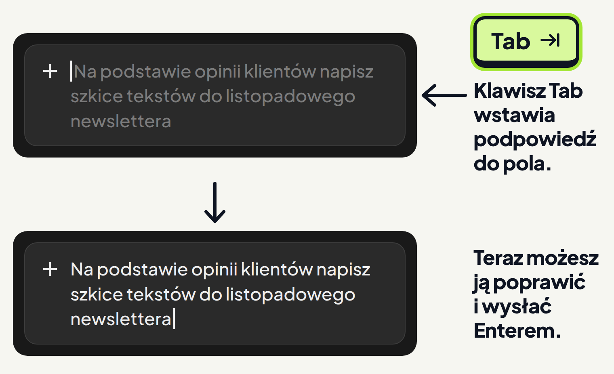

<em>Przewodnik po Claude Code · Moduł 0: Pierwsze kroki w aplikacji Claude · Lekcja 1 z 3</em>

# Instalacja i pierwsze zadanie

Prowadzisz sklep internetowy z odzieżą i szykujesz listopadowy newsletter. W folderze masz trzy pliki:

- opinie klientów z października,
- listę tematów dawnych newsletterów,
- wrześniowy newsletter.

Chcesz wybrać z opinii tematy, których jeszcze nie było w newsletterze.

W zwykłym czacie z AI sam przenosisz treść plików do rozmowy, a gotowy wynik sam zapisujesz w pliku.

Claude Code robi tę pracę wprost na plikach. Jest w aplikacji Claude na komputer, w zakładce Code. Możesz w niej prosić Claude o pracę w folderze na komputerze i oglądać zmiany, które wprowadził, bez terminala. <!-- fakt: aplikacja-bez-terminala -->

Dokumentacja opisuje pracę nad kodem, ale Claude Code pomaga też na przykład w pisaniu dokumentów. <!-- fakt: claude-code-pomaga-nie-tylko-w-kodzie-writing-docs --> <!-- fakt: aplikacja-ten-sam-silnik-co-w-terminalu -->

Po Twojej prośbie Claude czyta pliki z folderu i wprowadza w nich zmiany, a to, czy najpierw zapyta o zgodę, zależy od trybu. <!-- fakt: aplikacja-claude-czyta-pliki-i-zmienia-wedlug-trybu --> Umie też tworzyć nowe pliki. <!-- fakt: claude-code-tworzy-nowe-pliki --> <!-- fakt: aplikacja-ten-sam-silnik-co-w-terminalu -->

W tej lekcji:

1. zainstalujesz aplikację Claude i otworzysz zakładkę Code,
2. w ćwiczeniu dasz Claude pierwsze zadanie i zobaczysz, jak pracuje,
3. przygotujesz kopię folderu i ustawisz, gdzie Claude pracuje,
4. poprawisz Claude w trakcie pracy i dowiesz się, jak go zatrzymać,
5. sprawdzisz, co robić, gdy aplikacja nie działa.

Zaczynamy od instalacji. Ćwiczenia w ćwiczeniu zrobisz także bez niej.

## Zainstaluj aplikację i otwórz zakładkę Code

### Czego potrzebujesz

- Płatnego planu Claude: Pro, Max, Team albo Enterprise. <!-- fakt: plan-platny -->
- Komputera z macOS albo z Windows. Do pobrania są trzy instalatory: <!-- fakt: aplikacja-instalatory-macos-windows-arm64-linux-beta -->
  - jeden na macOS, dla procesorów Intel i Apple Silicon,
  - na Windows z procesorem x64,
  - osobny na Windows z procesorem ARM64.

Na Linuksie (Ubuntu i Debian) aplikacja jest w wersji beta, czyli testowej. Instaluje się ją przez apt (instalator programów na Linuksie) albo z pliku .deb. <!-- fakt: aplikacja-bez-terminala --> Ten kurs pokazuje aplikację na macOS i Windows.

### Krok po kroku

1. Otwórz [stronę dokumentacji o aplikacji](https://code.claude.com/docs/en/desktop-quickstart). Pobierz instalator dla swojego systemu i uruchom go. <!-- fakt: aplikacja-instalacja-macos-windows -->
2. Uruchom aplikację Claude. Na Macu znajdziesz ją w folderze Applications (Programy), w Windows w menu Start. <!-- fakt: aplikacja-uruchomienie-i-logowanie-kontem-anthropic -->
3. Zaloguj się kontem Anthropic. <!-- fakt: aplikacja-uruchomienie-i-logowanie-kontem-anthropic -->
4. Kliknij zakładkę Code u góry paska bocznego. <!-- fakt: aplikacja-zakladka-code-u-gory-paska-bocznego --> Gdy na pasku widać same ikony bez nazw, najedź myszą na ikonę, a pojawi się nazwa zakładki. <!-- fakt: aplikacja-zakladki-ikony-nazwa-po-najechaniu -->

W otwartej zakładce Code wybierasz folder z plikami i dajesz Claude zadanie. <!-- fakt: aplikacja-z-otwarta-zakladka-code-wybierasz-projekt-i-zadanie --> Jak to zrobić, pokazuje część „Rząd pod polem wiadomości: co ustawiasz i dlaczego”.

### Dzięki temu

- Claude Code to zakładka w tej samej aplikacji, w której rozmawiasz z Claude na czacie. <!-- fakt: aplikacja-code-to-zakladka-obok-czatu-i-cowork --> Jeśli rozmawiasz już z Claude w aplikacji na komputer, zakładkę Code znajdziesz właśnie w niej.
- Aplikacja zawiera Claude Code. Nie instalujesz więc Node.js (programu dla programistów) ani Claude Code do terminala. <!-- fakt: aplikacja-zawiera-claude-code-bez-nodejs-i-cli -->

### Gdy po kliknięciu Code pojawi się komunikat

- Prośba o wykupienie planu: zakładka Code wymaga płatnego planu, więc najpierw go wykup. <!-- fakt: aplikacja-code-prosba-o-plan --> <!-- fakt: plan-platny -->
- Prośba o zalogowanie online: dokończ logowanie i uruchom aplikację ponownie. <!-- fakt: aplikacja-code-prosba-o-logowanie-online -->
- Błąd 403 albo inny błąd logowania. Spróbuj kolejno: <!-- fakt: aplikacja-blad-403-cztery-kroki -->
  1. Wyloguj się i zaloguj ponownie z menu aplikacji. Ten sposób pomaga najczęściej.
  2. Sprawdź, czy Twój płatny plan jest aktywny.
  3. Sprawdź połączenie z internetem i ustawienia proxy (pośrednika w sieci).

Inne kłopoty z aplikacją opisuje część „Gdy aplikacja nie działa” na końcu lekcji.

W ćwiczeniu Claude pracuje na kopii folderu, Newsletter-kopia. Jak zrobić własną, pokażemy pod ćwiczeniem.

Zobaczysz, że po ustawieniu Local, folderu i trybu wystarczy napisać, co Claude ma zrobić, a sam przeczyta pliki z folderu i zapisze w nim nowy plik.

<!-- cwiczenie: cw1 -->

## Co tu się stało?

<!-- kolumny -->

#### Nowy plik

<!-- podglad: cw1 tematy -->

1. Najpierw Claude zbierał informacje: przeczytał opinie i listę dawnych tematów (karty z ikoną oka). <!-- fakt: claude-code-trzy-fazy-zadania --> <!-- fakt: aplikacja-ten-sam-silnik-co-w-terminalu -->
2. Potem wprowadził zmiany: w folderze pojawiła się nowa karta, tematy-listopad.txt.
3. Na końcu sprawdził wynik. W tym zadaniu przeczytał nowy plik.
4. Plik otworzysz, klikając jego ścieżkę w odpowiedzi Claude. <!-- fakt: aplikacja-klik-sciezki-w-rozmowie-otwiera-plik -->

#### Rząd pod polem wiadomości

1. W trybie Accept edits (przyjmowanie zmian) Claude sam stosuje zmiany w plikach, bez czekania na Twoją zgodę. <!-- fakt: aplikacja-accept-edits-auto-bez-czekania-na-zgode --> Dlatego nowy plik powstał bez pytania.
2. Ikona laptopa w ćwiczeniu to środowisko Local. Claude pracował na Twoim komputerze, z dostępem do Twoich plików. <!-- fakt: aplikacja-local-dziala-na-twoim-komputerze -->
3. Newsletter-kopia to folder, w którym Claude pracował w tej rozmowie. Claude czytał i zapisywał pliki w tym folderze. <!-- fakt: claude-code-dostep-do-folderu-i-podfolderow-reszta-za-zgoda --> <!-- fakt: aplikacja-ten-sam-silnik-co-w-terminalu -->

<!-- /kolumny -->

## Rząd pod polem wiadomości: co ustawiasz i dlaczego

### Zrób kopię folderu

Claude widzi pliki w folderze, który wskażesz, i w jego podfolderach. <!-- fakt: claude-code-dostep-do-folderu-i-podfolderow-reszta-za-zgoda --> <!-- fakt: aplikacja-ten-sam-silnik-co-w-terminalu -->

Narzędzia do plików, takie jak Read, pytają o zgodę, zanim otworzą plik spoza folderu rozmowy i folderów do niej dodanych. <!-- fakt: narzedzia-plikowe-pytaja-o-sciezki-poza-folderem-roboczym --> <!-- fakt: aplikacja-ten-sam-silnik-co-w-terminalu -->

Niektóre polecenia tylko do odczytu, na przykład ls i cat, Claude uruchamia bez pytania w każdym trybie. Dotyczy to także plików spoza folderu, chyba że ustawienia mówią inaczej. <!-- fakt: bash-polecenia-tylko-do-odczytu-bez-pytania --> <!-- fakt: aplikacja-ten-sam-silnik-co-w-terminalu -->

W tej lekcji wybierzesz tryb Accept edits (przyjmowanie zmian). W tym trybie Claude sam stosuje zmiany w plikach, bez czekania na Twoją zgodę. <!-- fakt: aplikacja-accept-edits-auto-bez-czekania-na-zgode -->

Robi to jednak tylko w folderze rozmowy i folderach do niej dodanych. <!-- fakt: accept-edits-edycje-w-folderze-bez-pytania --> <!-- fakt: accept-edits-polecenia-na-plikach --> <!-- fakt: aplikacja-ten-sam-silnik-co-w-terminalu -->

Dlatego daj mu kopię folderu. Oryginał leży poza kopią, więc bez Twojej zgody Claude go nie zmieni. <!-- fakt: accept-edits-polecenia-na-plikach --> <!-- fakt: aplikacja-ten-sam-silnik-co-w-terminalu -->

Na początek wybierz folder z kilkoma plikami, których treść pamiętasz. Dokumentacja radzi zacząć od małego projektu, który dobrze znasz: tak najszybciej zobaczysz, co potrafi Claude Code. <!-- fakt: aplikacja-rada-zacznij-od-malego-znanego-projektu -->

1. W Finderze (Mac) albo w Eksploratorze plików (Windows) skopiuj folder z plikami do zadania.
2. Do nazwy kopii dopisz „-kopia”, na przykład Newsletter-kopia. Od razu widać, na którym folderze pracuje Claude.

Kopia ma swoje granice:

- Chroni tylko pliki, które są w niej. Inne pliki na komputerze Claude traktuje tak samo jak oryginał. <!-- fakt: accept-edits-polecenia-na-plikach --> <!-- fakt: aplikacja-ten-sam-silnik-co-w-terminalu -->
- Pliki, które Claude utworzy w kopii, zostają w niej. Gotowy wynik przeniesiesz do oryginału sam.

### W aplikacji robisz to tak

Przed pierwszą wiadomością ustawiasz rząd przycisków pod polem wiadomości: środowisko, folder, tryb i model. <!-- fakt: aplikacja-rzad-pod-polem-srodowisko-folder-tryb-model -->

1. Kliknij pierwszy przycisk w rzędzie. To wybór środowiska, czyli miejsca, gdzie Claude pracuje. <!-- fakt: aplikacja-selektor-srodowiska-pierwsza-kontrolka --> Wybierz górną pozycję w grupie Local (lokalnie). <!-- fakt: aplikacja-local-gorna-pozycja-w-selektorze -->
2. Kliknij obok przycisk folderu. <!-- fakt: aplikacja-kontrolka-folderu-obok-selektora --> W jego menu wybierz pozycję, która otwiera folder, i wskaż kopię. <!-- fakt: aplikacja-open-folder-wskazuje-katalog-projektu -->
3. Kliknij przełącznik trybu i wybierz Accept edits. <!-- fakt: aplikacja-tryb-wybierasz-w-przelaczniku --> <!-- fakt: aplikacja-dostepne-tryby -->
4. Model zostaw taki, jaki jest. Możesz go zmienić później. <!-- fakt: aplikacja-model-prawa-czesc-rzedu-zmiana-pozniej -->
5. Wpisz zadanie w polu wiadomości i naciśnij <kbd>Enter</kbd>. <!-- fakt: aplikacja-enter-wysyla-zadanie -->

Pod polem wiadomości nie ma przycisku wyboru, gdzie Claude pracuje? Masz starszy układ aplikacji. <!-- fakt: aplikacja-wczesniejszy-uklad-brak-selektora -->

1. Do czasu aktualizacji środowisko i folder wybierasz nad polem wiadomości, a tryb i model pod nim. <!-- fakt: aplikacja-wczesniejszy-uklad-srodowisko-i-folder-nad-polem -->
2. Zaktualizuj aplikację starszą niż v2.37337.0: na Macu Claude > Check for Updates… (sprawdź aktualizacje), w Windows Help (pomoc) > Check for Updates…. <!-- fakt: aplikacja-wczesniejszy-uklad-aktualizacja -->
3. Po aktualizacji zacznij nową rozmowę w zakładce Code: dopiero ona skorzysta z nowszej wersji Claude Code. <!-- fakt: aplikacja-nowsza-wersja-check-for-updates-potem-nowa-sesja -->

Poniżej każde ustawienie po kolei.

### Środowisko: gdzie Claude pracuje

- **Po co.** Claude może pracować w różnych miejscach. Pierwszym przyciskiem w rzędzie wskazujesz mu to miejsce. <!-- fakt: aplikacja-selektor-srodowiska-pierwsza-kontrolka -->
- **Jak działa.** Do pracy na własnym komputerze wybierasz górną pozycję w grupie Local. <!-- fakt: aplikacja-local-gorna-pozycja-w-selektorze -->
- **Dzięki temu.** Środowisko Local działa na Twoim komputerze i ma bezpośredni dostęp do Twoich plików. <!-- fakt: aplikacja-local-dziala-na-twoim-komputerze -->
- **Ograniczenia.** Oprócz Local w wyborze są między innymi Cloud, SSH i WSL. W tym kursie zostajesz przy Local. Dla porządku: <!-- fakt: aplikacja-srodowiska-cloud-ssh-wsl -->
  - Cloud (chmura) działa domyślnie na komputerach Anthropic, a rozmowa trwa dalej po zamknięciu aplikacji,
  - SSH działa na innym komputerze, z którym łączysz się przez sieć,
  - WSL (tylko Windows) działa w osobnym systemie Linux na Twoim komputerze.

### Folder: na czym Claude pracuje

- **Po co.** Wyborem folderu wskazujesz, na czym Claude pracuje. Widzi pliki w tym folderze i w jego podfolderach. <!-- fakt: claude-code-dostep-do-folderu-i-podfolderow-reszta-za-zgoda --> <!-- fakt: aplikacja-ten-sam-silnik-co-w-terminalu --> Co z tego wynika dla pytań o zgodę, opisuje część „Zrób kopię folderu”.
- **Jak działa.** Klikasz przycisk folderu obok wyboru środowiska. W jego menu wybierasz pozycję, która otwiera folder, i wskazujesz właściwy folder. <!-- fakt: aplikacja-open-folder-wskazuje-katalog-projektu -->
- **Dzięki temu.** Każda rozmowa w zakładce Code ma własną historię i własny folder, niezależne od innych. <!-- fakt: aplikacja-sesja-ma-wlasna-historie-i-folder-projektu -->
- **Ograniczenia.** Komunikat „Failed to load session” (nie udało się wczytać rozmowy) może znaczyć dwie rzeczy: <!-- fakt: aplikacja-failed-to-load-session-folder-albo-uprawnienia -->
  - wybrany folder już nie istnieje, na przykład kopia została usunięta,
  - uprawnienia do plików blokują dostęp.

  Wybierz wtedy inny folder albo uruchom aplikację ponownie. <!-- fakt: aplikacja-failed-to-load-session-folder-albo-uprawnienia -->

### Tryb: czy Claude pyta o zgodę

- **Po co.** Zanim wyślesz zadanie, chcesz wiedzieć, czy Claude zapyta przed zmianą plików. Mówi Ci to tryb ustawiony w rzędzie. <!-- fakt: aplikacja-tryb-pod-polem-mowi-czy-claude-czeka-na-zgode -->
- **Jak działa.** Tryb zmieniasz w dowolnej chwili przełącznikiem trybu. <!-- fakt: aplikacja-przelacznik-pod-polem-wiadomosci --> W przełączniku wybierasz jeden z trybów: <!-- fakt: aplikacja-dostepne-tryby -->
  - Manual (ręczny): Claude pyta przed zmianą pliku i przed uruchomieniem polecenia na komputerze. Widzisz podgląd zmiany i każdą przyjmujesz albo odrzucasz. <!-- fakt: aplikacja-manual-podglad-i-przyciski -->
  - Accept edits: Claude bez pytania zmienia pliki i wykonuje typowe polecenia na plikach, na przykład tworzy folder albo przenosi plik. O inne polecenia nadal pyta. <!-- fakt: accept-edits-aplikacja-pyta-o-inne-polecenia -->
  - Plan i Auto: poznasz je w module 1. Auto nie u każdego jest na liście: pojawia się tylko wtedy, gdy ten tryb jest dla Ciebie dostępny. <!-- fakt: aplikacja-dostepne-tryby -->
- **Dzięki temu.** Na kopii folderu wybierasz Accept edits i patrzysz na pracę Claude bez klikania zgód na zmiany w plikach. Dokumentacja poleca ten tryb, gdy ufasz zmianom, które Claude wprowadza w plikach, i chcesz pracować szybciej. <!-- fakt: accept-edits-aplikacja-kiedy-uzywac --> Gdy chcesz samodzielnie zatwierdzać każdą zmianę, wybierasz Manual. <!-- fakt: aplikacja-zatwierdzanie-kazdej-zmiany-to-manual -->
- **Ograniczenia.** Aplikacja zapamiętuje tryb osobno dla każdego folderu, poza trybem Plan, który działa tylko w bieżącej rozmowie. <!-- fakt: aplikacja-tryb-wybierasz-w-przelaczniku --> Gdy Claude pracował już w tym folderze, zobaczysz tryb wybrany przy tamtej pracy, a nie ten z ćwiczenia: sprawdź go przed wysłaniem zadania.

Wcześniejsze wersje zakładki Code miały inne nazwy trybów, na przykład Ask permissions i Auto accept edits. <!-- fakt: aplikacja-wczesniejsze-nazwy-trybow -->

### Model

- **Po co.** Pracę Claude napędzają dwa składniki: modele, które rozumują, i narzędzia, które działają. <!-- fakt: claude-code-modele-rozumuja-narzedzia-dzialaja --> <!-- fakt: aplikacja-ten-sam-silnik-co-w-terminalu --> Narzędzia poznasz w części „Jak Claude pracuje”.
- **Jak działa.** Claude Code używa modeli Claude, żeby rozumieć kod i przemyśleć zadanie. <!-- fakt: claude-code-model-rozumie-kod-i-rozbija-zadanie-na-kroki --> <!-- fakt: aplikacja-ten-sam-silnik-co-w-terminalu -->
- **Dzięki temu.** Złożone zadanie Claude dzieli na kroki i je wykonuje, a dalsze kroki zmienia według tego, czego się dowie. <!-- fakt: claude-code-model-rozumie-kod-i-rozbija-zadanie-na-kroki --> <!-- fakt: aplikacja-ten-sam-silnik-co-w-terminalu -->

Model wybierasz w prawej części rzędu i możesz go zmienić później. <!-- fakt: aplikacja-model-prawa-czesc-rzedu-zmiana-pozniej --> Na początek zostaw ten, który jest ustawiony. Modele poznasz w module 6.

### Rozmowa, czyli sesja

Dokumentacja nazywa rozmowę z Claude w zakładce Code sesją. <!-- fakt: aplikacja-sesja-to-rozmowa-o-kodzie-wlasny-kontekst-i-zmiany -->

- **Po co.** Różne zadania prowadzisz w osobnych rozmowach, także kilka naraz. <!-- fakt: aplikacja-pasek-boczny-wylicza-sesje -->
- **Jak działa.** Na pasku bocznym widzisz listę swoich sesji. <!-- fakt: aplikacja-pasek-boczny-wylicza-sesje -->
- **Dzięki temu.** Rozmowy sobie nie przeszkadzają: każda sesja śledzi swój kontekst i swoje zmiany niezależnie od innych. <!-- fakt: aplikacja-sesja-sledzi-wlasne-zmiany-niezaleznie -->
- **Ograniczenia.** Nowa sesja zaczyna się bez historii rozmowy z poprzednich sesji. <!-- fakt: claude-code-sesje-niezalezne-nowa-z-pustym-kontekstem --> <!-- fakt: aplikacja-ten-sam-silnik-co-w-terminalu --> Ustalenia z innej rozmowy podaj w nowej jeszcze raz.

## Jak Claude pracuje

### Po co to wiedzieć

Zadanie z ćwiczenia wymagało kilku kroków: przeczytać dwa pliki, zapisać trzeci i go sprawdzić. Claude sam układa takie kroki jeden po drugim. O każdym następnym decyduje na podstawie tego, czego dowiedział się w poprzednim. <!-- fakt: claude-code-petla-dopasowuje-sie-do-zadania --> <!-- fakt: aplikacja-ten-sam-silnik-co-w-terminalu --> Gdy wiesz, w którym kroku jest Claude, wiesz też, kiedy i jak mu przerwać.

### Jak działa: trzy etapy

Dokumentacja opisuje pracę Claude w trzech etapach: <!-- fakt: claude-code-trzy-fazy-zadania --> <!-- fakt: aplikacja-ten-sam-silnik-co-w-terminalu -->

1. Zbiera informacje, na przykład czyta pliki.
2. Wprowadza zmiany, na przykład zapisuje nowy plik.
3. Sprawdza wynik.

Etapy mieszają się ze sobą i nie zawsze są potrzebne wszystkie trzy. <!-- fakt: claude-code-trzy-fazy-zadania --> <!-- fakt: aplikacja-ten-sam-silnik-co-w-terminalu --> Pytanie o pliki w folderze może wymagać samego zbierania informacji. <!-- fakt: claude-code-petla-dopasowuje-sie-do-zadania --> <!-- fakt: aplikacja-ten-sam-silnik-co-w-terminalu --> Etapy powtarzają się, aż zadanie będzie gotowe, a Ty możesz przerwać w każdej chwili. <!-- fakt: claude-code-petla-powtarza-sie-az-zadanie-gotowe-mozna-przerwac --> <!-- fakt: aplikacja-ten-sam-silnik-co-w-terminalu --> Dokumentacja nazywa to pętlą.

Pętla dopasowuje się do zadania. Gdy Claude naprawia błąd, przechodzi przez wszystkie trzy etapy wiele razy. <!-- fakt: claude-code-petla-dopasowuje-sie-do-zadania --> <!-- fakt: aplikacja-ten-sam-silnik-co-w-terminalu -->

### Narzędzia: czym Claude pracuje

Bez narzędzi Claude mógłby tylko odpowiadać tekstem. Dzięki narzędziom sam wykonuje pracę, zamiast tylko ją opisywać. <!-- fakt: claude-code-bez-narzedzi-tylko-tekst-z-narzedziami-dziala --> <!-- fakt: aplikacja-ten-sam-silnik-co-w-terminalu --> Ma między innymi narzędzia do:

- plików: czyta je, zmienia, tworzy nowe, zmienia nazwy i porządkuje, <!-- fakt: claude-code-tworzy-nowe-pliki --> <!-- fakt: aplikacja-ten-sam-silnik-co-w-terminalu -->
- szukania: znajduje pliki po wzorcu nazwy, na przykład wszystkie pliki .txt, i przeszukuje ich treść, <!-- fakt: claude-code-narzedzia-szukania-pliki-po-wzorcu --> <!-- fakt: aplikacja-ten-sam-silnik-co-w-terminalu -->
- uruchamiania poleceń na komputerze, <!-- fakt: claude-code-narzedzia-uruchamianie-polecen --> <!-- fakt: aplikacja-ten-sam-silnik-co-w-terminalu -->
- sieci: szuka w internecie i pobiera dokumentację. <!-- fakt: claude-code-narzedzia-siec --> <!-- fakt: aplikacja-ten-sam-silnik-co-w-terminalu -->

Pamiętasz z części o trybach: to, co Claude zrobi po Twojej prośbie, zależy od trybu. <!-- fakt: aplikacja-claude-czyta-pliki-i-zmienia-wedlug-trybu -->

### Dzięki temu: piszesz jak do człowieka

- Nie potrzebujesz idealnej prośby. Zaczynasz od tego, czego chcesz, i doprecyzowujesz w kolejnych wiadomościach. <!-- fakt: claude-code-rozmowa-nie-trzeba-idealnej-prosby --> <!-- fakt: aplikacja-ten-sam-silnik-co-w-terminalu -->
- Gdy pierwsza próba nie trafi, nie zaczynasz od nowa, tylko poprawiasz. <!-- fakt: claude-code-rozmowa-nie-trzeba-idealnej-prosby --> <!-- fakt: aplikacja-ten-sam-silnik-co-w-terminalu -->
- Podajesz kontekst i kierunek, a szczegóły zostawiasz Claude. <!-- fakt: claude-code-deleguj-kontekst-i-kierunek-bez-wymieniania-plikow --> <!-- fakt: aplikacja-ten-sam-silnik-co-w-terminalu --> Nie musisz wymieniać plików do przeczytania: Claude sam ustala, które przeczytać. <!-- fakt: claude-code-nie-trzeba-mowic-ktore-pliki-czytac --> <!-- fakt: aplikacja-ten-sam-silnik-co-w-terminalu --> W ćwiczeniu prośba nie podawała nazw plików z opiniami i z tematami, a Claude i tak je przeczytał.
- Nie wiesz, jak coś zrobić w Claude Code? Zapytaj o to Claude, a on wyjaśni. <!-- fakt: claude-code-mozna-zapytac-jak-z-niego-korzystac --> <!-- fakt: aplikacja-ten-sam-silnik-co-w-terminalu -->

### Ograniczenia

Opis etapów i narzędzi pochodzi ze strony dokumentacji o Claude Code w terminalu. Aplikacja działa na tym samym silniku, z oknami zamiast terminala. <!-- fakt: aplikacja-ten-sam-silnik-co-w-terminalu --> Interfejs zmienia to, jak widzisz Claude i jak z nim pracujesz, a pętla pod spodem jest identyczna. <!-- fakt: claude-code-interfejs-zmienia-widok-petla-identyczna -->

Ty też jesteś częścią pętli. W każdej chwili możesz skierować Claude inaczej, dodać informację albo poprosić o inne podejście. <!-- fakt: claude-code-ty-jestes-czescia-petli --> <!-- fakt: aplikacja-ten-sam-silnik-co-w-terminalu --> Tego uczy drugie ćwiczenie.

W drugim ćwiczeniu prosisz Claude o szkice tekstów do listopadowego newslettera. Claude zapowie trzy, w tym jeden niepotrzebny.

Zobaczysz, że poprawka wysłana w trakcie pracy działa dopiero po bieżącym kroku Claude.

<!-- cwiczenie: cw2 -->

## Co tu się stało?

<!-- kolumny -->

#### Z poprawką

<!-- podglad: cw2 z -->

1. Claude najpierw skończył bieżący krok, czyli szkic o dostawie. Poprawkę przeczytał dopiero potem. <!-- fakt: aplikacja-poprawka-enter-claude-czyta-po-biezacym-kroku -->
2. Ćwiczenie wysłało poprawkę klawiszem <kbd>Enter</kbd> i nie zatrzymało Claude. <!-- fakt: aplikacja-poprawka-enter-claude-czyta-po-biezacym-kroku -->
3. Nie trzeba było czekać do końca ani zaczynać od nowa. Powstały dwa szkice zamiast trzech. <!-- fakt: aplikacja-poprawka-bez-czekania-na-koniec-i-bez-startu-od-nowa -->

#### Bez poprawki

<!-- podglad: cw2 bez -->

1. Claude napisał wszystkie trzy szkice, które zapowiedział.
2. Trzeci szkic, o rozmiarach, jest niepotrzebny: o rozmiarach był wrześniowy newsletter.

<!-- /kolumny -->

## Poprawka i zatrzymanie

### Po co

Claude czasem zapowie albo zacznie coś, czego nie chcesz. W każdej chwili możesz go skierować inaczej. <!-- fakt: aplikacja-poprawka-bez-czekania-na-koniec-i-bez-startu-od-nowa -->

Masz na to dwa sposoby: poprawkę i zatrzymanie. Którąkolwiek drogę wybierzesz, nie musisz czekać do końca pracy ani zaczynać od nowa. <!-- fakt: aplikacja-poprawka-bez-czekania-na-koniec-i-bez-startu-od-nowa -->

### Jak działa poprawka

1. Gdy Claude pracuje, wpisz poprawkę w polu wiadomości.
2. Naciśnij <kbd>Enter</kbd>. Poprawka idzie do Claude, a bieżący krok się nie zatrzymuje. <!-- fakt: aplikacja-poprawka-enter-claude-czyta-po-biezacym-kroku -->
3. Claude czyta poprawkę zaraz po zakończeniu bieżącego kroku. Następny krok robi już według poprawki. <!-- fakt: aplikacja-poprawka-enter-claude-czyta-po-biezacym-kroku -->

Strona o terminalu opisuje to dokładniej. Gdy Claude używa narzędzi, czyta poprawkę zaraz po tym, jak z nich skorzysta. <!-- fakt: terminal-poprawka-enter-wiadomosc-w-kolejce-czytana-po-narzedziach --> <!-- fakt: aplikacja-ten-sam-silnik-co-w-terminalu -->

### Jak zatrzymać Claude

Ćwiczenie pokazuje tylko poprawkę. W aplikacji Claude zatrzymasz na dwa sposoby:

- przyciskiem stop, który przerywa pracę Claude od razu, <!-- fakt: aplikacja-przycisk-stop-przerywa-od-razu -->
- klawiszem <kbd>Esc</kbd>, który zatrzymuje odpowiedź Claude. <!-- fakt: aplikacja-esc-zatrzymuje-odpowiedz -->

Potem piszesz w polu wiadomości, co Claude ma zrobić dalej. Nie zaczynasz od nowa. <!-- fakt: aplikacja-poprawka-bez-czekania-na-koniec-i-bez-startu-od-nowa -->

### Dzięki temu

W ćwiczeniu poprawka oszczędziła Ci szkicu, który i tak trzeba by wyrzucić. To, co Claude zrobił dobrze, zostaje, bo nie zaczynasz od nowa. <!-- fakt: aplikacja-poprawka-bez-czekania-na-koniec-i-bez-startu-od-nowa -->

### Ograniczenia

Poprawka nie przerywa bieżącego kroku. <!-- fakt: aplikacja-poprawka-enter-claude-czyta-po-biezacym-kroku --> W ćwiczeniu szkic o dostawie powstał już po wysłaniu poprawki. Gdy zły jest właśnie ten krok, poprawka przyjdzie za późno.

Strona o terminalu mówi, że po przerwaniu klawiszem <kbd>Esc</kbd> Claude zachowuje pracę zrobioną do tej pory. <!-- fakt: terminal-esc-przerywa-claude-zachowuje-dotychczasowa-prace --> <!-- fakt: aplikacja-ten-sam-silnik-co-w-terminalu --> Jak sprawdzić i cofnąć zmiany, uczy lekcja 2.

## Kiedy zatrzymać Claude, a kiedy nie

<!-- kolumny -->

#### Zatrzymaj: przycisk stop albo Esc

1. Gdy Claude źle wykonuje bieżący krok. Przycisk stop przerywa pracę od razu. <!-- fakt: aplikacja-przycisk-stop-przerywa-od-razu -->
2. Gdy Claude źle zrozumiał całe zadanie i każdy dalszy krok byłby chybiony.

Po zatrzymaniu napisz, co Claude ma zrobić zamiast tego.

#### Napisz poprawkę: Enter

1. Gdy bieżący krok jest dobry, a chcesz zmienić kolejne kroki. Claude dokończy bieżący krok, a następny zrobi już według poprawki. <!-- fakt: aplikacja-poprawka-enter-claude-czyta-po-biezacym-kroku -->
2. Gdy chcesz dodać informację albo poprosić o inne podejście. <!-- fakt: claude-code-ty-jestes-czescia-petli --> <!-- fakt: aplikacja-ten-sam-silnik-co-w-terminalu -->
3. Tak jak w ćwiczeniu: zapowiedź była zła, ale pierwszy szkic był potrzebny.

<!-- /kolumny -->

## Szary tekst w polu wiadomości

Po odpowiedzi Claude w pustym polu wiadomości może pojawić się szary tekst. To podpowiedź Twojej następnej wiadomości. <!-- fakt: aplikacja-podpowiedz-polecenia-szary-tekst-w-pustym-polu --> Nie jest to Twoja wiadomość i nic jeszcze nie zostało wysłane:

1. Klawisz <kbd>Tab</kbd> albo strzałka w prawo wstawia podpowiedź do pola. Możesz ją wtedy poprawić i wysłać klawiszem <kbd>Enter</kbd>. <!-- fakt: aplikacja-podpowiedz-tab-wstawia-pisanie-zastepuje -->
2. Gdy zaczniesz pisać własną wiadomość, podpowiedź znika. <!-- fakt: aplikacja-podpowiedz-tab-wstawia-pisanie-zastepuje -->

Dzięki temu propozycję następnej wiadomości przyjmujesz jednym klawiszem, zamiast ją przepisywać. <!-- fakt: aplikacja-podpowiedz-tab-wstawia-pisanie-zastepuje -->

Żeby przygotować podpowiedź, aplikacja wysyła w tle krótkie zapytanie. Każde takie zapytanie liczy się do limitu Twojego planu. <!-- fakt: aplikacja-podpowiedz-polecenia-szary-tekst-w-pustym-polu -->

Podpowiedzi wyłączysz w Settings (ustawienia) > Claude Code. W grupie Sessions (sesje) znajdź wyłącznik Prompt suggestions (podpowiedzi wiadomości). Zmiana działa od następnego uruchomienia albo wznowienia sesji. <!-- fakt: aplikacja-podpowiedz-wylaczenie-w-ustawieniach -->

## Gdy aplikacja nie działa

- Pusty albo zawieszony ekran po uruchomieniu: zamknij aplikację i uruchom ją ponownie. Na macOS i Windows aplikacja przy uruchomieniu sama się aktualizuje. <!-- fakt: aplikacja-pusty-ekran-po-uruchomieniu-restart-i-aktualizacje -->
- Aplikacja nie chce się zamknąć? Na Macu naciśnij <kbd>Cmd</kbd>+<kbd>Q</kbd>. Gdy aplikacja nie odpowiada, naciśnij <kbd>Cmd</kbd>+<kbd>Option</kbd>+<kbd>Esc</kbd>, wybierz Claude i kliknij Force Quit (wymuś zamknięcie). <!-- fakt: aplikacja-nie-chce-sie-zamknac-macos-windows --> W Windows otwórz Menedżer zadań skrótem <kbd>Ctrl</kbd>+<kbd>Shift</kbd>+<kbd>Esc</kbd> i zakończ w nim proces Claude. <!-- fakt: aplikacja-nie-chce-sie-zamknac-macos-windows -->
- Instalator w Windows pokazuje błąd o innej trwającej instalacji, choć żadnej nie ma: spróbuj uruchomić instalator jako administrator. <!-- fakt: aplikacja-windows-blad-rownoczesnej-instalacji -->
- Aplikacja w Windows prosi o Git (program dla programistów), zanim zacznie sesję? Wersje starsze niż 1.49585.0 prosiły o niego przed każdą sesją w środowisku Local. Gdy widzisz taką prośbę i nie używasz worktree, zaktualizuj aplikację. <!-- fakt: aplikacja-windows-starsza-wersja-pyta-o-git --> W tym kursie worktree nie używasz.
- Wersję aplikacji sprawdzisz pod pozycją About Claude (o aplikacji Claude): na Macu w menu Claude, w Windows w menu Help. <!-- fakt: aplikacja-wersja-aplikacji-about-claude --> Przyda się, gdy sprawdzasz, czy aplikacja nie jest starsza niż v2.37337.0, czyli czy masz starszy układ. <!-- fakt: aplikacja-wczesniejszy-uklad-aktualizacja --> Podasz ją też, gdy zgłaszasz problem. <!-- fakt: aplikacja-prosba-o-pomoc-co-podac --> Numer wersji skopiujesz do schowka, klikając go. <!-- fakt: aplikacja-numer-wersji-kopiuje-sie-klikniecie -->
- Pomoc znajdziesz w aplikacji: Help > Get Support (uzyskaj pomoc). Możesz też wejść wprost na [stronę pomocy Claude](https://support.claude.com/). <!-- fakt: aplikacja-pomoc-get-support-albo-centrum-pomocy --> O instalacji piszą [artykuły pomocy o aplikacji Claude na komputer](https://support.claude.com/en/collections/16163169-claude-desktop). <!-- fakt: aplikacja-pomoc-centrum-pomocy-i-artykuly-o-instalacji -->

Gdy zgłaszasz problem, podaj: <!-- fakt: aplikacja-prosba-o-pomoc-co-podac -->

- wersję aplikacji,
- system operacyjny,
- dokładny tekst błędu,
- logi, czyli zapis działania aplikacji, jeśli dotyczą problemu.

## Źródła

- [Pierwsze kroki z aplikacją na komputer](https://code.claude.com/docs/en/desktop-quickstart)
- [Aplikacja Claude na komputer](https://code.claude.com/docs/en/desktop)
- [Jak działa Claude Code](https://code.claude.com/docs/en/how-claude-code-works)
- [Tryb interaktywny](https://code.claude.com/docs/en/interactive-mode)
- [Tryby uprawnień](https://code.claude.com/docs/en/permission-modes)
- [Narzędzia Claude Code](https://code.claude.com/docs/en/tools-reference)
- [Uprawnienia](https://code.claude.com/docs/en/permissions)

Sprawdzone 26.10.2026, Claude Code 2.1.310.
