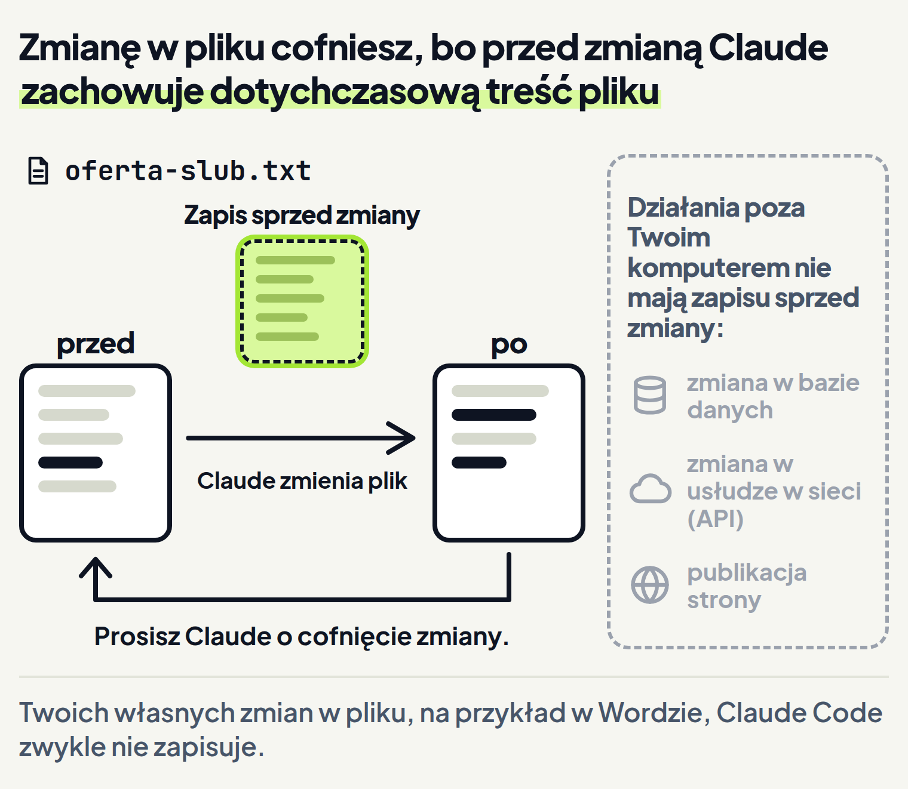
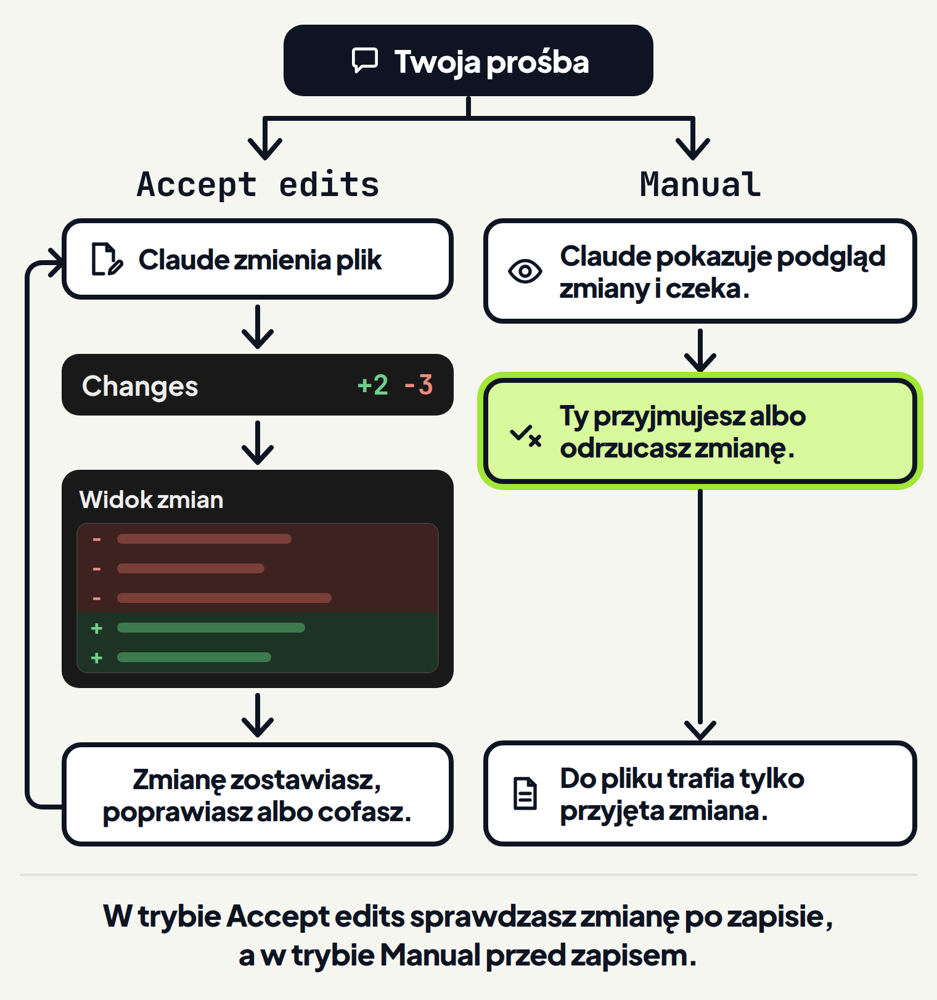
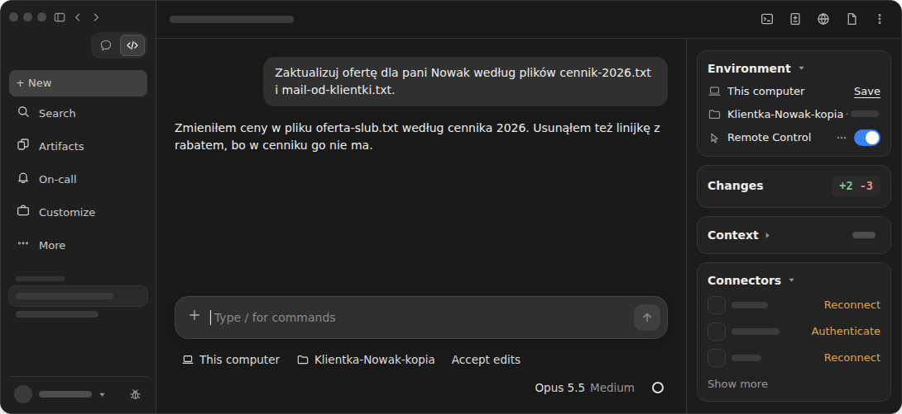

<em>Przewodnik po Claude Code · Moduł 0: Pierwsze kroki w aplikacji Claude · Lekcja 2 z 3</em>

# Sprawdź i cofnij zmiany

Fotografka ślubna przygotowuje ofertę dla pani Anny Nowak. Rok temu robiła jej sesję narzeczeńską, więc pani Nowak jest stałą klientką. W folderze Klientka-Nowak-kopia leżą trzy pliki:

- stara oferta dla pani Nowak,
- cennik na 2026 rok,
- mail od klientki z prośbą o ofertę na ślub.

Fotografka prosi Claude, żeby zaktualizował ofertę według cennika i maila. Claude zmienia ofertę i odpowiada dwoma zdaniami. Przy okazji usuwa linijkę z rabatem dla stałych klientów, choć nikt o to nie prosił.

Claude nie pyta o zgodę, bo pod polem wiadomości jest włączony tryb Accept edits (przyjmowanie zmian). <!-- fakt: aplikacja-przelacznik-pod-polem-wiadomosci --> W tym trybie Claude sam zmienia pliki. <!-- fakt: accept-edits-aplikacja-pyta-o-inne-polecenia -->

Dwa zdania odpowiedzi łatwo przebiec wzrokiem i nie zauważyć wzmianki o rabacie. Jeśli nikt nie sprawdzi pliku, oferta pójdzie do stałej klientki bez rabatu.

Ta lekcja uczy, jak tego uniknąć. W aplikacji obejrzysz zmiany, które zrobił Claude, bez terminala. <!-- fakt: aplikacja-przeglad-zmian-bez-terminala --> Zmianę, której nie chcesz, cofniesz zwykłą prośbą do Claude. <!-- fakt: terminal-mozna-poprosic-claude-o-cofniecie --> <!-- fakt: aplikacja-ten-sam-silnik-co-w-terminalu -->

W tej lekcji:

1. otworzysz widok zmian i znajdziesz zmianę, o którą nikt nie prosił,
2. poprawisz jedną linijkę albo cofniesz całą zmianę i sprawdzisz plik,
3. dowiesz się, czego cofnięcie nie obejmuje,
4. dowiesz się, jak sprawdzać zmiany, zanim trafią do pliku.

W pierwszym ćwiczeniu poprosisz Claude o aktualizację oferty. W widoku zmian zobaczysz linijki, które Claude usunął i dodał, także rabat, o którym prośba nie mówiła.

<!-- cwiczenie: cw1 -->

## Co tu się stało?

<!-- kolumny -->

#### W rozmowie

1. Claude przeczytał trzy pliki, które podświetliły się pod oknem, i zmienił plik oferty. <!-- fakt: aplikacja-claude-czyta-pliki-i-zmienia-wedlug-trybu -->
2. Nie pytał o zgodę, bo działał tryb Accept edits. <!-- fakt: accept-edits-aplikacja-pyta-o-inne-polecenia -->
3. O usunięciu rabatu zdecydował sam i wspomniał o tym jednym zdaniem.

#### W widoku zmian

1. Gdy Claude zmienił plik, w panelu obok rozmowy, na karcie Changes (zmiany), pojawiły się liczby +2 -3. <!-- fakt: aplikacja-auto-i-accept-edits-licznik-do-przegladu-w-widoku-zmian -->
2. Kliknięcie liczb otworzyło widok zmian z plikiem oferta-slub.txt. <!-- fakt: aplikacja-widok-zmian-liczby-na-karcie-changes -->
3. Zniknęły trzy linijki: dwie stare ceny i rabat. Doszły dwie: nowe ceny.

<!-- /kolumny -->

## Widok zmian: po co jest i jak go otworzyć

### Po co jest

W ćwiczeniu odpowiedź Claude streszczała pracę w dwóch zdaniach. Gdy zmian jest dużo albo dotyczą kilku plików, łatwo przeoczyć tę, o którą nikt nie prosił.

Widok zmian pokazuje zmiany w samych plikach. <!-- fakt: aplikacja-widok-zmian-przeglad-modyfikacji-plik-po-pliku --> Dokumentacja poleca aplikację między innymi wtedy, gdy chcesz obejrzeć zmiany na ekranie. <!-- fakt: aplikacja-polecana-do-wizualnego-przegladu-zmian -->

### Jak działa

W trybach Accept edits i Auto po zmianach w plikach pojawiają się liczby, na przykład +12 -1, a po ich kliknięciu przejrzysz te zmiany. <!-- fakt: aplikacja-auto-i-accept-edits-licznik-do-przegladu-w-widoku-zmian --> <!-- fakt: aplikacja-widok-zmian-liczby-na-karcie-changes -->

Liczby stoją na karcie Changes w panelu obok rozmowy. <!-- fakt: aplikacja-widok-zmian-liczby-na-karcie-changes --> Karty tego panelu pokazują między innymi, co Claude zmienił w tej rozmowie. <!-- fakt: aplikacja-panel-szczegolow-sesji-karty-obok-czatu -->

Obie liczby liczą linijki. <!-- fakt: aplikacja-widok-zmian-liczby-na-karcie-changes --> Liczba z plusem mówi, ile linijek doszło, a liczba z minusem, ile zniknęło.

Widok zmian to osobna część zakładki Code, tak jak rozmowa. <!-- fakt: aplikacja-widok-zmian-to-jeden-z-paneli-zakladki-code --> Otwierasz go na trzy sposoby:

1. Kliknij liczby na karcie Changes. <!-- fakt: aplikacja-widok-zmian-liczby-na-karcie-changes -->
2. Albo kliknij przycisk Changes na pasku tytułu rozmowy. <!-- fakt: aplikacja-widok-zmian-przycisk-changes-na-pasku-tytulu --> Jeśli nie wiesz, który to przycisk, najedź na niego myszą: pokaże się nazwa Changes. Gdy okno jest wąskie, przyciski, które się nie mieszczą, przechodzą do menu ⋮. <!-- fakt: aplikacja-przyciski-paneli-nazwa-po-najechaniu-menu-przy-waskim-oknie -->
3. Albo naciśnij skrót: Cmd+Shift+D na Macu, Ctrl+Shift+D w Windows. Ten sam skrót zamyka widok zmian. <!-- fakt: aplikacja-skrot-przelaczania-widoku-zmian-windows -->

Czytaj uważnie zwłaszcza linijki, które zniknęły. W ćwiczeniu właśnie wśród nich był rabat.

Nie widzisz karty Changes? Co wtedy zrobić, opisuje ostatnia część lekcji, „Nie widzisz karty Changes”.

### Dzięki temu

Przeglądasz zmienione pliki jeden po drugim, także zmianę, o której Claude napisał tylko jednym zdaniem. <!-- fakt: aplikacja-widok-zmian-przeglad-modyfikacji-plik-po-pliku --> Zanim oferta pójdzie do klientki, wiesz, co w niej jest.

### Ograniczenia

Liczby i widok zmian pokazują tylko zmiany z tej rozmowy. Zmian z innych rozmów tu nie zobaczysz. <!-- fakt: aplikacja-sesja-sledzi-wlasne-zmiany-niezaleznie -->

Rabat musi wrócić, bo pani Nowak jest stałą klientką. Możesz poprosić Claude o poprawkę jednej linijki albo o cofnięcie całej zmiany. W drugim ćwiczeniu przejdziesz obie drogi. Po poprawce jednej linijki w pliku zostają nowe ceny i wraca rabat. Po cofnięciu całej zmiany wraca dawna oferta, razem ze starymi cenami.

<!-- cwiczenie: cw2 -->

## Co tu się stało?

<!-- kolumny -->

#### Popraw jedną linijkę

<!-- podglad: cw2 popraw -->

1. Prośba mówiła, co ma wrócić (rabat), a co zostać (nowe ceny). W prawdziwej aplikacji wysyłasz ją klawiszem <kbd>Enter</kbd>. <!-- fakt: aplikacja-enter-wysyla-zadanie -->
2. Claude przywrócił tylko rabat.
3. W pliku są ceny z cennika 2026 i rabat.

#### Cofnij całą zmianę

<!-- podglad: cw2 cofnij -->

1. Prośba mówiła, żeby cofnąć wszystkie zmiany w ofercie.
2. Claude cofnął wszystkie swoje zmiany w ofercie.
3. Rabat wrócił, ale razem z nim wróciły stare ceny.

<!-- /kolumny -->

W obu drogach plik otwierasz kliknięciem ścieżki oferta-slub.txt w odpowiedzi Claude. Tą drogą otworzysz plik, o którym Claude wspomina w rozmowie. <!-- fakt: aplikacja-klik-sciezki-w-rozmowie-otwiera-plik --> Odpowiedź mówi, co Claude zrobił. Plik pokazuje, co naprawdę w nim jest.

## Cofanie zmian: co da się cofnąć, a czego nie

### Po co jest

Claude czasem zrobi coś, czego nie chcesz: usunie potrzebną linijkę albo źle zrozumie prośbę. Claude Code pozwala wtedy szybko cofnąć zmianę i wrócić do wersji pliku sprzed zmiany. <!-- fakt: claude-code-sam-sledzi-zmiany-plikow-claude --> <!-- fakt: claude-code-mozliwosci-te-same-w-kazdym-miejscu-pracy -->

Dokumentacja wymienia sytuacje, w których to się przydaje. <!-- fakt: punkty-zapisu-naprawa-pomylek-i-proby-wariantow --> <!-- fakt: claude-code-mozliwosci-te-same-w-kazdym-miejscu-pracy --> Oto trzy z nich:

- szybko cofasz zmianę, która coś zepsuła,
- próbujesz innego sposobu i nie tracisz punktu wyjścia,
- zmieniasz coś na próbę, bo wiesz, że możesz wrócić do wersji, która działała.

### Jak działa

Dokumentacja opisuje cofanie na stronach o samym Claude Code, nie na stronie o aplikacji. Aplikacja działa na tym samym silniku, więc mechanizm cofania jest w niej ten sam. <!-- fakt: aplikacja-ten-sam-silnik-co-w-terminalu -->

Zanim Claude zmieni plik, zachowuje jego dotychczasową zawartość, żeby w razie potrzeby dało się zmianę cofnąć. <!-- fakt: claude-code-przed-zmiana-kodu-zapisuje-stan-zmienianych-plikow --> <!-- fakt: terminal-przed-edycja-claude-zapisuje-zawartosc-pliku --> <!-- fakt: claude-code-mozliwosci-te-same-w-kazdym-miejscu-pracy --> Ten zapis sprzed zmiany dokumentacja nazywa punktem zapisu (checkpoint). <!-- fakt: claude-code-dwa-zabezpieczenia-punkty-zapisu-i-uprawnienia --> <!-- fakt: claude-code-mozliwosci-te-same-w-kazdym-miejscu-pracy -->

Claude Code śledzi zmiany, które Claude robi w plikach swoimi narzędziami do edycji, na przykład wtedy, gdy zmienia treść pliku, tak jak ofertę w ćwiczeniu. <!-- fakt: claude-code-sledzi-wszystkie-zmiany-narzedzi-do-edycji-plikow --> <!-- fakt: claude-code-mozliwosci-te-same-w-kazdym-miejscu-pracy -->

W aplikacji cofasz zmianę prośbą. Dokumentacja radzi, gdy coś pójdzie źle, poprosić Claude o cofnięcie. <!-- fakt: terminal-mozna-poprosic-claude-o-cofniecie --> <!-- fakt: aplikacja-ten-sam-silnik-co-w-terminalu -->

W polu wiadomości napisz, co Claude ma cofnąć: całą zmianę („Cofnij wszystkie zmiany w ofercie”) albo jedną linijkę („Przywróć rabat. Nowe ceny zostaw”). Potem otwórz plik tak jak w drugim ćwiczeniu i sprawdź, co w nim jest. <!-- fakt: aplikacja-klik-sciezki-w-rozmowie-otwiera-plik -->

### Dzięki temu

Złą zmianę cofniesz, więc możesz śmielej zlecać Claude większe zmiany, na przykład przeróbkę całej oferty. <!-- fakt: punkty-zapisu-naprawa-pomylek-i-proby-wariantow --> <!-- fakt: claude-code-mozliwosci-te-same-w-kazdym-miejscu-pracy -->

Punkty zapisu zostają także wtedy, gdy później znów otworzysz tę rozmowę z listy rozmów na pasku bocznym. <!-- fakt: punkty-zapisu-sa-niezalezne-od-gita-i-zostaja-po-wznowieniu-rozmowy --> <!-- fakt: aplikacja-pasek-boczny-wylicza-sesje --> <!-- fakt: claude-code-mozliwosci-te-same-w-kazdym-miejscu-pracy --> Nie zostają jednak na zawsze: domyślnie znikają około 30 dni po ostatnim zapisie w tej rozmowie, a cofnięcie do zapisu, którego już nie ma, może się nie udać. <!-- fakt: punkty-zapisu-migawki-znikaja-po-okolo-30-dniach --> <!-- fakt: claude-code-mozliwosci-te-same-w-kazdym-miejscu-pracy -->

<!-- analogia: To jak zapis gry przed trudnym poziomem: gdy coś pójdzie źle, wracasz do zapisu. Taki zapis obejmuje jednak tylko pliki na Twoim komputerze. Opublikowanej strony ani zmiany w bazie danych nie cofnie. -->

### Ograniczenia

- Punkty zapisu obejmują tylko zmiany w plikach. <!-- fakt: terminal-checkpointy-obejmuja-tylko-zmiany-w-plikach --> <!-- fakt: aplikacja-ten-sam-silnik-co-w-terminalu -->
- Claude Code śledzi tylko pliki, które Claude zmieniał w tej rozmowie. Twoich własnych zmian w plikach poza Claude Code, na przykład w Wordzie, ani zmian z innych rozmów prowadzonych w tym samym czasie zwykle nie zapisuje. <!-- fakt: punkty-zapisu-nie-obejmuja-recznych-zmian-poza-claude-code --> <!-- fakt: claude-code-mozliwosci-te-same-w-kazdym-miejscu-pracy -->
- Plik, który Claude zmienił tylko poleceniem terminala, a nie narzędziem do edycji, nie jest śledzony i zostaje taki, jaki jest. <!-- fakt: punkty-zapisu-plik-zmieniony-tylko-poleceniami-bash-nie-jest-sledzony --> <!-- fakt: claude-code-mozliwosci-te-same-w-kazdym-miejscu-pracy --> Takim poleceniem Claude na przykład przenosi plik (lekcja 1). <!-- fakt: accept-edits-aplikacja-pyta-o-inne-polecenia -->
- Punkty zapisu służą do szybkiego cofania w trakcie rozmowy. Nie są trwałą historią wersji plików. <!-- fakt: punkty-zapisu-to-szybkie-odzyskiwanie-w-sesji-nie-trwala-historia --> <!-- fakt: claude-code-mozliwosci-te-same-w-kazdym-miejscu-pracy --> Trwałym zabezpieczeniem zostaje kopia folderu, taka jak w lekcji 1. W ćwiczeniach Claude pracuje na folderze Klientka-Nowak-kopia, a oryginał leży nietknięty.

Działania, które zmieniają coś poza Twoim komputerem, nie mają zapisu sprzed zmiany. <!-- fakt: punkty-zapisu-dzialan-na-zdalnych-systemach-pilnujesz-trybem-uprawnien --> <!-- fakt: claude-code-mozliwosci-te-same-w-kazdym-miejscu-pracy --> Dokumentacja wymienia:

- zmiany w bazach danych,
- zmiany w usługach w sieci, z którymi Claude łączy się przez API (połączenie między programami),
- publikację, na przykład strony w internecie.

## Kiedy cofnąć całą zmianę, a kiedy nie

<!-- kolumny -->

#### Cofnij całą zmianę

1. Cała zmiana jest zła, na przykład Claude zmienił nie tę ofertę.
2. Zmian jest dużo i prościej zacząć od nowa, niż poprawiać każdą.
3. Pamiętaj: znikną też dobre zmiany, jak nowe ceny w ćwiczeniu.

#### Popraw jedną linijkę

1. Prawie wszystko pasuje, a źle jest w jednym miejscu.
2. W prośbie napisz, co ma wrócić, a co zostać.
3. Dobre zmiany zostają w pliku.

<!-- /kolumny -->

## Sprawdzanie zmian, zanim trafią do pliku: tryb Manual

### Po co jest

Widok zmian i cofanie działają po fakcie: zmiana jest już w pliku. Czasem wolisz zobaczyć zmianę, zanim trafi do pliku.

Claude Code ma dwa zabezpieczenia. Punkty zapisu pozwalają cofnąć zmiany w plikach. Uprawnienia, między innymi tryb wybrany w przełączniku pod polem wiadomości, decydują, co Claude może zrobić bez pytania. <!-- fakt: claude-code-dwa-zabezpieczenia-punkty-zapisu-i-uprawnienia --> <!-- fakt: claude-code-mozliwosci-te-same-w-kazdym-miejscu-pracy --> <!-- fakt: aplikacja-przelacznik-pod-polem-wiadomosci -->

Działania, które zmieniają coś poza Twoim komputerem, kontrolujesz trybem uprawnień. <!-- fakt: punkty-zapisu-dzialan-na-zdalnych-systemach-pilnujesz-trybem-uprawnien --> <!-- fakt: claude-code-mozliwosci-te-same-w-kazdym-miejscu-pracy -->

### Jak działa

Przełącznik trybu znasz z lekcji 1: stoi w rzędzie pod polem wiadomości i zmieniasz nim tryb w dowolnej chwili. <!-- fakt: aplikacja-przelacznik-pod-polem-wiadomosci --> Tryb Manual (ręczny) też znasz z lekcji 1. Do sprawdzania zmian przed zapisem użyjesz go tak:

1. Kliknij przełącznik trybu i wybierz Manual. <!-- fakt: aplikacja-tryb-wybierasz-w-przelaczniku --> <!-- fakt: aplikacja-zatwierdzanie-kazdej-zmiany-to-manual -->
2. Wyślij prośbę. Przy każdej zmianie zobaczysz jej podgląd i przyciski, którymi ją przyjmujesz albo odrzucasz. <!-- fakt: aplikacja-manual-podglad-i-przyciski --> <!-- fakt: aplikacja-manual-przyciski-zatwierdzania -->
3. Zmiana trafia do pliku dopiero po Twojej zgodzie. <!-- fakt: tryb-manual-aplikacja-czeka-na-zatwierdzenie -->

### Dzięki temu

Złą zmianę odrzucasz, zanim trafi do pliku, więc nie ma czego cofać. <!-- fakt: tryb-manual-aplikacja-czeka-na-zatwierdzenie -->

### Ograniczenia

Przy każdej zmianie Claude czeka na Ciebie, więc praca idzie wolniej. <!-- fakt: tryb-manual-aplikacja-czeka-na-zatwierdzenie --> Dokumentacja radzi wybrać tryb Accept edits, gdy ufasz zmianom, które Claude wprowadza w plikach, i chcesz pracować szybciej. <!-- fakt: accept-edits-aplikacja-kiedy-uzywac -->

Aplikacja zapamiętuje tryb dla folderu, więc Manual zostanie włączony także w kolejnych rozmowach w tym folderze, dopóki go nie zmienisz. <!-- fakt: aplikacja-tryb-wybierasz-w-przelaczniku -->

Wszystkie tryby poznasz w module 1.

## Nie widzisz karty Changes

- Panel obok rozmowy pojawia się po rozpoczęciu rozmowy, gdy jest na niego dość miejsca. <!-- fakt: aplikacja-panel-szczegolow-sesji-karty-obok-czatu -->
- Jeśli panel jest schowany, kliknij przycisk Show session rail (pokaż panel) na pasku tytułu rozmowy. Przycisk Hide session rail (schowaj panel) chowa go z powrotem. Oba znajdziesz też w menu ⋮ tego paska. <!-- fakt: aplikacja-panel-szczegolow-ukryj-i-pokaz -->
- Jeśli pod polem wiadomości nie ma przycisku wyboru, gdzie Claude pracuje, masz wcześniejszy układ aplikacji. <!-- fakt: aplikacja-wczesniejszy-uklad-brak-selektora --> W tym układzie nie ma panelu obok rozmowy. <!-- fakt: aplikacja-wczesniejszy-uklad-nie-ma-panelu-szczegolow -->
- Przy wcześniejszym układzie zaktualizuj aplikację do wersji v2.37337.0 lub nowszej: Claude > Check for Updates… na Macu albo Help > Check for Updates… w Windows. <!-- fakt: aplikacja-wczesniejszy-uklad-aktualizacja -->

## Źródła

- [Aplikacja Claude na komputer](https://code.claude.com/docs/en/desktop)
- [Pierwsze kroki w aplikacji na komputer](https://code.claude.com/docs/en/desktop-quickstart)
- [Jak działa Claude Code](https://code.claude.com/docs/en/how-claude-code-works)
- [Punkty zapisu](https://code.claude.com/docs/en/checkpointing)

Sprawdzone 26.10.2026, Claude Code 2.1.310.
