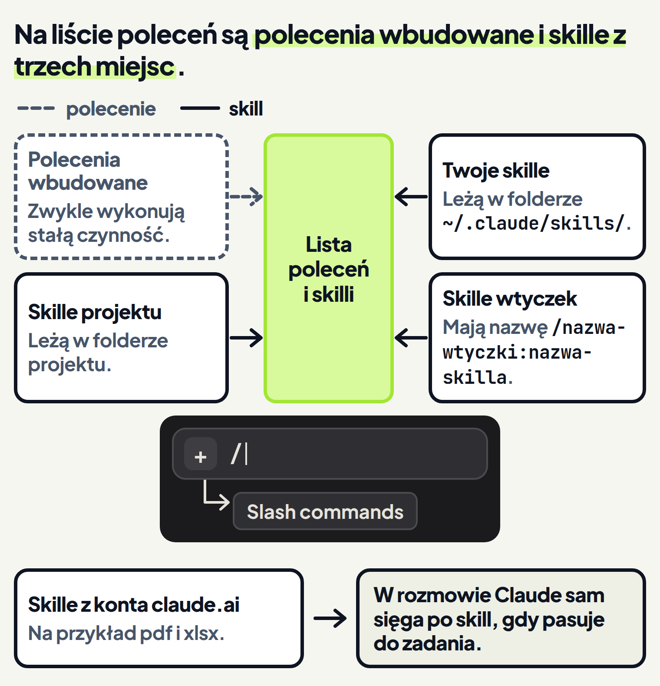

<em>Przewodnik po Claude Code · Moduł 4: Skille: powtarzalne zadania na jedno polecenie · Lekcja 1 z 4</em>

# Gotowe skille z Twojego konta i lista poleceń

Prowadzisz sklep internetowy z kawą. Co miesiąc pobierasz ze sklepu eksport sprzedaży w pliku Excel i chcesz wiedzieć, co sprzedało się najlepiej. W ćwiczeniu niżej Claude to sprawdzi i skorzysta przy tym z gotowego skilla z Twojego konta claude.ai.

Claude nie otworzy jednak pliku `.xlsx` zwykłym odczytem. Gdy wskażesz taki plik znakiem @, Claude dostanie tylko jego ścieżkę, bez zawartości. <!-- fakt: read-odmawia-xlsx-po-at-claude-dostaje-sciezke --> <!-- fakt: aplikacja-ten-sam-silnik-co-w-terminalu -->

Przy takim pliku zwykły odczyt kończy się błędem. <!-- fakt: read-odmawia-xlsx-po-at-claude-dostaje-sciezke --> <!-- fakt: aplikacja-ten-sam-silnik-co-w-terminalu --> Mimo to Claude pracuje dalej. Błąd podpowiada mu skill do tego typu pliku, jeśli taki skill jest dostępny. <!-- fakt: read-blad-podpowiada-skill-do-typu-pliku --> <!-- fakt: aplikacja-ten-sam-silnik-co-w-terminalu -->

Skill to plik `SKILL.md` z instrukcjami. Claude używa go sam, gdy pasuje do zadania, albo gdy wpiszesz jego nazwę po ukośniku. <!-- fakt: skill-czym-jest --> Takiego skilla nie musisz pisać samodzielnie. Rozmowa w aplikacji na Twoim komputerze ładuje skille włączone dla Twojego konta claude.ai. <!-- fakt: aplikacja-sesja-laduje-skille-konta-claude-ai --> Są wśród nich gotowe skille Anthropic, na przykład `pdf` i `xlsx`. <!-- fakt: skill-wbudowane -->

Z tej lekcji dowiesz się:

- kiedy Claude sam sięga po gotowy skill z Twojego konta,
- jak samemu wybrać skill z listy poleceń, którą otwiera znak / albo przycisk + i pozycja Slash commands,
- skąd biorą się pozycje na tej liście.

W ćwiczeniu niżej poprosisz Claude o podsumowanie wrześniowego arkusza zwykłymi słowami, bez nazwy skilla. Zobaczysz, że Claude sam sięgnął po gotowy skill z konta claude.ai, a wynik trafił do nowego pliku w folderze.

<!-- cwiczenie: cw1 -->

## Co tu się stało?

<!-- kolumny -->

#### W rozmowie

1. Prośba opisywała tylko zadanie, bez nazwy skilla. U siebie wysyłasz taką prośbę klawiszem <kbd>Enter</kbd>. <!-- fakt: aplikacja-enter-wysyla-zadanie -->
2. W aplikacji Claude ładuje skille sam, gdy pasują do zadania. <!-- fakt: aplikacja-skille-claude-laduje-sam-albo-wskazujesz --> Dlatego Claude użył skilla, choć w prośbie nie było jego nazwy.
3. W ćwiczeniu tylko odpowiedź Claude mówi, że użył skilla. To przykład: u siebie możesz zobaczyć inne słowa.

#### W pliku

<!-- podglad: cw1 sam -->

1. Podczas pracy świeciła karta sprzedaz-wrzesien.xlsx, czyli arkusza z prośby. Świecące karty są tylko w ćwiczeniu.
2. Claude utworzył w folderze nowy plik wnioski-wrzesien.txt. <!-- fakt: claude-code-tworzy-nowe-pliki --> <!-- fakt: aplikacja-ten-sam-silnik-co-w-terminalu -->
3. Kliknięcie ścieżki pliku w odpowiedzi Claude otworzyło ten plik. <!-- fakt: aplikacja-klik-sciezki-w-rozmowie-otwiera-plik -->

<!-- /kolumny -->

## Gotowe skille z Twojego konta

Gotowy skill przydaje się na przykład wtedy, gdy zwykły odczyt nie otwiera pliku, tak jak arkusza `.xlsx`. <!-- fakt: read-odmawia-xlsx-po-at-claude-dostaje-sciezke --> <!-- fakt: read-blad-podpowiada-skill-do-typu-pliku --> <!-- fakt: aplikacja-ten-sam-silnik-co-w-terminalu --> Nie musisz wtedy pisać instrukcji od zera.

### Skąd Claude ma te skille

Każda rozmowa w zakładce Code to sesja z własną historią i własnym folderem. <!-- fakt: aplikacja-rozmowa-to-sesja-z-wlasna-historia --> Rozmowa na Twoim komputerze ładuje też skille włączone dla Twojego konta claude.ai. <!-- fakt: aplikacja-sesja-laduje-skille-konta-claude-ai --> Wśród skilli konta są: <!-- fakt: skill-wbudowane -->

- skille, które tworzysz albo włączasz w ustawieniach claude.ai,
- skille, które daje tam Twoja organizacja,
- gotowe skille Anthropic.

Część gotowych skilli Anthropic, na przykład `pdf` i `xlsx`, jest wśród nich zawsze. Pozostałe włączasz albo wyłączasz w ustawieniach skilli na claude.ai. <!-- fakt: skill-pdf-xlsx-zawsze-sie-synchronizuja -->

### Jak Claude z nich korzysta

Claude sięga po skill z konta sam, gdy skill pasuje do zadania. Możesz też wskazać skill wprost. <!-- fakt: aplikacja-skille-claude-laduje-sam-albo-wskazujesz --> Jak wskazać skill z listy, pokaże ćwiczenie 2.

Dzięki temu prosisz zwykłymi słowami, jak w ćwiczeniu 1, a Claude dobiera skill do zadania. <!-- fakt: aplikacja-skille-claude-laduje-sam-albo-wskazujesz --> Wynik każesz zapisać w nowym pliku, a Claude ten plik utworzy. <!-- fakt: claude-code-tworzy-nowe-pliki --> <!-- fakt: aplikacja-ten-sam-silnik-co-w-terminalu -->

### Na co uważać

- Claude może pominąć skill, który by pomógł. <!-- fakt: claude-dopasowuje-zadanie-do-opisow-skilli --> <!-- fakt: aplikacja-ten-sam-silnik-co-w-terminalu --> Przyczynę opisuje część „Jak Claude wybiera skill” niżej.
- Chcesz sprawdzić, czy Claude widzi skill? Zapytaj go, jakie skille są dostępne, i poszukaj tego skilla w odpowiedzi. <!-- fakt: skill-gdy-nie-rusza-opis-pytanie-nazwa --> <!-- fakt: aplikacja-ten-sam-silnik-co-w-terminalu -->
- Twoja organizacja może ustawić `disableSideloadFlags`. Wtedy rozmowa na Twoim komputerze nie wczyta skilli konta. <!-- fakt: aplikacja-sesja-laduje-skille-konta-claude-ai --> Gdy skilla do danego typu pliku nie ma, błąd podpowiada Claude polecenie powłoki albo skrypt, który czyta ten format. <!-- fakt: read-blad-podpowiada-skill-do-typu-pliku --> <!-- fakt: aplikacja-ten-sam-silnik-co-w-terminalu -->

## Lista poleceń: dwie drogi

Polecenia sterują Claude Code z wnętrza rozmowy. <!-- fakt: polecenia-steruja-claude-code-z-rozmowy --> <!-- fakt: aplikacja-ten-sam-silnik-co-w-terminalu --> Skille pochodzą z kilku miejsc. <!-- fakt: skill-lista-polecen-co-na-liscie --> Nie musisz pamiętać ich nazw: na liście poleceń przejrzysz, co masz do dyspozycji. <!-- fakt: skill-aplikacja-menu -->

### Jak otworzyć listę

Listę otwierasz na dwa sposoby: <!-- fakt: skill-aplikacja-menu -->

- wpisujesz znak / w polu wiadomości,
- klikasz przycisk + obok pola i wybierasz Slash commands (polecenia z ukośnikiem).

Przycisk + daje dostęp nie tylko do listy poleceń, ale też do załączników, konektorów (połączeń z innymi narzędziami) i wtyczek. <!-- fakt: aplikacja-plus-menu-skille-konektory-wtyczki --> Ten sam przycisk znasz z lekcji 3 modułu 0: dołączasz nim pliki do wiadomości. <!-- fakt: aplikacja-plus-i-przeciaganie-dolaczaja-pliki -->

### Co jest na liście

Na liście są: <!-- fakt: skill-lista-polecen-co-na-liscie -->

- polecenia wbudowane w Claude Code,
- Twoje skille,
- skille projektu,
- skille z zainstalowanych wtyczek.

### Jak wybrać skill

Wybrana pozycja listy pojawia się w polu wiadomości podświetlona. Po niej wpisujesz zadanie i wysyłasz jak zwykle. <!-- fakt: skill-wybrany-podswietlony-zadanie-po-nim --> Polecenie wyślesz też wtedy, gdy Claude jeszcze pracuje, tak samo jak każdą inną wiadomość. <!-- fakt: aplikacja-polecenie-mozna-wyslac-w-trakcie-pracy -->

Dzięki temu wybierasz skill z listy i dopisujesz tylko, czego dotyczy zadanie. <!-- fakt: skill-wybrany-podswietlony-zadanie-po-nim -->

Nie każde polecenie pojawia się u każdego, więc lista u każdego może wyglądać inaczej. <!-- fakt: polecenia-nie-u-kazdego-te-same --> Dlatego w ćwiczeniu wiersz z wybranym skillem to szary pasek bez nazwy.

W ćwiczeniu niżej otworzysz listę dwiema drogami. Zobaczysz, że:

- przycisk + → Slash commands i znak / otwierają tę samą listę,
- wybrany skill stoi podświetlony w polu wiadomości,
- zadanie dopisuje się po nim.

<!-- cwiczenie: cw2 -->

## Co tu się stało?

<!-- kolumny -->

#### Przez +

<!-- podglad: cw2 plus -->

1. Przycisk + otworzył menu, a pozycja Slash commands otworzyła listę. <!-- fakt: skill-aplikacja-menu -->
2. Wybrany skill pojawił się w polu wiadomości podświetlony. <!-- fakt: skill-wybrany-podswietlony-zadanie-po-nim -->
3. Zadanie dopisało się po nim i poszło do rozmowy jak zwykła wiadomość. <!-- fakt: skill-wybrany-podswietlony-zadanie-po-nim -->

#### Przez /

1. Znak / w polu wiadomości otworzył listę od razu, bez menu. <!-- fakt: skill-aplikacja-menu -->
2. To ta sama lista poleceń i skilli co po kliknięciu Slash commands. <!-- fakt: skill-lista-polecen-co-na-liscie -->
3. Polecenie działa tylko na początku wiadomości. Tekst po nim staje się jego argumentem, czyli dopiskiem do polecenia. <!-- fakt: polecenie-tylko-na-poczatku-wiadomosci --> <!-- fakt: aplikacja-ten-sam-silnik-co-w-terminalu --> Tu dopiskiem było zadanie z nazwami plików.

<!-- /kolumny -->

## Polecenie a skill i skąd pochodzą skille

Na liście stoją obok siebie polecenia wbudowane i skille wbudowane w Claude Code. Działają inaczej: <!-- fakt: skill-wbudowany-instrukcje-polecenie-stala-logika --> <!-- fakt: aplikacja-ten-sam-silnik-co-w-terminalu -->

- skill wbudowany to instrukcje dla Claude: daje mu szczegółowe wskazówki, a Claude prowadzi pracę swoimi narzędziami,
- większość poleceń wbudowanych od razu wykonuje stałą, zaprogramowaną czynność.

Dzięki temu wiesz, czego się spodziewać po wyborze z listy. <!-- fakt: skill-wbudowany-instrukcje-polecenie-stala-logika --> <!-- fakt: aplikacja-ten-sam-silnik-co-w-terminalu -->

Skille na liście pochodzą z kilku miejsc:

- **Twoje skille.** Rozmowa na Twoim komputerze ładuje je z folderu `~/.claude/skills/`. <!-- fakt: aplikacja-lokalna-sesja-laduje-skille-osobiste -->
- **Skille projektu.** Leżą w projekcie, w pliku `.claude/skills/<nazwa>/SKILL.md`. <!-- fakt: skill-projektu-katalog --> <!-- fakt: aplikacja-ten-sam-silnik-co-w-terminalu --> Jak zapisać taki skill, pokaże lekcja 2 tego modułu.
- **Skille wtyczek.** Działają pod nazwą `/nazwa-wtyczki:nazwa-skilla`. <!-- fakt: skill-wtyczki-nazwa-z-dwukropkiem --> <!-- fakt: aplikacja-ten-sam-silnik-co-w-terminalu --> Wtyczki poznasz w lekcji 4 tego modułu.

Skille z konta claude.ai też trafiają do rozmowy na Twoim komputerze. <!-- fakt: aplikacja-sesja-laduje-skille-konta-claude-ai -->

### Na co uważać

- To, które polecenia masz na liście, zależy od platformy, planu i środowiska. <!-- fakt: polecenia-nie-u-kazdego-te-same -->
- Polecenia, które w terminalu otwierają osobny panel, w zakładce Code działają inaczej. <!-- fakt: aplikacja-polecenia-z-panelem-terminala-dzialaja-inaczej --> Te z nich, które nie przyjmują dopisku, na przykład `/permissions`, odpowiadają napisem isn't available in this environment (niedostępne w tym środowisku). <!-- fakt: aplikacja-permissions-niedostepne -->

## Jak Claude wybiera skill

W ćwiczeniu 1 Claude sam sięgnął po skill. Od czego to zależy? Odpowiedź podpowie też, kiedy lepiej wskazać skill samodzielnie.

Kontekst to wszystko, co Claude ma przed sobą w rozmowie:

- historia rozmowy,
- treść plików,
- CLAUDE.md,
- wczytane skille,
- instrukcje systemowe.

W trakcie pracy kontekst się zapełnia. <!-- fakt: claude-code-okno-kontekstu-co-trzyma-zapelnia-sie --> <!-- fakt: aplikacja-ten-sam-silnik-co-w-terminalu -->

Claude ma w kontekście listę nazw i opisów skilli. <!-- fakt: skill-laduje-sie-przy-uzyciu --> <!-- fakt: aplikacja-ten-sam-silnik-co-w-terminalu --> Domyślnie opisy skilli wczytują się na początku rozmowy. <!-- fakt: skill-opisy-na-starcie-tresc-przy-uzyciu --> <!-- fakt: aplikacja-ten-sam-silnik-co-w-terminalu --> Pełna treść skilla trafia do rozmowy dopiero wtedy, gdy skill zostaje uruchomiony. <!-- fakt: skill-laduje-sie-przy-uzyciu --> <!-- fakt: aplikacja-ten-sam-silnik-co-w-terminalu -->

Claude porównuje Twoje zadanie z opisami skilli i po nich decyduje, które pasują. <!-- fakt: claude-dopasowuje-zadanie-do-opisow-skilli --> <!-- fakt: aplikacja-ten-sam-silnik-co-w-terminalu --> Gdy zadanie pasuje do opisu, wystarczą zwykłe słowa. <!-- fakt: aplikacja-skille-claude-laduje-sam-albo-wskazujesz -->

Opisy mogą być mętne albo podobne do siebie. Wtedy Claude może wziąć zły skill albo pominąć ten, który by pomógł. <!-- fakt: claude-dopasowuje-zadanie-do-opisow-skilli --> <!-- fakt: aplikacja-ten-sam-silnik-co-w-terminalu --> Gdy chcesz, żeby Claude użył konkretnego skilla, uruchom go jego nazwą z ukośnikiem. <!-- fakt: claude-dopasowuje-zadanie-do-opisow-skilli --> <!-- fakt: aplikacja-ten-sam-silnik-co-w-terminalu -->

<!-- analogia: To jak spis treści książki: na starcie Claude widzi tylko tytuły rozdziałów. Gdy pytanie pasuje do tytułu, otwiera rozdział. Wpisanie nazwy z ukośnikiem to prośba „otwórz na tym rozdziale”. Przy mętnym tytule łatwo otworzyć zły rozdział. -->

## Kiedy wskazać skill z listy, a kiedy nie

<!-- kolumny -->

#### Wskaż skill z listy

- Gdy chcesz, żeby Claude użył właśnie tego skilla. <!-- fakt: claude-dopasowuje-zadanie-do-opisow-skilli --> <!-- fakt: aplikacja-ten-sam-silnik-co-w-terminalu -->
- Gdy masz kilka skilli o podobnych opisach. Przy opisach, które się pokrywają, Claude może wziąć zły skill. <!-- fakt: claude-dopasowuje-zadanie-do-opisow-skilli --> <!-- fakt: aplikacja-ten-sam-silnik-co-w-terminalu -->

#### Wystarczą zwykłe słowa

- Gdy zadanie pasuje do tego, co skill robi, jak podsumowanie arkusza w ćwiczeniu 1. Claude sam ładuje skille, gdy pasują do zadania. <!-- fakt: aplikacja-skille-claude-laduje-sam-albo-wskazujesz -->

<!-- /kolumny -->

Nazwa skilla z ukośnikiem na początku wiadomości uruchamia skill od razu. <!-- fakt: skill-uruchomienie-ukosnik --> <!-- fakt: aplikacja-ten-sam-silnik-co-w-terminalu --> Ta sama nazwa dalej w wiadomości niczego od razu nie uruchamia. Liczy się jako Twoje pozwolenie dla tej wiadomości. Claude może wtedy użyć skilla w trakcie odpowiedzi, a po Twoich słowach ocenia, czy o to prosisz. <!-- fakt: skill-uruchomienie-ukosnik --> <!-- fakt: aplikacja-ten-sam-silnik-co-w-terminalu --> Tak działa nazwa wpisana jako osobne słowo, bez przylegającego znaku interpunkcyjnego. <!-- fakt: skill-uruchomienie-ukosnik --> <!-- fakt: aplikacja-ten-sam-silnik-co-w-terminalu -->

## U siebie w aplikacji

1. Wpisz znak / w polu wiadomości albo kliknij przycisk + i wybierz Slash commands. <!-- fakt: skill-aplikacja-menu -->
2. Przejrzyj listę. U Ciebie może wyglądać inaczej niż w ćwiczeniu. <!-- fakt: polecenia-nie-u-kazdego-te-same -->
3. Wybierz skill, wpisz po nim zadanie i naciśnij <kbd>Enter</kbd>. <!-- fakt: skill-wybrany-podswietlony-zadanie-po-nim --> <!-- fakt: aplikacja-enter-wysyla-zadanie -->
4. Kliknij ścieżkę pliku w odpowiedzi Claude i sprawdź wynik. <!-- fakt: aplikacja-klik-sciezki-w-rozmowie-otwiera-plik -->

Skillami konta zarządzasz w dwóch miejscach: <!-- fakt: skille-konta-zarzadzasz-w-customize-albo-na-claude-ai -->

- przez Customize (dostosuj) na pasku bocznym aplikacji; tam w jednym miejscu masz konektory, skille i wtyczki, <!-- fakt: aplikacja-customize-zarzadzanie-konektorami-skillami-wtyczkami -->
- w ustawieniach skilli na claude.ai; tam włączasz albo wyłączasz gotowe skille Anthropic poza tymi, które są zawsze wśród skilli Twojego konta. <!-- fakt: skill-pdf-xlsx-zawsze-sie-synchronizuja -->

W polu wiadomości wpiszesz też polecenia, które poznasz w dalszych modułach:

- `/context` wypisuje w rozmowie podział jej okna kontekstu na kategorie (moduł 6). <!-- fakt: aplikacja-context-wypisuje-podzial-okna-kontekstu -->
- Gdy kontekst się zapełni, Claude streszcza rozmowę sam. `/compact` uruchamia streszczenie rozmowy wcześniej i zwalnia miejsce w kontekście (moduł 6). <!-- fakt: aplikacja-compact-skraca-rozmowe-wczesniej -->
- `/btw` otwiera boczną rozmowę, która może czytać wszystko z głównej rozmowy do tego momentu, a niczego do niej nie dokłada (moduł 6). <!-- fakt: aplikacja-btw-otwiera-boczna-rozmowe -->
- `/remote-control` włącza Remote Control (zdalne sterowanie) dla tej rozmowy. <!-- fakt: aplikacja-remote-control-polecenie-wlacza-dla-sesji --> Połączona rozmowa pojawia się na liście sesji na claude.ai/code i w aplikacjach Claude na urządzeniach zalogowanych na Twoje konto claude.ai (moduł 8). <!-- fakt: aplikacja-remote-control-sesja-na-innych-urzadzeniach -->
- `/goal` działa w aplikacji. <!-- fakt: goal-dziala-w-aplikacji --> Ustawia cel: Claude pracuje dalej, aż warunek zostanie spełniony albo cel zniknie z innego powodu (moduł 8). <!-- fakt: goal-claude-pracuje-az-warunek-spelniony --> <!-- fakt: aplikacja-ten-sam-silnik-co-w-terminalu -->

## Źródła

- [Aplikacja Claude na komputer](https://code.claude.com/docs/en/desktop)
- [Rozszerz Claude o skille](https://code.claude.com/docs/en/skills)
- [Polecenia](https://code.claude.com/docs/en/commands)
- [Rozszerz Claude Code](https://code.claude.com/docs/en/features-overview)
- [Narzędzia Claude Code](https://code.claude.com/docs/en/tools-reference)
- [Jak działa Claude Code](https://code.claude.com/docs/en/how-claude-code-works)
- [Cel: Claude pracuje, aż go spełni](https://code.claude.com/docs/en/goal)

Sprawdzone 26.10.2026, Claude Code 2.1.310.
