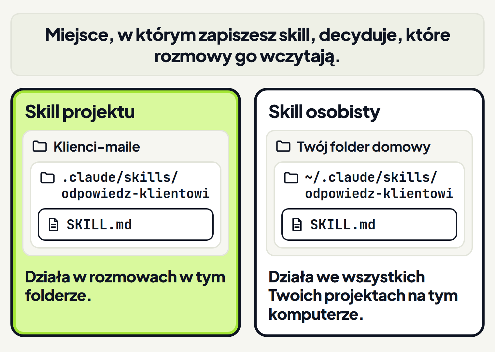
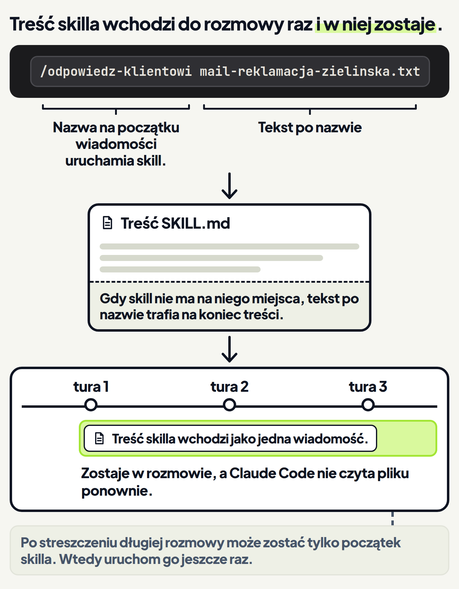

<em>Przewodnik po Claude Code · Moduł 4: Skille: powtarzalne zadania na jedno polecenie · Lekcja 2 z 4</em>

# Twój pierwszy skill

Co rano odpisujesz na maile klientów i co rano wklejasz do rozmowy te same zasady odpisywania. Na taką sytuację jest skill. Dokumentacja Claude Code radzi zrobić skill, gdy w kółko wklejasz do rozmowy: <!-- fakt: skill-tworz-gdy-wklejasz-te-same-instrukcje -->

- te same instrukcje,
- tę samą listę kontrolną,
- tę samą procedurę z kilku kroków.

Trzeci raz wklejasz tę samą procedurę? To wyraźny sygnał, żeby zapisać ją jako skill. <!-- fakt: skill-wyzwalacze-ten-sam-prompt-ta-sama-procedura --> To samo, gdy w kółko wpisujesz ten sam prompt na początek zadania: zapisz go jako skill, który uruchamiasz sam. <!-- fakt: skill-wyzwalacze-ten-sam-prompt-ta-sama-procedura -->

Skill to plik `SKILL.md` z instrukcjami. Claude używa go sam, gdy pasuje do zadania, albo gdy wpiszesz jego nazwę po ukośniku. <!-- fakt: skill-czym-jest --> Działa jak karta z zasadami, którą zostawiasz nowej osobie w zespole: piszesz ją raz, a potem tylko mówisz „zrób według karty”.

Folderów i plików skilla nie zakładasz ręcznie. W aplikacji prosisz o to Claude, a on tworzy nowy plik. <!-- fakt: claude-code-tworzy-nowe-pliki -->

W ćwiczeniach obsługujesz skrzynkę mailową sklepu ze świecami sojowymi. Zasady odpisywania dała Ci właścicielka sklepu. Leżą w pliku jak-odpisuje-klientom.txt.

W ćwiczeniu niżej poprosisz Claude o zapisanie tych zasad jako skill. Zobaczysz, że:

- zasady trafiły do pliku `SKILL.md` w folderze `.claude`,
- zapis tam wymagał Twojej zgody mimo trybu Accept edits (przyjmowanie zmian), <!-- fakt: accept-edits-sciezki-chronione-pytaja -->
- plik zaczyna się od nazwy i opisu skilla.

<!-- cwiczenie: cw1 -->

## Co tu się stało?

<!-- kolumny -->

#### W rozmowie

1. Przełącznik pod polem wiadomości przez cały czas pokazywał Accept edits. <!-- fakt: aplikacja-przelacznik-pod-polem-wiadomosci --> W tym trybie Claude tworzy i zmienia zwykłe pliki w folderze bez pytania. <!-- fakt: accept-edits-edycje-w-folderze-bez-pytania -->
2. Folder `.claude`, w którym leżą skille, jest chroniony, żeby Claude przypadkiem nie uszkodził własnych ustawień. <!-- fakt: sciezki-chronione-czym-sa -->
3. W trybach Manual (ręczny) i Accept edits zapis w chronionym folderze wymaga Twojej zgody. <!-- fakt: accept-edits-sciezki-chronione-pytaja --> <!-- fakt: aplikacja-ten-sam-silnik-co-w-terminalu --> Dlatego Claude zapisał plik dopiero po kliknięciu ptaszka.

#### W pliku

<!-- podglad: cw1 zapisz -->

1. Między liniami `---` stoją nazwa i opis skilla. To nagłówek pliku. <!-- fakt: skill-plik-ma-naglowek-i-instrukcje -->
2. Po opisie Claude decyduje, kiedy sam użyje skilla. <!-- fakt: skill-opis-decyduje -->
3. Pod nagłówkiem stoją Twoje zasady, czyli instrukcje dla Claude. <!-- fakt: skill-plik-ma-naglowek-i-instrukcje -->

<!-- /kolumny -->

## Z czego składa się skill

Każdy plik `SKILL.md` ma dwie części: <!-- fakt: skill-plik-ma-naglowek-i-instrukcje -->

- nagłówek między liniami `---`, który mówi Claude, kiedy użyć skilla,
- treść z instrukcjami, według których Claude pracuje, gdy skill działa.

### Nazwa: polecenie, które wpisujesz

Nazwa folderu skilla albo pole `name` staje się poleceniem, które wpisujesz. <!-- fakt: skill-nazwa-polecenia-z-folderu-albo-pola-name --> Skill odpowiedz-klientowi uruchomisz więc poleceniem `/odpowiedz-klientowi`.

Skille Claude Code działają według otwartego standardu Agent Skills, czyli wspólnych zasad budowy skilli. Ten standard działa w wielu narzędziach AI. <!-- fakt: skill-otwarty-standard-agent-skills --> Według tego standardu nazwa skilla: <!-- fakt: skill-nazwa-male-litery-cyfry-myslniki -->

- ma od 1 do 64 znaków,
- ma tylko małe litery, cyfry i myślniki, bez spacji,
- nie zaczyna się ani nie kończy myślnikiem i nie ma dwóch myślników pod rząd,
- jest taka sama jak nazwa folderu skilla.

### Opis: po nim Claude poznaje, kiedy sięgnąć po skill

Pole `description` to opis: co skill robi i kiedy go użyć. Po nim Claude decyduje, kiedy sam użyje skilla. <!-- fakt: skill-opis-decyduje --> Wszystkie pola nagłówka są nieobowiązkowe. Dokumentacja zaleca wypełnić tylko `description`, żeby Claude wiedział, kiedy użyć skilla. <!-- fakt: skill-pola-opcjonalne-zalecany-opis -->

Porównaj dwa opisy:

- „Pomaga w mailach.” Nie mówi, w jakich mailach ani kiedy skill ma działać.
- „Pisze szkic odpowiedzi na mail od klienta sklepu ze świecami. Użyj, gdy proszę o odpowiedź na maila albo reklamację.” Mówi, co skill robi i w jakiej sytuacji go użyć.

Pierwszy opis jest mętny. Przy mętnych opisach Claude może wziąć zły skill albo pominąć ten, który by pomógł. <!-- fakt: claude-dopasowuje-zadanie-do-opisow-skilli -->

### Treść: wiedza albo zadanie

Treść skilla to jedno z dwojga: <!-- fakt: skill-tresc-wiedza-albo-zadanie -->

- wiedza, którą Claude stosuje w bieżącej pracy, na przykład zasady, wzorce i wytyczne stylu,
- instrukcje krok po kroku do konkretnego zadania.

Zasady odpisywania z ćwiczenia to wiedza: obowiązują w każdej odpowiedzi na mail.

### Na co uważać przy pisaniu skilla

Pisz treść zwięźle. Po wczytaniu treść skilla zostaje w rozmowie w kolejnych turach, więc każda linijka stale obciąża rozmowę. <!-- fakt: skill-tresc-zwiezla-zostaje-w-rozmowie --> Tura to jedna Twoja wiadomość razem z odpowiedzią Claude.

Pilnuj pierwszej linii pliku. Plik zapisuje Claude, więc po zapisie otwórz go i sprawdź, czy na samej górze stoi linia `---`. Claude Code czyta nagłówek tylko wtedy, gdy otwierająca linia `---` jest pierwszą linią pliku. <!-- fakt: skill-naglowek-od-pierwszej-linii --> Inaczej traktuje cały plik, razem z liniami `---`, jako treść skilla. <!-- fakt: skill-naglowek-od-pierwszej-linii --> Wystarczy więc pusta linia nad `---`, żeby nagłówek przestał działać. Gdy ją zobaczysz, poproś Claude o jej usunięcie.

## Gdzie leży skill

Miejsce, w którym zapiszesz skill, decyduje, które rozmowy go wczytają. <!-- fakt: skill-miejsce-zapisu-decyduje -->

Masz dwa miejsca do wyboru:

- **Skill projektu** leży w pliku `.claude/skills/<nazwa>/SKILL.md`. <!-- fakt: skill-projektu-katalog --> Claude Code wczytuje go z folderu `.claude/skills/` w folderze, w którym pracujesz. <!-- fakt: skill-projektu-z-folderu-sesji --> <!-- fakt: aplikacja-ten-sam-silnik-co-w-terminalu -->
- **Skill osobisty** leży w Twoim folderze domowym, w pliku `~/.claude/skills/<nazwa>/SKILL.md`. Działa we wszystkich Twoich projektach na tym komputerze. <!-- fakt: skill-osobisty-wszystkie-projekty-na-komputerze --> <!-- fakt: skill-miejsce-zapisu-decyduje --> Aplikacja wczytuje go w sesjach na Twoim komputerze. <!-- fakt: aplikacja-lokalna-sesja-laduje-skille-osobiste -->

Zasady z ćwiczenia dotyczą tylko maili sklepu ze świecami. Dlatego skill leży w folderze Klienci-maile jako skill projektu.

### Dlaczego Claude pyta o zgodę

Folder `.claude` należy do chronionych folderów, żeby Claude przypadkiem nie uszkodził własnych ustawień. <!-- fakt: sciezki-chronione-czym-sa --> W trybach Manual i Accept edits zapis w nich wymaga Twojej zgody. <!-- fakt: accept-edits-sciezki-chronione-pytaja -->

Dzięki temu w tych trybach Claude nie zapisze skilla w folderze `.claude` bez Twojej zgody. <!-- fakt: accept-edits-sciezki-chronione-pytaja --> <!-- fakt: aplikacja-ten-sam-silnik-co-w-terminalu -->

### Dlaczego pierwszy skill uruchamiasz w nowej rozmowie

W ćwiczeniu folder `.claude/skills/` powstał w trakcie rozmowy. Claude Code nie obserwuje folderu skilli, którego nie było na starcie sesji, czyli tej rozmowy: nie widzi skilli, które do niego trafią. <!-- fakt: skill-nowy-folder-skilli-wymaga-przeladowania --> <!-- fakt: aplikacja-ten-sam-silnik-co-w-terminalu --> Nowa rozmowa w tym samym folderze wczytuje skille projektu już na starcie. <!-- fakt: skill-projektu-z-folderu-sesji --> <!-- fakt: aplikacja-ten-sam-silnik-co-w-terminalu --> Dlatego pierwszy skill w folderze uruchamiasz w nowej rozmowie.

W drugim ćwiczeniu otwierasz nową rozmowę w tym samym folderze. Zobaczysz, że skill działa w dwóch sytuacjach: gdy jego nazwa z ukośnikiem stoi na początku wiadomości i gdy zwykła prośba pasuje do opisu. <!-- fakt: skill-uruchomienie-ukosnik --> <!-- fakt: aplikacja-skille-claude-laduje-sam-albo-wskazujesz --> Oba szkice trzymają się zasad z pliku.

<!-- cwiczenie: cw2 -->

## Co tu się stało?

<!-- kolumny -->

#### Nazwa na początku

<!-- podglad: cw2 nazwa -->

1. Nazwa skilla z ukośnikiem na początku wiadomości uruchomiła go od razu. <!-- fakt: skill-uruchomienie-ukosnik -->
2. Tekst po nazwie, tu nazwa pliku z mailem, stał się argumentem polecenia, czyli dopiskiem do niego. <!-- fakt: polecenie-tylko-na-poczatku-wiadomosci -->
3. Claude Code dopisał ten tekst na końcu treści skilla, więc Claude widział nazwę pliku. <!-- fakt: skill-tekst-po-nazwie-dopisany-na-koncu -->

#### Zwykła prośba

<!-- podglad: cw2 slowa -->

1. W prośbie nie było nazwy skilla.
2. Claude porównał zadanie z opisami skilli i uznał, że odpowiedz-klientowi pasuje. <!-- fakt: claude-dopasowuje-zadanie-do-opisow-skilli -->
3. W aplikacji Claude sam ładuje skille, gdy pasują do zadania. <!-- fakt: aplikacja-skille-claude-laduje-sam-albo-wskazujesz -->

<!-- /kolumny -->

W ćwiczeniu przy zwykłej prośbie Claude sam napisał w odpowiedzi, że skorzystał ze skilla. U siebie sprawdzisz, czy Claude widzi Twój skill: zapytaj go, jakie skille są dostępne, i poszukaj swojego w odpowiedzi. <!-- fakt: skill-gdy-nie-rusza-opis-pytanie-nazwa -->

## Co się dzieje z treścią skilla

Gdy Ty albo Claude uruchomicie skill, jego treść wchodzi do rozmowy jako jedna wiadomość. <!-- fakt: skill-tresc-wchodzi-raz-i-zostaje -->

Polecenie działa tylko na początku wiadomości. Tekst po nazwie polecenia staje się jego argumentami. <!-- fakt: polecenie-tylko-na-poczatku-wiadomosci --> Gdy treść skilla nie ma na ten tekst osobnego miejsca, Claude Code dopisuje go na końcu treści skilla. Dzięki temu Claude i tak widzi, co wpisano. <!-- fakt: skill-tekst-po-nazwie-dopisany-na-koncu --> Skill odpowiedz-klientowi z ćwiczenia takiego miejsca nie ma.

Ta sama nazwa dalej w wiadomości, jako osobne słowo bez przylegającego znaku interpunkcyjnego, niczego nie uruchamia, tylko pozwala Claude użyć skilla. <!-- fakt: skill-uruchomienie-ukosnik -->

Treść skilla zostaje w rozmowie w kolejnych turach. <!-- fakt: skill-tresc-wchodzi-raz-i-zostaje --> Dzięki temu zasady są w rozmowie także przy drugim i trzecim mailu i nie musisz ich wklejać. <!-- fakt: skill-tresc-wchodzi-raz-i-zostaje -->

Claude Code nie czyta jednak pliku skilla ponownie w kolejnych turach. Dlatego wskazówki na całe zadanie pisz jako stałe zasady, a nie jednorazowe kroki. <!-- fakt: skill-tresc-wchodzi-raz-i-zostaje --> Tak jak w ćwiczeniu: zasada „Najwyżej 120 słów” dotyczy każdego maila, nie tylko pierwszego.

Gdy w rozmowie kończy się miejsce, Claude sam ją streszcza i pracuje dalej. <!-- fakt: aplikacja-compact-skraca-rozmowe-wczesniej --> Gdy długa rozmowa zostanie streszczona, Claude Code może zachować tylko początek skilla. Uruchom go wtedy jeszcze raz, żeby wróciła pełna treść. <!-- fakt: skill-po-streszczeniu-uruchom-ponownie --> Najważniejsze zasady stawiaj na górze pliku `SKILL.md`. <!-- fakt: skill-po-streszczeniu-uruchom-ponownie -->

## Kiedy wpisać nazwę skilla, a kiedy nie

<!-- kolumny -->

#### Wpisz nazwę

- Gdy chcesz, żeby Claude użył właśnie tego skilla. Uruchom go wtedy poleceniem /nazwa. <!-- fakt: claude-dopasowuje-zadanie-do-opisow-skilli -->
- Gdy masz kilka skilli o podobnych opisach. Przy opisach, które się pokrywają, Claude może wziąć zły skill. <!-- fakt: claude-dopasowuje-zadanie-do-opisow-skilli -->

#### Wystarczy zwykła prośba

- Gdy prośba pasuje do tego, co skill robi. Claude sam ładuje skille, gdy pasują do zadania. <!-- fakt: aplikacja-skille-claude-laduje-sam-albo-wskazujesz -->
- Gdy opis mówi, co skill robi i kiedy go użyć. Po opisie Claude decyduje, kiedy sam użyje skilla. <!-- fakt: skill-opis-decyduje -->

<!-- /kolumny -->

### Gdy skill nie rusza

Claude nie używa skilla, choć powinien? Zrób po kolei: <!-- fakt: skill-gdy-nie-rusza-opis-pytanie-nazwa -->

1. Sprawdź, czy opis zawiera słowa, których naturalnie używasz w prośbach.
2. Zapytaj Claude, jakie skille są dostępne, i sprawdź, czy Twój skill jest w odpowiedzi.
3. Napisz prośbę słowami bliższymi opisowi.
4. Uruchom skill wprost: wpisz jego nazwę z ukośnikiem na początku wiadomości.

### Gdy skill rusza za często

Claude używa skilla wtedy, kiedy tego nie chcesz? Napisz bardziej konkretny opis. <!-- fakt: skill-rusza-za-czesto-doprecyzuj-opis --> Na przykład zamiast „maile” napisz „maile od klientów sklepu ze świecami”.

## U siebie w aplikacji

1. Otwórz rozmowę w folderze, w którym leżą maile i plik z zasadami.
2. Poproś Claude o zapisanie zasad jako skill projektu. Podaj nazwę z małych liter, cyfr i myślników, na przykład odpowiedz-klientowi. <!-- fakt: skill-nazwa-male-litery-cyfry-myslniki --> Wyślij prośbę klawiszem <kbd>Enter</kbd>. <!-- fakt: aplikacja-enter-wysyla-zadanie -->
3. Zatwierdź zapis w folderze `.claude`. W trybach Manual i Accept edits Claude poprosi o zgodę. <!-- fakt: accept-edits-sciezki-chronione-pytaja --> <!-- fakt: aplikacja-ten-sam-silnik-co-w-terminalu -->
4. Kliknij ścieżkę pliku w odpowiedzi Claude i przeczytaj opis oraz zasady. <!-- fakt: aplikacja-klik-sciezki-w-rozmowie-otwiera-plik -->
5. Otwórz nową rozmowę w tym samym folderze i wyślij nazwę skilla z ukośnikiem, a po niej nazwę pliku z mailem. <!-- fakt: skill-nowy-folder-skilli-wymaga-przeladowania --> <!-- fakt: skill-uruchomienie-ukosnik -->
6. Swój skill znajdziesz też na liście poleceń. Otwiera ją znak / w polu wiadomości (lekcja 1). <!-- fakt: skill-lista-polecen-co-na-liscie -->

Później przydadzą Ci się jeszcze te wskazówki:

- **Poprawka skilla.** Poproś Claude o zmianę opisu albo zasad w pliku. Gdy folder skilli był już na starcie rozmowy, Claude Code uwzględni zmianę w tej samej rozmowie, bez otwierania nowej. <!-- fakt: skill-zmiana-dziala-bez-restartu --> <!-- fakt: aplikacja-ten-sam-silnik-co-w-terminalu --> Treść skilla, który już działał w tej rozmowie, zostaje w niej w starej wersji, bo Claude Code nie czyta pliku ponownie. <!-- fakt: skill-tresc-wchodzi-raz-i-zostaje -->
- **Skill do wszystkich projektów.** Poproś o zapis w `~/.claude/skills/<nazwa>/SKILL.md`, czyli w Twoim folderze domowym. <!-- fakt: skill-osobisty-wszystkie-projekty-na-komputerze --> W trybach Manual i Accept edits zapis w `~/.claude` też wymaga Twojej zgody. <!-- fakt: accept-edits-sciezki-chronione-pytaja --> <!-- fakt: sciezki-chronione-czym-sa --> <!-- fakt: aplikacja-ten-sam-silnik-co-w-terminalu --> Gdy folderu `~/.claude/skills` nie było na starcie rozmowy, skill zadziała w nowej rozmowie. <!-- fakt: skill-nowy-folder-skilli-wymaga-przeladowania --> <!-- fakt: aplikacja-lokalna-sesja-laduje-skille-osobiste -->
- **Usunięcie skilla.** Gdy skill jest Ci niepotrzebny albo działa źle, poproś Claude o usunięcie jego folderu, na przykład `.claude/skills/odpowiedz-klientowi/`. <!-- fakt: skill-usuwasz-razem-z-folderem --> Treść skilla, który już działał w tej rozmowie, zostaje w niej, bo Claude Code nie czyta pliku ponownie. <!-- fakt: skill-tresc-wchodzi-raz-i-zostaje -->

Gdy włączasz skill osobisty na swoim koncie claude.ai, wgrywasz go na to konto. Jego nagłówek może wtedy mieć tylko te pola: <!-- fakt: skill-na-konto-claude-ai-szesc-pol -->

- `name`,
- `description`,
- `license`,
- `compatibility`,
- `metadata`,
- `allowed-tools`.

## Źródła

- [Rozszerz Claude o skille](https://code.claude.com/docs/en/skills)
- [Polecenia](https://code.claude.com/docs/en/commands)
- [Rozszerz Claude Code](https://code.claude.com/docs/en/features-overview)
- [Tryby uprawnień](https://code.claude.com/docs/en/permission-modes)
- [Aplikacja Claude na komputer](https://code.claude.com/docs/en/desktop)
- [Jak działa Claude Code](https://code.claude.com/docs/en/how-claude-code-works)
- [Specyfikacja Agent Skills](https://agentskills.io/specification)

Sprawdzone 26.10.2026, Claude Code 2.1.310.
