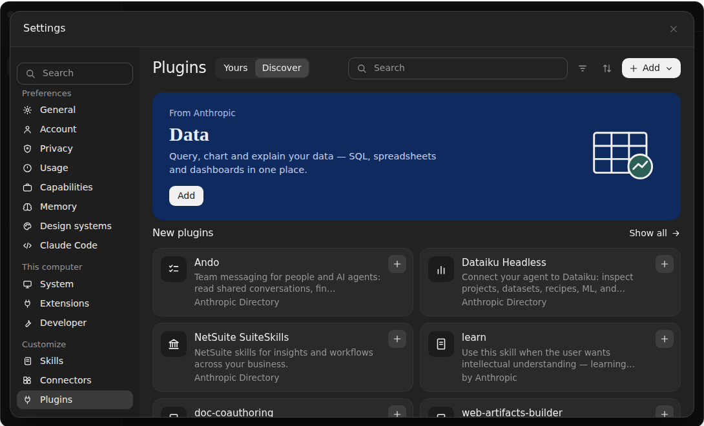
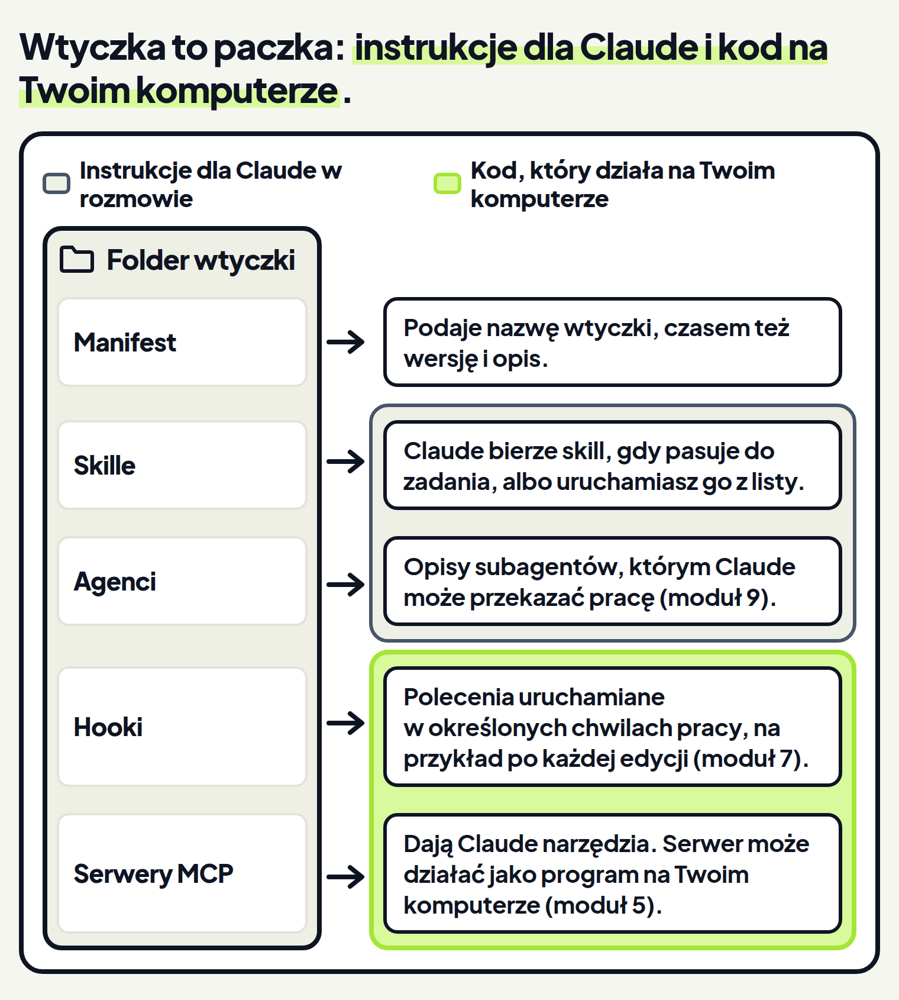

<em>Przewodnik po Claude Code · Moduł 4: Skille: powtarzalne zadania na jedno polecenie · Lekcja 4 z 4</em>

# Wtyczki: gotowe zestawy skilli

Prowadzisz małą firmę szkoleniową. Oferty szkoleń piszesz w folderze Szkolenia-oferty. Ten sam zestaw do ofert przydałby Ci się też w innych folderach, na przykład w folderze stałego klienta: kilka skilli i innych składników. Dokumentacja radzi: gdy drugi projekt potrzebuje tego samego zestawu, zapakuj go jako wtyczkę. <!-- fakt: drugie-repozytorium-ten-sam-zestaw-wtyczka -->

Takiego zestawu nie musisz budować samodzielnie. Gdy instalujesz wtyczkę, dostajesz kilka skilli i innych składników w jednej paczce, zbudowanej przez kogoś innego. Razem z nią przychodzą aktualizacje z jej katalogu. <!-- fakt: wtyczka-gdy-kilka-rzeczy-naraz-cudzy-zestaw --> Katalog to spis wtyczek. <!-- fakt: wtyczki-zwykle-z-katalogu --> Więcej o nim w części „Skąd biorą się wtyczki”.

Wtyczka (plugin) to folder ze skillami i innymi składnikami. Claude Code instaluje go i ładuje jako jedną całość. <!-- fakt: wtyczka-folder-instalowany-jako-calosc --> <!-- fakt: aplikacja-ten-sam-silnik-co-w-terminalu --> W aplikacji Claude na komputer instalujesz wtyczki bez terminala. <!-- fakt: aplikacja-wtyczki-dodaja-skille-agentow-hooki-bez-terminala -->

Zanim to zrobisz, zapamiętaj jedno: zainstalowana wtyczka może uruchomić dowolny kod na Twoim komputerze, z Twoimi uprawnieniami. <!-- fakt: wtyczka-moze-uruchomic-dowolny-kod --> <!-- fakt: aplikacja-ten-sam-silnik-co-w-terminalu --> Dlatego ta lekcja uczy też, komu ufać.

Z tej lekcji dowiesz się:

- jak otworzyć przeglądarkę wtyczek przyciskiem + i pozycjami Plugins (wtyczki) i Browse plugins (przeglądaj wtyczki), a potem znaleźć i wybrać wtyczkę,
- gdzie znajdziesz skille zainstalowanej wtyczki i gdzie leżą jej pliki,
- jak ocenić wtyczkę przed instalacją i jak ją wyłączyć.

W ćwiczeniu niżej zobaczysz, że przeglądarkę wtyczek otwierasz w aplikacji bez terminala: przyciskiem + i pozycjami Plugins i Browse plugins.

<!-- cwiczenie: cw1 -->

## Co tu się stało?

<!-- kolumny -->

#### W menu

Przycisk + obok pola wiadomości daje dostęp do: <!-- fakt: aplikacja-plus-menu-skille-konektory-wtyczki -->

- załączników,
- skilli,
- konektorów,
- wtyczek.

1. Pozycja Plugins (wtyczki) otworzyła drugie menu. Pozycja Browse plugins (przeglądaj wtyczki) otworzyła przeglądarkę wtyczek (plugin browser). <!-- fakt: aplikacja-plugins-browse-albo-manage-plugins --> <!-- fakt: aplikacja-przegladarka-wtyczek-z-twoich-katalogow --> <!-- fakt: aplikacja-add-plugins-otwiera-przegladarke-wtyczek -->
2. U siebie zrobisz to w rozmowie na swoim komputerze. <!-- fakt: aplikacja-add-plugins-otwiera-przegladarke-wtyczek -->

#### W przeglądarce

1. Przeglądarka pokazuje wtyczki z Twoich katalogów, czyli spisów wtyczek. <!-- fakt: aplikacja-przegladarka-wtyczek-z-twoich-katalogow -->
2. Twoje katalogi mogą być inne niż w ćwiczeniu, więc u siebie możesz zobaczyć inne wtyczki. <!-- fakt: aplikacja-przegladarka-wtyczek-z-twoich-katalogow -->
3. Dalej znajdujesz wtyczkę i ją wybierasz. <!-- fakt: aplikacja-instalacja-znajdz-i-wybierz-wtyczke -->

<!-- /kolumny -->

Obraz niżej pokazuje przeglądarkę wtyczek z ćwiczenia 1.

Wybór wtyczki sprawdź u siebie: dokumentacja nie opisuje, jak wygląda w aplikacji.

## Instalacja

Instalacja włącza wtyczkę, chyba że jej autor ustawił inaczej. <!-- fakt: instalacja-wlacza-wtyczke --> <!-- fakt: aplikacja-ten-sam-silnik-co-w-terminalu -->

W terminalu przy instalacji wybierasz jeszcze zakres, czyli to, dla kogo wtyczka jest włączona. <!-- fakt: wtyczka-zakres-decyduje-dla-kogo -->

## Co jest we wtyczce

Wtyczka to folder. <!-- fakt: wtyczka-folder-instalowany-jako-calosc --> <!-- fakt: aplikacja-ten-sam-silnik-co-w-terminalu -->

<!-- analogia: To jak paczka z meblami: w środku jest instrukcja, czyli skille i agenci, oraz elektronarzędzie, które działa w Twoim domu, czyli hooki i serwery MCP. -->

Plik `.claude-plugin/plugin.json`, czyli manifest, nadaje wtyczce nazwę. Może też dodać wersję i opis. <!-- fakt: wtyczka-manifest-nazwa-wersja-opis --> <!-- fakt: aplikacja-ten-sam-silnik-co-w-terminalu -->

Składniki wtyczki:

- **Skille.** To instrukcje `SKILL.md`. Claude ładuje je, gdy pasują, a Ty możesz uruchomić je jak polecenie. <!-- fakt: wtyczka-skladnik-skille --> <!-- fakt: aplikacja-ten-sam-silnik-co-w-terminalu -->
- **Agenci.** To opisy subagentów, którym Claude może przekazać pracę. Subagentów poznasz w module 9. <!-- fakt: wtyczka-skladnik-agenci --> <!-- fakt: aplikacja-ten-sam-silnik-co-w-terminalu -->
- **Hooki.** To polecenia, które Claude Code uruchamia w określonych momentach pracy, na przykład po każdej edycji. Hooki poznasz w module 7. <!-- fakt: wtyczka-skladnik-hooki --> <!-- fakt: aplikacja-ten-sam-silnik-co-w-terminalu -->
- **Serwery MCP.** To serwery narzędzi, z którymi Claude Code łączy się, dopóki wtyczka jest włączona. Poznasz je w module 5. <!-- fakt: wtyczka-skladnik-serwery-mcp --> <!-- fakt: aplikacja-ten-sam-silnik-co-w-terminalu -->

Skill z wtyczki działa wszędzie tam, gdzie wtyczka jest włączona. Jego nazwa ma postać `/nazwa-wtyczki:nazwa-skilla`. Część przed dwukropkiem to przedrostek z nazwą wtyczki. <!-- fakt: skill-wtyczki-nazwa-z-dwukropkiem --> <!-- fakt: aplikacja-ten-sam-silnik-co-w-terminalu -->

Dzięki wtyczce:

- przedrostek z nazwą wtyczki pozwala wielu wtyczkom działać obok siebie, <!-- fakt: wtyczka-pakuje-skille-hooki-subagentow-mcp --> <!-- fakt: aplikacja-ten-sam-silnik-co-w-terminalu -->
- ten sam zestaw masz w wielu projektach. <!-- fakt: wtyczka-pakuje-skille-hooki-subagentow-mcp -->

Do jednego skilla wtyczka nie jest potrzebna. Skille, subagenci, hooki i serwery MCP działają też bez wtyczki. <!-- fakt: skill-hook-mcp-dzialaja-bez-wtyczki --> <!-- fakt: aplikacja-ten-sam-silnik-co-w-terminalu --> Skill zapisany w `~/.claude/skills/` jest dostępny w każdym projekcie na Twoim komputerze. <!-- fakt: skill-hook-mcp-dzialaja-bez-wtyczki --> <!-- fakt: aplikacja-ten-sam-silnik-co-w-terminalu --> Więcej o tym wyborze mówi część „Kiedy instalować wtyczkę, a kiedy nie”.

## Skąd biorą się wtyczki

Większość wtyczek pochodzi z katalogu wtyczek (marketplace). To spis wtyczek i miejsc, skąd można je pobrać. <!-- fakt: wtyczki-zwykle-z-katalogu --> Katalog to spis, a nie sklep. Dodajesz go raz, a potem instalujesz z niego wtyczki. <!-- fakt: katalog-wtyczek-spis-nie-sklep --> <!-- fakt: aplikacja-ten-sam-silnik-co-w-terminalu -->

Droga wtyczki do rozmowy ma trzy kroki: <!-- fakt: wtyczka-droga-z-katalogu-do-sesji --> <!-- fakt: aplikacja-ten-sam-silnik-co-w-terminalu -->

1. Katalog wymienia wtyczkę.
2. Ty ją instalujesz.
3. Claude Code ładuje jej składniki.

### Katalogi Anthropic

Anthropic wydaje trzy ogólne katalogi wtyczek. Każdy to spis wtyczek we własnym repozytorium na GitHubie. <!-- fakt: anthropic-trzy-katalogi-wtyczek --> Nazwy i zawartość: <!-- fakt: katalogi-anthropic-nazwy --> <!-- fakt: katalogi-anthropic-co-zawieraja -->

- **oficjalny** `claude-plugins-official`: wtyczki utrzymywane przez Anthropic oraz wtyczki partnerów i innych autorów,
- **społeczności** `claude-community`: wtyczki innych wydawców, które ich autorzy zgłosili do Anthropic,
- **demonstracyjny** `claude-code-plugins`: kilka przykładowych wtyczek, które pokazują, co może zawierać wtyczka.

Większość wtyczek w oficjalnym katalogu pochodzi od partnerów i innych autorów, a nie od Anthropic. <!-- fakt: oficjalny-katalog-glownie-od-partnerow --> Producenci narzędzi publikują w nim wtyczki, które łączą Claude Code z ich usługami. Anthropic utrzymuje mniejszy zestaw własnych. <!-- fakt: oficjalny-katalog-glownie-od-partnerow -->

Przykład z oficjalnego katalogu to wtyczka `skill-creator`. Automatyzuje w Claude Code powtarzane porównania przy sprawdzaniu skilla. W aplikacji instalujesz ją z oficjalnego katalogu. <!-- fakt: skill-creator-w-aplikacji-z-oficjalnego-katalogu -->

Claude Code sam dodaje oficjalny katalog przy pierwszym uruchomieniu rozmowy w terminalu, chyba że blokują to zasady organizacji. <!-- fakt: oficjalny-katalog-dodawany-przy-pierwszej-sesji-w-terminalu -->

### Katalogi innych wydawców

Wiele popularnych wtyczek nie ma w żadnym katalogu Anthropic. Są w katalogach swoich autorów, zwykle w repozytorium na GitHubie. <!-- fakt: wiele-wtyczek-w-katalogach-autorow --> Anthropic nie sprawdza katalogów innych wydawców. <!-- fakt: anthropic-nie-sprawdza-cudzych-katalogow -->

Inny katalog trzeba dodać tylko wtedy, gdy wtyczki nie ma w oficjalnym katalogu Anthropic. Tak bywa na przykład z wtyczką od współpracownika albo z wtyczką z katalogu społeczności. <!-- fakt: katalog-dodajesz-gdy-wtyczki-nie-ma-w-oficjalnym -->

Katalog wtyczek to nie Claude Marketplace. Claude Marketplace to strona claude.com/marketplace, na której przeglądasz: <!-- fakt: katalog-wtyczek-to-nie-claude-marketplace -->

- wtyczki,
- konektory,
- produkty partnerów,
- partnerów, którzy świadczą usługi.

W ćwiczeniu niżej wtyczka jest już zainstalowana i włączona. Zobaczysz, że skill z zainstalowanej wtyczki wybierasz z tej samej listy co każdy inny skill. W folderze przybywa tylko wynik pracy, bo pliki wtyczki leżą poza nim.

<!-- cwiczenie: cw2 -->

## Co tu się stało?

<!-- kolumny -->

#### W rozmowie

1. Znak / otworzył listę poleceń. Na liście są też skille z zainstalowanych wtyczek. <!-- fakt: skill-lista-polecen-co-na-liscie --> Lista u każdego może wyglądać inaczej, dlatego w ćwiczeniu wiersz ze skillem wtyczki to szary pasek bez napisu. <!-- fakt: polecenia-nie-u-kazdego-te-same -->
2. Wybrany skill pojawił się w polu wiadomości podświetlony, a zadanie dopisało się po nim. <!-- fakt: skill-wybrany-podswietlony-zadanie-po-nim -->
3. Skill wtyczki działa pod nazwą `/nazwa-wtyczki:nazwa-skilla`. <!-- fakt: skill-wtyczki-nazwa-z-dwukropkiem --> <!-- fakt: aplikacja-ten-sam-silnik-co-w-terminalu -->

#### W folderze

<!-- podglad: cw2 skill-wtyczki -->

1. Claude utworzył w folderze nowy plik oferta-nowak.txt. <!-- fakt: claude-code-tworzy-nowe-pliki --> <!-- fakt: aplikacja-ten-sam-silnik-co-w-terminalu -->
2. W folderze nie przybył żaden plik wtyczki. Pobrane i zainstalowane wtyczki leżą w `~/.claude/plugins/`. <!-- fakt: wtyczka-pliki-w-claude-plugins --> <!-- fakt: aplikacja-ten-sam-silnik-co-w-terminalu -->
3. Włączona wtyczka jest częścią każdej rozmowy. <!-- fakt: wtyczka-wlaczona-jest-w-kazdej-sesji --> <!-- fakt: aplikacja-ten-sam-silnik-co-w-terminalu -->

<!-- /kolumny -->

W ćwiczeniu Claude pisze w odpowiedzi, że użył skilla z wtyczki. To przykładowe słowa: u siebie możesz zobaczyć inne.

## Co wtyczka robi w każdej rozmowie

Włączona wtyczka jest częścią każdej rozmowy, nie tylko tych, w których jej używasz. <!-- fakt: wtyczka-wlaczona-jest-w-kazdej-sesji --> <!-- fakt: aplikacja-ten-sam-silnik-co-w-terminalu -->

Kontekst to wszystko, co Claude ma przed sobą w rozmowie, między innymi historia rozmowy, treść plików, wczytane skille i instrukcje systemowe. <!-- fakt: claude-code-okno-kontekstu-co-trzyma-zapelnia-sie --> <!-- fakt: aplikacja-ten-sam-silnik-co-w-terminalu -->

W każdej rozmowie z włączoną wtyczką:

- nazwy i opisy jej skilli, po które Claude może sięgnąć sam, są w kontekście w każdej turze, czyli przy każdej odpowiedzi Claude, żeby Claude wiedział, że istnieją, <!-- fakt: wtyczka-nazwy-i-opisy-w-kazdej-turze --> <!-- fakt: aplikacja-ten-sam-silnik-co-w-terminalu -->
- pełna treść skilla ładuje się dopiero wtedy, gdy skill zostaje użyty, <!-- fakt: wtyczka-nazwy-i-opisy-w-kazdej-turze --> <!-- fakt: aplikacja-ten-sam-silnik-co-w-terminalu -->
- serwery MCP wtyczki działają obok rozmowy, a jej hooki odpalają się przy swoich zdarzeniach. <!-- fakt: wtyczka-serwery-mcp-i-hooki-dzialaja-w-sesji --> <!-- fakt: aplikacja-ten-sam-silnik-co-w-terminalu -->

Dzięki temu skille włączonej wtyczki masz pod ręką w każdej rozmowie. <!-- fakt: wtyczka-wlaczona-jest-w-kazdej-sesji --> <!-- fakt: aplikacja-ten-sam-silnik-co-w-terminalu -->

Opisy skilli wtyczki mają jednak swoją cenę. Liczą się do zużycia i zajmują miejsce w kontekście, także wtedy, gdy nic z wtyczki nie działa. <!-- fakt: wtyczka-nazwy-i-opisy-w-kazdej-turze --> <!-- fakt: aplikacja-ten-sam-silnik-co-w-terminalu --> Wtyczkę, której nie potrzebujesz, wyłączysz albo odinstalujesz w aplikacji. <!-- fakt: aplikacja-plugins-browse-albo-manage-plugins --> Jak to zrobić, pokazuje część „U siebie w aplikacji”.

## Komu ufać przed instalacją

Nazwa katalogu mówi, kto wydaje spis, a nie co robi każda wtyczka w nim. Dlatego sprawdź wtyczkę przed instalacją, z jakiegokolwiek katalogu pochodzi. <!-- fakt: nazwa-katalogu-mowi-kto-wydaje-nie-co-robi-wtyczka -->

Nazwa katalogu stawia go na jednym z trzech poziomów: oficjalny, społeczności albo inny wydawca. <!-- fakt: katalogi-trzy-poziomy-anthropic-nie-do-podrobienia --> <!-- fakt: aplikacja-ten-sam-silnik-co-w-terminalu --> Claude Code przyjmuje nazwy oficjalne i społeczności tylko dla katalogów z repozytoriów Anthropic na GitHubie. Dlatego cudzy katalog nie może udawać katalogu Anthropic. <!-- fakt: katalogi-trzy-poziomy-anthropic-nie-do-podrobienia --> <!-- fakt: aplikacja-ten-sam-silnik-co-w-terminalu --> Katalog wydany przez współpracownika albo Twoją organizację jest na poziomie „inny wydawca”. <!-- fakt: katalogi-trzy-poziomy-anthropic-nie-do-podrobienia -->

Poziom katalogu nie mówi, czy kod wtyczki jest bezpieczny. Bez względu na poziom zainstalowana wtyczka może uruchamiać kod z Twoimi uprawnieniami. <!-- fakt: wtyczka-kazdy-poziom-kod-z-twoimi-uprawnieniami --> <!-- fakt: wtyczka-dziala-jako-ty --> <!-- fakt: aplikacja-ten-sam-silnik-co-w-terminalu -->

### Co wtyczka przynosi

Wtyczka może przynieść dwa rodzaje treści: kod, który działa na Twoim komputerze z Twoimi uprawnieniami, i instrukcje dla Claude. <!-- fakt: wtyczka-kod-na-komputerze-i-instrukcje-w-kontekscie --> <!-- fakt: aplikacja-ten-sam-silnik-co-w-terminalu -->

- **Hooki** działają jako polecenia takie, jakie wpisuje się w terminalu (polecenia powłoki, shell). Uruchamiają się w określonych momentach pracy, na przykład przed użyciem narzędzia albo po nim. <!-- fakt: wtyczka-hooki-to-polecenia-powloki --> <!-- fakt: aplikacja-ten-sam-silnik-co-w-terminalu -->
- **Serwery MCP**: Claude Code łączy się z serwerami MCP włączonej wtyczki i daje Claude ich narzędzia. Serwer MCP może działać jako program, który Claude Code uruchamia na Twoim komputerze. <!-- fakt: wtyczka-serwer-mcp-proces-na-komputerze --> <!-- fakt: aplikacja-ten-sam-silnik-co-w-terminalu -->
- **Skille i agenci** trafiają do kontekstu Claude jako instrukcje. Wpływają na to, co Claude robi narzędziami, które już ma. <!-- fakt: wtyczka-skille-i-agenci-jako-instrukcje --> <!-- fakt: aplikacja-ten-sam-silnik-co-w-terminalu -->

### Co sprawdzić przed instalacją

Zanim zainstalujesz wtyczkę, sprawdź, co dodaje i skąd pochodzi. <!-- fakt: przed-instalacja-sprawdz-co-dodaje-i-skad --> Na stronie Claude Marketplace przeszukasz oficjalny katalog Anthropic. Strona pokazuje liczbę instalacji i przy części wtyczek oznaczenie Anthropic verified. <!-- fakt: claude-marketplace-liczba-instalacji-anthropic-verified --> Co to oznaczenie sprawdza, dokumentacja nie mówi.

Dokumentacja Claude Code przytacza ostrzeżenie przed instalacją wtyczki (po angielsku zaczyna się od słów „Make sure you trust a plugin”): <!-- fakt: ostrzezenie-zaufaj-wtyczce-przed-instalacja -->

„Upewnij się, że ufasz wtyczce, zanim ją zainstalujesz, zaktualizujesz albo użyjesz. Anthropic nie kontroluje, jakie serwery MCP, pliki ani inne oprogramowanie zawierają wtyczki. Nie może sprawdzić, czy działają zgodnie z zamiarem i czy się nie zmienią. Więcej informacji znajdziesz na stronie domowej każdej wtyczki”. <!-- fakt: ostrzezenie-zaufaj-wtyczce-przed-instalacja -->

### Co obejmują reguły uprawnień, a czego nie

- Reguły uprawnień Claude Code obejmują wywołania narzędzi przez Claude. Nie obejmują kodu, który wtyczka uruchamia sama. <!-- fakt: reguly-uprawnien-nie-obejmuja-kodu-wtyczki --> <!-- fakt: aplikacja-ten-sam-silnik-co-w-terminalu -->
- Hooki wtyczki, które uruchamiają polecenia powłoki, działają z Twoimi pełnymi uprawnieniami. <!-- fakt: hooki-wtyczki-z-pelnymi-uprawnieniami --> <!-- fakt: aplikacja-ten-sam-silnik-co-w-terminalu -->
- Gdy Claude wywołuje narzędzie z serwera MCP wtyczki, Twoje reguły uprawnień obejmują to wywołanie. <!-- fakt: narzedzia-mcp-wtyczki-podlegaja-regulom-uprawnien --> <!-- fakt: aplikacja-ten-sam-silnik-co-w-terminalu -->

Hooki wtyczki sprawdzisz w lekcji 3 modułu 7.

### Aktualizacje

Wtyczki aktualizują się same, gdy ich katalog ma włączoną automatyczną aktualizację: <!-- fakt: wtyczki-aktualizuja-sie-z-katalogu --> <!-- fakt: aplikacja-ten-sam-silnik-co-w-terminalu -->

- w oficjalnym katalogu `claude-plugins-official` jest ona domyślnie włączona, <!-- fakt: oficjalny-katalog-auto-aktualizacja-domyslnie-wlaczona -->
- w katalogu społeczności i w katalogach innych wydawców jest domyślnie wyłączona. <!-- fakt: inne-katalogi-auto-aktualizacja-domyslnie-wylaczona -->

Przy włączonej aktualizacji Claude Code aktualizuje wtyczkę w tle. Sprawdzone przez Ciebie pliki mogą się więc zmienić na dysku. <!-- fakt: wtyczka-aktualizacja-zmienia-sprawdzone-pliki --> <!-- fakt: aplikacja-ten-sam-silnik-co-w-terminalu --> Trwająca rozmowa zostaje przy wersjach wtyczek, które już wczytała, a nowe wersje wczytuje dopiero następna rozmowa. <!-- fakt: wtyczki-sesja-trzyma-wczytane-wersje --> <!-- fakt: aplikacja-ten-sam-silnik-co-w-terminalu -->

## Kiedy instalować wtyczkę, a kiedy nie

<!-- kolumny -->

#### Zainstaluj

- Gdy ten sam zestaw ma działać w wielu projektach, na przykład w folderze każdego klienta. <!-- fakt: drugie-repozytorium-ten-sam-zestaw-wtyczka --> <!-- fakt: wtyczka-pakuje-skille-hooki-subagentow-mcp -->
- Gdy chcesz gotowy zestaw zbudowany przez kogoś innego, z aktualizacjami z jego katalogu. <!-- fakt: wtyczka-gdy-kilka-rzeczy-naraz-cudzy-zestaw -->

#### Nie instaluj

- Gdy wystarczy Ci jeden skill. Zapisz go jako skill osobisty albo skill projektu, jak w lekcji 2 tego modułu. <!-- fakt: skill-hook-mcp-dzialaja-bez-wtyczki --> <!-- fakt: aplikacja-ten-sam-silnik-co-w-terminalu -->
- Gdy nie wiesz, kto wydaje katalog i co wtyczka uruchamia. Wtyczka może uruchomić dowolny kod na Twoim komputerze. <!-- fakt: nazwa-katalogu-mowi-kto-wydaje-nie-co-robi-wtyczka --> <!-- fakt: wtyczka-moze-uruchomic-dowolny-kod --> <!-- fakt: aplikacja-ten-sam-silnik-co-w-terminalu -->
- Gdy pracujesz w sesji w chmurze. Wtyczki zainstalowane z aplikacji nie działają w sesjach w chmurze. <!-- fakt: aplikacja-wtyczki-nie-w-chmurze-i-wsl -->

<!-- /kolumny -->

## U siebie w aplikacji

1. Otwórz rozmowę na swoim komputerze. Kliknij przycisk + obok pola wiadomości, wybierz Plugins (wtyczki), a potem Browse plugins (przeglądaj wtyczki). <!-- fakt: aplikacja-plugins-browse-albo-manage-plugins -->
2. Gdy menu pokazuje Add plugins (dodaj wtyczki) zamiast Plugins, wybierz Add plugins. <!-- fakt: aplikacja-add-plugins-otwiera-przegladarke-wtyczek -->
3. Znajdź wtyczkę i ją wybierz. <!-- fakt: aplikacja-instalacja-znajdz-i-wybierz-wtyczke --> Sprawdź, co przeglądarka pokazuje przy wtyczce.
4. Wpisz znak / w polu wiadomości i poszukaj skilli wtyczki na liście poleceń. <!-- fakt: skill-lista-polecen-co-na-liscie --> Możesz też zapytać Claude, jakie skille są dostępne, i poszukać skilla w odpowiedzi. <!-- fakt: skill-gdy-nie-rusza-opis-pytanie-nazwa --> <!-- fakt: aplikacja-ten-sam-silnik-co-w-terminalu -->

Wtyczką zarządzasz w dwóch miejscach:

- w menu przycisku +: Plugins, a potem Manage plugins (zarządzaj wtyczkami); tam włączasz, wyłączasz i odinstalowujesz wtyczki, <!-- fakt: aplikacja-plugins-browse-albo-manage-plugins -->
- przez Customize (dostosuj) na pasku bocznym aplikacji; tam w jednym miejscu masz konektory, skille i wtyczki. <!-- fakt: aplikacja-customize-zarzadzanie-konektorami-skillami-wtyczkami -->

Skill z wtyczki usuwasz, wyłączając albo odinstalowując wtyczkę, która go daje. <!-- fakt: skill-wtyczki-usuwasz-wylaczajac-wtyczke --> <!-- fakt: aplikacja-ten-sam-silnik-co-w-terminalu -->

Poradniki do terminala każą wpisać polecenie `/plugin`. W aplikacji wtyczkami zarządzasz w przeglądarce wtyczek i w Manage plugins, opisanych wyżej. <!-- fakt: aplikacja-wtyczki-menedzer-zamiast-polecenia-plugin --> <!-- fakt: aplikacja-plugins-browse-albo-manage-plugins --> Polecenie `/plugin` stoi też na liście poleceń w aplikacji, ale dokumentacja nie opisuje, co tam robi.

Wtyczki wczytują się na starcie rozmowy. <!-- fakt: wtyczki-laduja-sie-na-starcie-sesji --> <!-- fakt: aplikacja-ten-sam-silnik-co-w-terminalu -->

Kilku rzeczy dokumentacja nie opisuje dla aplikacji. Sprawdź u siebie:

- czy skille nowej wtyczki pojawią się od razu w otwartej rozmowie, czy dopiero w nowej,
- czy przeglądarka wtyczek pokazuje oficjalny katalog, gdy nie używasz terminala,
- jak dodać katalog,
- pod jakim napisem skill wtyczki stoi na liście poleceń,
- gdzie jest Manage plugins, gdy menu pokazuje Add plugins.

## Źródła

- [Aplikacja Claude na komputer](https://code.claude.com/docs/en/desktop)
- [Wtyczki: przegląd](https://code.claude.com/docs/en/plugins/overview)
- [Instalowanie i zarządzanie wtyczkami](https://code.claude.com/docs/en/plugins/install)
- [Katalogi wtyczek Anthropic](https://code.claude.com/docs/en/plugins/anthropic-marketplaces)
- [Bezpieczeństwo i zaufanie do wtyczek](https://code.claude.com/docs/en/plugins/security)
- [Rozszerz Claude o skille](https://code.claude.com/docs/en/skills)
- [Rozszerz Claude Code](https://code.claude.com/docs/en/features-overview)
- [Polecenia](https://code.claude.com/docs/en/commands)
- [Jak działa Claude Code](https://code.claude.com/docs/en/how-claude-code-works)

Sprawdzone 26.10.2026, Claude Code 2.1.310.
