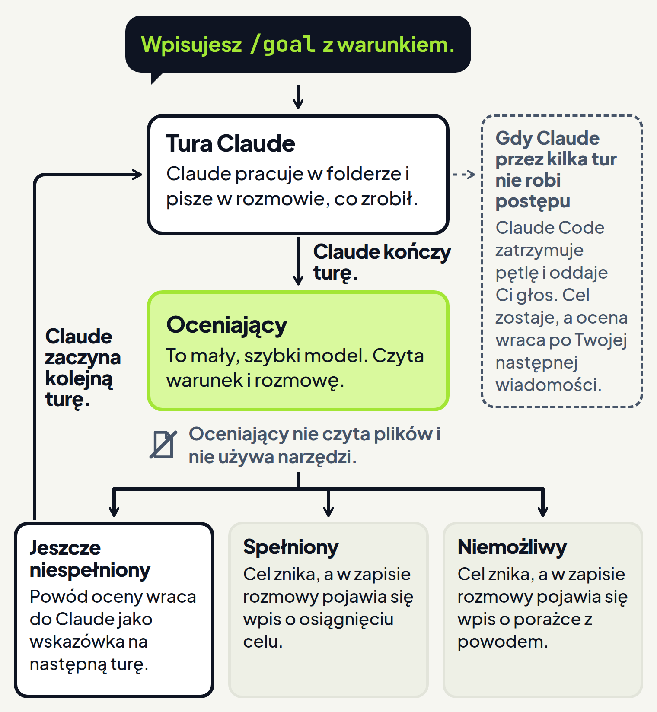
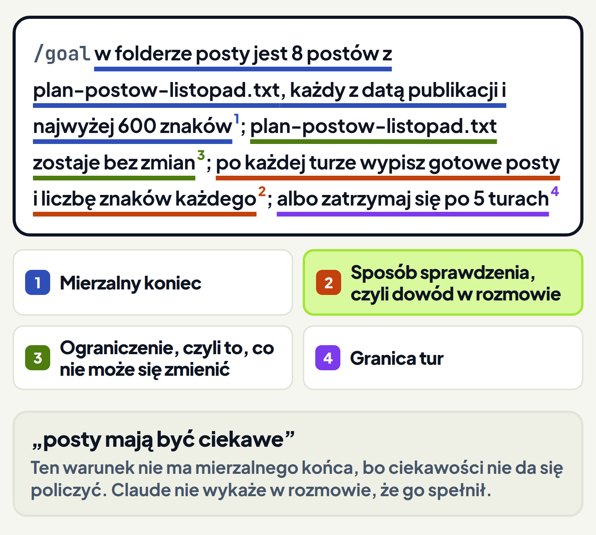

<em>Przewodnik po Claude Code · Moduł 8: Claude pracuje, kiedy Cię nie ma · Lekcja 3 z 4</em>

# /goal: Claude pracuje, aż spełni warunek

Prowadzisz dla klientki profil jej gabinetu weterynaryjnego na Instagramie i potrzebujesz ośmiu postów na listopad. Zlecasz je Claude, a ten pisze trzy i pyta, czy pisać dalej. Claude kończy turę, czyli oddaje Ci głos z pytaniem. <!-- fakt: goal-ustawia-warunek-i-pracuje-dalej --> Odpisujesz „dalej”, a po kilku kolejnych postach Claude znów pyta.

Sam tryb Auto tego nie zmieni. Zatwierdza on użycie narzędzi w trakcie jednej tury, ale nowej tury nie zaczyna. <!-- fakt: goal-auto-nie-zaczyna-nowej-tury --> Claude przestaje pracować wtedy, gdy sam uzna, że praca jest skończona. <!-- fakt: goal-auto-nie-zaczyna-nowej-tury -->

Polecenie `/goal` ustawia warunek ukończenia, czyli opis tego, kiedy praca jest skończona. Claude pracuje dalej, aż warunek zostanie spełniony albo cel skończy się z innego powodu, i nie czeka na Twoje prośby o każdy krok. <!-- fakt: goal-ustawia-warunek-i-pracuje-dalej --> <!-- fakt: goal-cel-znika-sam --> Po każdej turze osobny model, który w tej lekcji nazywamy oceniającym, sprawdza, czy warunek jest spełniony. <!-- fakt: goal-ocenia-swiezy-model --> Gdy oceniający uzna, że jeszcze nie, Claude zaczyna kolejną turę, zamiast oddać Ci głos. <!-- fakt: goal-ustawia-warunek-i-pracuje-dalej --> `/goal` działa w aplikacji Claude na komputer. <!-- fakt: goal-dziala-w-aplikacji -->

W ćwiczeniu niżej ustawisz cel jednym poleceniem. Zobaczysz, że Claude:

- sam zaczyna kolejną turę,
- w każdej turze pisze, ile pracy już zrobił,
- kończy, gdy warunek jest spełniony.

<!-- cwiczenie: cw1 -->

## Co tu się stało?

<!-- kolumny -->

#### W rozmowie

1. Polecenie `/goal` od razu zaczęło turę, bez osobnej prośby. <!-- fakt: goal-ustawienie-od-razu-startuje-ture -->
2. Po pierwszej turze brakowało trzech postów. Oceniający uznał warunek za jeszcze niespełniony, więc Claude pracował dalej. <!-- fakt: goal-ocenia-swiezy-model --> <!-- fakt: goal-werdykt-niespelniony -->
3. W każdej turze Claude napisał, która to tura z pięciu dozwolonych, na przykład „Tura 1 z 5”. <!-- fakt: goal-granica-tur-albo-czasu -->
4. Po drugiej turze warunek był spełniony. Cel zniknął, a kolejnej tury nie było. <!-- fakt: goal-werdykt-spelniony -->

#### W plikach

<!-- podglad: cw1 cel -->

1. W folderze `posty` przybyło pięć nowych plików. <!-- fakt: claude-code-tworzy-nowe-pliki -->
2. Nikt nie klikał zgody, bo rozmowa była w trybie Auto. W tym trybie pracy Claude pilnuje strażnik (klasyfikator). <!-- fakt: auto-klasyfikator-ocenia-przed-wykonaniem --> Strażnik to osobny model, który ocenia działania Claude przed wykonaniem i blokuje te, które wykraczają poza Twoją prośbę. <!-- fakt: auto-klasyfikator-ocenia-przed-wykonaniem --> Odczytów i zmian plików w Twoim folderze strażnik nie ocenia. Wyjątkiem są zapisy w chronionych folderach i plikach, na przykład w folderze `.claude` z ustawieniami Claude. <!-- fakt: auto-odczyty-i-zmiany-w-folderze-bez-klasyfikatora --> <!-- fakt: sciezki-chronione-czym-sa -->
3. Ostatni post ma datę i godziny przyjęć, tak jak chce klientka.

<!-- /kolumny -->

## Praca do warunku

Cel ustawiasz do dużej pracy, której koniec da się sprawdzić. <!-- fakt: goal-do-duzej-pracy-ze-sprawdzalnym-koncem --> Osiem postów, każdy z datą i nie dłuższy niż 600 znaków, to dobry przykład.

### Jak ustawić cel

1. W polu wiadomości wpisz `/goal`. Gdy wpiszesz sam znak `/`, aplikacja pokaże listę dostępnych poleceń, także wbudowanych, więc `/goal` możesz też wybrać z tej listy. <!-- fakt: goal-aplikacja-ukosnik-polecenia-wbudowane -->
2. Po poleceniu wpisz warunek, który ma być spełniony. <!-- fakt: goal-nowy-cel-zastepuje-stary -->
3. Wyślij wiadomość klawiszem <kbd>Enter</kbd>, jak zwykle. <!-- fakt: goal-aplikacja-ukosnik-polecenia-wbudowane --> <!-- fakt: aplikacja-enter-wysyla-zadanie -->

Ustawienie celu od razu zaczyna turę. Poleceniem dla Claude jest sam warunek, więc osobnej prośby nie wysyłasz. <!-- fakt: goal-ustawienie-od-razu-startuje-ture -->

W jednej sesji może być aktywny jeden cel. <!-- fakt: goal-jeden-cel-na-sesje --> Gdy ustawisz nowy, zastąpi poprzedni. <!-- fakt: goal-nowy-cel-zastepuje-stary -->

### Kto decyduje, że praca jest skończona

Za każdym razem, gdy Claude kończy turę, Claude Code wysyła warunek i dotychczasową rozmowę do oceniającego. Oceniający to mały, szybki model. <!-- fakt: goal-ocena-maly-szybki-model --> Oceniający zwraca jeden z trzech werdyktów, każdy z krótkim powodem: <!-- fakt: goal-ocena-maly-szybki-model -->

- jeszcze niespełniony, <!-- fakt: goal-werdykt-niespelniony -->
- spełniony, <!-- fakt: goal-werdykt-spelniony -->
- niemożliwy. <!-- fakt: goal-werdykt-niemozliwy -->

Przy werdykcie „jeszcze niespełniony” Claude pracuje dalej, a powód bierze jako wskazówkę na następną turę. <!-- fakt: goal-werdykt-niespelniony --> Co dzieje się przy dwóch pozostałych werdyktach, opisuje część „Kiedy cel się kończy”. Tury i oceny powtarzają się na zmianę aż do końca celu. Ten ciąg nazywamy pętlą celu.

<!-- wyjasnienie: obrazy/petla-celu-wyjasnienie.png | Po każdej turze oceniający czyta rozmowę i mówi „jeszcze nie”, więc Claude zaczyna kolejną turę, aż cel zostanie spełniony. -->

Dzięki temu nie piszesz „dalej” po każdej turze. O końcu pracy nie decyduje Claude, który wykonuje pracę. Decyduje o nim oceniający, który w samej pracy nie bierze udziału. <!-- fakt: goal-ocenia-swiezy-model -->

### Ograniczenia

- Cel działa tylko w bieżącej sesji. <!-- fakt: goal-tylko-w-tej-sesji -->
- Ocena kosztuje tokeny, które zużywa oceniający, czyli mały, szybki model. Zwykle to znikoma część w porównaniu z tokenami samej pracy Claude. <!-- fakt: goal-koszt-oceny-niewielki -->
- Ustawiony cel nie gwarantuje, że praca zostanie skończona. Cel znika też wtedy, gdy oceniający uzna warunek za niemożliwy, albo gdy tura zakończy się błędem, który musisz naprawić. <!-- fakt: goal-cel-znika-sam -->

## Dobry warunek

Oceniający sprawdza warunek według tego, co Claude pokazał w rozmowie. <!-- fakt: goal-ocena-tylko-z-rozmowy --> Oceniający nie uruchamia poleceń, nie czyta plików ani nie używa innych narzędzi, więc ocenia tylko to, co Claude już pokazał w rozmowie. <!-- fakt: goal-ocena-tylko-z-rozmowy --> <!-- fakt: goal-oceniajacy-nie-uzywa-narzedzi -->

Dlatego warunek piszesz tak, żeby Claude mógł w rozmowie wykazać, że go spełnił. <!-- fakt: goal-ocena-tylko-z-rozmowy --> Dobry warunek do długiej pracy ma zwykle trzy części:

1. Jeden mierzalny stan końcowy, na przykład liczba plików. <!-- fakt: goal-warunek-mierzalny-koniec --> W ćwiczeniu był to warunek, że w folderze `posty` ma być 8 postów, każdy z datą publikacji i najwyżej 600 znaków.
2. Sposób sprawdzenia, czyli to, jak Claude ma wykazać, że warunek jest spełniony. <!-- fakt: goal-warunek-sposob-sprawdzenia --> W ćwiczeniu Claude miał po każdej turze wypisać gotowe posty i liczbę znaków każdego.
3. Ważne ograniczenia, czyli to, co nie może się zmienić po drodze. <!-- fakt: goal-warunek-ograniczenia --> W ćwiczeniu plan postów miał zostać bez zmian.

Do tego dopisz granicę tur albo czasu, na przykład „albo zatrzymaj się po 5 turach”. Ogranicza ona, jak długo trwa cel. <!-- fakt: goal-granica-tur-albo-czasu --> Claude w każdej turze pisze, jak blisko jest tej granicy, na przykład „Tura 2 z 5”. Oceniający sprawdza w rozmowie, czy granica została osiągnięta. <!-- fakt: goal-granica-tur-albo-czasu -->

Warunek może mieć do 4000 znaków. <!-- fakt: goal-warunek-do-4000-znakow -->

Dzięki temu cel kończy się, gdy praca jest zrobiona i wykazana w rozmowie. <!-- fakt: goal-ocena-tylko-z-rozmowy --> Granica tur nie pozwala też, żeby cel trwał bez końca. <!-- fakt: goal-granica-tur-albo-czasu -->

Uważaj na dwie rzeczy:

- Warunek „posty mają być ciekawe” nie ma mierzalnego końca, bo ciekawości nie da się policzyć. <!-- fakt: goal-warunek-mierzalny-koniec -->
- Czego Claude nie pokaże w rozmowie, tego oceniający nie zobaczy, nawet gdy to leży w pliku. <!-- fakt: goal-ocena-tylko-z-rozmowy -->

W drugim ćwiczeniu ustawisz ten sam cel dwa razy: raz bez sposobu sprawdzenia, raz z nim. Zobaczysz, że oceniający widzi tylko rozmowę. Cel z warunkiem, który każe Claude pokazać dowód w rozmowie, skończy się szybciej.

<!-- cwiczenie: cw2 -->

## Co tu się stało?

Po obu poleceniach ćwiczenia skrócone posty wyglądają tak samo. Różnica jest w rozmowie: tylko tam oceniający szuka dowodu. <!-- fakt: goal-oceniajacy-nie-uzywa-narzedzi -->

<!-- kolumny -->

#### Bez sposobu sprawdzenia

<!-- podglad: cw2 bez -->

1. W pierwszej turze Claude skrócił dwa posty, ale nie podał liczby znaków.
2. Oceniający ocenia tylko to, co Claude pokazał w rozmowie. <!-- fakt: goal-ocena-tylko-z-rozmowy --> Dlatego uznał warunek za jeszcze niespełniony.
3. Powód oceny był dla Claude wskazówką na następną turę. <!-- fakt: goal-werdykt-niespelniony --> W drugiej turze Claude wypisał liczby znaków.

#### Ze sposobem sprawdzenia

1. Warunek kazał Claude wypisać liczbę znaków każdego posta po każdej turze. <!-- fakt: goal-warunek-sposob-sprawdzenia -->
2. Liczby znaków były w rozmowie już po pierwszej turze.
3. Cel skończył się po jednej turze.

<!-- /kolumny -->

## Kiedy cel się kończy

Wracasz do komputera i chcesz wiedzieć, czy praca jest skończona, czy stoi.

### Cel znika sam

Cel znika sam w trzech sytuacjach: <!-- fakt: goal-cel-znika-sam -->

- Warunek jest spełniony. Claude Code usuwa cel i dodaje do zapisu rozmowy wpis o osiągnięciu celu. <!-- fakt: goal-werdykt-spelniony -->
- Oceniający uznał, że warunku nigdy nie da się spełnić. Claude Code usuwa cel i zapisuje wpis o porażce z powodem. Celu nie musisz usuwać sam. <!-- fakt: goal-werdykt-niemozliwy -->
- Tura zakończyła się błędem, który musisz naprawić. <!-- fakt: goal-blad-do-naprawy-kasuje-cel -->

Cel kasują cztery rodzaje błędów: <!-- fakt: goal-bledy-ktore-kasuja-cel -->

- wyczerpane środki na koncie,
- niedostępny model,
- przepełnienie kontekstu (pamięci rozmowy), którego nie usunęło automatyczne streszczanie rozmowy,
- błąd logowania, gdy Claude Code sam zarządza danymi logowania.

W aplikacji na komputer błąd logowania celu nie kasuje. Danymi logowania zarządza wtedy aplikacja i sama przywraca dostęp. <!-- fakt: goal-aplikacja-blad-logowania-nie-kasuje-celu -->

Po błędzie, który skasował cel, naprawiasz przyczynę. Potem ustawiasz cel jeszcze raz poleceniem `/goal` z warunkiem. <!-- fakt: goal-blad-do-naprawy-kasuje-cel --> Kontekst i limity opisuje moduł 6.

### Cel zostaje

- Po innym błędzie, na przykład po wyczerpaniu limitu użycia claude.ai, cel dalej jest ustawiony. <!-- fakt: goal-inne-bledy-cel-zostaje -->
- Gdy Claude przez kilka tur z rzędu nie używa narzędzi, czyli nie robi postępu, Claude Code zatrzymuje pętlę i oddaje Ci głos. Cel dalej jest ustawiony, a ocena wraca po Twojej następnej wiadomości. <!-- fakt: goal-brak-postepu-zatrzymuje-petle -->
- Gdy pod koniec tury wciąż działa subagent albo polecenie w tle, Claude Code pomija ocenę tej tury. Ocenia na końcu następnej tury, po której nic już nie działa w tle. <!-- fakt: goal-praca-w-tle-odklada-ocene --> Subagentów i pracę w tle poznasz w module 9.

Gdy w dowolnej chwili wyślesz wiadomość, od razu zaczynasz następną turę. <!-- fakt: goal-wiadomosc-od-razu-startuje-ture -->

### Jak sprawdzić i usunąć cel

Wpisz `/goal` bez niczego po nim, a polecenie pokaże stan celu. Przy aktywnym celu stan pokazuje: <!-- fakt: goal-stan-bez-argumentu -->

- warunek,
- jak długo cel trwa,
- ile tur oceniono,
- ile tokenów zużyto,
- ostatni powód oceniającego.

Ostatni powód oceniającego w stanie celu mówi Ci, nad czym Claude pracuje dalej. <!-- fakt: goal-stan-pokazuje-ostatni-powod -->

Gdy żaden cel nie jest aktywny, a wcześniej w tej sesji jakiś został osiągnięty, stan pokazuje: <!-- fakt: goal-stan-po-osiagnietym-celu -->

- osiągnięty warunek,
- czas trwania,
- liczbę tur,
- zużyte tokeny.

`/goal clear` usuwa aktywny cel, zanim ten zakończy się sam. Zamiast `clear` możesz wpisać: <!-- fakt: goal-clear-usuwa-cel -->

- `stop`,
- `off`,
- `reset`,
- `none`,
- `cancel`.

Polecenie `/clear`, które zaczyna nową rozmowę, też usuwa cel. <!-- fakt: goal-clear-nowa-rozmowa-usuwa-cel --> Polecenie `/clear` opisuje moduł 6.

## /goal, tryb Auto i zadanie z harmonogramu

Do pracy bez pilnowania masz kilka narzędzi. Każde usuwa inną przerwę w pracy Claude.

<!-- kolumny -->

#### Tryb Auto

1. Usuwa pytania o zgodę przy kolejnych narzędziach. <!-- fakt: goal-auto-i-goal-uzupelniaja-sie -->
2. Sam zatwierdza użycie narzędzi w trakcie jednej tury, ale nowej tury nie zaczyna. <!-- fakt: goal-auto-nie-zaczyna-nowej-tury -->
3. Jest przeznaczony do długich zadań. <!-- fakt: auto-do-dlugich-zadan -->
4. Zachęca Claude, żeby pracował dalej bez pytań doprecyzowujących. <!-- fakt: auto-zacheca-do-pracy-bez-pytan-doprecyzowujacych -->

#### /goal

1. Zastępuje Twoje prośby o kolejne tury. <!-- fakt: goal-auto-i-goal-uzupelniaja-sie -->
2. Po każdej turze oceniający sprawdza Twój warunek. <!-- fakt: goal-ocenia-swiezy-model -->
3. Nie zmienia trybu uprawnień. <!-- fakt: goal-nie-zmienia-trybu-auto-bez-nadzoru -->
4. Działa tylko w bieżącej sesji. <!-- fakt: goal-tylko-w-tej-sesji -->

<!-- /kolumny -->

Tryb Auto i `/goal` uzupełniają się. <!-- fakt: goal-auto-i-goal-uzupelniaja-sie --> Razem sprawiają, że dużą pracę w jednej sesji Claude robi bez pytania Cię o zgodę i bez czekania na Twoje „dalej”. <!-- fakt: goal-auto-i-goal-uzupelniaja-sie --> Żeby Claude przechodził przez tury celu bez nadzoru, uruchom `/goal` w trybie Auto. <!-- fakt: goal-nie-zmienia-trybu-auto-bez-nadzoru -->

Tryb wybierasz w przełączniku w rzędzie pod polem wiadomości. <!-- fakt: aplikacja-przelacznik-pod-polem-wiadomosci --> Auto pojawia się tam tylko wtedy, gdy jest dla Ciebie dostępny. <!-- fakt: auto-aplikacja-opis-trybu --> Tryb Auto dokładnie opisuje moduł 1.

Gdy ustawisz cel w trybie Manual, Claude dalej pyta przed wywołaniami narzędzi, na które Twoje ustawienia jeszcze nie pozwalają. <!-- fakt: goal-w-manual-claude-dalej-pyta --> Claude najpierw proponuje zmianę i czeka, aż ją zatwierdzisz. <!-- fakt: tryb-manual-aplikacja-czeka-na-zatwierdzenie -->

Tryb Auto nie gwarantuje bezpieczeństwa. Używaj go do zadań, przy których ufasz, że Claude pójdzie w dobrą stronę. Nie zastępuj nim przeglądu wrażliwych działań. <!-- fakt: auto-nie-gwarantuje-bezpieczenstwa -->

### Hook Stop i zadanie z harmonogramu

Hook Stop to wpis w pliku ustawień, który uruchamia się po każdej turze. Może uruchomić skrypt albo prompt, który oceni model. <!-- fakt: goal-hook-stop-dla-kazdej-sesji --> Hook zapisany w pliku ustawień działa we wszystkich sesjach, których ten plik dotyczy. <!-- fakt: goal-hook-stop-dla-kazdej-sesji --> `/goal` działa jak hook Stop z promptem, ale obejmuje tylko bieżącą sesję. <!-- fakt: goal-dziala-jak-hook-stop-na-sesje --> Hooki opisuje moduł 7.

`/goal` sprawia, że Claude pracuje dalej w bieżącej sesji. <!-- fakt: goal-praca-o-porze-bez-otwartej-sesji --> Pracę, która ma ruszać także wtedy, gdy żadna sesja nie jest otwarta, ustawiasz jako zadanie z harmonogramu. <!-- fakt: goal-praca-o-porze-bez-otwartej-sesji --> Zadań z harmonogramu uczy lekcja 1 tego modułu.

`/goal` podlega tej samej zasadzie zaufania do folderu co hooki z plików ustawień. Powodem jest to, że oceniający należy do systemu hooków. `/goal` nie działa też wtedy, gdy hooki są wyłączone. W każdej z tych sytuacji polecenie wypisuje, dlaczego nie działa. <!-- fakt: goal-wymaga-zaufania-folderu-i-hookow -->

## Kiedy ustawić cel, a kiedy nie

<!-- kolumny -->

#### Ustaw cel

- Ustaw cel, gdy praca jest duża, a jej koniec da się sprawdzić. <!-- fakt: goal-do-duzej-pracy-ze-sprawdzalnym-koncem -->
- Ustaw cel, gdy Claude może wykazać koniec pracy w rozmowie, na przykład wypisać liczbę znaków każdego posta. <!-- fakt: goal-ocena-tylko-z-rozmowy -->
- Ustaw cel, gdy nie chcesz pisać „dalej” po każdej turze. <!-- fakt: goal-ustawia-warunek-i-pracuje-dalej -->

#### Nie ustawiaj

- Nie ustawiaj celu, gdy końca pracy nie da się zmierzyć, na przykład przy warunku „posty mają być ciekawe”. <!-- fakt: goal-warunek-mierzalny-koniec -->
- Nie ustawiaj celu, gdy praca ma ruszać o stałej porze, bez otwartej sesji. Wtedy ustaw zadanie z harmonogramu. <!-- fakt: goal-praca-o-porze-bez-otwartej-sesji -->
- Nie ustawiaj celu w trybie Auto, gdy w zadaniu są wrażliwe działania, a nikt ich nie przejrzy. <!-- fakt: auto-nie-gwarantuje-bezpieczenstwa -->

<!-- /kolumny -->

## Źródła

- [Praca do celu: /goal](https://code.claude.com/docs/en/goal)
- [Aplikacja Claude na komputer](https://code.claude.com/docs/en/desktop)
- [Tryby uprawnień](https://code.claude.com/docs/en/permission-modes)
- [Jak działa Claude Code](https://code.claude.com/docs/en/how-claude-code-works)
- [Pierwsze kroki w aplikacji](https://code.claude.com/docs/en/desktop-quickstart)

Sprawdzone 26.10.2026, Claude Code 2.1.310.
