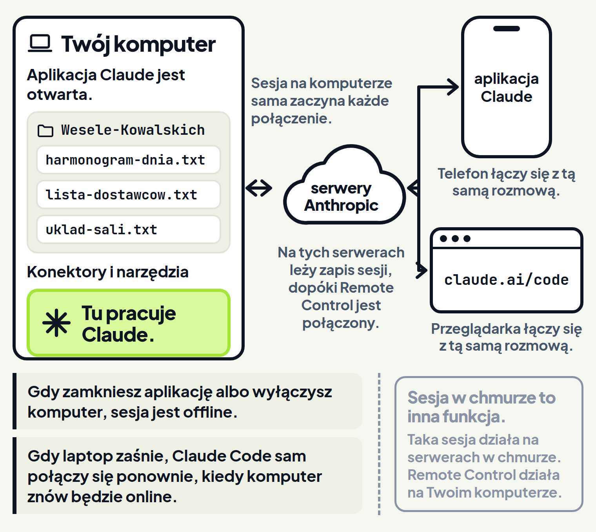
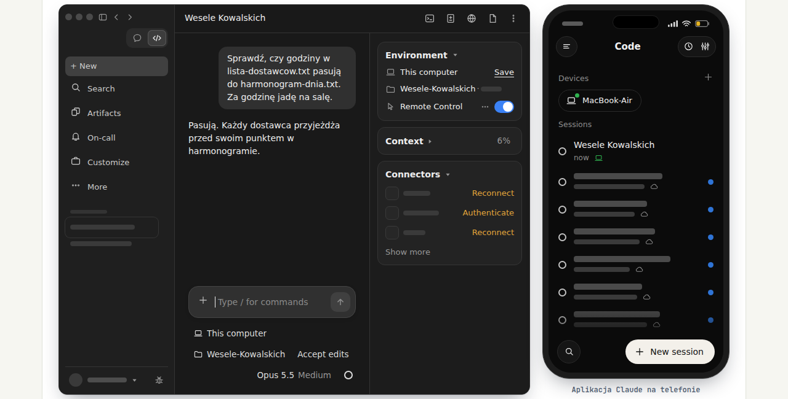
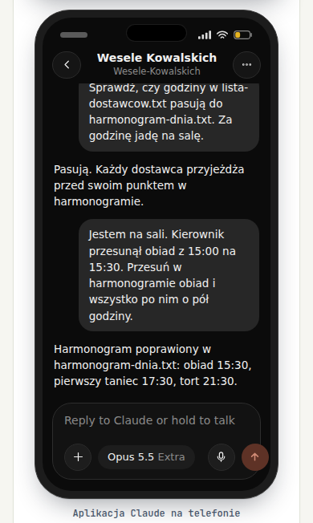
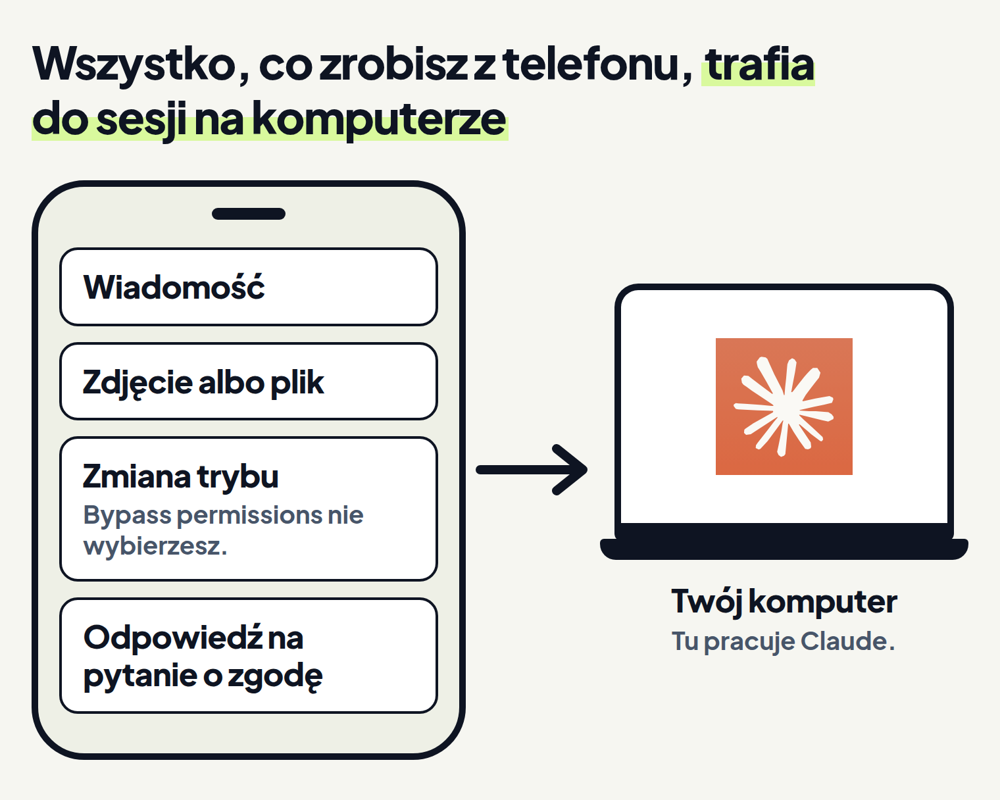

<em>Przewodnik po Claude Code · Moduł 8: Claude pracuje, kiedy Cię nie ma · Lekcja 4 z 4</em>

# Rozmowa z komputera dalej na telefonie

Organizujesz jutrzejsze wesele Kowalskich. Rano przy biurku sprawdzasz z Claude harmonogram dnia i listę dostawców. W południe jesteś już na sali, a kierownik sali przesuwa obiad o pół godziny. Harmonogram leży na komputerze w biurze. Chcesz na telefonie prowadzić tę samą rozmowę z Claude co rano przy biurku i mieć dostęp do plików na komputerze.

Do tego służy Remote Control (zdalne sterowanie). Łączy aplikację Claude na telefonie z sesją Claude Code, która działa na Twoim komputerze. <!-- fakt: remote-control-laczy-aplikacje-z-sesja-na-komputerze --> Zaczynasz pracę przy biurku, a dalej prowadzisz ją z telefonu. <!-- fakt: remote-control-laczy-aplikacje-z-sesja-na-komputerze --> W tej lekcji sesja i rozmowa znaczą to samo, bo aplikacja nazywa rozmowę z Claude sesją. Claude cały czas pracuje na komputerze, więc pliki zostają tam, gdzie były. <!-- fakt: remote-control-claude-pracuje-na-komputerze -->

Rano, przed wyjazdem na salę, włączasz Remote Control w rozmowie o weselu. W południe z sali wysyłasz do niej wiadomość z telefonu.

W ćwiczeniu obok aplikacji na komputerze w biurze widzisz też telefon. Zobaczysz, że wiadomość wysłana z telefonu jest w tej samej rozmowie na komputerze, a Claude zmienia harmonogram w folderze pod oknem. <!-- fakt: remote-control-zapis-synchronizuje-rozmowe --> <!-- fakt: remote-control-claude-pracuje-na-komputerze -->

<!-- cwiczenie: cw1 -->

## Co tu się stało?

<!-- kolumny -->

#### Wiadomość z sali

1. Telefon pokazał sesję z komputera na liście sesji, pod jej nazwą: Wesele Kowalskich. <!-- fakt: telefon-sesja-po-nazwie-na-liscie -->
2. Wiadomość z telefonu trafiła do tej samej rozmowy co prośba z biurka. Rozmowa jest zsynchronizowana na Twoich urządzeniach. <!-- fakt: remote-control-zapis-synchronizuje-rozmowe -->
3. Telefon tylko łączył się z sesją na komputerze. <!-- fakt: remote-control-nie-sesja-w-chmurze -->

#### Zmiana na komputerze

1. Na karcie Environment (środowisko) w panelu obok rozmowy przełącznik Remote Control był włączony. Tak sprawdzasz, czy sesja jest połączona. <!-- fakt: remote-control-aplikacja-stan-w-karcie-environment -->
2. Claude przeczytał harmonogram bez pytania, bo sesja jest w trybie Accept edits (przyjmowanie zmian). <!-- fakt: accept-edits-odczyty-bez-pytania --> W tym trybie Claude sam wprowadza też zmiany w plikach. <!-- fakt: aplikacja-auto-i-accept-edits-stosuja-zmiany -->
3. Plik zmienił się w folderze na komputerze, nie na telefonie. <!-- fakt: remote-control-claude-pracuje-na-komputerze -->
4. Po kliknięciu ścieżki w odpowiedzi Claude otworzył się harmonogram z trzema przesuniętymi godzinami. <!-- fakt: aplikacja-klik-sciezki-w-rozmowie-otwiera-plik -->

<!-- /kolumny -->

Jak włączyć Remote Control we własnej sesji, opisuje część „Jak otworzyć sesję na telefonie”.

## Ta sama sesja na telefonie

### Po co

Rano przy biurku sprawdzasz harmonogram, a poprawki przychodzą w południe na sali. Chcesz je wprowadzić od razu, w tej samej rozmowie i w tych samych plikach. Właśnie wtedy wybierasz Remote Control. <!-- fakt: remote-control-kiedy-uzywac -->

### Jak działa

Remote Control łączy sesję na Twoim komputerze z aplikacją Claude na telefonie (iOS albo Android) i ze stroną claude.ai/code w przeglądarce, także na innym komputerze. <!-- fakt: remote-control-laczy-aplikacje-z-sesja-na-komputerze -->

Claude cały czas pracuje na komputerze. Tam wykonuje polecenia i czyta pliki. <!-- fakt: remote-control-claude-pracuje-na-komputerze --> Telefon i przeglądarka tylko łączą się z tą sesją. <!-- fakt: remote-control-nie-sesja-w-chmurze --> <!-- fakt: telefon-aplikacja-okno-do-sesji -->

Z telefonu masz dostęp do wszystkiego, czego sesja używa na komputerze: <!-- fakt: remote-control-pliki-i-konektory-dostepne -->

- pliki,
- konektory (serwery MCP), które opisuje moduł 5,
- narzędzia,
- ustawienia projektu.

Sesja z aplikacji na komputer pojawia się na innych urządzeniach, gdy połączy ją Remote Control. <!-- fakt: remote-control-aplikacja-sesja-na-innych-urzadzeniach --> Rozmowa jest zsynchronizowana na Twoich urządzeniach, więc piszesz w niej raz przy biurku, raz z telefonu. <!-- fakt: remote-control-zapis-synchronizuje-rozmowe -->

### Dzięki temu

Z telefonu pracujesz na plikach, których na telefonie nie ma. Wynik i tak ląduje w folderze na komputerze, tak jak w ćwiczeniu. <!-- fakt: remote-control-claude-pracuje-na-komputerze -->

### Ograniczenia

- Komputer musi pozostać włączony, a aplikacja Claude na komputer otwarta. <!-- fakt: telefon-komputer-musi-dzialac -->
- Gdy zamkniesz aplikację na komputerze, sesja jest rozłączona, dopóki jej nie przywrócisz. <!-- fakt: remote-control-zamkniecie-aplikacji-sesja-offline --> Przywracasz ją, gdy w aplikacji na komputer wznowisz tę rozmowę: wraca ta sama sesja, a nie nowa. <!-- fakt: remote-control-aplikacja-ta-sama-sesja-po-wznowieniu -->
- Gdy laptop zaśnie albo zniknie sieć, Claude Code sam połączy się ponownie, kiedy komputer znów będzie online. <!-- fakt: remote-control-wraca-po-uspieniu -->
- Remote Control działa w planach Pro, Max, Team i Enterprise, czyli w abonamencie Claude. Z kluczem API zamiast abonamentu nie działa. <!-- fakt: remote-control-plany --> W planach Team i Enterprise najpierw musi go włączyć właściciel firmowego konta Claude (rola Owner). <!-- fakt: remote-control-plany -->
- Sesja na Twoim komputerze sama łączy się z internetem i to ona zaczyna każde połączenie. Nie otwiera na komputerze wejść (portów), przez które ktoś z zewnątrz mógłby się z nim połączyć. <!-- fakt: remote-control-polaczenia-tylko-wychodzace -->
- Gdy konektor z claude.ai wymaga zalogowania, z telefonu nie otworzysz panelu konektorów (`/mcp`). <!-- fakt: telefon-konektor-logowanie-bez-panelu-mcp --> Link do logowania bierzesz z komputera, na którym działa sesja, a otwierasz go na telefonie. <!-- fakt: telefon-konektor-logowanie-bez-panelu-mcp -->
- Dopóki sesja jest połączona przez Remote Control, zapis sesji leży na serwerach Anthropic. <!-- fakt: remote-control-zapis-rozmowy-na-serwerach -->

Zapis sesji obejmuje: <!-- fakt: remote-control-zapis-rozmowy-na-serwerach -->

- Twoje wiadomości,
- odpowiedzi Claude,
- to, co robiły narzędzia.

Co z rozmowy trafia do Anthropic i jak to się ma do danych klientów, opisuje lekcja 4 modułu 5.

Remote Control łatwo pomylić z dwiema innymi funkcjami:

- **Sesja w chmurze** działa na serwerach w chmurze, domyślnie u Anthropic, a Remote Control na Twoim komputerze. <!-- fakt: remote-control-a-sesja-w-chmurze-gdzie-dziala --> Gdy komputer ma być wyłączony, dokumentacja poleca sesję w chmurze albo projekt. Oba działają w chmurze, także przy zamkniętym laptopie. <!-- fakt: telefon-komputer-wylaczony-chmura --> Tych funkcji kurs nie omawia.
- **Dispatch** to jedna, stała rozmowa z Claude w Cowork. Wysyłasz do niej zadanie, a Claude sam decyduje, jak je wykonać. <!-- fakt: telefon-dispatch-w-cowork --> Remote Control łączy natomiast telefon z sesją, która działa na Twoim komputerze. <!-- fakt: remote-control-laczy-aplikacje-z-sesja-na-komputerze -->

## Jak otworzyć sesję na telefonie

### Po co

Zanim wyjdziesz z biura, połączysz rozmowę z telefonem, żeby tam na Ciebie czekała.

### Na komputerze

1. Otwórz sesję, którą chcesz mieć na telefonie. To ma być sesja lokalna, czyli działająca na Twoim komputerze. <!-- fakt: remote-control-aplikacja-polecenie-w-polu --> Włącz przełącznik Remote Control tej sesji. Przełącznik jest na karcie Environment w panelu obok rozmowy, a krok 2 mówi, jak ten panel pokazać. <!-- fakt: remote-control-aplikacja-stan-w-karcie-environment --> Możesz też wpisać `/remote-control` w polu wiadomości. <!-- fakt: remote-control-aplikacja-przelacznik-albo-polecenie --> Krótsza wersja polecenia to `/rc`. <!-- fakt: remote-control-aplikacja-polecenie-w-polu -->
2. Panel szczegółów to karty obok rozmowy. W ćwiczeniu 1 była w nim karta Environment. <!-- fakt: aplikacja-panel-szczegolow-sesji-karty-obok-czatu --> Gdy go nie widać, kliknij Show session rail (pokaż panel sesji) na pasku tytułu sesji. Gdy okno jest wąskie, ten przycisk jest w menu ⋮ tego paska. <!-- fakt: aplikacja-panel-szczegolow-ukryj-i-pokaz -->
3. Na przełączniku Remote Control w karcie Environment (środowisko) tego panelu sprawdzisz, czy sesja jest połączona. <!-- fakt: remote-control-aplikacja-stan-w-karcie-environment --> Wiersz Remote Control jest w tej karcie pod wierszem z folderem sesji. Po prawej ma przycisk … i przełącznik, który po włączeniu jest niebieski. Ten wiersz pokazało ćwiczenie 1.
4. Połączona sesja pojawia się na liście sesji na claude.ai/code i w aplikacjach Claude na urządzeniach z Twoim kontem. <!-- fakt: remote-control-aplikacja-sesja-na-innych-urzadzeniach -->

### Na telefonie

1. Zainstaluj aplikację Claude na iOS albo na Androida. Na iPadzie to ta sama aplikacja co na iOS. <!-- fakt: telefon-ios-android-ipad -->
2. Zaloguj się tym samym kontem claude.ai i do tej samej organizacji co w Claude Code na komputerze. <!-- fakt: telefon-to-samo-konto -->
3. Stuknij zakładkę Code w menu aplikacji. Osobnej aplikacji Claude Code na telefon nie ma, sesje są w zakładce Code. <!-- fakt: telefon-bez-osobnej-aplikacji-zakladka-code --> <!-- fakt: telefon-zakladka-code-ikona-komputera -->
4. Na liście sesji znajdź swoją sesję po nazwie. <!-- fakt: telefon-sesja-po-nazwie-na-liscie --> Lista ma dwie części: u góry Devices (urządzenia) z Twoim komputerem, niżej Sessions (sesje). Gdy nie nadasz sesji nazwy, Claude Code po wysłaniu Twojej prośby sam zmieni tytuł sesji tak, żeby pasował do tej prośby. <!-- fakt: remote-control-tytul-z-prosby -->
5. Dokumentacja opisuje sesję Remote Control, która jest online, jako ikonę komputera z zieloną kropką. <!-- fakt: telefon-zakladka-code-ikona-komputera --> W aplikacji wygląda to tak: zielona kropka jest przy Twoim komputerze w części Devices, a sesja ma w części Sessions zieloną ikonę laptopa obok napisu now.
6. Piszesz dalej w tej samej rozmowie. <!-- fakt: remote-control-rozmowa-na-wszystkich-urzadzeniach -->

W przeglądarce tę samą listę sesji znajdziesz na claude.ai/code. <!-- fakt: telefon-sesja-po-nazwie-na-liscie -->

### Dzięki temu

Przed wyjściem z biura wystarczy włączyć jeden przełącznik albo wpisać jedno polecenie. <!-- fakt: remote-control-aplikacja-przelacznik-albo-polecenie --> Na telefonie sesja czeka na liście. <!-- fakt: remote-control-aplikacja-sesja-na-innych-urzadzeniach -->

### Ograniczenia

- Nie widzisz zakładki Code? Twój plan albo organizacja może nie obejmować Claude Code na telefonie. <!-- fakt: telefon-brak-zakladki-code -->
- Sesję rozłączasz, gdy wpiszesz `/remote-control` jeszcze raz. <!-- fakt: remote-control-aplikacja-wylaczenie-poleceniem --> Możesz też wyłączyć jej przełącznik. <!-- fakt: remote-control-aplikacja-wylacz-jedna-sesje --> Więcej o tym w części „Które sesje widać na innych urządzeniach”.

Wieczorem wracasz do biura. W ćwiczeniu zobaczysz, że przy biurku piszesz dalej w tej samej rozmowie, do której w południe szły wiadomości z telefonu. <!-- fakt: remote-control-aplikacja-sesja-na-innych-urzadzeniach --> <!-- fakt: remote-control-zapis-synchronizuje-rozmowe --> Claude zapisze SMS do dostawców w nowym pliku na komputerze. <!-- fakt: claude-code-tworzy-nowe-pliki --> Drugie polecenie zaprowadzi Cię do ustawienia Connect new sessions to Remote Control. Gdy jest włączone, nowe sesje, które zaczynasz na tym komputerze, łączą się same. <!-- fakt: remote-control-aplikacja-nowe-sesje-same --> <!-- fakt: remote-control-aplikacja-wylacz-nowe-sesje -->

<!-- cwiczenie: cw2 -->

## Co tu się stało?

<!-- kolumny -->

#### Plik na komputerze

<!-- podglad: cw2 przy-biurku -->

1. Claude przeczytał harmonogram i listę dostawców, a potem zapisał SMS w nowym pliku. <!-- fakt: claude-code-tworzy-nowe-pliki -->
2. Plik powstał w folderze na komputerze. <!-- fakt: remote-control-claude-pracuje-na-komputerze -->
3. Po kliknięciu ścieżki w odpowiedzi Claude otworzył się plik z SMS-em. <!-- fakt: aplikacja-klik-sciezki-w-rozmowie-otwiera-plik -->

#### Jedna rozmowa

1. Po naciśnięciu klawisza <kbd>Enter</kbd> prośba z biurka trafiła do tej samej rozmowy, w której jest wiadomość z sali. <!-- fakt: aplikacja-enter-wysyla-zadanie --> <!-- fakt: remote-control-zapis-synchronizuje-rozmowe -->
2. Sesja cały czas działała w aplikacji na komputerze. <!-- fakt: remote-control-nie-sesja-w-chmurze --> W południe wiadomość szła do niej z telefonu, a wieczorem piszesz w niej przy biurku. <!-- fakt: remote-control-zapis-synchronizuje-rozmowe -->

<!-- /kolumny -->

W drugim poleceniu otwierasz Settings (ustawienia) > Claude Code. W części Remote Control ustawienie Connect new sessions to Remote Control jest włączone, więc nowe sesje, które zaczynasz na tym komputerze, łączą się same. <!-- fakt: remote-control-aplikacja-nowe-sesje-same --> <!-- fakt: remote-control-aplikacja-wylacz-nowe-sesje --> Kiedy je wyłączyć, opisuje część „Które sesje widać na innych urządzeniach”.

## Co zrobisz z telefonu

### Po co

Na sali nie tylko czytasz odpowiedzi Claude. Chcesz też:

- dosłać zdjęcie,
- zmienić tryb pracy,
- odpowiedzieć Claude, gdy o coś pyta.

### Jak działa

- **Wiadomość** trafia do tej samej rozmowy co prośby z komputera. <!-- fakt: remote-control-rozmowa-na-wszystkich-urzadzeniach -->
- **Znak `@`:** po jego wpisaniu podpowiadają się ścieżki plików z folderu na komputerze. <!-- fakt: remote-control-pliki-i-konektory-dostepne -->
- **Zdjęcie albo plik** dołączasz z podpisem albo bez. Claude widzi zdjęcie wprost w wiadomości. <!-- fakt: remote-control-zdjecia-i-pliki-z-telefonu --> Inne pliki Claude Code pobiera na komputer i podaje Claude tak jak plik wskazany znakiem `@`. <!-- fakt: remote-control-zdjecia-i-pliki-z-telefonu -->
- **Zdjęcie na komputerze:** Claude Code zapisuje każde zdjęcie w folderze na komputerze, w którym trzyma przesłane zdjęcia (`~/.claude/uploads/`), i podaje Claude jego ścieżkę. Dzięki temu Claude może wstawić zdjęcie do plików, które tworzy. <!-- fakt: telefon-zdjecia-w-uploads -->
- **Tryb pracy** zmienisz, gdy stukniesz + w polu wiadomości, a potem Permission (uprawnienia). <!-- fakt: telefon-tryb-plus-permission --> Do wyboru są Manual (ręczny), Accept edits, Plan (planowanie) i Auto (automatyczny). <!-- fakt: telefon-tryby-bez-bypass --> Auto wybierzesz tylko wtedy, gdy sesja spełnia wymagania tego trybu. <!-- fakt: telefon-auto-wymaga-dostepnosci -->
- **Pytania o zgodę i pytania Claude** czekają, aż na nie odpowiesz. <!-- fakt: remote-control-pytania-o-zgode-czekaja -->
- **Model i wysiłek:** gdy wybierzesz model na telefonie, Claude w sesji na komputerze pracuje na tym modelu. <!-- fakt: remote-control-model-z-telefonu --> Poziom wysiłku ustawiony na telefonie też działa w sesji na komputerze. <!-- fakt: remote-control-wysilek-z-telefonu --> Model i wysiłek opisuje moduł 6.
- **Polecenie `/clear`:** gdy w sesji wpiszesz `/clear`, rozmowa zaczyna się od nowa także na połączonych urządzeniach. <!-- fakt: remote-control-clear-na-urzadzeniach --> Polecenie `/clear` opisuje moduł 6.

 <!-- fakt: remote-control-rozmowa-na-wszystkich-urzadzeniach --> <!-- fakt: remote-control-claude-pracuje-na-komputerze --> <!-- fakt: telefon-tryby-bez-bypass -->
<!-- analogia: To jak pilot do telewizora: telewizor (komputer) gra w salonie, a pilot (telefon) tylko nim steruje. Gdy wyłączysz telewizor, pilot nic nie zrobi. -->

### Dzięki temu

Z sali możesz:

- odpowiadać Claude,
- poprawiać pliki,
- dosyłać zdjęcia.

Wynik ląduje w folderze na komputerze. <!-- fakt: remote-control-claude-pracuje-na-komputerze -->

### Ograniczenia

- Bypass permissions (pomijanie uprawnień) z telefonu nie wybierzesz. <!-- fakt: telefon-tryby-bez-bypass -->
- Z telefonu nie uruchomisz poleceń, które działają tylko w terminalu. <!-- fakt: telefon-polecenia-tylko-lokalne -->
- Pliku z telefonu czasem nie da się pobrać na komputer. Claude i tak dostaje wiadomość i pliki, które doszły. W miejscu brakującego pliku Claude Code dopisuje notatkę, na przykład `[1 of 3 attachments did not arrive]` (1 z 3 załączników nie dotarł). <!-- fakt: remote-control-zalacznik-nie-doszedl -->
- Na claude.ai/code albo w aplikacji Claude na komputer może pojawić się komunikat Remote Control disconnected (Remote Control rozłączony) albo Can't reach (brak połączenia). To znaczy, że przeglądarka albo aplikacja straciła kontakt z Claude Code na Twoim komputerze. <!-- fakt: remote-control-rozlaczenie-nie-mowi-czy-pracuje --> Żaden z tych komunikatów nie mówi, czy Claude dalej pracuje na komputerze. <!-- fakt: remote-control-rozlaczenie-nie-mowi-czy-pracuje -->
- Gdy Remote Control jest włączony, Claude może wysyłać na telefon powiadomienia push. <!-- fakt: remote-control-push-na-telefon --> Dokumentacja opisuje, jak je włączyć, tylko w terminalu, dlatego ta lekcja ich nie pokazuje. <!-- fakt: remote-control-push-wlaczasz-w-terminalu -->

## Które sesje widać na innych urządzeniach

### Po co

Nie każda rozmowa ma trafiać na telefon. Na przykład rozmowa o fakturach klientów nie powinna tam trafiać.

### Jak działa

To, które rozmowy widać na innych urządzeniach, ustawiasz na trzy sposoby. Każdy działa na co innego.

1. **Jedną sesję rozłączasz jej przełącznikiem Remote Control.** Wystarczy wyłączyć przełącznik tej sesji. <!-- fakt: remote-control-aplikacja-wylacz-jedna-sesje --> Możesz też wpisać `/remote-control` jeszcze raz. <!-- fakt: remote-control-aplikacja-wylaczenie-poleceniem --> Wyjątkiem jest sesja, która połączyła się sama przy starcie. Polecenie `/remote-control` jej nie rozłączy, tylko pokaże wiersz `Remote Control is already on. This session connected automatically when it started.` (Remote Control jest już włączony, sesja połączyła się sama przy starcie). Rozłączasz ją przyciskiem Turn off (wyłącz) w tym wierszu. <!-- fakt: remote-control-aplikacja-polaczona-przy-starcie-turn-off -->
2. **Łączenie nowych sesji ustawiasz w Settings (ustawienia) > Claude Code.** Służy do tego ustawienie Connect new sessions to Remote Control (łącz nowe sesje z Remote Control). Gdy jest włączone, nowe sesje, które zaczynasz na tym komputerze, łączą się same. <!-- fakt: remote-control-aplikacja-nowe-sesje-same --> <!-- fakt: remote-control-aplikacja-wylacz-nowe-sesje --> Gdy je wyłączysz, nowe sesje na tym komputerze nie trafią na inne urządzenia. <!-- fakt: remote-control-aplikacja-wylacz-nowe-sesje --> Dopóki tego ustawienia nie zmienisz, aplikacja kieruje się plikami ustawień Claude Code, a gdy tam nic nie ma, domyślnym ustawieniem Twojej organizacji. <!-- fakt: remote-control-aplikacja-ustawienie-domyslne-organizacji --> Gdy przełącznik tego ustawienia już jest wyłączony, włącz go i znowu wyłącz. Wtedy aplikacja zapisze Twój wybór. <!-- fakt: remote-control-aplikacja-wlacz-wylacz-zapisuje-wybor --> To ustawienie pokazało drugie polecenie ćwiczenia 2. W części Remote Control tej strony ustawienie ma opis „Sessions you start on this computer connect to Remote Control automatically, so you can continue them from other devices.”. Znaczy on: sesje, które zaczynasz na tym komputerze, same łączą się z Remote Control, więc prowadzisz je dalej z innych urządzeń.
3. **Sesję, która już jest na innych urządzeniach, ukryjesz archiwizacją.** Zarchiwizuj ją w aplikacji na komputer. Zniknie wtedy z domyślnej listy sesji na innych urządzeniach. <!-- fakt: remote-control-aplikacja-archiwizacja-ukrywa -->

Sesja, która połączyła się sama, pojawia się tylko w aplikacjach Claude zalogowanych na Twoje konto. Nikt inny nie dostaje do niej dostępu. <!-- fakt: remote-control-tylko-twoje-konto -->

Gdy w aplikacji na komputer wznowisz rozmowę z włączonym Remote Control, na liście zostaje ta sama sesja. <!-- fakt: remote-control-aplikacja-ta-sama-sesja-po-wznowieniu -->

### Dzięki temu

Ty decydujesz, które rozmowy widać na innych urządzeniach. Rozmowa o weselu trafia na telefon, a rozmowa o fakturach nie.

### Ograniczenia

- Ustawienie Connect new sessions to Remote Control dotyczy nowych sesji. <!-- fakt: remote-control-aplikacja-wylacz-nowe-sesje --> Sesję, która już jest połączona, rozłączasz jej własnym przełącznikiem. <!-- fakt: remote-control-aplikacja-wylacz-jedna-sesje -->

## Kiedy włączać Remote Control, a kiedy nie

<!-- kolumny -->

#### Włącz

- Włącz Remote Control, gdy jesteś w trakcie pracy na komputerze i chcesz ją prowadzić dalej z innego urządzenia. <!-- fakt: remote-control-kiedy-uzywac -->
- Włącz go, gdy komputer i aplikacja Claude pozostaną włączone. <!-- fakt: telefon-komputer-musi-dzialac -->
- Włącz go, gdy do pracy potrzebujesz plików i konektorów z komputera. <!-- fakt: remote-control-pliki-i-konektory-dostepne -->
- Włącz go, gdy chcesz z telefonu sprawdzać, jak Claude idzie do celu ustawionego poleceniem `/goal` z lekcji 3. `/goal` działa też przez Remote Control. <!-- fakt: goal-dziala-w-aplikacji -->

#### Nie włączaj

- Nie włączaj Remote Control, gdy komputer będzie wyłączony albo zamkniesz aplikację. Sesja będzie wtedy offline. <!-- fakt: remote-control-zamkniecie-aplikacji-sesja-offline --> <!-- fakt: telefon-komputer-musi-dzialac -->
- Nie włączaj go, gdy rozmowa nie powinna trafiać na inne urządzenia. Przy połączonym Remote Control zapis sesji leży na serwerach Anthropic. <!-- fakt: remote-control-zapis-rozmowy-na-serwerach -->
- Nie włączaj go, gdy praca ma ruszać sama o stałej porze. Wtedy ustaw zadanie z harmonogramu z lekcji 1. <!-- fakt: harmonogram-zadanie-startuje-nowa-sesje -->

<!-- /kolumny -->

## Źródła

- [Remote Control](https://code.claude.com/docs/en/remote-control)
- [Claude Code na telefonie](https://code.claude.com/docs/en/mobile)
- [Aplikacja Claude na komputer](https://code.claude.com/docs/en/desktop)
- [Tryby uprawnień](https://code.claude.com/docs/en/permission-modes)
- [Pierwsze kroki w aplikacji](https://code.claude.com/docs/en/desktop-quickstart)
- [Jak działa Claude Code](https://code.claude.com/docs/en/how-claude-code-works)
- [Praca do celu: /goal](https://code.claude.com/docs/en/goal)
- [Zadania z harmonogramu w aplikacji](https://code.claude.com/docs/en/desktop-scheduled-tasks)

Sprawdzone 26.10.2026, Claude Code 2.1.310.
