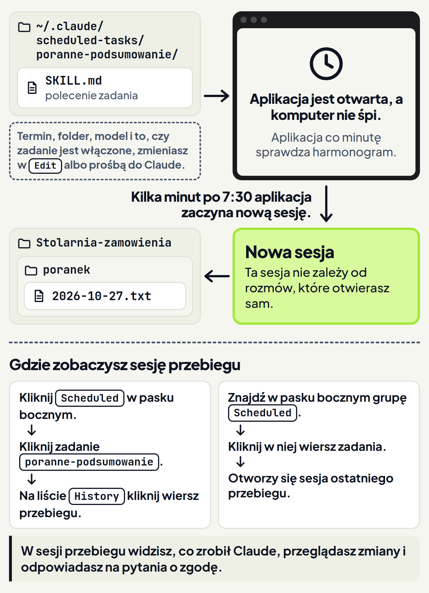
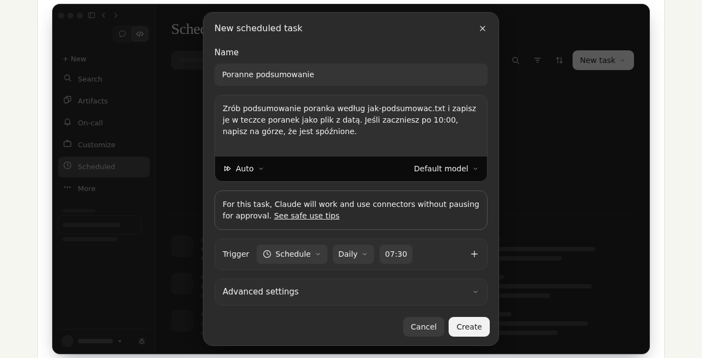
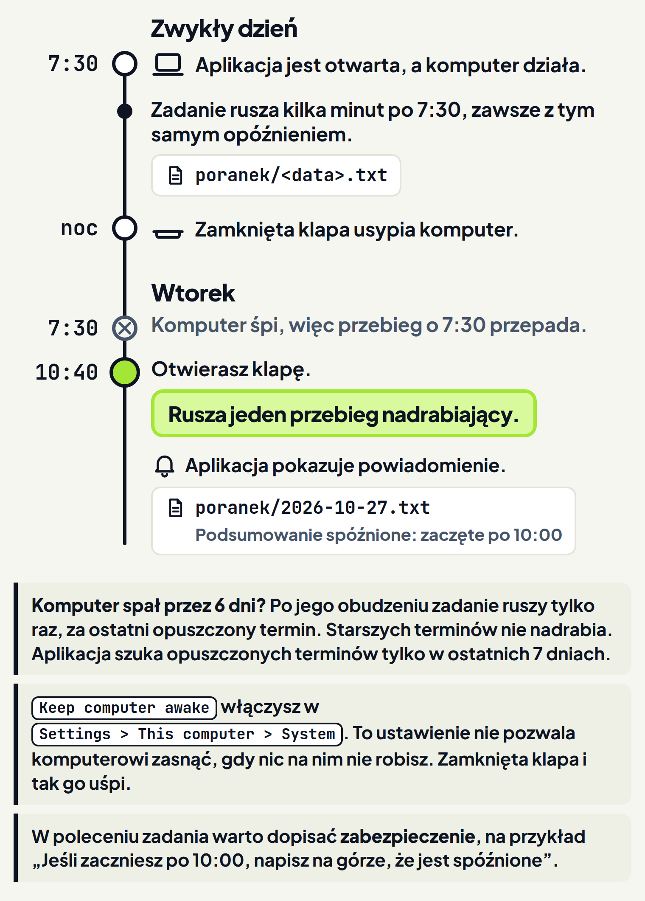

<em>Przewodnik po Claude Code · Moduł 8: Claude pracuje, kiedy Cię nie ma · Lekcja 1 z 4</em>

# Zadanie co rano

Masz stolarnię i robisz meble na zamówienie. Co rano, zanim wyjedziesz na pomiar, przeglądasz arkusz zamówień i listę dostaw płyt. Potem spisujesz, co Cię dziś czeka. Każdego dnia to ta sama praca.

Tę pracę może robić za Ciebie zadanie z harmonogramu (w aplikacji nazywa się Scheduled task). Takie zadanie samo uruchamia nową sesję o wybranej porze i tak często, jak chcesz. <!-- fakt: harmonogram-zadanie-startuje-nowa-sesje --> Każde takie uruchomienie zadania nazywamy w kursie przebiegiem. Dokumentacja podaje taki przykład: zadanie, które co rano robi podsumowanie z kalendarza i poczty. <!-- fakt: harmonogram-zadanie-startuje-nowa-sesje -->

W tej sesji Claude zmienia pliki tak samo jak w rozmowie, którą zaczynasz sam. <!-- fakt: harmonogram-sesja-przebiegu-co-widac --> Podsumowanie może więc być w folderze, zanim usiądziesz do biurka.

W ćwiczeniu zobaczysz, że po jednej prośbie w rozmowie Claude robi dwie rzeczy. Zapisuje dzisiejsze podsumowanie w teczce `poranek` i ustawia zadanie, które od jutra zrobi to samo bez Ciebie. <!-- fakt: harmonogram-prosba-tworzy-zadanie --> Drugie polecenie w ćwiczeniu pokaże inny sposób: takie samo zadanie ustawisz w formularzu, który otwierasz kliknięciem Scheduled w pasku bocznym. <!-- fakt: harmonogram-formularz-otwierasz-scheduled --> W ćwiczeniu oba sposoby ustawiają zadanie o tej samej nazwie. We własnej aplikacji wybierz jeden z nich, bo nazwa zadania musi się różnić od nazw innych zadań. <!-- fakt: harmonogram-nazwa-niepowtarzalna -->

<!-- cwiczenie: cw1 -->

## Co tu się stało?

<!-- kolumny -->

#### W rozmowie

1. Prośba podawała porę: codziennie o 7:30. Taka prośba w dowolnej rozmowie tworzy zadanie, które się powtarza. <!-- fakt: harmonogram-prosba-tworzy-zadanie -->
2. Dzisiejsze podsumowanie Claude zrobił od razu, bo prośba kończyła się zdaniem „Dziś zrób je od razu”.
3. Zdanie „Jeśli zaczniesz po 10:00, napisz na górze, że jest spóźnione” to zabezpieczenie. Gdy komputer prześpi porę, zadanie może ruszyć dużo później. <!-- fakt: harmonogram-zabezpieczenie-w-poleceniu -->

#### W teczce poranek

<!-- podglad: cw1 zadanie -->

1. Claude utworzył teczkę `poranek` i plik z dzisiejszą datą. <!-- fakt: claude-code-tworzy-nowe-pliki -->
2. Claude zapisał plik bez pytania o zgodę, bo rozmowa była w trybie Accept edits (przyjmowanie zmian). <!-- fakt: accept-edits-edycje-w-folderze-bez-pytania -->
3. Od jutra kolejne podsumowania zrobi zadanie, za każdym razem w nowej sesji. <!-- fakt: harmonogram-sprawdza-co-minute-nowa-sesja --> Folder, w którym pracuje zadanie, sprawdzisz na stronie zadania. <!-- fakt: harmonogram-edit-zmienia-ustawienia --> Otworzysz ją, gdy klikniesz Scheduled w pasku bocznym, a potem zadanie na liście. <!-- fakt: harmonogram-strona-zadania -->

<!-- /kolumny -->

Drugie polecenie pokazało, jak takie samo zadanie ustawić w formularzu. W ćwiczeniu wystarczyło kliknąć po kolei:

1. Scheduled,
2. New task,
3. Advanced settings,
4. Create,
5. Run now.

Co robisz w każdym kroku formularza, objaśnia część „Formularz” niżej.

## Zadanie z harmonogramu

Zadanie z harmonogramu przydaje się do pracy, która wraca w stałym rytmie. <!-- fakt: harmonogram-zadanie-startuje-nowa-sesje --> W tej lekcji poznasz zadania lokalne, czyli zadania na Twoim komputerze. Zadanie lokalne ma bezpośredni dostęp do Twoich plików i narzędzi. <!-- fakt: harmonogram-lokalne-tylko-przy-otwartej-aplikacji -->

### Jak działa

1. Gdy aplikacja jest otwarta, co minutę sprawdza harmonogram. <!-- fakt: harmonogram-sprawdza-co-minute-nowa-sesja -->
2. Gdy nadejdzie pora zadania, aplikacja uruchamia nową sesję. Ta sesja nie zależy od rozmów, które otwierasz sam. <!-- fakt: harmonogram-sprawdza-co-minute-nowa-sesja -->
3. W tej sesji Claude zmienia pliki i uruchamia polecenia tak samo jak w Twojej rozmowie. <!-- fakt: harmonogram-sesja-przebiegu-co-widac -->
4. Zadanie lokalne korzysta też z konektorów. Konektory opisuje moduł 5. <!-- fakt: harmonogram-porownanie-konektory -->

Polecenie zadania leży w pliku SKILL.md, w folderze `~/.claude/scheduled-tasks/<nazwa-zadania>/`. <!-- fakt: harmonogram-polecenie-w-pliku-skill --> Ten folder leży w Twoim folderze domowym. Zwykle nie musisz tam zaglądać, bo polecenie zmienisz też w formularzu Edit (edycja) albo prośbą do Claude. <!-- fakt: harmonogram-edit-zmienia-ustawienia --> <!-- fakt: harmonogram-prosba-lista-edycja-pauza --> Plik SKILL.md znasz z modułu o skillach. Zmiana polecenia w tym pliku zadziała przy następnym przebiegu zadania. <!-- fakt: harmonogram-polecenie-w-pliku-skill -->

W pliku SKILL.md nie ma:

- terminu,
- folderu,
- modelu,
- tego, czy zadanie jest włączone. <!-- fakt: harmonogram-termin-poza-plikiem -->

Te rzeczy zmieniasz w formularzu Edit albo prośbą do Claude. <!-- fakt: harmonogram-termin-poza-plikiem -->

### Dzięki temu

Wynik jest w folderze, zanim usiądziesz do pracy. Zadanie nie potrzebuje otwartej rozmowy. <!-- fakt: harmonogram-porownanie-otwarta-sesja --> Zadanie nie znika też po ponownym uruchomieniu. <!-- fakt: harmonogram-porownanie-trwa-po-ponownym-uruchomieniu -->

### Ograniczenia

- Zadanie lokalne rusza tylko wtedy, gdy aplikacja jest otwarta, a komputer nie śpi. <!-- fakt: harmonogram-lokalne-tylko-przy-otwartej-aplikacji -->
- Zadania lokalne wymagają aplikacji Claude na komputer (Claude Desktop) w wersji 1.1.5368 albo nowszej. <!-- fakt: harmonogram-wymaga-wersji-aplikacji -->

## Dwie drogi: prośba i formularz

Zadanie ustawisz prośbą w rozmowie albo formularzem. Prośba jest prostsza, bo nie musisz szukać przycisków. Dokumentacja uprzedza, że formularz może wyglądać różnie. <!-- fakt: harmonogram-new-task-rozne-ekrany -->

### Prośba w rozmowie

Zadanie utworzysz, opisując w dowolnej rozmowie, czego chcesz. Prośba o pracę codziennie rano o stałej godzinie tworzy zadanie, które się powtarza. <!-- fakt: harmonogram-prosba-tworzy-zadanie -->

Prośba o przypomnienie o konkretnej porze tworzy zadanie jednorazowe. Po uruchomieniu takie zadanie samo się wyłącza. <!-- fakt: harmonogram-prosba-jednorazowe --> Przykład takiej prośby: „Przypomnij mi jutro o 15:00 o telefonie do Nowaków w sprawie kuchni”.

Gdy poprosisz Claude, ustawi też zadanie, które rusza częściej niż co godzinę. Może też ustawić zadanie, które ruszy tylko raz, o wybranej porze w przyszłości. <!-- fakt: harmonogram-claude-ustawia-termin -->

Po prośbie sprawdź ustawienia zadania:

1. W zakładce Code kliknij Scheduled (zaplanowane) w pasku bocznym, potem zadanie na liście. Otworzy się strona zadania. <!-- fakt: harmonogram-strona-zadania -->
2. Kliknij ikonę ołówka. Otworzy się formularz Edit. <!-- fakt: harmonogram-olowek-otwiera-edit -->

W formularzu Edit sprawdź:

- polecenie,
- termin,
- folder,
- tryb uprawnień.

Na początek wybierz ten sam tryb co w ćwiczeniu, czyli Accept edits. W tym trybie Claude tworzy i zmienia pliki w folderze bez pytania. <!-- fakt: accept-edits-edycje-w-folderze-bez-pytania -->

W Edit możesz zmienić każde z tych ustawień. <!-- fakt: harmonogram-edit-zmienia-ustawienia --> Każde zadanie ma własny tryb, który ustawiasz przy tworzeniu albo edycji zadania. <!-- fakt: harmonogram-tryb-wlasny-zadania --> Co robi każdy tryb, gdy nie ma Cię przy komputerze, pokaże lekcja 2 tego modułu.

Folder i tryb zadania utworzonego prośbą sprawdzasz właśnie w formularzu Edit. Dokumentacja nie podaje, jaki folder i jaki tryb dostaje takie zadanie, dlatego zaglądaj do Edit po każdej prośbie.

### Formularz

Ten sposób pokazało drugie polecenie ćwiczenia 1. W ćwiczeniu pola okna były już wypełnione i wystarczyło klikać przyciski. We własnej aplikacji pola wypełniasz sam, według kroków niżej.

1. W zakładce Code kliknij Scheduled w pasku bocznym albo w jego menu More (więcej). <!-- fakt: harmonogram-formularz-otwierasz-scheduled -->
2. Kliknij New task (nowe zadanie) w prawym górnym rogu strony Scheduled tasks. Otworzy się okno New scheduled task (nowe zadanie z harmonogramu). <!-- fakt: harmonogram-new-task-rozne-ekrany -->
3. W polu Name wpisz nazwę, na przykład Poranne podsumowanie. Może mieć spacje i wielkie litery. Na stronie zadania i w pasku bocznym zobaczysz ją tak, jak ją wpiszesz.
4. Folder zadania na dysku dostanie tę nazwę zapisaną małymi literami, z myślnikami zamiast spacji, na przykład poranne-podsumowanie. Nazwa zadania staje się więc nazwą folderu i dlatego musi się różnić od nazw innych zadań. <!-- fakt: harmonogram-nazwa-niepowtarzalna -->
5. W polu pod nazwą wpisz, co Claude ma zrobić, gdy zadanie ruszy. <!-- fakt: harmonogram-polecenie-pod-nazwa -->
6. Karta Trigger (termin) ma już wpisany termin: Schedule, Daily i godzinę. Zmienisz go w kroku 8. Najpierw rozwiń pod nią Advanced settings (ustawienia zaawansowane) i na karcie General (ogólne) włącz Only on this computer (tylko na tym komputerze). Wtedy zadanie działa na Twoim komputerze, w lokalnym folderze. <!-- fakt: harmonogram-only-on-this-computer -->
7. W wierszu Local folder wybierz folder. Dopóki go nie wybierzesz, przycisk Create (utwórz) jest nieaktywny. <!-- fakt: harmonogram-local-folder-wymagany --> Pozostałych wierszy tej karty, na przykład Require this computer, ani kart Connectors (konektory) i Notifications (powiadomienia) nie zmieniaj. Dokumentacja nie wymienia ich w krokach zakładania zadania lokalnego.
8. Wróć do karty Trigger. W polu, w którym stoi Daily, wybierz gotowy termin. <!-- fakt: harmonogram-trigger-gotowy-termin --> Godzinę wpiszesz w polu obok.
9. Na pasku pola z poleceniem wybierz tryb uprawnień i model. Jeśli ich nie zmienisz, przebiegi użyją Twoich ustawień Claude Code i domyślnego modelu. <!-- fakt: harmonogram-tryb-i-model-w-polu-polecenia -->
10. Na tym pasku mogą już być wybrane tryb Auto i Default model (model domyślny). Przy Auto pod polem jest napis „For this task, Claude will work and use connectors without pausing for approval.”. Znaczy on: w tym zadaniu Claude pracuje i używa konektorów, nie czekając na Twoją zgodę. Kliknij nazwę trybu na pasku i wybierz Accept edits, ten sam tryb co przy prośbie w ćwiczeniu. <!-- fakt: harmonogram-tryb-wlasny-zadania --> W ćwiczeniu okno zostaje przy Auto, dlatego strona zadania pokazuje w Permissions tryb Auto.
11. Kliknij Create (utwórz). Jeśli folder nie jest jeszcze zaufany, aplikacja zapyta, czy ufasz temu folderowi. Potem otworzy się strona zadania. <!-- fakt: harmonogram-create-zaufanie-folderu -->
12. Na stronie zadania kliknij Run now (uruchom teraz), jeśli chcesz pierwszy przebieg od razu, bez czekania na termin. <!-- fakt: harmonogram-run-now --> Przebieg znajdziesz potem na liście History (historia). <!-- fakt: harmonogram-sesja-przebiegu-w-history -->

### Terminy

Przy włączonym Only on this computer karta Trigger daje cztery terminy: <!-- fakt: harmonogram-trigger-cztery-opcje -->

- Hourly: co godzinę,
- Daily: codziennie o wybranej godzinie, liczonej w czasie lokalnym,
- Weekdays: jak Daily, ale bez soboty i niedzieli,
- Weekly: w wybranym dniu tygodnia o wybranej godzinie. <!-- fakt: harmonogram-opcje-terminu -->

Dwóch kolejnych terminów w tym oknie nie ma. Wybierzesz je dopiero w formularzu Edit, po utworzeniu zadania: <!-- fakt: harmonogram-trigger-cztery-opcje -->

- Manual: bez terminu, zadanie rusza tylko po kliknięciu Run now (uruchom teraz), <!-- fakt: harmonogram-opcje-terminu -->
- Custom: własny termin, który wpisujesz sam w zapisie cron, według czasu lokalnego. <!-- fakt: harmonogram-custom-cron -->

Dwie inne odmiany formularza dają od razu wszystkie sześć terminów. Pierwsza to okno, w którym przełącznik Only on this computer jest na samej górze. Druga to formularz na całą stronę. <!-- fakt: harmonogram-szesc-terminow-od-razu --> Obie odmiany opisuje następna część, „Gdy okno wygląda inaczej”.

### Gdy okno wygląda inaczej

Po kliknięciu New task zamiast okna New scheduled task może się pokazać coś innego: <!-- fakt: harmonogram-new-task-rozne-ekrany -->

- Może się pokazać menu z pozycjami Create with Claude (utwórz z Claude) i Set up manually (ustaw ręcznie). Wybierz Set up manually, a otworzy się okno z formularzem. <!-- fakt: harmonogram-new-task-rozne-ekrany -->
- Może się otworzyć okno, w którym przełącznik Only on this computer jest na samej górze. Włącz ten przełącznik, zanim cokolwiek wpiszesz, a pojawi się pusty formularz zadania lokalnego. <!-- fakt: harmonogram-okno-only-na-gorze --> W tym formularzu przycisk Create jest nieaktywny, dopóki nie wypełnisz pól Description (opis) i Working folder (folder roboczy). <!-- fakt: harmonogram-okno-only-opis-i-folder -->
- Może się też pokazać menu z pozycjami Local (lokalnie) i Cloud (w chmurze) albo od razu formularz na całą stronę. <!-- fakt: harmonogram-new-task-rozne-ekrany --> Z menu wybierz Local. Otworzy się strona New local routine albo New local scheduled task. Tryb, model i folder wybierasz na niej w polu Instructions (polecenie). <!-- fakt: harmonogram-formularz-na-cala-strone --> Gdy na tej stronie Create jest nieaktywne, najedź na nie myszą. Zobaczysz, czego formularz jeszcze potrzebuje. <!-- fakt: harmonogram-create-podpowiedz-po-najechaniu -->

Jeśli w pasku bocznym widzisz Routines zamiast Scheduled, aplikacja pokazuje tę funkcję pod dawną nazwą. Klikasz wtedy Routines tam, gdzie lekcja mówi Scheduled, i New routine tam, gdzie mówi New task. <!-- fakt: harmonogram-dawna-nazwa-routines --> Po New routine wypełniasz formularz na całą stronę, jak w ostatnim punkcie wyżej. <!-- fakt: harmonogram-formularz-otwierasz-scheduled -->

### Dzięki temu

Zadanie powstaje z kilku zdań w rozmowie. Po formularz sięgasz wtedy, gdy chcesz sam wybrać folder, tryb i termin.

### Ograniczenia

W formularzu ustawisz zadanie co godzinę albo rzadziej. Gdy termin ustawia Claude, zadanie może ruszać nawet co minutę. <!-- fakt: harmonogram-najkrotszy-odstep -->

## Kiedy zadanie ruszy

Podsumowanie ma czekać rano. Laptop czasem jednak śpi z zamkniętą klapą. Warto wiedzieć, co wtedy dzieje się z zadaniem.

### Jak działa

- Zadanie startuje kilka minut po swojej porze, i to zawsze z tym samym opóźnieniem. <!-- fakt: harmonogram-opoznienie-kilka-minut -->
- Zadania działają tylko wtedy, gdy aplikacja jest uruchomiona, a komputer nie śpi. Jeśli komputer prześpi porę zadania, ten przebieg przepada. <!-- fakt: harmonogram-uspiony-komputer-pomija-przebieg -->
- Gdy aplikacja się uruchomi albo komputer się obudzi, aplikacja sprawdza opuszczone przebiegi z ostatnich 7 dni. Uruchamia dokładnie jeden przebieg nadrabiający, za ostatni opuszczony termin. Starszych opuszczonych przebiegów nie nadrabia. <!-- fakt: harmonogram-przebieg-nadrabiajacy -->
- Gdy rusza przebieg nadrabiający, aplikacja pokazuje powiadomienie. <!-- fakt: harmonogram-powiadomienie-o-nadrabianiu -->

### Dzięki temu

Po tygodniu urlopu nie dostaniesz sześciu podsumowań naraz. Jeśli komputer przespał sześć dni, codzienne zadanie ruszy po obudzeniu komputera tylko raz. <!-- fakt: harmonogram-przebieg-nadrabiajacy -->

### Ograniczenia

- Przebieg nadrabiający może ruszyć dużo po swojej porze. Zadanie na 9:00 może ruszyć o 23:00, jeśli komputer spał cały dzień. <!-- fakt: harmonogram-zabezpieczenie-w-poleceniu -->
- Gdy liczy się godzina, dopisz zabezpieczenie w samym poleceniu. <!-- fakt: harmonogram-zabezpieczenie-w-poleceniu --> W ćwiczeniu zabezpieczeniem było zdanie: „Jeśli zaczniesz po 10:00, napisz na górze, że jest spóźnione”.
- Żeby komputer nie zasypiał, gdy nic na nim nie robisz, włącz Keep computer awake (nie usypiaj komputera) w Settings (ustawienia) > This computer > System. Zamknięcie klapy laptopa i tak go uśpi. <!-- fakt: harmonogram-keep-computer-awake -->

Następnego dnia wracasz do wczorajszej rozmowy. W aplikacji klikasz ją w pasku bocznym. <!-- fakt: goal-aplikacja-powrot-do-sesji-w-pasku-bocznym --> Ćwiczenie zaczyna się już w tej rozmowie. Przyjmij, że ustawienia zadania są już sprawdzone: zadanie poranne-podsumowanie pracuje na tym komputerze, w folderze Stolarnia-zamowienia. <!-- fakt: harmonogram-edit-zmienia-ustawienia -->

Zobaczysz, że we wtorek w teczce `poranek` czeka spóźnione podsumowanie, o które tego dnia nikt nie prosił. <!-- fakt: harmonogram-przebieg-nadrabiajacy --> Zadanie wstrzymasz zwykłą prośbą. <!-- fakt: harmonogram-prosba-lista-edycja-pauza -->

<!-- cwiczenie: cw2 -->

## Co tu się stało?

<!-- kolumny -->

#### W teczce poranek

<!-- podglad: cw2 rano -->

1. O 7:30 komputer spał, więc ten przebieg przepadł. <!-- fakt: harmonogram-uspiony-komputer-pomija-przebieg -->
2. Po otwarciu klapy ruszył jeden przebieg nadrabiający. <!-- fakt: harmonogram-przebieg-nadrabiajacy -->
3. Przebieg zaczął się po 10:00, więc zgodnie z poleceniem Claude dopisał na górze, że podsumowanie jest spóźnione.

#### W rozmowie

1. Claude wypisał Twoje zadanie.
2. Wstrzymane zadanie nie ruszy, ale nie znika. <!-- fakt: harmonogram-status-active-paused -->
3. Po powrocie z targów poproś Claude, żeby je wznowił. Zadanie włączasz i wyłączasz prośbą do Claude albo w formularzu Edit. <!-- fakt: harmonogram-termin-poza-plikiem -->

W każdej rozmowie poprosisz Claude, żeby Twoje zadania:

- wypisał,
- utworzył,
- zmienił,
- wstrzymał. <!-- fakt: harmonogram-prosba-lista-edycja-pauza -->

<!-- /kolumny -->

## Wynik przebiegu i porządek w zadaniach

Zadanie pracuje bez Ciebie, więc czasem chcesz sprawdzić, co dokładnie zrobiło. Czasem też chcesz je wstrzymać na wyjazd, zamiast kasować.

### Strona zadania

Strona Scheduled pokazuje zadania lokalne i zadania w chmurze. <!-- fakt: harmonogram-strona-scheduled-tasks-lokalne-i-chmura --> Stronę jednego zadania otwierasz w zakładce Code: kliknij Scheduled w pasku bocznym, potem zadanie na liście. <!-- fakt: harmonogram-strona-zadania --> Na stronie zadania są:

- Run now: uruchamia zadanie od razu, bez czekania na termin, <!-- fakt: harmonogram-run-now -->
- przełącznik Active obok Run now (dokumentacja nazywa go Status): przełącza między Active (włączone) i Paused (wstrzymane), bez usuwania zadania, <!-- fakt: harmonogram-status-active-paused -->
- Edit: zmienia polecenie, termin, folder i inne ustawienia, <!-- fakt: harmonogram-edit-zmienia-ustawienia -->
- Delete: usuwa zadanie. <!-- fakt: harmonogram-usuwasz-przyciskiem-delete -->

Pod nazwą zadania widać Next run (następny przebieg) z porą najbliższego uruchomienia. Po lewej jest lista History (historia), a po prawej części Instructions (polecenie), Repeats (termin) i Permissions (tryb uprawnień). W Permissions od razu sprawdzisz, w jakim trybie pracuje zadanie.

Tę stronę pokazało ćwiczenie 1 po kliknięciu Create. Przed pierwszym przebiegiem History ma napis No runs yet (jeszcze bez przebiegów), a po Run now pojawia się na niej wiersz przebiegu. Repeats podaje termin, w ćwiczeniu Daily at 7:30 AM. Ikony ołówka (Edit) i przycisku Delete ćwiczenie nie pokazuje.

Dzięki temu na wyjazd nie musisz kasować zadania. Ustawiasz Paused albo prosisz Claude o wstrzymanie, a po powrocie zadanie wznawiasz. <!-- fakt: harmonogram-status-active-paused --> <!-- fakt: harmonogram-termin-poza-plikiem -->

### Sesja przebiegu

Każdy przebieg uruchamia nową sesję. <!-- fakt: harmonogram-sprawdza-co-minute-nowa-sesja --> Znajdziesz ją na dwa sposoby:

1. Na stronie zadania kliknij wiersz przebiegu na liście History (historia). <!-- fakt: harmonogram-sesja-przebiegu-w-history -->
2. W pasku bocznym kliknij wiersz zadania w grupie Scheduled. Otworzy się sesja ostatniego przebiegu. <!-- fakt: harmonogram-grupa-scheduled-w-pasku -->

W sesji przebiegu:

- widzisz, co zrobił Claude,
- przeglądasz zmiany,
- odpowiadasz na pytania o zgodę. <!-- fakt: harmonogram-sesja-przebiegu-co-widac -->

Dzięki temu rano sprawdzisz, co zadanie zrobiło bez Ciebie, i odpowiesz na pytanie o zgodę, na którym stanęło. <!-- fakt: harmonogram-sesja-przebiegu-co-widac --> <!-- fakt: zgoda-bez-ciebie-manual-przebieg-stoi --> O pytaniach o zgodę jest lekcja 2. Obie drogi do sesji przebiegu pokazuje dolna część rysunku „Jak działa zadanie z harmonogramu”.

### Ograniczenia

W bieżącym układzie aplikacji grupę Scheduled trzeba włączyć: <!-- fakt: harmonogram-grupa-scheduled-wlaczasz -->

1. Otwórz menu Group and sort (grupuj i sortuj).
2. Wybierz Show (pokaż).
3. Wybierz Scheduled.

Na początku grupa jest zwinięta, więc kliknij jej nagłówek. <!-- fakt: harmonogram-grupa-scheduled-wlaczasz -->

- We wcześniejszym układzie aplikacji grupa Scheduled jest na liście sesji od razu i nie trzeba jej włączać. <!-- fakt: harmonogram-grupa-scheduled-wlaczasz --> Jeśli pod polem wiadomości nie ma przycisku wyboru miejsca pracy Claude, masz wcześniejszy układ aplikacji. <!-- fakt: aplikacja-wczesniejszy-uklad-brak-selektora -->
- Menu Show pokazuje Scheduled tylko wtedy, gdy co najmniej jedno zadanie ma Status Active. Gdy Scheduled w tym menu nie ma, sesje przebiegów otworzysz z listy History na stronie zadania. Ta lista działa zawsze, także bez grupy Scheduled. <!-- fakt: harmonogram-grupa-scheduled-przy-aktywnym-zadaniu -->
- Zadanie usuwasz przyciskiem Delete na jego stronie. <!-- fakt: harmonogram-usuwasz-przyciskiem-delete -->
- Sesje usuniętego zadania trafiają do archiwum, nie są kasowane. <!-- fakt: harmonogram-delete-archiwizuje-sesje -->
- Folder z plikiem SKILL.md zostaje na dysku w `~/.claude/scheduled-tasks/<nazwa-zadania>/`. Ten folder usuwasz sam. <!-- fakt: harmonogram-folder-zadania-zostaje -->

## Kiedy ustawić zadanie z harmonogramu, a kiedy nie

<!-- kolumny -->

#### Zadanie lokalne

1. Wybierz je, gdy zadanie potrzebuje plików i narzędzi z Twojego komputera. <!-- fakt: harmonogram-kiedy-chmura-aplikacja-loop -->
2. Zadanie lokalne działa na Twoim komputerze i ma dostęp do jego plików. <!-- fakt: harmonogram-porownanie-gdzie-dziala --> <!-- fakt: harmonogram-porownanie-pliki-na-komputerze -->
3. Zadanie lokalne wymaga włączonego komputera. <!-- fakt: harmonogram-porownanie-wlaczony-komputer -->

#### Zadanie w chmurze

1. Wybierz je do pracy, która ma działać niezawodnie bez Twojego komputera. <!-- fakt: harmonogram-kiedy-chmura-aplikacja-loop -->
2. Zadanie w chmurze działa domyślnie w chmurze Anthropic, także przy wyłączonym komputerze. <!-- fakt: harmonogram-porownanie-gdzie-dziala --> <!-- fakt: harmonogram-chmura-dziala-przy-wylaczonym-komputerze -->
3. Zadanie w chmurze nie ma dostępu do plików na Twoim komputerze, bo pracuje na świeżej kopii repozytorium. <!-- fakt: harmonogram-porownanie-pliki-na-komputerze -->
4. W tym kursie takiego zadania nie ustawiamy.

<!-- /kolumny -->

W terminalu działa jeszcze polecenie /loop. Ustawia ono harmonogram, który trwa tylko w jednej sesji Claude Code. <!-- fakt: harmonogram-loop-w-terminalu --> Zadania /loop należą do sesji i wymagają otwartej sesji. <!-- fakt: harmonogram-loop-nalezy-do-sesji --> <!-- fakt: harmonogram-porownanie-otwarta-sesja --> Harmonogram, który trwa niezależnie od sesji, daje na przykład zadanie lokalne. <!-- fakt: harmonogram-loop-nalezy-do-sesji -->

## Źródła

- [Zadania z harmonogramu w aplikacji](https://code.claude.com/docs/en/desktop-scheduled-tasks)
- [Polecenia według harmonogramu](https://code.claude.com/docs/en/scheduled-tasks)
- [Aplikacja Claude na komputer](https://code.claude.com/docs/en/desktop)
- [Szybki start w aplikacji](https://code.claude.com/docs/en/desktop-quickstart)
- [Jak działa Claude Code](https://code.claude.com/docs/en/how-claude-code-works)
- [Tryby uprawnień](https://code.claude.com/docs/en/permission-modes)

Sprawdzone 26.10.2026, Claude Code 2.1.310.
