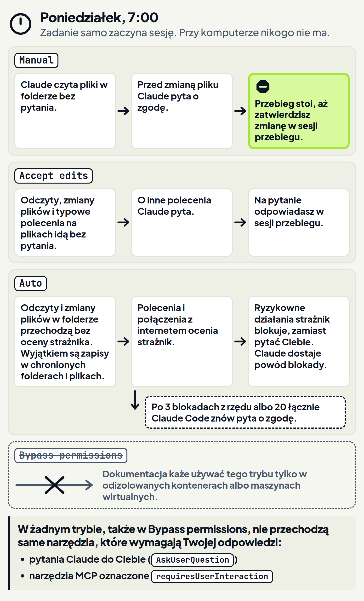
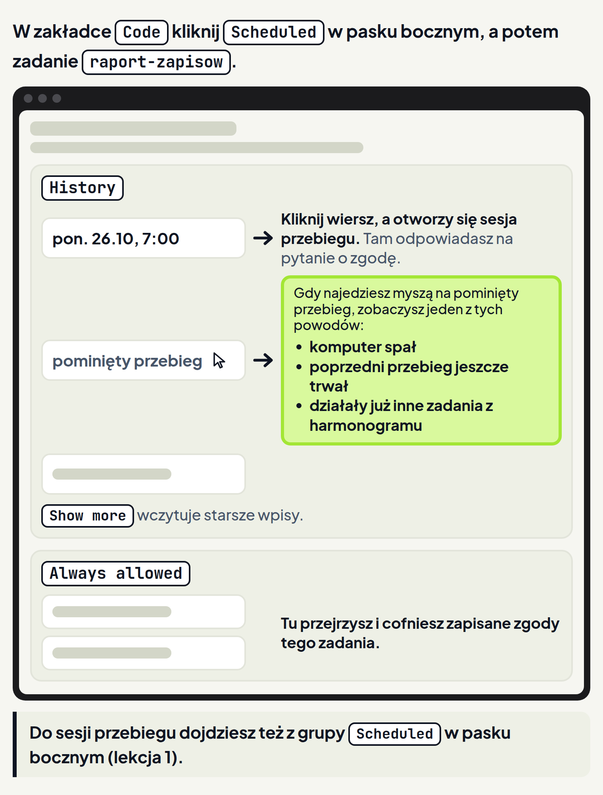
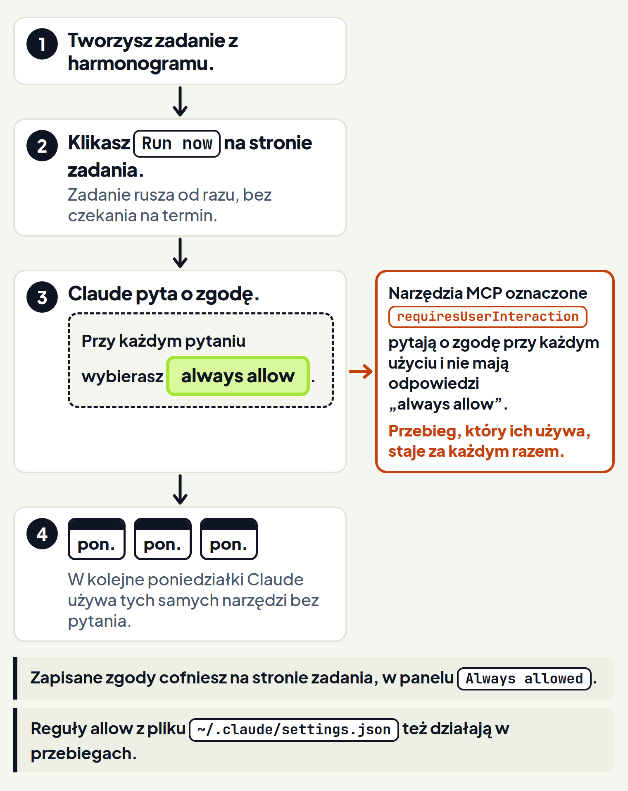

<em>Przewodnik po Claude Code · Moduł 8: Claude pracuje, kiedy Cię nie ma · Lekcja 2 z 4</em>

# Pytania o zgodę, gdy nie ma Cię przy komputerze

Prowadzisz marketing szkoły tańca Rytm: salsa, bachata i balet dla dzieci. Co poniedziałek o 7:00 zadanie z harmonogramu liczy nowe zapisy z formularza na stronie. Liczbę zapisów z zeszłego tygodnia dopisuje do raportu dla właścicielki szkoły. Takie zadanie samo zaczyna nową sesję o porze, którą wybierzesz. <!-- fakt: harmonogram-zadanie-startuje-nowa-sesje -->

Jest poniedziałek, 10:00. Raport miał być gotowy o 7:00, a w pliku nic nie przybyło. Zadanie się nie zepsuło, tylko działa w trybie Manual (ręcznym). W tym trybie przebieg, czyli jedno uruchomienie zadania, staje, gdy Claude potrzebuje narzędzia, na które zadanie nie ma zgody. Przebieg czeka, dopóki nie zatwierdzisz użycia tego narzędzia. <!-- fakt: zgoda-bez-ciebie-manual-przebieg-stoi --> O 7:00 przy komputerze nikogo nie było.

Każde zadanie ma własny tryb uprawnień, który ustawiasz przy tworzeniu albo edycji zadania. <!-- fakt: harmonogram-tryb-wlasny-zadania --> Od tego trybu zależy, co przebieg zrobi bez Ciebie: stanie na pytaniu o zgodę albo zrobi pracę sam. Ta lekcja pokazuje oba przypadki. Uczy też, jak przygotować zadanie, żeby nie stawało.

W ćwiczeniu zobaczysz przebieg w trybie Manual. W tym przebiegu Claude przeczytał zapisy bez pytania. Od 7:00 przebieg stoi na karcie zgody, czyli na pytaniu o zgodę z podglądem zmiany. Pracę skończy dopiero wtedy, gdy zatwierdzisz zmianę w sesji przebiegu.

<!-- cwiczenie: cw1 -->

## Co tu się stało?

<!-- kolumny -->

#### Zanim przebieg stanął

1. Zadanie ruszyło o 7:00 i zaczęło nową sesję, bez Ciebie. <!-- fakt: harmonogram-zadanie-startuje-nowa-sesje -->
2. Claude przeczytał zapisy-online.csv bez pytania. W trybie Manual bez pytania idą tylko odczyty. <!-- fakt: tryb-manual-bez-pytania-tylko-odczyt -->
3. Dopisanie zapisów z tygodnia do raportu to zmiana pliku, więc Claude zapytał o zgodę. Karta zgody pokazała podgląd zmiany. <!-- fakt: aplikacja-manual-podglad-i-przyciski -->

#### Karta zgody

1. Karta czekała od 7:00. Przebieg w trybie Manual stoi, dopóki nie zatwierdzisz tego, o co pyta karta zgody. <!-- fakt: zgoda-bez-ciebie-manual-przebieg-stoi -->
2. Zatwierdzasz w sesji przebiegu, odpowiadając tam na pytanie o zgodę. <!-- fakt: zgoda-bez-ciebie-manual-przebieg-stoi --> W ćwiczeniu zmianę zatwierdza się ptaszkiem na karcie zgody. <!-- fakt: aplikacja-manual-przyciski-zatwierdzania -->
3. Zmiana trafiła do raportu dopiero po kliknięciu ptaszka. <!-- fakt: tryb-manual-aplikacja-czeka-na-zatwierdzenie -->

<!-- /kolumny -->

## Tryb zadania

### Po co

Raport ma być gotowy o 7:00, a o tej porze nikt nie kliknie zgody. Tryb zadania decyduje, czy przebieg stanie na pierwszym pytaniu, czy zrobi pracę sam. <!-- fakt: harmonogram-tryb-wlasny-zadania --> <!-- fakt: zgoda-bez-ciebie-manual-przebieg-stoi -->

### Jak działa

Tryb wybierasz przy tworzeniu zadania. W formularzu nowego zadania robisz to na pasku pola z poleceniem. <!-- fakt: harmonogram-tryb-i-model-w-polu-polecenia --> Później tryb zmieniasz w formularzu Edit (edycja):

1. W zakładce Code kliknij Scheduled (zaplanowane) w pasku bocznym, potem zadanie na liście. Otworzy się strona zadania. <!-- fakt: harmonogram-strona-zadania -->
2. Kliknij ikonę ołówka. Otworzy się formularz Edit. <!-- fakt: harmonogram-olowek-otwiera-edit -->
3. Ustaw tryb uprawnień. <!-- fakt: harmonogram-tryb-wlasny-zadania --> W Edit zmieniasz też polecenie, termin i folder. <!-- fakt: harmonogram-edit-zmienia-ustawienia -->

Tryby znasz z modułu 1. Gdy nie ma Cię przy komputerze, działają tak:

- **Manual (ręczny):** bez pytania Claude tylko czyta pliki w folderze. <!-- fakt: tryb-manual-bez-pytania-tylko-odczyt --> Gdy Claude potrzebuje narzędzia, na które zadanie nie ma zgody, przebieg staje. Czeka, dopóki nie zatwierdzisz użycia tego narzędzia w sesji przebiegu. <!-- fakt: zgoda-bez-ciebie-manual-przebieg-stoi -->
- **Accept edits (przyjmowanie zmian):** odczyty, zmiany plików i typowe polecenia do obsługi plików idą bez pytania. <!-- fakt: accept-edits-odczyty-bez-pytania --> O inne polecenia, które chce uruchomić na komputerze, Claude pyta. <!-- fakt: accept-edits-aplikacja-pyta-o-inne-polecenia --> Na takie pytanie odpowiadasz w sesji przebiegu. <!-- fakt: harmonogram-sesja-przebiegu-co-widac -->
- **Auto (automatyczny):** Claude robi wszystko bez pytania, a w tle działają kontrole bezpieczeństwa. <!-- fakt: tryb-auto-bez-pytania-wszystko-z-kontrola-w-tle --> Co to znaczy dla zadania, pokazuje ćwiczenie 2 i część „Auto bez Ciebie”.
- **Bypass permissions (pomijanie uprawnień):** dokumentacja każe go używać tylko w odizolowanych kontenerach albo maszynach wirtualnych. <!-- fakt: aplikacja-bypass-tylko-kontenery --> Twój komputer, na którym pracuje zadanie lokalne, nie jest takim odizolowanym miejscem.

### Dzięki temu

Wybierasz z góry, czy zadanie ma czekać na Ciebie przy każdej zmianie, czy pracować samo.

### Ograniczenia

- Przełącznikiem w rzędzie pod polem wiadomości zmieniasz tryb rozmowy, w której właśnie pracujesz. <!-- fakt: aplikacja-przelacznik-pod-polem-wiadomosci --> Tryb zadania to osobne ustawienie samego zadania. <!-- fakt: harmonogram-tryb-wlasny-zadania -->
- Gdy przy tworzeniu zadania nie zmienisz trybu, przebiegi działają według Twoich ustawień Claude Code. <!-- fakt: harmonogram-tryb-i-model-w-polu-polecenia --> Dlatego sprawdź tryb zadania w Edit, zamiast go zgadywać.
- Zadanie utworzone prośbą w rozmowie (lekcja 1) też ma swój tryb. <!-- fakt: harmonogram-tryb-wlasny-zadania --> Dokumentacja nie mówi, jaki to tryb, więc i tu sprawdzasz go w Edit.
- W Edit słowo Manual ma dwa znaczenia. <!-- fakt: harmonogram-tryb-wlasny-zadania --> <!-- fakt: harmonogram-trigger-cztery-opcje --> Tryb Manual to tryb uprawnień, o którym mówi ta część. Manual wybrany jako termin w formularzu Edit oznacza, że zadanie nie ma harmonogramu i rusza tylko po kliknięciu Run now (uruchom teraz). <!-- fakt: harmonogram-opcje-terminu -->

## Przebieg, który czeka

### Po co

O 10:00 w raporcie nic nie przybyło. Chcesz wiedzieć, na czym stanął przebieg i jak go dokończyć, zamiast zlecać pracę od nowa.

### Jak działa

Przebieg w trybie Manual czeka na Twoją zgodę we własnej sesji. Zatwierdzasz go tam, odpowiadając na pytanie o zgodę. <!-- fakt: zgoda-bez-ciebie-manual-przebieg-stoi --> Do sesji przebiegu dojdziesz dwiema drogami, tak jak w lekcji 1:

1. Na stronie zadania kliknij wiersz przebiegu na liście History (historia). <!-- fakt: harmonogram-sesja-przebiegu-w-history -->
2. W pasku bocznym kliknij wiersz zadania w grupie Scheduled. Otworzy się sesja ostatniego przebiegu. <!-- fakt: harmonogram-grupa-scheduled-w-pasku -->

W sesji przebiegu widzisz, co zrobił Claude, przeglądasz zmiany i odpowiadasz na pytania o zgodę. <!-- fakt: harmonogram-sesja-przebiegu-co-widac -->

Lista History (historia) na stronie zadania pokazuje wszystkie przebiegi, także pominięte. <!-- fakt: zgoda-bez-ciebie-historia-pominietych-przebiegow --> Najedź myszą na pominięty wpis, a zobaczysz jeden z trzech powodów: <!-- fakt: zgoda-bez-ciebie-historia-pominietych-przebiegow -->

- komputer spał,
- poprzedni przebieg jeszcze trwał,
- działały już inne zadania z harmonogramu.

Starsze wpisy wczytasz, gdy klikniesz Show more (pokaż więcej) pod listą. <!-- fakt: zgoda-bez-ciebie-historia-pominietych-przebiegow -->

### Dzięki temu

Gdy zatwierdzisz zmianę w sesji przebiegu, przebieg dokończy pracę, która czekała od rana. <!-- fakt: zgoda-bez-ciebie-manual-przebieg-stoi --> Z listy History dowiesz się też, czy przebieg w ogóle ruszył.

### Ograniczenia

- Dokumentacja nie mówi, czy aplikacja daje znać o przebiegu, który czeka na zgodę. Dlatego w poniedziałek rano zajrzyj do sesji przebiegu albo do historii zadania.
- Pominięty przebieg w ogóle nie ruszył. Przebieg, który stoi na pytaniu o zgodę, ruszył i czeka w swojej sesji.

Po pierwszym poniedziałku zmieniasz w Edit tryb zadania na Auto. <!-- fakt: harmonogram-tryb-wlasny-zadania --> <!-- fakt: harmonogram-olowek-otwiera-edit --> Mija tydzień.

W ćwiczeniu zobaczysz, że przebieg w trybie Auto nie czekał. Claude zmienił raport bez karty zgody. Chciał też skasować kopię pliku z zapisami, ale zablokował to strażnik (osobny model, który ocenia działania Claude przed wykonaniem). <!-- fakt: auto-klasyfikator-ocenia-przed-wykonaniem --> Claude opisał blokadę w sesji przebiegu, obok zmian.

<!-- cwiczenie: cw2 -->

## Co tu się stało?

<!-- kolumny -->

#### Zmiana raportu

1. Claude dopisał zapisy z tygodnia bez karty zgody. W trybie Auto Claude sam wprowadza zmiany w plikach. <!-- fakt: aplikacja-auto-i-accept-edits-stosuja-zmiany -->
2. W trybie Auto odczyty i zmiany plików w folderze przechodzą bez oceny strażnika. Wyjątkiem są zapisy w chronionych folderach i plikach, na przykład w folderze `.claude` z ustawieniami Claude. <!-- fakt: auto-odczyty-i-zmiany-w-folderze-bez-klasyfikatora --> <!-- fakt: sciezki-chronione-czym-sa -->
3. Gdy klikniesz liczby na karcie Changes (zmiany), otworzy się widok zmian z dopisaną linijką. <!-- fakt: aplikacja-widok-zmian-liczby-na-karcie-changes -->

#### Zablokowane kasowanie

1. Kasowanie pliku to polecenie, a takie działania ocenia strażnik. <!-- fakt: auto-kolejnosc-reszta-do-klasyfikatora -->
2. Na liście tego, co strażnik domyślnie blokuje, jest nieodwracalne kasowanie plików, które istniały, zanim zaczęła się sesja. <!-- fakt: auto-blokuje-niszczenie-plikow --> Tym razem strażnik zablokował kasowanie kopii pliku z zapisami.
3. Claude dostał powód blokady i opisał ją w odpowiedzi. <!-- fakt: auto-claude-dostaje-powod-blokady --> Kopia została w folderze.

<!-- /kolumny -->

## Auto bez Ciebie

### Po co

Zadanie, które ma skończyć pracę przed Twoim przyjściem, nie może stać na karcie zgody.

### Jak działa

W trybie Auto Claude pracuje bez rutynowych pytań. <!-- fakt: auto-aplikacja-opis-trybu --> Pilnuje go drugi model AI, strażnik (klasyfikator), znany z modułu 1. <!-- fakt: auto-klasyfikator-ocenia-przed-wykonaniem --> Strażnik ocenia działania przed wykonaniem i blokuje te, które wykraczają poza Twoją prośbę. <!-- fakt: auto-klasyfikator-ocenia-przed-wykonaniem --> Przebieg w Auto wygląda tak:

1. Odczyty i zmiany plików w folderze przechodzą bez oceny strażnika. Wyjątkiem są zapisy w chronionych folderach i plikach, na przykład w folderze `.claude` z ustawieniami Claude. <!-- fakt: auto-odczyty-i-zmiany-w-folderze-bez-klasyfikatora --> <!-- fakt: sciezki-chronione-czym-sa -->
2. Prawie wszystko inne, na przykład polecenia i połączenia z internetem, trafia do strażnika. <!-- fakt: auto-kolejnosc-reszta-do-klasyfikatora --> <!-- fakt: auto-aplikacja-opis-trybu --> Wyjątek to polecenia kasowania najważniejszych folderów, na przykład folderu, w którym pracujesz, albo Twojego folderu domowego. <!-- fakt: auto-kolejnosc-reszta-do-klasyfikatora --> <!-- fakt: sciezki-krytyczne-rm-pyta-w-manual-i-accept-edits --> Tych poleceń strażnik nie ocenia. Claude Code obsługuje je według osobnej zasady, którą opisuje lekcja o strażniku w module 1. <!-- fakt: auto-kolejnosc-reszta-do-klasyfikatora -->
3. Ryzykowne działania strażnik blokuje, zamiast pytać Ciebie. <!-- fakt: auto-aplikacja-klasyfikator-blokuje-ryzykowne -->
4. Gdy strażnik zablokuje działanie, Claude dostaje powód. <!-- fakt: auto-claude-dostaje-powod-blokady -->

Auto zachęca też Claude, żeby pracował dalej, zamiast przerywać i dopytywać. <!-- fakt: auto-zacheca-do-pracy-bez-pytan-doprecyzowujacych -->

### Dzięki temu

Przebieg nie staje na rutynowych pytaniach o zgodę. <!-- fakt: auto-aplikacja-opis-trybu --> Co Claude zrobił, a czego nie, sprawdzisz potem w sesji przebiegu. <!-- fakt: harmonogram-sesja-przebiegu-co-widac -->

### Ograniczenia

- Gdy strażnik zablokuje działanie 3 razy z rzędu albo 20 razy łącznie, tryb Auto się wstrzymuje i Claude Code znów pyta o zgodę. <!-- fakt: auto-wstrzymanie-po-blokadach --> Zgoda na działanie, o które Claude Code zapytał, wznawia Auto. <!-- fakt: auto-zgoda-po-wstrzymaniu-wznawia-auto --> Także w przebiegu w Auto Claude Code może więc znów zapytać o zgodę. <!-- fakt: auto-wstrzymanie-po-blokadach --> Odpowiadasz w sesji przebiegu. <!-- fakt: harmonogram-sesja-przebiegu-co-widac -->
- Claude nadal pyta, gdy Twoja prośba albo skill wprost tego wymaga. <!-- fakt: auto-zacheca-do-pracy-bez-pytan-doprecyzowujacych --> Nie pisz więc w poleceniu zadania „zapytaj mnie, jeśli…”, bo o 7:00 nikt na takie pytanie nie odpowie.
- Auto zmniejsza liczbę pytań o zgodę, ale nie gwarantuje bezpieczeństwa. Używaj go do zadań, przy których ufasz, że Claude pójdzie w dobrą stronę, a nie zamiast przeglądu wrażliwych działań. <!-- fakt: auto-nie-gwarantuje-bezpieczenstwa -->
- Auto pojawia się na liście trybów tylko wtedy, gdy jest dla Ciebie dostępny. <!-- fakt: aplikacja-dostepne-tryby -->

## Pierwsze uruchomienie z Tobą

### Po co

Raport idzie do właścicielki szkoły, więc wolisz zostać przy trybie Manual. Nie chcesz jednak co poniedziałek rano zatwierdzać tej samej zmiany.

### Jak działa

1. Po utworzeniu zadania kliknij na jego stronie Run now. Zadanie ruszy od razu, bez czekania na termin. <!-- fakt: harmonogram-run-now -->
2. Pilnuj pytań o zgodę i przy każdym wybierz „always allow” (zawsze pozwalaj). <!-- fakt: zgoda-bez-ciebie-run-now-always-allow --> Na pytania odpowiadasz w sesji przebiegu. <!-- fakt: harmonogram-sesja-przebiegu-co-widac -->
3. W kolejnych przebiegach tego zadania Claude użyje tych samych narzędzi bez pytania o zgodę. <!-- fakt: zgoda-bez-ciebie-kolejne-przebiegi-bez-pytan -->

Na karcie zgody w ćwiczeniu 1 odpowiedzi „always allow” nie ma. Dokumentacja nie opisuje, jak w aplikacji wygląda pytanie z tą odpowiedzią. Dlatego podajemy ją tylko w tekście, tak jak zapisuje ją dokumentacja.

Zapisane zgody przeglądasz i cofasz na stronie zadania. <!-- fakt: zgoda-bez-ciebie-zgody-przegladasz-i-cofasz --> Służy do tego panel Always allowed (zawsze dozwolone). <!-- fakt: zgoda-bez-ciebie-panel-always-allowed -->

W sesjach zadań działają też reguły allow (pozwól) z pliku ustawień `~/.claude/settings.json`. <!-- fakt: zgoda-bez-ciebie-reguly-allow-w-sesjach-zadan --> W zakładce Code reguły uprawnień zmieniasz w plikach ustawień, o czym mówi lekcja 1 modułu 1. <!-- fakt: aplikacja-reguly-uprawnien-w-plikach-ustawien --> W tej lekcji nie musisz tego pliku zmieniać.

### Dzięki temu

Pierwsze uruchomienie robisz przy komputerze. W następnych przebiegach Claude używa tych samych narzędzi bez pytania, a zadanie zostaje w trybie Manual. <!-- fakt: zgoda-bez-ciebie-kolejne-przebiegi-bez-pytan -->

### Ograniczenia

- Zapisana zgoda dotyczy tego zadania i tych narzędzi, przy których wybierzesz „always allow”. <!-- fakt: zgoda-bez-ciebie-kolejne-przebiegi-bez-pytan --> <!-- fakt: zgoda-bez-ciebie-panel-always-allowed -->
- Niektóre narzędzia serwerów MCP są oznaczone tak, że pytają o zgodę przy każdym użyciu (w dokumentacji `requiresUserInteraction`). Przy pytaniu o takie narzędzie nie ma odpowiedzi „always allow”. Przebieg, który ich używa, staje za każdym razem. <!-- fakt: zgoda-bez-ciebie-narzedzia-pytaja-przy-kazdym-wywolaniu --> Skąd się bierze takie oznaczenie, mówi lekcja 2 modułu 5 o konektorach.
- W żadnym trybie, także w Bypass permissions, nie przechodzą same narzędzia, które wymagają Twojej odpowiedzi: <!-- fakt: zgoda-bez-ciebie-zaden-tryb-nie-przepuszcza-interakcji -->
  - pytania Claude do Ciebie (narzędzie AskUserQuestion),
  - narzędzia MCP oznaczone tak jak w punkcie wyżej.

## Kiedy zostawić zadaniu tryb Manual, a kiedy nie

<!-- kolumny -->

#### Zostaw Manual

1. Zostaw Manual, gdy chcesz zatwierdzać każdą zmianę, zanim trafi do pliku. Do tego służy ten tryb. <!-- fakt: aplikacja-zatwierdzanie-kazdej-zmiany-to-manual -->
2. Po utworzeniu zadania kliknij Run now i przy każdym pytaniu wybierz „always allow”. <!-- fakt: zgoda-bez-ciebie-run-now-always-allow -->
3. W kolejnych przebiegach Claude użyje tych samych narzędzi bez pytania. <!-- fakt: zgoda-bez-ciebie-kolejne-przebiegi-bez-pytan -->

#### Wybierz Auto

1. Wybierz Auto, gdy zadanie ma skończyć pracę przed Twoim przyjściem i ufasz, że Claude pójdzie w nim w dobrą stronę. <!-- fakt: auto-nie-gwarantuje-bezpieczenstwa -->
2. Po przebiegu otwórz jego sesję i sprawdź, co zrobił Claude. <!-- fakt: harmonogram-sesja-przebiegu-co-widac -->
3. Nie używaj Auto zamiast przeglądu wrażliwych działań. <!-- fakt: auto-nie-gwarantuje-bezpieczenstwa -->

<!-- /kolumny -->

Accept edits wystarczy, gdy zadanie tylko czyta i zmienia pliki w folderze. <!-- fakt: accept-edits-odczyty-bez-pytania --> O inne polecenia, które chce uruchomić na komputerze, Claude w tym trybie zapyta. <!-- fakt: accept-edits-aplikacja-pyta-o-inne-polecenia -->

Bypass permissions nie wybieraj dla zadania na swoim komputerze. Dokumentacja każe go używać tylko w odizolowanych kontenerach albo maszynach wirtualnych. <!-- fakt: aplikacja-bypass-tylko-kontenery -->

## Źródła

- [Zadania z harmonogramu w aplikacji](https://code.claude.com/docs/en/desktop-scheduled-tasks)
- [Tryby uprawnień](https://code.claude.com/docs/en/permission-modes)
- [Aplikacja Claude na komputer](https://code.claude.com/docs/en/desktop)
- [Szybki start w aplikacji](https://code.claude.com/docs/en/desktop-quickstart)

Sprawdzone 26.10.2026, Claude Code 2.1.310.
