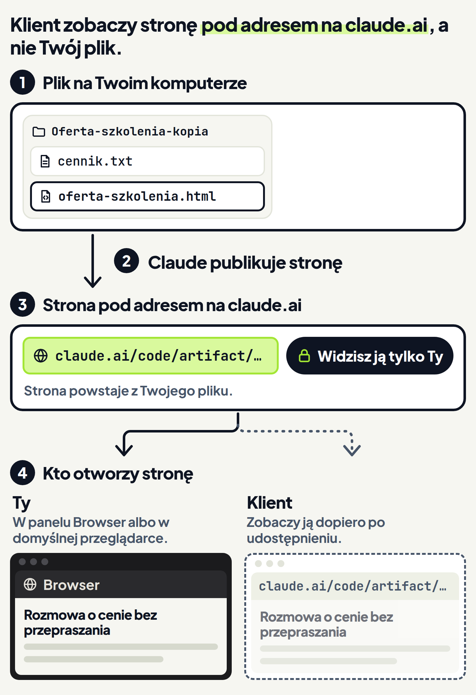
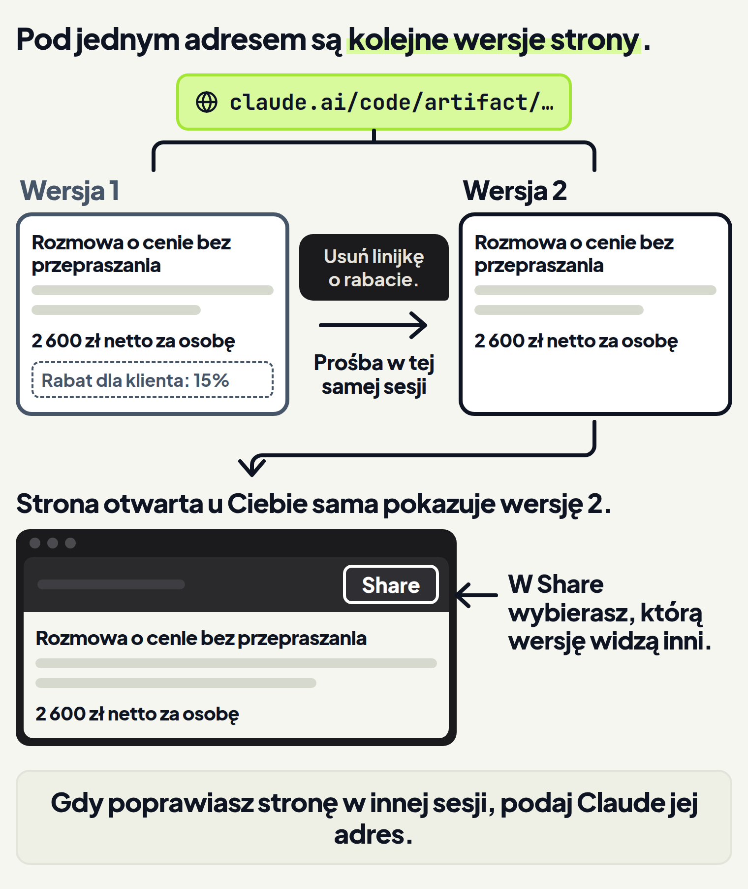
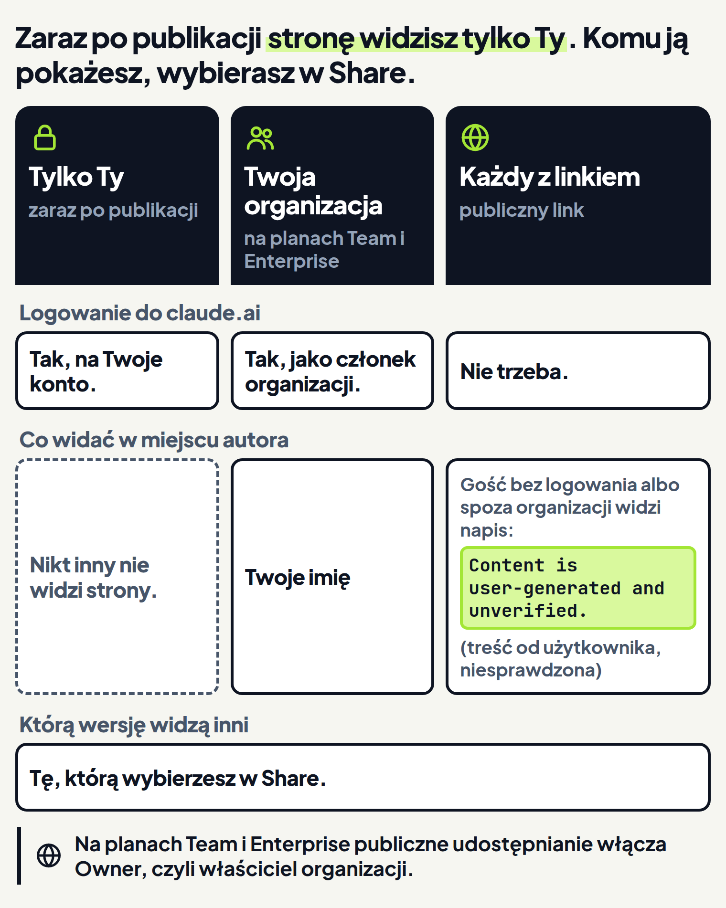
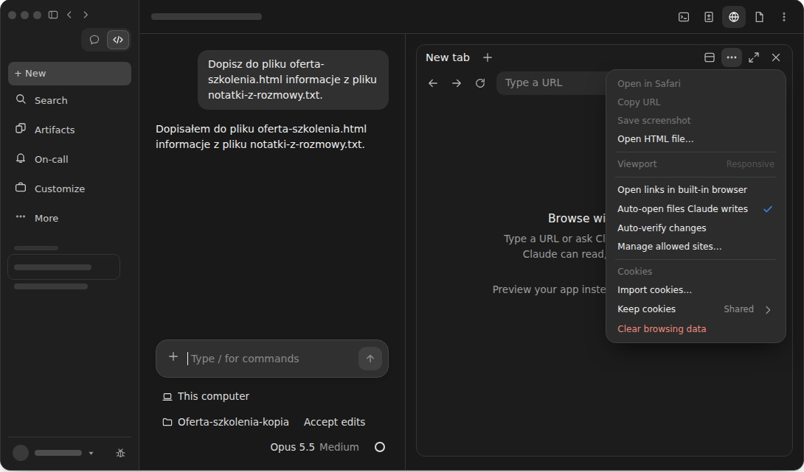

<em>Przewodnik po Claude Code · Moduł 3: Strona internetowa z Twoich materiałów · Lekcja 2 z 4</em>

# Artefakt: link do strony dla klienta

Strona oferty z lekcji 1 to plik w folderze na Twoim komputerze. Klient jej stamtąd nie otworzy. Możesz wysłać plik mailem, ale nie wiesz, czy u klienta otworzy się tak samo jak u Ciebie. Klient potrzebuje linku, który po prostu kliknie.

Taki link daje artefakt. Artefakt to interaktywna strona, którą Claude Code publikuje z Twojej sesji pod prywatnym adresem na claude.ai. <!-- fakt: artefakt-to-strona-pod-prywatnym-linkiem-na-claude-ai --> Stronę możesz zostawić prywatną, udostępnić swojej organizacji albo opublikować pod publicznym linkiem. <!-- fakt: artefakt-trzy-widownie-prywatny-organizacja-publiczny --> Publiczny link otworzy każdy, także klient, bez logowania do claude.ai. <!-- fakt: artefakt-publiczny-link-otwiera-kazdy-bez-logowania -->

Twórcy Claude Code radzą sięgać po artefakt, gdy wynik łatwiej obejrzeć i poklikać, niż czytać linijka po linijce. <!-- fakt: artefakt-kiedy-latwiej-obejrzec-niz-czytac --> Jako przykład podają link wysłany koledze zamiast wyniku wklejonego do Slacka. <!-- fakt: artefakt-link-zamiast-wklejania-wyniku --> Oferta dla klienta to właśnie taki wynik: klient ma ją obejrzeć, a nie czytać plik.

Artefakty wymagają między innymi planu Pro, Max, Team albo Enterprise i logowania do konta claude.ai w aplikacji. <!-- fakt: artefakt-dostepnosc-plan-konto-aplikacja --> Więcej warunków znajdziesz w części „Kiedy artefakty działają”.

Pracujesz tak jak w lekcji 1:

- na Twoim komputerze (w aplikacji: This computer, w dokumentacji: Local), <!-- fakt: aplikacja-local-dziala-na-twoim-komputerze --> <!-- fakt: aplikacja-rzad-pod-polem-folder-z-nazwa-kadr -->
- w kopii folderu z plikami oferty,
- w trybie Accept edits (przyjmowanie zmian). <!-- fakt: aplikacja-rzad-pod-polem-srodowisko-folder-tryb-model -->

Przed ćwiczeniem Claude dopisał do strony informacje z notatek z rozmowy z klientem.

Zobacz w ćwiczeniu, jak wygląda strona oferty opublikowana jako artefakt. <!-- fakt: artefakt-to-strona-pod-prywatnym-linkiem-na-claude-ai --> Sprawdź też, co zobaczyłby klient po udostępnieniu. Zobaczyłby tę samą treść co Ty, także linijkę o rabacie, którego miał nie widzieć. <!-- fakt: artefakt-nowy-widoczny-tylko-dla-ciebie --> Drugim poleceniem otworzysz panel Browser przyciskiem na pasku tytułu sesji i zajrzysz do jego menu. <!-- fakt: aplikacja-panel-browser-skrot-i-przycisk-na-pasku-tytulu -->

<!-- cwiczenie: cw1 -->

## Co tu się stało?

<!-- kolumny -->

#### U Ciebie

<!-- podglad: cw1 publikuj -->

1. Prośba zawierała słowo „artefakt” i wskazywała plik strony w folderze. <!-- fakt: artefakt-prosba-nazwij-artefakt-albo-opisz-strone -->
2. Claude opublikował ten plik. Strona artefaktu powstaje z tego pliku. <!-- fakt: artefakt-opublikowany-plik-jest-opakowany-w-dokument-html --> Claude dopisał wcześniej do pliku notatki, dlatego na stronie jest linijka o rabacie.
3. W ćwiczeniu link z odpowiedzi Claude otworzył stronę artefaktu w panelu Browser (przeglądarce w aplikacji). <!-- fakt: aplikacja-link-w-rozmowie-cmd-klik-zwykla-przegladarka --> <!-- fakt: aplikacja-panel-browser-to-przegladarka-z-kartami -->
4. Nagłówek strony artefaktu ma tytuł, który wybrał Claude. <!-- fakt: artefakt-naglowek-strony-tytul-share-awatar-opis-zrzutu --> <!-- fakt: artefakt-tytul-i-ikone-karty-wybiera-claude --> Kolorowy pasek nagłówka dodaliśmy w kursie, w aplikacji go nie ma. Po nim rozpoznasz artefakt w ćwiczeniu.
5. Panel Browser nie ma Twoich zapisanych logowań i historii. Możesz się w nim logować na stronach. <!-- fakt: aplikacja-panel-browser-czysty-profil-bez-zapisanych-logowan --> <!-- fakt: aplikacja-panel-browser-mozna-logowac-sie-na-stronach -->
6. Nowy artefakt widzisz tylko Ty. <!-- fakt: artefakt-nowy-widoczny-tylko-dla-ciebie -->

#### U klienta

<!-- podglad: cw1 publikuj klient -->

1. Po udostępnieniu klient zobaczyłby tę samą treść co Ty, także linijkę o rabacie. <!-- fakt: artefakt-nowy-widoczny-tylko-dla-ciebie -->
2. Przełącznik „Tak zobaczy klient” pokazuje, jak strona będzie wyglądać po udostępnieniu publicznym. <!-- fakt: artefakt-nowy-widoczny-tylko-dla-ciebie -->
3. Gość bez logowania albo spoza Twojej organizacji widzi zamiast Twojego imienia napis `Content is user-generated and unverified.` (treść od użytkownika, niesprawdzona). <!-- fakt: artefakt-gosc-publicznego-linku-widzi-napis-zamiast-imienia --> <!-- fakt: artefakt-nowy-widoczny-tylko-dla-ciebie -->
4. Widok klienta w ćwiczeniu jest uproszczony.

<!-- /kolumny -->

Klient zobaczy stronę pod tym adresem, nie Twój plik.

W drugim poleceniu panel Browser otworzył się po kliknięciu przycisku Browser na pasku tytułu sesji. <!-- fakt: aplikacja-panel-browser-skrot-i-przycisk-na-pasku-tytulu --> Co robią pozycje menu tego panelu, opisuje część „Link w aplikacji: panel Browser albo domyślna przeglądarka”.

## Artefakt: strona pod linkiem zamiast pliku w folderze

**Po co.** Klient potrzebuje adresu, który otworzy u siebie. Artefakt daje taki adres bez przenoszenia strony do kreatora stron. <!-- fakt: artefakt-to-strona-pod-prywatnym-linkiem-na-claude-ai -->

**Jak to działa.** Co dzieje się z plikiem strony:

- Claude Code opakowuje Twój plik w dokument HTML i serwuje go ze ścisłą polityką CSP. <!-- fakt: artefakt-opublikowany-plik-jest-opakowany-w-dokument-html --> Stronę otwierasz pod adresem na claude.ai. <!-- fakt: artefakt-to-strona-pod-prywatnym-linkiem-na-claude-ai --> CSP to zasady, które ograniczają, co strona może robić. Poznasz je w części „Czego strona nie zrobi”. <!-- fakt: artefakt-opublikowany-plik-jest-opakowany-w-dokument-html -->
- Artefakt otwierasz w przeglądarce i aktualizuje się w miejscu, dopóki sesja trwa. <!-- fakt: artefakt-otwierasz-w-przegladarce-aktualizuje-sie-w-miejscu-gdy-sesja-trwa -->
- Claude może zbudować stronę z czegokolwiek, do czego sięga Twoja sesja. <!-- fakt: artefakt-claude-buduje-strone-z-tego-do-czego-sesja-ma-dostep -->

W części o planach Team i Enterprise dokumentacja podaje, gdzie leży treść artefaktu. Jest przechowywana na infrastrukturze prowadzonej przez Anthropic. <!-- fakt: artefakt-tresc-na-infrastrukturze-anthropic --> Widzą ją tylko zalogowani członkowie organizacji, która ją opublikowała, i osoby, którym ją udostępniono. Wyjątkiem jest artefakt udostępniony publicznie. <!-- fakt: artefakt-tresc-na-infrastrukturze-anthropic -->

**Co zyskujesz.** Zamiast pliku wysyłasz klientowi adres strony. Stronę poprawiasz w tej samej sesji, a otwarta strona sama pokazuje zmiany. <!-- fakt: artefakt-otwierasz-w-przegladarce-aktualizuje-sie-w-miejscu-gdy-sesja-trwa --> Do publikacji wystarczy prośba w rozmowie z Claude. <!-- fakt: artefakt-prosba-nazwij-artefakt-albo-opisz-strone -->

**Ograniczenia.** Na co uważać:

- Artefakt to jedna samodzielna strona bez zaplecza, więc nie obsłuży wielu podstron. <!-- fakt: artefakt-jedna-strona-bez-zaplecza --> Zaplecze to program na serwerze, który zapisuje dane, na przykład zgłoszenia z formularza.
- Narzędzie z zapleczem trzeba uruchomić na własnym serwerze. <!-- fakt: artefakt-jedna-strona-bez-zaplecza --> Strona z lekcji 1 ma same teksty, bez formularzy i zapisów, więc artefakt jej wystarczy.

## Jak poprosić o artefakt i kiedy Claude zapyta

**Po co.** Chcesz zamówić artefakt zwykłym zdaniem w rozmowie. Chcesz też wiedzieć, czy przed publikacją pojawi się okno zgody, jak przy zmianach w trybie Manual (ręczne zatwierdzanie). <!-- fakt: aplikacja-manual-podglad-i-przyciski -->

**Jak to działa.** W aplikacji robisz to tak:

1. W polu wiadomości poproś zwykłym zdaniem. Nazwij funkcję, czyli napisz „artefakt”, albo opisz, co ma być widać na stronie. <!-- fakt: artefakt-prosba-nazwij-artefakt-albo-opisz-strone --> Pisz „strona”, nie „dokument”. Gdy masz podłączone Claude Docs (dokumenty, które czytają inne osoby), prośba o dokument dla innych osób trafia do Claude Docs zamiast na stronę artefaktu. <!-- fakt: docs-konektor-prosba-o-dokument-dla-innych-idzie-do-docs --> Claude Docs poznasz w lekcji 4.
2. Wskaż plik z folderu, który ma stać się stroną. Bez wskazania miejsca Claude zapisze stronę w folderze tymczasowym, poza Twoim folderem. <!-- fakt: artefakt-bez-wskazania-plik-w-katalogu-tymczasowym -->
3. Tytuł strony i ikonę karty przeglądarki wybiera Claude. Jeśli chcesz własny tytuł, podaj go w prośbie. <!-- fakt: artefakt-tytul-i-ikone-karty-wybiera-claude -->
4. Wyślij prośbę klawiszem <kbd>Enter</kbd>. <!-- fakt: aplikacja-enter-wysyla-zadanie -->

Prośba z ćwiczenia, którą możesz wziąć za wzór: „Opublikuj plik oferta-szkolenia.html z tego folderu jako artefakt. Chcę potem wysłać klientowi link do tej strony.” Gdy chcesz własny tytuł, dopisz na przykład: „Tytuł strony: Oferta szkolenia dla zespołu sprzedaży.”

Tytuł ma znaczenie, bo widać go w Twojej galerii artefaktów na claude.ai i w udostępnionych linkach. <!-- fakt: artefakt-tytul-widac-w-galerii-i-w-udostepnionych-linkach -->

Claude może też sam opublikować artefakt, gdy wynik nadaje się na stronę. <!-- fakt: artefakt-prosba-nazwij-artefakt-albo-opisz-strone --> Taki artefakt też widzisz tylko Ty, dopóki go nie udostępnisz. Dzięki temu nic nie trafi do klienta bez Twojej decyzji. <!-- fakt: artefakt-nowy-widoczny-tylko-dla-ciebie -->

Nowy artefakt, o który prosisz w wiadomości, przechodzi bez okna zgody. Claude Code pyta najpierw tylko w kilku przypadkach, które wymienia dokumentacja. <!-- fakt: artefakt-publikacja-z-prosby-bez-okna-zgody -->

**Co zyskujesz.** Wystarczy jedno zdanie w rozmowie.

**Ograniczenia.** Claude Code pyta przed publikacją w takich przypadkach:

- Sesja działa w trybie Plan (planowanie). Claude Code pyta przed pierwszą publikacją każdego artefaktu. <!-- fakt: artefakt-publikacja-z-prosby-bez-okna-zgody -->
- Artefakt jest już udostępniony publicznie. Claude Code pyta raz na rozmowę, zanim go zmieni. <!-- fakt: artefakt-publiczny-pyta-raz-na-rozmowe-przed-zmiana -->
- Odczyt pliku wymaga Twojej zgody. Claude Code pyta, zanim go opublikuje. <!-- fakt: artefakt-pyta-gdy-plik-wymaga-zgody-na-odczyt --> Gdy wskazujesz plik z folderu, w którym pracujesz, tego pytania nie będzie. Takie pliki Claude czyta bez pytania, nawet w trybie Manual. <!-- fakt: odczyty-w-folderze-roboczym-bez-zgody-w-manual -->
- W trybie Manual albo Accept edits, gdy zmiana w pliku artefaktu wymaga Twojej zgody, Claude Code pyta przed publikacją tej zmiany. <!-- fakt: artefakt-pyta-przy-zmianie-pliku-bez-zgody-w-manual --> W Accept edits pliki w folderze roboczym Claude zmienia bez pytania. <!-- fakt: accept-edits-edycje-w-folderze-bez-pytania -->

W tych przypadkach w trybie Auto (automatycznym) zamiast pytania publikację sprawdza klasyfikator, czyli automatyczny strażnik. <!-- fakt: artefakt-publikacja-z-prosby-bez-okna-zgody --> Tryby opisuje moduł 1.

## Poprawka: usuń linijkę o rabacie

**Po co.** Na stronę trafiła linijka z notatek: „Rabat dla klienta: 15% (nie pisać na stronie)”. Klient nie może jej zobaczyć. Chcesz ją usunąć przed udostępnieniem strony i zachować ten sam link.

Zobacz w ćwiczeniu, jak w tej samej sesji Claude publikuje poprawkę pod tym samym adresem. <!-- fakt: artefakt-poprawka-zmienia-plik-i-publikuje-pod-tym-samym-adresem --> Strona artefaktu otwarta u Ciebie sama pokazuje nową wersję. <!-- fakt: artefakt-otwarta-strona-pokazuje-aktualizacje-wersje-wybierasz-w-share -->

<!-- cwiczenie: cw2 -->

## Co tu się stało?

<!-- kolumny -->

#### W rozmowie

1. W tej samej sesji Claude zmienił plik strony i opublikował go pod tym samym adresem. <!-- fakt: artefakt-poprawka-zmienia-plik-i-publikuje-pod-tym-samym-adresem -->
2. Claude zmienił plik bez okna zgody, bo w ćwiczeniu Claude działa w trybie Accept edits. <!-- fakt: accept-edits-edycje-w-folderze-bez-pytania -->
3. Pod oknem ćwiczenia plik oferta-szkolenia.html ma ramkę, bo Claude go zmienił.

#### Na stronie artefaktu

<!-- podglad: cw2 popraw -->

1. Linijki o rabacie już na stronie nie ma.
2. Strona otwarta u Ciebie sama pokazuje nową wersję. <!-- fakt: artefakt-otwarta-strona-pokazuje-aktualizacje-wersje-wybierasz-w-share -->
3. W lekcji 1 po poprawce trzeba było znów kliknąć ścieżkę pliku. <!-- fakt: aplikacja-klik-sciezki-do-pdf-html-wideo-otwiera-panel-browser --> Tu adres się nie zmienił, a strona odświeżyła się sama. <!-- fakt: artefakt-otwierasz-w-przegladarce-aktualizuje-sie-w-miejscu-gdy-sesja-trwa -->
4. Przełącznik „Tak zobaczy klient” pokazuje, jak tę wersję zobaczy klient, gdy udostępnisz ją publicznie. <!-- fakt: artefakt-nowy-widoczny-tylko-dla-ciebie -->

<!-- /kolumny -->

## Jak poprawiać artefakt i wybierać wersję

**Jak to działa.** Poprawkę zlecasz w rozmowie:

1. W tej samej sesji napisz, co ma się zmienić, i poproś o ponowną publikację.
2. Claude zmienia plik, z którego powstała strona, i publikuje go ponownie pod tym samym adresem. <!-- fakt: artefakt-poprawka-zmienia-plik-i-publikuje-pod-tym-samym-adresem -->
3. Strona otwarta u Ciebie sama pokazuje zmianę. <!-- fakt: artefakt-otwarta-strona-pokazuje-aktualizacje-wersje-wybierasz-w-share -->
4. Każda publikacja to kolejna wersja strony. Którą wersję widzą inni, wybierasz w Share (udostępnij) w nagłówku strony artefaktu. <!-- fakt: artefakt-otwarta-strona-pokazuje-aktualizacje-wersje-wybierasz-w-share -->

Prośba z ćwiczenia, którą możesz wziąć za wzór: „Usuń z pliku oferta-szkolenia.html linijkę o rabacie dla klienta i opublikuj stronę ponownie.”

Gdy chcesz poprawić stronę w nowej sesji, podaj Claude adres artefaktu. Bez adresu nowa sesja tworzy nowy artefakt, zamiast poprawić istniejący. <!-- fakt: artefakt-poprawka-z-innej-sesji-podaj-adres --> Prośba może wyglądać tak: „Popraw artefakt https://claude.ai/code/artifact/… i dopisz termin szkolenia.”

<!-- analogia: To jak dokument Google: link wysłany klientowi zostaje ten sam, choć treść pod nim się zmienia. -->

**Co zyskujesz.** Klient dostaje jeden link. Poprawiasz stronę do skutku, a adres się nie zmienia. <!-- fakt: artefakt-poprawka-zmienia-plik-i-publikuje-pod-tym-samym-adresem --> Gdy nowa wersja nie jest gotowa, w Share wybierzesz, którą wersję widzą inni. <!-- fakt: artefakt-otwarta-strona-pokazuje-aktualizacje-wersje-wybierasz-w-share -->

**Ograniczenia.** Gdy artefakt jest udostępniony publicznie, Claude Code pyta raz na rozmowę, zanim go zmieni. <!-- fakt: artefakt-publiczny-pyta-raz-na-rozmowe-przed-zmiana -->

## Jak dać klientowi link

Cała droga od pliku do klienta w prawdziwej aplikacji:

1. Poproś Claude, żeby opublikował plik strony jako artefakt. <!-- fakt: artefakt-prosba-nazwij-artefakt-albo-opisz-strone -->
2. Sprawdź stronę oczami klienta i zleć poprawki (o tym niżej, w części „Sprawdź, zanim udostępnisz”).
3. Otwórz stronę artefaktu w przeglądarce i kliknij Share w nagłówku strony. <!-- fakt: artefakt-nowy-widoczny-tylko-dla-ciebie -->
4. Wybierz odbiorców, czyli kto ma widzieć stronę, i wersję. <!-- fakt: artefakt-menu-share-opis-zrzutu --> <!-- fakt: artefakt-otwarta-strona-pokazuje-aktualizacje-wersje-wybierasz-w-share -->
5. Skopiuj link. Na zrzucie w dokumentacji służy do tego przycisk Copy link (kopiuj link). <!-- fakt: artefakt-menu-share-opis-zrzutu -->
6. Wyślij link klientowi.

**Po co.** Nowy artefakt widzisz tylko Ty. <!-- fakt: artefakt-nowy-widoczny-tylko-dla-ciebie --> Klient otworzy link dopiero wtedy, gdy udostępnisz stronę. <!-- fakt: artefakt-nowy-widoczny-tylko-dla-ciebie --> Musisz też wiedzieć, co klient zobaczy oprócz treści strony.

**Jak to działa.** Stronę udostępniasz na stronie artefaktu na claude.ai, przyciskiem Share w nagłówku. <!-- fakt: artefakt-nowy-widoczny-tylko-dla-ciebie --> Nagłówek prowadzi też do Twojej galerii pod adresem claude.ai/code/artifacts. Są w niej wszystkie utworzone przez Ciebie artefakty. <!-- fakt: artefakt-galeria-claude-ai-code-artifacts -->

Gdy sesja się skończy, stronę znajdziesz w galerii. <!-- fakt: artefakt-galeria-claude-ai-code-artifacts --> Gdy zechcesz ją poprawić, podasz Claude jej adres w nowej sesji. <!-- fakt: artefakt-poprawka-z-innej-sesji-podaj-adres -->

Na zrzucie w dokumentacji otwarte menu Share ma: <!-- fakt: artefakt-menu-share-opis-zrzutu -->

- przełącznik Always share latest version (zawsze udostępniaj najnowszą wersję),
- wybór wersji, na zrzucie z napisem Sharing version 2 (udostępniana wersja 2),
- wybór odbiorców, na zrzucie Everyone at Acme (wszyscy w Acme, przykładowa firma),
- przycisk Copy link (kopiuj link).

Dokumentacja nie opisuje, jak działa przełącznik Always share latest version. <!-- fakt: artefakt-menu-share-opis-zrzutu -->

To, komu możesz udostępnić artefakt, zależy od planu. <!-- fakt: artefakt-publiczny-link-otwiera-kazdy-bez-logowania --> Możliwi odbiorcy:

- Tylko Ty. Tak jest zaraz po publikacji. <!-- fakt: artefakt-nowy-widoczny-tylko-dla-ciebie --> Na planach Pro i Max artefakty są prywatne, dopóki ich nie udostępnisz. <!-- fakt: artefakt-pro-max-bez-administratora -->
- Osoby z Twojej organizacji, na planach Team i Enterprise: wybrane osoby albo wszyscy w organizacji. Oglądający logują się do claude.ai jako członkowie organizacji. <!-- fakt: artefakt-udostepnianie-w-organizacji-team-enterprise -->
- Każdy z linkiem. Publiczny link otworzy każdy w internecie, bez logowania do claude.ai. Na planach Team i Enterprise publiczne udostępnianie jest wyłączone, dopóki Owner (właściciel organizacji) go nie włączy. <!-- fakt: artefakt-publiczny-link-otwiera-kazdy-bez-logowania -->

Na Pro i Max zostawiasz stronę dla siebie albo udostępniasz ją publicznym linkiem. <!-- fakt: artefakt-trzy-widownie-prywatny-organizacja-publiczny --> <!-- fakt: artefakt-udostepnianie-w-organizacji-team-enterprise -->

Klient z innej firmy nie jest członkiem Twojej organizacji. Stronę zobaczy więc tylko pod publicznym linkiem. <!-- fakt: artefakt-udostepnianie-w-organizacji-team-enterprise -->

Kto widzi autora strony:

- Oglądający z Twojej organizacji widzą, kto opublikował stronę. <!-- fakt: artefakt-ogladajacy-z-organizacji-widza-imie-autora -->
- Przy artefakcie udostępnionym w organizacji Twoje imię jest w menu tytułu. Przy artefakcie publicznym jest w nagłówku strony, gdy oglądający z organizacji są zalogowani. <!-- fakt: artefakt-ogladajacy-z-organizacji-widza-imie-autora -->
- Gość bez logowania albo spoza Twojej organizacji widzi zamiast Twojego imienia napis `Content is user-generated and unverified.` (treść od użytkownika, niesprawdzona). <!-- fakt: artefakt-gosc-publicznego-linku-widzi-napis-zamiast-imienia --> Klient z innej firmy zobaczy więc ten napis. Uprzedź go o tym w wiadomości z linkiem.

Jeśli strona ma kilka części, na przykład program, cenę i kontakt, poproś Claude o link do każdej z nich. Taki link to link artefaktu z kotwicą na końcu, na przykład `#overview`. <!-- fakt: artefakt-link-do-czesci-strony-z-kotwica --> Kotwica to dopisek po znaku #, który prowadzi do miejsca na stronie. Prośba może brzmieć: „Daj mi link do części z cennikiem na stronie oferty.”

**Co zyskujesz.** Klient dostaje jeden link do strony albo od razu do cennika. Ty decydujesz, kto ją zobaczy i którą wersję. <!-- fakt: artefakt-otwarta-strona-pokazuje-aktualizacje-wersje-wybierasz-w-share -->

**Ograniczenia.** Na co uważać:

- Na planach Team i Enterprise publiczny link zadziała dopiero wtedy, gdy Owner włączy publiczne udostępnianie dla organizacji. <!-- fakt: artefakt-publiczny-link-otwiera-kazdy-bez-logowania -->
- Gdy Owner wyłączy publiczne udostępnianie (w ustawieniach to External sharing), istniejące publiczne linki przestają działać. Działają znowu, gdy Owner ponownie je włączy. <!-- fakt: artefakt-wylaczenie-publicznego-udostepniania-blokuje-istniejace-linki -->

### Sprawdź, zanim udostępnisz

Przeczytaj stronę, zanim ją udostępnisz, bo Claude buduje ją z czegokolwiek, do czego sięga sesja. <!-- fakt: artefakt-claude-buduje-strone-z-tego-do-czego-sesja-ma-dostep --> Tak na stronę oferty trafiła linijka o rabacie z notatek.

Drugi powód: gdy klient ma już link, skasowanie strony zepsuje link także u niego. <!-- fakt: artefakt-klawisz-d-w-liscie-artifacts-kasuje-trwale-link-przestaje-dzialac --> Dokumentacja opisuje kasowanie artefaktu z listy `/artifacts` w Claude Code (klawisz d). Strona dokumentacji o aplikacji tej listy nie wymienia. Kasowanie jest trwałe, a link przestaje działać dla wszystkich. <!-- fakt: artefakt-klawisz-d-w-liscie-artifacts-kasuje-trwale-link-przestaje-dzialac -->

## Link w aplikacji: panel Browser albo domyślna przeglądarka

**Po co.** Gdy Claude poda w odpowiedzi link do artefaktu, otwierasz go w aplikacji albo w przeglądarce, której używasz na co dzień. Warto wiedzieć, czym te dwa miejsca się różnią.

**Jak to działa.**

- Przy pierwszym kliknięciu linku aplikacja pyta, gdzie otwierać linki: w panelu Browser czy w domyślnej przeglądarce. <!-- fakt: aplikacja-zmiana-wyboru-otwierania-linkow-w-menu-panelu --> Strona otwiera się w panelu Browser, gdy wybierzesz panel.
- Wybór zmienisz pozycją Open links in built-in browser (otwieraj linki we wbudowanej przeglądarce) w menu „…” panelu Browser, czyli pod trzema kropkami w jego nagłówku. <!-- fakt: aplikacja-zmiana-wyboru-otwierania-linkow-w-menu-panelu -->
- Gdy klikniesz link z wciśniętym klawiszem <kbd>Cmd</kbd> (macOS) albo <kbd>Ctrl</kbd> (Windows), otworzy się od razu w domyślnej przeglądarce. <!-- fakt: aplikacja-link-w-rozmowie-cmd-klik-zwykla-przegladarka -->
- Panel Browser to przeglądarka z kartami. <!-- fakt: aplikacja-panel-browser-to-przegladarka-z-kartami -->
- Panel Browser nie ma Twoich zapisanych logowań i historii. Możesz się w nim logować na stronach. <!-- fakt: aplikacja-panel-browser-czysty-profil-bez-zapisanych-logowan --> <!-- fakt: aplikacja-panel-browser-mozna-logowac-sie-na-stronach -->
- Pozycją Keep cookies (zachowaj ciasteczka) w menu „…” panelu wybierasz, czy panel zachowa ciasteczka po zamknięciu aplikacji. Gdy je zachowa, nie logujesz się od nowa. <!-- fakt: aplikacja-panel-browser-keep-cookies -->

**Co zyskujesz.** W panelu Browser oglądasz stronę w tej samej aplikacji, w której rozmawiasz z Claude. <!-- fakt: aplikacja-panele-obok-siebie --> Poprawkę zlecasz od razu, bez przełączania programów. W domyślnej przeglądarce otworzysz stronę jak każdą inną. <!-- fakt: aplikacja-link-w-rozmowie-cmd-klik-zwykla-przegladarka -->

**Ograniczenia.** W ćwiczeniu nie ma okna wyboru, a u siebie w aplikacji jest. <!-- fakt: aplikacja-zmiana-wyboru-otwierania-linkow-w-menu-panelu --> Menu „…” panelu Browser otworzysz drugim poleceniem ćwiczenia 1. Pozycje tego menu niczego w ćwiczeniu nie zmieniają.

## Czego strona nie zrobi

**Po co.** Chcesz dodać do strony:

- zdjęcie z internetu,
- drugą podstronę,
- formularz zapisów.

Gdy znasz granice artefaktu, rozumiesz, czemu coś nie działa albo czemu Claude odmówił publikacji.

**Jak to działa.** Z internetu strona wczyta tylko kilka rzeczy, a resztę Claude wkleja do jej pliku. <!-- fakt: artefakt-czcionki-z-google-fonts-skrypty-z-pieciu-cdn --> <!-- fakt: artefakt-zewnetrzne-obrazy-zablokowane-obrazy-w-pliku -->

<!-- analogia: To jak bagaż podręczny w samolocie: na pokład wniesiesz tylko to, co jest na liście dozwolonych, a resztę pakujesz do walizki. -->

Z zasad CSP i z budowy artefaktu wynika, czego strona nie zrobi:

- Zewnętrzne obrazy są zablokowane. Claude wkleja obrazy do samego pliku strony. <!-- fakt: artefakt-zewnetrzne-obrazy-zablokowane-obrazy-w-pliku -->
- Kroje pisma strona ładuje tylko z Google Fonts. Skrypty ładuje z pięciu publicznych serwerów CDN, czyli serwerów z gotowymi skryptami. <!-- fakt: artefakt-czcionki-z-google-fonts-skrypty-z-pieciu-cdn -->
- Skrypty na stronie mogą łączyć się tylko z jej własnym adresem i z serwerami Google Fonts. <!-- fakt: artefakt-wywolania-sieciowe-tylko-do-wlasnego-pochodzenia -->
- Artefakt to strona bez zaplecza, więc sam nie sprawdzi, kto go ogląda. <!-- fakt: artefakt-bez-zaplecza-bez-logowania-ogladajacych -->
- Linki względne, czyli do innych plików obok strony, nie działają, bo na claude.ai trafia tylko plik strony. <!-- fakt: artefakt-linki-wzgledne-nie-dzialaja -->
- Treść z wieloma częściami Claude układa na jednej stronie, z kotwicami zamiast osobnych plików. <!-- fakt: artefakt-linki-wzgledne-nie-dzialaja -->
- Plik musi mieć rozszerzenie .html, .htm albo .md. <!-- fakt: artefakt-plik-html-htm-md-utf8 -->
- Plik Markdown (.md) wyświetla się jako sformatowana strona dokumentu. <!-- fakt: artefakt-plik-html-htm-md-utf8 -->
- Plik pod ścieżką, która wskazuje komputer w sieci, na przykład plik z udziału sieciowego w firmie, jest odrzucany bez odczytu. Udział sieciowy to folder udostępniony w sieci. <!-- fakt: artefakt-plik-spod-sciezki-sieciowej-odrzucony -->
- Strona może mieć najwyżej 16 MiB (jednostka rozmiaru niewiele większa od megabajta). <!-- fakt: artefakt-limit-16-mib-duze-obrazy -->

**Co zyskujesz.** Wiesz, co zlecić Claude:

- zdjęcia wklejone do pliku strony zamiast adresów zdjęć z internetu,
- jedną stronę z częściami zamiast kilku podstron,
- kontakt jako zwykły adres e-mail zamiast formularza,
- notatkę w pliku .md, gdy chcesz pokazać zwykły dokument.

Gdy Claude odmówi publikacji, wiesz, gdzie szukać przyczyny.

**Ograniczenia.** Na co uważać:

- Gdy publikacja nie udaje się z powodu rozmiaru, zwykle winne są duże obrazy wklejone do pliku strony. <!-- fakt: artefakt-limit-16-mib-duze-obrazy --> Poproś wtedy Claude o mniejsze zdjęcia.
- Strona zużywa więcej tokenów niż ta sama treść podana zwykłą odpowiedzią tekstową. Najwięcej dokładają obrazy wklejone do pliku strony. <!-- fakt: artefakt-strona-zuzywa-wiecej-tokenow-najwiecej-obrazy -->
- Strona nie ma zaplecza, więc nie ma gdzie zapisać zgłoszeń na szkolenie ani płatności. <!-- fakt: artefakt-bez-zaplecza-bez-logowania-ogladajacych -->
- Plik z udziału sieciowego skopiuj najpierw do folderu na swoim komputerze.

## Kiedy artefakty działają

Artefakty wymagają kilku warunków naraz. Wśród nich są: <!-- fakt: artefakt-dostepnosc-plan-konto-aplikacja -->

- plan Pro, Max, Team albo Enterprise,
- logowanie do konta claude.ai w aplikacji na komputer,
- aplikacja Claude na komputer w wersji 1.13576.0 lub nowszej.

Aplikację zaktualizujesz w menu Claude > Check for Updates… (sprawdź aktualizacje). Na Windowsie to menu Help > Check for Updates… <!-- fakt: aplikacja-uklad-paneli-i-edytor-pliku-wymagaja-wersji-1-2581-0 -->

Plan zmienia to, kto decyduje o artefaktach: <!-- fakt: artefakt-pro-max-bez-administratora -->

- Na planach Pro i Max nie ma ustawień administratora dla artefaktów.
- Na planach Team i Enterprise artefakty są domyślnie włączone, a Owner może je wyłączyć dla organizacji.

To, czy artefakty są dozwolone w Twojej organizacji, wynika z jej zasad. Claude Code wczytuje je z serwera Anthropic (api.anthropic.com). <!-- fakt: artefakt-polityka-z-api-anthropic-claude-mowi-dlaczego --> Gdy ich nie wczyta, artefakty są niedostępne. Gdy wtedy poprosisz o artefakt, Claude powie, dlaczego go nie ma. <!-- fakt: artefakt-polityka-z-api-anthropic-claude-mowi-dlaczego -->

Gdy któryś warunek nie jest spełniony, Claude zapisuje lokalny plik HTML albo mówi, że nie może opublikować. <!-- fakt: artefakt-brak-linku-znaczy-artefakty-niewlaczone --> Plik bez linku w odpowiedzi to więc znak, żeby sprawdzić warunki z listy wyżej.

## Kiedy wysyłać klientowi link do artefaktu, a kiedy nie

<!-- kolumny -->

#### Wyślij link

1. Gdy klient ma stronę obejrzeć i poklikać, a nie czytać plik. <!-- fakt: artefakt-kiedy-latwiej-obejrzec-niz-czytac -->
2. Gdy strona jest sprawdzona w widoku klienta i nie ma na niej notatek tylko dla Ciebie.
3. Gdy w Share wybierzesz odbiorców, wśród których jest klient, i wersję, którą ma zobaczyć. <!-- fakt: artefakt-otwarta-strona-pokazuje-aktualizacje-wersje-wybierasz-w-share -->

#### Jeszcze nie wysyłaj

1. Gdy na stronie są notatki tylko dla Ciebie, jak rabat w ćwiczeniu. Najpierw poproś Claude o poprawkę.
2. Gdy strona ma zbierać zapisy albo płatności. Artefakt to jedna strona bez zaplecza. <!-- fakt: artefakt-jedna-strona-bez-zaplecza -->
3. Gdy Claude zapisał plik bez linku. Wtedy artefakty nie są włączone w Twojej sesji. <!-- fakt: artefakt-brak-linku-znaczy-artefakty-niewlaczone -->

<!-- /kolumny -->

W lekcji 3 zobaczysz resztę możliwości artefaktów:

- uwagi od zespołu,
- cudzy artefakt,
- dane na żywo,
- plik do pobrania.

W lekcji 4 zrobisz z tych samych plików prezentację dla klienta w Claude Slides.

## Źródła

- [Udostępnianie wyników sesji jako artefakty](https://code.claude.com/docs/en/artifacts)
- [Aplikacja Claude na komputer](https://code.claude.com/docs/en/desktop)
- [Tryby uprawnień](https://code.claude.com/docs/en/permission-modes)
- [Konfiguracja uprawnień](https://code.claude.com/docs/en/permissions)

Sprawdzone 23–26.10.2026, Claude Code 2.1.309–2.1.310.
