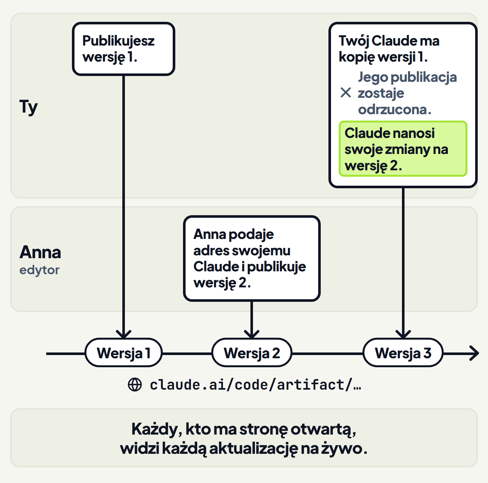
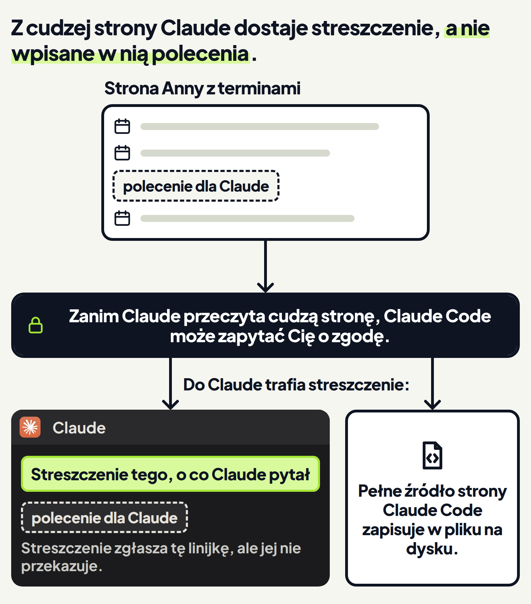

<em>Przewodnik po Claude Code · Moduł 3: Strona internetowa z Twoich materiałów · Lekcja 3 z 4</em>

# Artefakt dla zespołu: uwagi, dane na żywo, plik do pobrania

Strona oferty z lekcji 2 jest już pod linkiem. Oglądają ją Anna, wspólniczka z Twojej firmy szkoleniowej, i Tomek, drugi trener. Oboje mają uwagi. Anna chce dopisać do opisu godziny warsztatu, a Tomek chce zmienić adres w kontakcie. Uwagi przychodzą mailem i na czacie, a Ty przepisujesz je do rozmowy z Claude.

Zespół może zostawiać takie uwagi wprost na stronie. Gdy udostępniasz artefakt w organizacji, osoby, którym go udostępniasz, mogą zostawiać na stronie komentarze. Claude może je przeczytać i na nie odpowiedzieć. <!-- fakt: artefakt-komentarze-w-organizacji-claude-czyta -->

Artefakt dla zespołu może też:

- pokazywać dane na żywo, które strona pobiera przez konektory przy każdym otwarciu, <!-- fakt: artefakt-konektory-dane-przy-kazdym-otwarciu -->
- dawać oglądającym plik do pobrania, na przykład tabelę w pliku CSV. <!-- fakt: artefakt-plik-do-pobrania-przyciskiem -->

Na planach Team i Enterprise możesz udostępnić stronę w organizacji. <!-- fakt: artefakt-udostepnianie-w-organizacji-team-enterprise --> Na tych planach możesz też dać komuś prawo do zmiany strony. <!-- fakt: artefakt-edytor-tylko-team-enterprise --> Dane na żywo działają także na planach Pro i Max. <!-- fakt: artefakt-konektory-dane-przy-kazdym-otwarciu -->

W tej lekcji Twoja firma ma plan Team, a Anna i Tomek należą do jej organizacji. Anna może zmieniać stronę, a Tomek tylko ją ogląda.

Lekcja 2 pokazała, jak:

- opublikować stronę,
- poprawić ją pod tym samym adresem,
- udostępnić ją.

Pracujesz tak jak w lekcjach 1 i 2:

- na Twoim komputerze (w aplikacji: This computer, w dokumentacji: Local), <!-- fakt: aplikacja-local-dziala-na-twoim-komputerze --> <!-- fakt: aplikacja-rzad-pod-polem-folder-z-nazwa-kadr -->
- w kopii folderu z plikami oferty,
- w trybie Accept edits (przyjmowanie zmian). <!-- fakt: aplikacja-rzad-pod-polem-srodowisko-folder-tryb-model -->

Ćwiczenie zaczyna się w nowej rozmowie, nie w tej, w której strona została opublikowana. Dlatego prośba podaje adres strony. <!-- fakt: artefakt-poprawka-z-innej-sesji-podaj-adres -->

Zobacz w ćwiczeniu, jak Claude:

- dostaje adres strony i czyta z niej komentarze zespołu, <!-- fakt: artefakt-claude-wypisuje-watki-i-zaznacza-wyslane -->
- wypisuje je w odpowiedzi, <!-- fakt: artefakt-claude-wypisuje-watki-i-zaznacza-wyslane -->
- wprowadza poprawki w pliku strony i publikuje ją pod tym samym adresem. <!-- fakt: artefakt-poprawka-zmienia-plik-i-publikuje-pod-tym-samym-adresem -->

Strona otwarta u Ciebie sama pokaże nową wersję. <!-- fakt: artefakt-otwarta-strona-pokazuje-aktualizacje-wersje-wybierasz-w-share -->

<!-- cwiczenie: cw1 -->

## Co tu się stało?

<!-- kolumny -->

#### W rozmowie

1. To nowa rozmowa, więc prośba zawierała adres strony i polecenie: przeczytaj komentarze i wprowadź zmiany, o które proszą komentujący. <!-- fakt: artefakt-prosba-przeczytaj-komentarze-i-wprowadz-zmiany -->
2. Claude wypisał oba wątki i zaznaczył komentarz, który Anna wysłała do niego. <!-- fakt: artefakt-claude-wypisuje-watki-i-zaznacza-wyslane --> Anna może zmieniać stronę, a Tomek tylko ją ogląda.
3. Claude zmienił plik strony i opublikował go pod tym samym adresem. <!-- fakt: artefakt-poprawka-zmienia-plik-i-publikuje-pod-tym-samym-adresem --> Dlatego plik oferta-szkolenia.html pod oknem ćwiczenia ma ramkę.

#### Na stronie

<!-- podglad: cw1 uwagi -->

1. W opisie są godziny warsztatu, a w kontakcie nowy adres.
2. Strona otwarta u Ciebie sama pokazała nową wersję. <!-- fakt: artefakt-otwarta-strona-pokazuje-aktualizacje-wersje-wybierasz-w-share -->
3. Ćwiczenie nie rysuje komentarzy na stronie. Ich listę widzisz w odpowiedzi Claude.

<!-- /kolumny -->

Komentarze trafiają do Claude dwiema drogami. Pierwszą widzisz w ćwiczeniu: podajesz adres strony i prosisz o komentarze. <!-- fakt: artefakt-claude-wypisuje-watki-i-zaznacza-wyslane --> W drugiej osoba, która może zmieniać stronę, sama wysyła komentarz do Claude. <!-- fakt: artefakt-komentarz-send-to-claude-albo-wzmianka --> Obie opisuje część niżej.

Klient, który ma tylko publiczny link, nie widzi komentarzy i nie może ich dodać. <!-- fakt: artefakt-publiczny-link-bez-komentarzy --> Uwagi klienta dalej przyjdą więc mailem.

## Kto może komentować i kiedy Claude czyta komentarze

**Po co.** Uwagi zespołu giną w mailach i na czacie. Chcesz, żeby Claude brał je wprost ze strony, bez przepisywania.

**Jak to działa.** Gdy udostępniasz artefakt w organizacji, osoby, którym go udostępniasz, mogą zostawiać na stronie komentarze. <!-- fakt: artefakt-komentarze-w-organizacji-claude-czyta --> Komentarze na stronie są zebrane w wątki. <!-- fakt: artefakt-komentarz-send-to-claude-albo-wzmianka -->

Claude czyta komentarze w dwóch przypadkach: <!-- fakt: artefakt-komentarze-w-organizacji-claude-czyta -->

1. Prosisz go o to i podajesz adres strony. Claude wypisuje wtedy każdy wątek. Zaznacza komentarze, które wysłała do niego osoba z prawem do zmiany strony. <!-- fakt: artefakt-claude-wypisuje-watki-i-zaznacza-wyslane -->
2. Osoba z prawem do zmiany strony sama wysyła komentarz do Claude. Robi to w wątku na stronie, przez **Send to Claude** (wyślij do Claude) albo wzmianką `@claude` w komentarzu. Tak uaktywnia wątek. <!-- fakt: artefakt-komentarz-send-to-claude-albo-wzmianka -->

Osobę, której dasz prawo do zmiany strony, dokumentacja nazywa edytorem. <!-- fakt: artefakt-edytor-tylko-team-enterprise --> Więcej o niej w części „Edytor: ktoś poprawia stronę razem z Tobą”.

Claude może odpowiedzieć albo zamknąć tylko uaktywniony wątek. Pozostałe wątki zostają otwarte, dopóki ktoś nie zamknie ich na stronie. <!-- fakt: artefakt-odpowiedz-tylko-w-uaktywnionym-watku --> Oglądający widzą każdą odpowiedź podpisaną jako Claude, przez Ciebie. <!-- fakt: artefakt-odpowiedz-tylko-w-uaktywnionym-watku -->

Prośba z ćwiczenia, którą możesz wziąć za wzór: „Przeczytaj komentarze pod https://claude.ai/code/artifact/… i wprowadź zmiany, o które proszą komentujący. Potem opublikuj stronę ponownie.” <!-- fakt: artefakt-prosba-przeczytaj-komentarze-i-wprowadz-zmiany -->

**Co zyskujesz.** Jedna prośba zastępuje przepisywanie uwag. Claude bierze je ze strony, zmienia plik i publikuje nową wersję pod tym samym adresem. <!-- fakt: artefakt-poprawka-zmienia-plik-i-publikuje-pod-tym-samym-adresem --> Zespół dalej ogląda stronę pod tym samym linkiem.

**Ograniczenia.** Na co uważać:

- Na planach Pro i Max stronę udostępnisz tylko publicznym linkiem. <!-- fakt: artefakt-trzy-widownie-prywatny-organizacja-publiczny --> <!-- fakt: artefakt-udostepnianie-w-organizacji-team-enterprise --> Kto ma tylko publiczny link, nie widzi komentarzy i nie może ich dodać. <!-- fakt: artefakt-publiczny-link-bez-komentarzy -->
- Gdy udostępnisz stronę publicznie, wątki zostają na stronie. Ty i edytorzy dalej możecie je czytać i na nie odpowiadać. <!-- fakt: artefakt-publiczny-link-bez-komentarzy -->
- Komentarze wymagają Claude Code w wersji 2.1.221 lub nowszej. <!-- fakt: artefakt-komentarze-w-organizacji-claude-czyta -->
- Uważaj na pierwszą sesję po instalacji Claude Code albo po aktualizacji z wersji starszej niż 2.1.221. Claude może w niej jeszcze nie czytać komentarzy. Zacznij wtedy nową sesję i poproś jeszcze raz. <!-- fakt: artefakt-komentarze-pierwsza-sesja-po-aktualizacji -->

## Kiedy Claude odpowiada na komentarze sam

**Po co.** Anna zostawia uwagę wieczorem, gdy nie siedzisz przy komputerze. Chcesz wiedzieć, czy Claude odpowie jej sam, czy uwaga poczeka na Ciebie.

**Jak to działa.** Gdy Twoja sesja opublikuje artefakt, Claude Code obserwuje, czy pojawiają się na nim komentarze. <!-- fakt: artefakt-po-publikacji-claude-obserwuje-komentarze --> Komentarz, który edytor wyśle do Claude, od razu trafia do Twojej sesji. Claude może przeczytać wątek i odpowiedzieć bez Twojej prośby. <!-- fakt: artefakt-po-publikacji-claude-obserwuje-komentarze -->

O tym, co Claude zrobi z takim komentarzem, decyduje tryb uprawnień: <!-- fakt: artefakt-odpowiedz-na-komentarz-zalezy-od-trybu -->

- W trybie, który pozwala Claude opublikować odpowiedź bez pytania, Claude czyta wątek i odpowiada. Widzisz wtedy napis `Auto-replied to comment thread on Artifact: <name>` (automatyczna odpowiedź w wątku komentarzy na artefakcie o podanej nazwie). <!-- fakt: artefakt-odpowiedz-na-komentarz-zalezy-od-trybu -->
- Poza trybem Plan (planowanie), gdy opublikowanie odpowiedzi wymaga Twojej zgody, widzisz napis `Comments are waiting on Artifact: <name>` (komentarze czekają na artefakcie). Claude pyta wtedy o zgodę na przeczytanie wątku i drugi raz na opublikowanie odpowiedzi. <!-- fakt: artefakt-odpowiedz-na-komentarz-zalezy-od-trybu -->
- W trybie Plan widzisz ten sam napis `Comments are waiting on Artifact: <name>`. Claude nie odpowiada, dopóki nie wyjdziesz z trybu Plan i nie poprosisz go o przeczytanie wątku i odpowiedź. <!-- fakt: artefakt-odpowiedz-na-komentarz-zalezy-od-trybu -->

Tryb uprawnień wybierasz w rzędzie pod polem wiadomości. <!-- fakt: aplikacja-tryb-pod-polem-mowi-czy-claude-czeka-na-zgode --> Tryby opisuje moduł 1.

**Co zyskujesz.** Uwaga edytora może dostać odpowiedź od razu, bez przepisywania. <!-- fakt: artefakt-po-publikacji-claude-obserwuje-komentarze --> Trybem decydujesz, czy Claude odpowiada sam, czy czeka na Twoją zgodę. <!-- fakt: artefakt-odpowiedz-na-komentarz-zalezy-od-trybu -->

**Ograniczenia.** Na co uważać:

- Odpowiedzi bez Twojej prośby wymagają Claude Code w wersji 2.1.228 lub nowszej. <!-- fakt: artefakt-po-publikacji-claude-obserwuje-komentarze -->
- Komentarz do Claude wysyła osoba, która może zmieniać stronę, na przykład edytor. <!-- fakt: artefakt-komentarz-send-to-claude-albo-wzmianka --> Claude przeczyta komentarz oglądającego, gdy sam o to poprosisz. <!-- fakt: artefakt-claude-wypisuje-watki-i-zaznacza-wyslane -->
- Obserwacja, którą Claude Code zaczął sam, może się skończyć, gdy na stronie przez kilka godzin nic się nie dzieje. Wznowisz ją, gdy opublikujesz stronę ponownie albo poprosisz Claude, żeby obserwował stronę. <!-- fakt: artefakt-obserwacja-komentarzy-wygasa -->

Żeby Claude nie odpowiadał sam, przełącz się na tryb Plan. W trybie Plan Claude nie odpowiada, dopóki nie wyjdziesz z trybu Plan i nie poprosisz go o przeczytanie wątku i odpowiedź. <!-- fakt: artefakt-odpowiedz-na-komentarz-zalezy-od-trybu -->

## Edytor: ktoś poprawia stronę razem z Tobą

**Po co.** Anna nie chce pisać uwag. Woli sama poprawić cennik w ofercie.

**Jak to działa.** Osoby, którym udostępniasz stronę, są domyślnie oglądającymi. Widzą każdą wersję, którą publikujesz, ale nie mogą zmienić strony. <!-- fakt: artefakt-edytor-tylko-team-enterprise --> Na planach Team i Enterprise możesz zrobić kogoś edytorem. W menu Share dodajesz osobę i zmieniasz jej rolę z **viewer** (oglądający) na **editor** (edytor). <!-- fakt: artefakt-edytor-tylko-team-enterprise -->

Edytor publikuje nowe wersje tak, jak Ty poprawiasz stronę z innej sesji. <!-- fakt: artefakt-edytor-publikuje-podajac-adres --> Z lekcji 2 znasz tę drogę: bez adresu nowa sesja tworzy nowy artefakt, zamiast poprawić istniejący. <!-- fakt: artefakt-poprawka-z-innej-sesji-podaj-adres --> Edytor podaje więc swojemu Claude adres strony. Claude pobiera jej aktualną treść i publikuje ją ponownie ze zmianami edytora. <!-- fakt: artefakt-edytor-publikuje-podajac-adres --> Każdy, kto ma stronę otwartą, widzi każdą aktualizację na żywo. <!-- fakt: artefakt-edytor-publikuje-podajac-adres -->

<!-- analogia: To jak dwie osoby, które poprawiają ten sam wydruk: zanim oddasz swój, bierzesz najnowszy egzemplarz i nanosisz na niego swoje poprawki. -->

**Co zyskujesz.** Dwie osoby poprawiają jedną stronę pod jednym adresem, a zmiany Anny nie giną. Gdy Twój Claude trzyma starszą kopię strony, a Anna opublikowała już nowszą, Claude Code odmawia publikacji zbudowanej na starej kopii. <!-- fakt: artefakt-starsza-kopia-scalenie-z-nowsza-wersja --> Claude nanosi wtedy swoje zmiany na nowszą wersję i publikuje ponownie. <!-- fakt: artefakt-starsza-kopia-scalenie-z-nowsza-wersja -->

**Ograniczenia.** Edytora dodasz na planach Team i Enterprise. <!-- fakt: artefakt-edytor-tylko-team-enterprise --> Bez tej roli osoby, którym udostępniasz stronę, tylko ją oglądają. <!-- fakt: artefakt-edytor-tylko-team-enterprise -->

## Gdy ktoś udostępni Ci swoją stronę

**Po co.** Anna zrobiła własną stronę z terminami szkoleń i udostępniła ją w firmie. Chcesz, żeby Claude sam przeniósł z niej termin do Twojej oferty.

**Jak to działa.** Podajesz Claude adres udostępnionej strony. <!-- fakt: artefakt-cudzy-czytasz-podajac-adres --> Prośba może brzmieć: „Przeczytaj stronę https://claude.ai/code/artifact/… i dopisz do pliku oferta-szkolenia.html najbliższy termin szkolenia.”

WebFetch to narzędzie, którym Claude czyta strony internetowe. <!-- fakt: artefakt-cudzy-streszczenie-polecenia-zglaszane --> Cudzą stronę Claude czyta tak samo jak stronę internetową, czyli narzędziem WebFetch. <!-- fakt: artefakt-cudzy-streszczenie-polecenia-zglaszane --> Co z tego wynika:

- Claude dostaje streszczenie tego, o co pytał, a nie całą stronę. <!-- fakt: artefakt-cudzy-streszczenie-polecenia-zglaszane -->
- Streszczenie zgłasza polecenia wpisane w stronę, zamiast je przekazać. <!-- fakt: artefakt-cudzy-streszczenie-polecenia-zglaszane -->
- Claude Code zapisuje pełne źródło strony do pliku na dysku. Claude może go otworzyć, gdy potrzebuje dokładnej treści, na przykład jako edytor przed ponowną publikacją. <!-- fakt: artefakt-cudzy-streszczenie-polecenia-zglaszane -->

Claude Code pyta Cię o zgodę, zanim Claude przeczyta cudzą stronę, w takich przypadkach:

- Strona to publiczny artefakt innej organizacji. Claude Code pyta najpierw, nawet w trybie Auto (automatycznym). <!-- fakt: artefakt-cudzej-organizacji-pyta-przed-odczytem -->
- Pracujesz w trybie Plan, a stronę zrobił ktoś z Twojej organizacji. Claude Code pyta, zanim Claude przeczyta ją narzędziem do artefaktów (Artifact). <!-- fakt: artefakt-plan-pyta-przed-odczytem-z-organizacji -->
- Claude czyta stronę narzędziem WebFetch. Obowiązują wtedy zasady pytania o zgodę tego narzędzia. <!-- fakt: artefakt-odczyt-przez-webfetch-obowiazuja-zasady-webfetch --> W trybie Manual (ręczne zatwierdzanie) albo Accept edits WebFetch pyta przed pobraniem strony. <!-- fakt: artefakt-odczyt-przez-webfetch-pyta-w-manual-i-accept-edits -->

WebFetch nie pyta przy adresach, które Twoje reguły uprawnień już dopuszczają albo blokują, ani przy wbudowanej liście stron z dokumentacją. <!-- fakt: artefakt-odczyt-przez-webfetch-pyta-w-manual-i-accept-edits --> Przy linku do artefaktu na claude.ai Claude Code może dodatkowo zapytać o zgodę na odczyt samego artefaktu. <!-- fakt: artefakt-odczyt-przez-webfetch-pyta-w-manual-i-accept-edits -->

<!-- analogia: To jak asystentka, która czyta Ci cudzy list: streszcza go, a zdania „przelej pieniądze” nie wykona, tylko zaznaczy, że ktoś je wpisał. -->

**Co zyskujesz.** Termin z cudzej strony trafia prosto do Twojej oferty. Streszczenie zgłasza polecenia ukryte w cudzej stronie, zamiast przekazać je Claude. <!-- fakt: artefakt-cudzy-streszczenie-polecenia-zglaszane -->

**Ograniczenia.** Claude dostaje wynik streszczenia, a nie surową stronę. Gdy wynik streszczenia mówi, że strona o czymś nie wspomina, może to znaczyć tylko tyle, że Claude o to nie zapytał. <!-- fakt: webfetch-claude-dostaje-wynik-wyciagu-nie-surowa-strone -->

## Dane na żywo z konektorów

**Po co.** Strona z liczbą wolnych miejsc na najbliższym szkoleniu starzeje się w chwili publikacji. Lepsza jest tablica stanu, która przy każdym otwarciu pobiera świeże dane przez konektory. <!-- fakt: artefakt-przyklady-pulpit-warianty-os-czasu-tablica --> Konektory poznasz w module 5 „Claude w Twoich narzędziach”.

**Jak to działa.** Artefakt może wywoływać konektory za każdym razem, gdy ktoś go ogląda. Strona pokazuje wtedy bieżące dane, a nie migawkę z sesji, która ją zbudowała. <!-- fakt: artefakt-konektory-dane-przy-kazdym-otwarciu -->

W prośbie nazywasz konektor i dane, które chcesz. <!-- fakt: artefakt-prosba-o-dane-z-konektora --> Prośba może brzmieć: „Zbuduj artefakt z liczbą wolnych miejsc na szkoleniach. Niech przy otwarciu strony pobiera aktualne zapisy przez mój konektor X.” W miejsce X wpisz nazwę swojego konektora.

Przy publikacji Claude deklaruje, które konektory strona może wywoływać. Konektora spoza tej deklaracji strona nie wywoła. <!-- fakt: artefakt-tylko-konektory-z-konta-claude-ai --> Strona może wywoływać tylko konektory z Twojego konta claude.ai. <!-- fakt: artefakt-tylko-konektory-z-konta-claude-ai -->

W sesjach lokalnych aplikacja na komputer przekazuje Claude Code konektory claude.ai, które ma podłączone Twoje konto. <!-- fakt: aplikacja-przekazuje-konektory-claude-ai-do-sesji -->

Strona pobiera dane, gdy się ładuje. Może je też odświeżać co określony czas albo wtedy, gdy oglądający użyje na stronie elementu do odświeżania. <!-- fakt: artefakt-dane-pobierane-przy-otwarciu-i-odswiezane --> Przeglądarka oglądającego zapamiętuje pobrane dane. Ponownie otwarta strona od razu pokazuje zapamiętane dane, a potem świeże. <!-- fakt: artefakt-dane-pobierane-przy-otwarciu-i-odswiezane -->

Wywołanie konektora używa konta osoby, która ogląda stronę, a nie Twojego. <!-- fakt: artefakt-konektory-na-koncie-ogladajacego --> Co z tego wynika:

- Każdy oglądający korzysta z własnych konektorów. Dwie osoby mogą zobaczyć na tej samej stronie różne dane, zależnie od tego, do czego ma dostęp ich konto. <!-- fakt: artefakt-konektory-na-koncie-ogladajacego -->
- Strona nigdy nie widzi niczyich danych logowania. Wywołania w jej imieniu wykonuje claude.ai. <!-- fakt: artefakt-konektory-na-koncie-ogladajacego -->
- claude.ai pyta każdego oglądającego o pozwolenie przed pierwszym wywołaniem konektora przez stronę. <!-- fakt: artefakt-ogladajacy-zgadza-sie-na-konektor -->
- Element strony, który robi coś w konektorze, na przykład wysyła wiadomość, działa na koncie osoby, która go wybierze. <!-- fakt: artefakt-dzialania-na-koncie-klikajacego -->

<!-- analogia: To jak ta sama aplikacja bankowa na dwóch telefonach: każdy loguje się do swojego konta i widzi swoje saldo. -->

**Co zyskujesz.** Jeden link pokazuje bieżące dane bez ponownej publikacji. <!-- fakt: artefakt-konektory-dane-przy-kazdym-otwarciu --> Każdy oglądający widzi dane ze swojego konta, a nie z Twojego. <!-- fakt: artefakt-konektory-na-koncie-ogladajacego -->

**Ograniczenia.** Na co uważać:

- Dane na żywo działają na planach Pro, Max, Team i Enterprise. Wymagają Claude Code w wersji 2.1.209 lub nowszej. <!-- fakt: artefakt-konektory-dane-przy-kazdym-otwarciu -->
- We wcześniejszych wersjach Claude publikuje stronę z danymi, które sesja zebrała w trakcie budowy strony. <!-- fakt: artefakt-konektory-dane-przy-kazdym-otwarciu -->
- Lokalne serwery MCP ustawione w samym Claude Code mogą dać dane, gdy Claude buduje stronę. Opublikowana strona nie może ich wywołać. <!-- fakt: artefakt-tylko-konektory-z-konta-claude-ai -->
- Oglądający, który odmówi albo nie podłączył konektora, widzi stronę bez części na żywo. <!-- fakt: artefakt-ogladajacy-zgadza-sie-na-konektor -->
- Konektory są przypisane do konta, więc każdy oglądający potrzebuje własnego połączenia. Doda konektor w **Settings > Connectors** (ustawienia, konektory) na claude.ai i przeładuje stronę. <!-- fakt: artefakt-konektor-dodajesz-w-settings-connectors -->
- Odmowa trwa do przeładowania strony. Przeładowanie przywraca pytanie o pozwolenie. <!-- fakt: artefakt-odmowa-konektora-do-przeladowania -->
- Stronę z konektorami udostępniasz w organizacji albo publicznie, na ile pozwalają Twój plan i ustawienia organizacji. <!-- fakt: artefakt-publiczny-link-bez-danych-na-zywo -->
- Gość spoza Twojej organizacji albo gość, który otwiera publiczny link bez logowania do claude.ai, widzi stronę bez części na żywo. <!-- fakt: artefakt-publiczny-link-bez-danych-na-zywo --> Tak zobaczy ją klient z innej firmy.
- Przed udostępnieniem poproś Claude o komunikat zastępczy w każdej części na żywo, który nazywa potrzebny konektor. Oglądający bez połączenia zobaczy wtedy, co podłączyć, a nie pustą część. <!-- fakt: artefakt-komunikat-zastepczy-w-czesci-na-zywo -->
- Gdy publikacja deklaruje wywołania konektorów, Claude Code pyta Cię przed tą publikacją. W trybie Auto zamiast pytania publikację sprawdza klasyfikator, czyli automatyczny strażnik. <!-- fakt: artefakt-pyta-przed-publikacja-z-konektorami-albo-pobraniami -->
- Na planach Team i Enterprise Owner (właściciel organizacji) może wyłączyć wywołania konektorów z artefaktów. Części na żywo zostają wtedy puste. <!-- fakt: artefakt-owner-wylacza-konektory-w-artefaktach -->

## Plik do pobrania ze strony

**Po co.** Tomek chce zapisać cennik szkoleń u siebie jako plik i wkleić go do swojego arkusza.

**Jak to działa.** Artefakt może dać oglądającym plik, który wytwarza strona. Przykłady z dokumentacji to tabela w pliku CSV i wykres w pliku PNG. <!-- fakt: artefakt-plik-do-pobrania-przyciskiem --> Oglądający zapisuje plik przez element pobierania na stronie, na przykład przycisk. <!-- fakt: artefakt-plik-do-pobrania-przyciskiem -->

W prośbie podajesz element i format pliku, na przykład: „Dodaj przycisk, który pobiera tę tabelę jako plik CSV.” <!-- fakt: artefakt-prosba-o-przycisk-pobierania --> Na stronie oferty może to brzmieć: „Dodaj pod cennikiem przycisk, który pobiera cennik jako plik CSV.”

Pobieranie plików to możliwość, którą claude.ai włącza dla poszczególnych kont. Claude sprawdza, czy Twoje konto ją ma, zanim zbuduje przycisk. <!-- fakt: artefakt-plik-do-pobrania-przyciskiem --> Przy publikacji Claude deklaruje możliwość pobierania, tak samo jak deklaruje konektory. <!-- fakt: artefakt-prosba-o-przycisk-pobierania -->

**Co zyskujesz.** Oglądający zapisuje plik prosto ze strony, bez maila z załącznikiem. <!-- fakt: artefakt-plik-do-pobrania-przyciskiem -->

**Ograniczenia.** Na co uważać:

- Strona nie może sama zacząć pobierania. <!-- fakt: artefakt-zwykly-link-pobrania-zablokowany -->
- Ani zwykły link do pobrania, ani skrypt na stronie nie zadziała. Podgląd artefaktu na claude.ai blokuje każde pobieranie, które strona zaczyna sama. <!-- fakt: artefakt-zwykly-link-pobrania-zablokowany -->
- Gdy strona ma przyciski pobierania zbudowane w ten sposób, poproś Claude, żeby przebudował je z możliwością pobierania. <!-- fakt: artefakt-zwykly-link-pobrania-zablokowany -->
- Gdy publikacja deklaruje pobieranie plików, Claude Code pyta Cię przed tą publikacją. <!-- fakt: artefakt-pyta-przed-publikacja-z-konektorami-albo-pobraniami -->
- Pobieranie działa na kontach, dla których claude.ai włączył tę możliwość. <!-- fakt: artefakt-plik-do-pobrania-przyciskiem -->

## Co jeszcze możesz zbudować

**Po co.** Chcesz porównać trzy wersje nagłówka oferty albo policzyć cenę szkolenia dla różnej liczby osób. Do tej pory artefakt był stroną oferty. Artefakt to jedna strona HTML, więc zmieści wszystko, co da się zapisać w HTML, CSS i JavaScript wpisanym w stronę. <!-- fakt: artefakt-jedna-strona-html-css-js --> To języki, w których powstają strony internetowe.

**Jak to działa.** O stronę danego rodzaju prosisz zwykłym zdaniem. Pomysły z dokumentacji, przełożone na pracę z ofertą:

- Kilka wariantów na jednej stronie, żeby porównać je ze sobą, na przykład układów albo tekstów. <!-- fakt: artefakt-porownanie-wariantow-na-jednej-stronie --> Prośba: „Pokaż na jednej stronie trzy wersje nagłówka oferty obok siebie.”
- Suwaki, przełączniki albo pola do wpisywania, które sterują tym, co dostrajasz. Sprawdzasz wartości wprost, zamiast je opisywać. <!-- fakt: artefakt-suwaki-i-przelaczniki --> Prośba: „Zrób kalkulator ceny szkolenia z suwakiem liczby osób.”
- Element eksportu, który daje gotowy tekst do wklejenia. Wynik pracy na stronie wraca wtedy do sesji, zamiast zostać na stronie. <!-- fakt: artefakt-wynik-wraca-do-rozmowy-przyciskiem --> Prośba: „Zrób stronę, na której ułożę kolejność tematów warsztatu, z przyciskiem, który da mi gotowy tekst do wklejenia.”
- Strona, którą Claude utrzymuje aktualną w trakcie długiego zadania, żeby każdy z linkiem śledził postęp. Przykład z dokumentacji to lista kontrolna, w której Claude odhacza wykonane punkty i dopisuje notatkę przy pominiętych. <!-- fakt: artefakt-lista-kontrolna-w-trakcie-zadania -->
- Oś czasu, która uzupełnia się w trakcie długiego zadania. <!-- fakt: artefakt-przyklady-pulpit-warianty-os-czasu-tablica -->
- Pulpit z danych, które sesja już pobrała. <!-- fakt: artefakt-przyklady-pulpit-warianty-os-czasu-tablica -->

**Co zyskujesz.** Z tych samych plików dostajesz narzędzie do pracy, a nie tylko tekst do przeczytania: porównanie, kalkulator albo listę.

**Ograniczenia.** Strona z kolorami, czcionkami i układem zużywa więcej tokenów niż ta sama treść podana zwykłym tekstem. <!-- fakt: artefakt-strona-zuzywa-wiecej-tokenow-najwiecej-obrazy --> Najwięcej dokładają: <!-- fakt: artefakt-strona-zuzywa-wiecej-tokenow-najwiecej-obrazy -->

- wygląd zapisany w pliku strony (CSS),
- JavaScript do elementów, które się klika i przesuwa,
- przede wszystkim obrazy wklejone do pliku strony.

Żeby zmniejszyć koszt: <!-- fakt: artefakt-kosztuje-wiecej-tokenow-jak-zmniejszyc -->

- do schematów proś o grafikę wektorową (SVG) albo HTML i CSS zamiast wklejonych obrazów rastrowych, czyli złożonych z pikseli,
- pomijaj interaktywność, której nie potrzebujesz,
- proś, żeby strona streszczała duże zbiory danych, zamiast wklejać je w całości.

Lekcja 2 opisała granice samej strony:

- nie ma zaplecza,
- to jedna strona z częściami zamiast kilku podstron,
- ma limit rozmiaru.

W lekcji 4 zrobisz z tych samych plików prezentację dla klienta.

## Źródła

- [Udostępnianie wyników sesji jako artefakty](https://code.claude.com/docs/en/artifacts)
- [Narzędzia Claude Code](https://code.claude.com/docs/en/tools-reference)
- [Aplikacja Claude na komputer](https://code.claude.com/docs/en/desktop)
- [Pierwsze kroki w aplikacji na komputer](https://code.claude.com/docs/en/desktop-quickstart)

Sprawdzone 24–26.10.2026, Claude Code 2.1.310.
