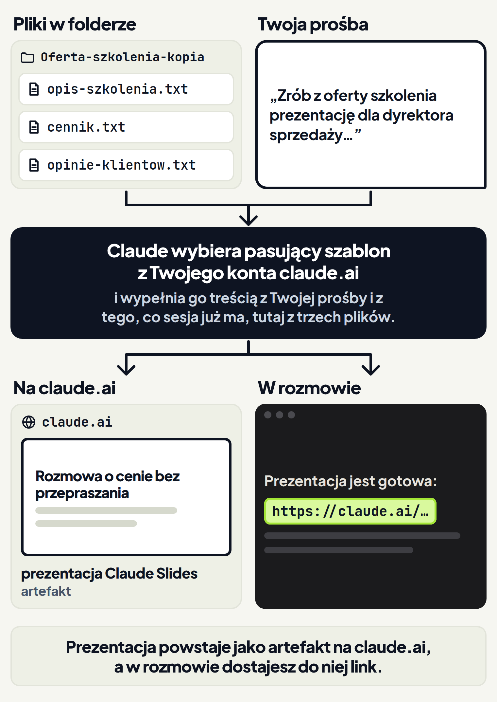
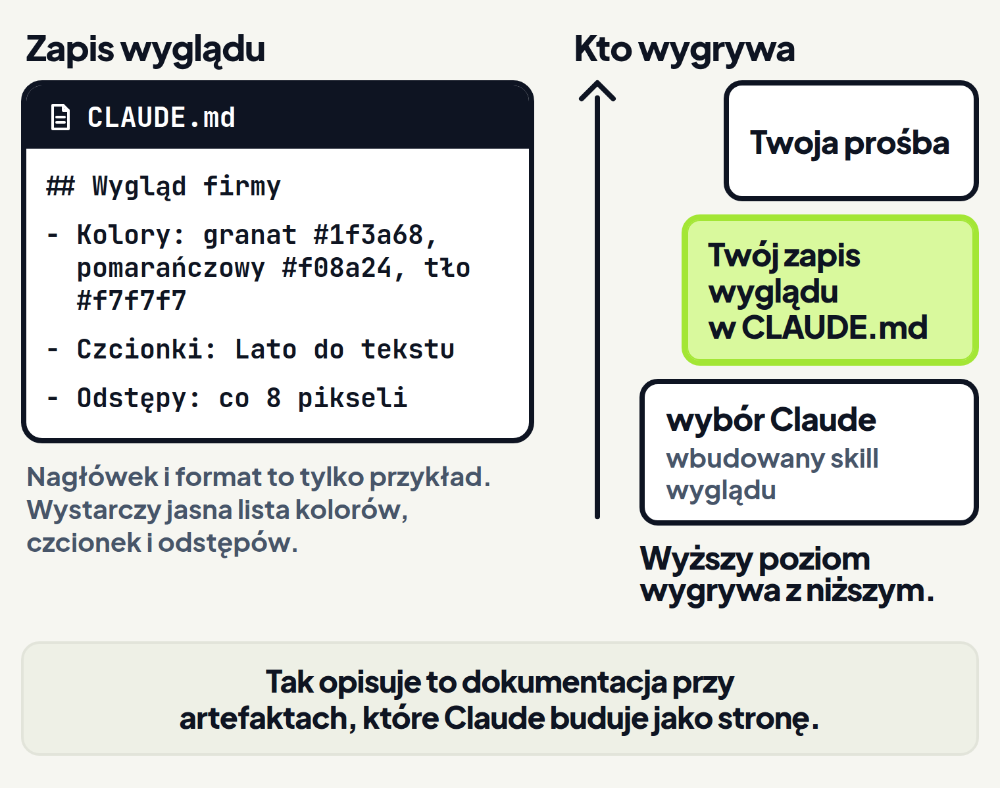
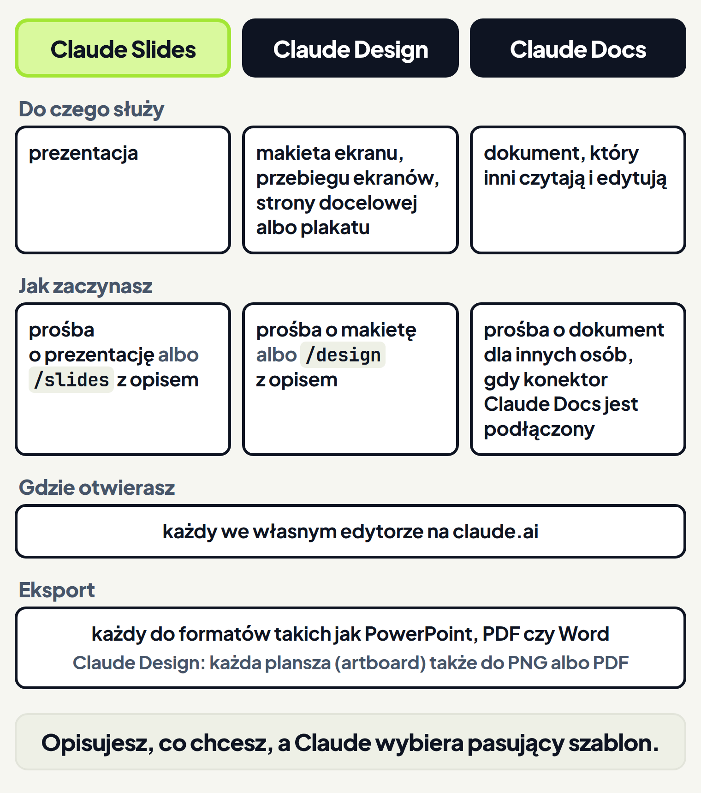

<em>Przewodnik po Claude Code · Moduł 3: Strona internetowa z Twoich materiałów · Lekcja 4 z 4</em>

# Prezentacja dla klienta z Twoich materiałów (Claude Slides)

Prowadzisz warsztat „Rozmowa o cenie bez przepraszania”. Dyrektor sprzedaży firmy, która myśli o zamówieniu warsztatu, pisze: „Strony z ofertą nikt na zarządzie nie otworzy. Prześlij slajdy”. Opis szkolenia, cennik i opinie klientów masz w trzech plikach, tych samych co w lekcji 1. Ręczne składanie slajdów z trzech plików zajmuje wieczór, a przy przepisywaniu łatwo pomylić cenę.

W tej lekcji zrobisz z tych plików prezentację dla klienta w Claude Slides. To szablon prezentacji na Twoim koncie claude.ai. <!-- fakt: szablony-slides-design-docs-do-czego --> Opisujesz w rozmowie, jakiej prezentacji potrzebujesz. Claude wybiera pasujący szablon, wypełnia go z Twojej prośby i z tego, co sesja już ma, na przykład z plików wskazanych w prośbie, i daje Ci link. <!-- fakt: slides-zwykla-prosba-wybiera-szablon -->

W ćwiczeniu wyślesz zwykłą prośbę o prezentację z plików w folderze, a Claude odpowie linkiem. <!-- fakt: slides-zwykla-prosba-wybiera-szablon --> Pod linkiem zobaczysz uproszczony przykład slajdów z tekstami z tych plików. Prawdziwa prezentacja otwiera się w edytorze na claude.ai. <!-- fakt: slides-edytor-na-claude-ai-i-eksport --> W drugim poleceniu ćwiczenia zobaczysz, jak ten edytor wygląda rozwinięty na całe okno.

<!-- cwiczenie: cw1 -->

## Co tu się stało?

<!-- kolumny -->

#### W rozmowie

1. Prośba mówiła, o czym ma być prezentacja i dla kogo. Wymieniała też trzy pliki z tekstami. Pod oknem ćwiczenia te pliki się podświetliły, bo Claude czyta pliki z folderu. <!-- fakt: aplikacja-claude-czyta-pliki-projektu -->
2. Claude wybrał szablon prezentacji i wypełnił go z prośby i z plików. W odpowiedzi dał link. <!-- fakt: slides-zwykla-prosba-wybiera-szablon -->
3. Kliknięcie ścieżki cennik.txt otworzyło plik. <!-- fakt: aplikacja-klik-sciezki-w-rozmowie-otwiera-plik --> Cena w pliku zgadza się z ceną w odpowiedzi Claude.

#### W panelu Browser

<!-- podglad: cw1 prezentacja -->

1. W ćwiczeniu link otworzył się w panelu Browser, czyli w przeglądarce z kartami w aplikacji. <!-- fakt: aplikacja-link-w-rozmowie-cmd-klik-zwykla-przegladarka --> <!-- fakt: aplikacja-panel-browser-to-przegladarka-z-kartami -->
2. Prezentacja w ćwiczeniu ma cztery slajdy z tekstami z Twoich plików. To uproszczony przykład slajdów. Tytuł prezentacji w nagłówku wybrał Claude. <!-- fakt: artefakt-tytul-i-ikone-karty-wybiera-claude -->
3. Prezentację otwierasz w przeglądarce na komputerze, żeby ją edytować albo pokazać. <!-- fakt: slides-otwierasz-w-przegladarce-na-komputerze -->

<!-- /kolumny -->

W drugim poleceniu link otworzył prezentację w edytorze, a ikona w prawym górnym rogu rozwinęła edytor na całe okno ćwiczenia. Co robisz w edytorze, opisuje część „Jak zrobić prezentację i pokazać ją klientowi”.

## Jak działa szablon Claude Slides

**Po co.** Klient chce slajdów na spotkanie, a Ty masz teksty oferty w plikach. Zamiast przepisywać je ręcznie na slajdy, prosisz Claude o prezentację.

**Jak to działa.** Przypomnienie z lekcji 2: artefakt to interaktywna strona, którą Claude Code publikuje z Twojej sesji pod prywatnym adresem na claude.ai. <!-- fakt: artefakt-to-strona-pod-prywatnym-linkiem-na-claude-ai --> Zamiast budować stronę od zera, Claude może zbudować artefakt na jednym z szablonów na Twoim koncie claude.ai: <!-- fakt: szablony-slides-design-docs-do-czego -->

- Claude Slides do prezentacji,
- Claude Design do projektu wizualnego,
- Claude Docs do dokumentu, który inni będą czytać i edytować.

Claude wybiera pasujący szablon, wypełnia go z Twojej prośby i z tego, co sesja już ma, na przykład z plików wskazanych w prośbie, i daje Ci link. <!-- fakt: slides-zwykla-prosba-wybiera-szablon --> Prezentacja powstaje jako artefakt na claude.ai; w rozmowie dostajesz do niej link. <!-- fakt: szablony-slides-design-docs-do-czego --> <!-- fakt: slides-zwykla-prosba-wybiera-szablon -->



**Co zyskujesz.** Każdy szablon otwiera się we własnym edytorze na claude.ai, skąd eksportujesz go do formatów takich jak PowerPoint, PDF czy Word. <!-- fakt: slides-edytor-na-claude-ai-i-eksport --> W edytorze Ty i osoby z Twojego zespołu zmieniacie prezentację ręcznie albo prosicie o to Claude. <!-- fakt: slides-edytor-na-claude-ai-i-eksport --> Slajdów nie przepisujesz więc do innego programu.

**Ograniczenia.**

- Slajdy w ćwiczeniu to przykład.
- Claude wypełnia szablon tym, co ma sesja. <!-- fakt: slides-zwykla-prosba-wybiera-szablon --> Liczby na slajdach sprawdzasz więc w swoich plikach.
- Nowa prezentacja jest widoczna tylko dla Ciebie, dopóki jej nie udostępnisz. <!-- fakt: artefakt-nowy-widoczny-tylko-dla-ciebie --> Jak udostępnić artefakt, pokazała lekcja 2.

## Jak zrobić prezentację i pokazać ją klientowi

1. W polu wiadomości napisz, o czym ma być prezentacja i dla kogo. Wymień pliki z tekstami. Naciśnij <kbd>Enter</kbd>. <!-- fakt: aplikacja-enter-wysyla-zadanie --> <!-- fakt: slides-zwykla-prosba-wybiera-szablon -->
2. Pisz „prezentacja”, nie „dokument”. Dlaczego, przeczytasz niżej w części o Claude Docs.
3. Kliknij link w odpowiedzi Claude. Za pierwszym razem aplikacja zapyta, czy otwierać linki w panelu Browser, czy w domyślnej przeglądarce. <!-- fakt: aplikacja-link-w-rozmowie-cmd-klik-zwykla-przegladarka --> Gdy klikniesz link z wciśniętym klawiszem <kbd>Cmd</kbd> (macOS) albo <kbd>Ctrl</kbd> (Windows), otworzy się od razu w domyślnej przeglądarce. <!-- fakt: aplikacja-link-w-rozmowie-cmd-klik-zwykla-przegladarka --> Więcej o tym wyborze mówi lekcja 2.
4. Panel Browser nie ma Twoich zapisanych logowań. <!-- fakt: aplikacja-panel-browser-czysty-profil-bez-zapisanych-logowan --> Możesz się w nim zalogować na claude.ai. <!-- fakt: aplikacja-panel-browser-mozna-logowac-sie-na-stronach -->
5. Prezentację otwierasz w przeglądarce na komputerze, żeby ją edytować albo pokazać. <!-- fakt: slides-otwierasz-w-przegladarce-na-komputerze --> W edytorze na claude.ai zmieniasz ją ręcznie albo prosisz Claude o zmianę. Stamtąd ją eksportujesz. <!-- fakt: slides-edytor-na-claude-ai-i-eksport -->
6. Zanim pokażesz prezentację klientowi, porównaj liczby na slajdach z plikami. Plik otworzysz, gdy klikniesz jego ścieżkę w odpowiedzi Claude. <!-- fakt: aplikacja-klik-sciezki-w-rozmowie-otwiera-plik -->


## Druga droga: polecenie /slides

**Po co.** Przy zwykłej prośbie szablon wybiera Claude. <!-- fakt: slides-zwykla-prosba-wybiera-szablon --> Gdy chcesz mieć pewność, że powstanie prezentacja, wskazujesz szablon poleceniem `/slides`. <!-- fakt: slides-polecenie-tworzy-artefakt-i-daje-link -->

**Jak to działa.** Wpisz w polu wiadomości `/slides`, a po nim, o czym jest prezentacja i dla kogo. <!-- fakt: slides-polecenie-slides-z-opisem-temat-i-odbiorca --> Na przykład: `/slides` oferta warsztatu dla dyrektora sprzedaży. <!-- fakt: slides-polecenie-slides-z-opisem-temat-i-odbiorca --> Po wpisaniu ukośnika aplikacja pokazuje listę poleceń i skilli. Wybrane polecenie pojawia się w polu podświetlone, a opis piszesz po nim. <!-- fakt: skill-aplikacja-menu --> Bez opisu Claude najpierw zapyta, o czym ma być prezentacja. <!-- fakt: slides-bez-opisu-claude-pyta -->

**Co zyskujesz.** Po poleceniu `/slides` z opisem Claude tworzy artefakt Claude Slides i daje Ci link. <!-- fakt: slides-polecenie-tworzy-artefakt-i-daje-link --> Dalej pracujesz tak samo jak po zwykłej prośbie.

**Ograniczenia.**

- Gdy `slides` nie ma na liście po ukośniku, sprawdź wersję Claude Code. Polecenia nie ma też, gdy organizacja wyłączyła szablon Slides. <!-- fakt: slides-polecenia-wymagaja-wersji-i-wlaczonego-szablonu -->
- Polecenie wymaga Claude Code 2.1.265 lub nowszego. <!-- fakt: slides-polecenia-wymagaja-wersji-i-wlaczonego-szablonu -->
- Polecenie działa tylko w sesji, w której artefakty są dostępne. <!-- fakt: slides-polecenia-wymagaja-wersji-i-wlaczonego-szablonu -->

Wersję sprawdzisz i zmienisz tak:

1. Wpisz `/status` w sesji lokalnej w zakładce Code i przeczytaj wiersz Claude Code. <!-- fakt: aplikacja-status-pokazuje-wersje-claude-code-sesji -->
2. Nowszą wersję dostaniesz przez Claude > Check for Updates… (macOS) albo Help > Check for Updates… (Windows). <!-- fakt: aplikacja-nowsza-wersja-claude-code-check-for-updates-i-nowa-sesja -->
3. Potem zacznij nową sesję. <!-- fakt: aplikacja-nowsza-wersja-claude-code-check-for-updates-i-nowa-sesja -->

## Czego potrzebujesz, żeby korzystać z Claude Slides

Prezentacja z szablonu to artefakt. <!-- fakt: szablony-slides-design-docs-do-czego --> Obowiązują więc warunki z lekcji 2, między innymi: <!-- fakt: artefakt-dostepnosc-plan-konto-aplikacja -->

- plan Pro, Max, Team albo Enterprise,
- logowanie do konta claude.ai w aplikacji,
- aplikacja Claude na komputer w wersji 1.13576.0 lub nowszej.

Szablony są w wersji beta. Na planach Pro, Max i Team są domyślnie włączone. <!-- fakt: slides-szablony-beta-plany --> Na planie Enterprise każdy szablon włącza Owner (właściciel organizacji) w Organization settings > Artifacts (ustawienia organizacji > artefakty). <!-- fakt: slides-szablony-beta-plany -->

Dokumentacja podaje warunek wersji Claude Code 2.1.265 przy poleceniach `/slides` i `/design`. <!-- fakt: slides-polecenia-wymagaja-wersji-i-wlaczonego-szablonu -->

## Wygląd w kolorach Twojej firmy

**Po co.** Strona oferty z lekcji 1 i 2 ma kolory, które wybrał Claude. Twoja firma ma swoje: granat z logo i czcionkę z papieru firmowego. Nie chcesz wpisywać ich do każdej prośby.

**Jak to działa.** Gdy Claude buduje artefakt, stosuje wbudowany skill wyglądu. Dzięki niemu strona dostaje przemyślane kolory, czcionki i układ bez dodatkowych próśb. <!-- fakt: artefakt-wbudowany-skill-wygladu-szuka-zapisu-wygladu --> Ten skill najpierw szuka w projekcie Twojego zapisu wyglądu (design system), a dopiero potem wybiera własny. <!-- fakt: artefakt-wbudowany-skill-wygladu-szuka-zapisu-wygladu -->

Design tokens to nazwane wartości kolorów, czcionek i odstępów, których zapis wyglądu używa wiele razy. Zapisujesz je tam, gdzie Claude je znajdzie, na przykład w pliku CLAUDE.md w folderze projektu. <!-- fakt: artefakt-zapis-wygladu-marki-w-claude-md --> O pliku CLAUDE.md mówi moduł 2. Taki zapis może wyglądać tak:

```
## Wygląd firmy
- Kolory: granat #1f3a68, pomarańczowy #f08a24, tło #f7f7f7
- Czcionki: Lato do tekstu
- Odstępy: co 8 pikseli
```

Nagłówek i układ z przykładu nie są wymagane. Wystarczy każda jasna lista kolorów, czcionek i odstępów. <!-- fakt: artefakt-pierwszenstwo-prosba-zapis-wygladu-claude --> Gdy chcesz konkretny krój czcionki, nazwij go w prośbie albo w zapisie wyglądu. <!-- fakt: artefakt-konkretny-kroj-nazwij-w-prosbie-albo-zapisie -->


<!-- analogia: To jak w firmie: polecenie szefa przy konkretnym zadaniu wygrywa z firmowym poradnikiem, a poradnik wygrywa z gustem pracownika. -->

**Co zyskujesz.** Twój zapis wyglądu wygrywa z własnymi wyborami Claude. <!-- fakt: artefakt-pierwszenstwo-prosba-zapis-wygladu-claude --> Kolorów firmy nie wpisujesz więc do każdej prośby.

**Ograniczenia.**

- Twoja prośba wygrywa z zapisem wyglądu. <!-- fakt: artefakt-pierwszenstwo-prosba-zapis-wygladu-claude --> Prośba „zrób stronę na czerwono” przebije więc kolory z CLAUDE.md.
- Dokumentacja opisuje zapis wyglądu przy artefaktach, które Claude buduje jako stronę. <!-- fakt: artefakt-wbudowany-skill-wygladu-szuka-zapisu-wygladu -->

## Dwa inne szablony: Design i Docs



Szablon dobiera Claude według tego, co opisujesz w prośbie. <!-- fakt: slides-zwykla-prosba-wybiera-szablon --> Poza Claude Slides są jeszcze dwa.

### Claude Design: makieta strony albo plakat

**Po co.** Chcesz pokazać grafikowi makietę strony kampanii albo plakatu na targi, zanim grafik zacznie właściwy projekt.

**Jak to działa.** Uruchamiasz polecenie `/design` z opisem, gdy zamiast gotowej strony chcesz makietę: <!-- fakt: design-polecenie-makiety-artboardy-na-jednym-plotnie -->

- ekranu programu,
- kilku ekranów po kolei,
- strony docelowej kampanii,
- plakatu.

Claude szkicuje projekt jako artboardy, czyli plansze, na jednym płótnie. Płótno publikuje jako artefakt Claude Design. <!-- fakt: design-polecenie-makiety-artboardy-na-jednym-plotnie -->

**Co zyskujesz.** Artefakt otwierasz w przeglądarce na komputerze. Zaznaczasz element na artboardzie i go zmieniasz, a zmiany zapisują się same. Każdy artboard eksportujesz do PNG albo PDF. <!-- fakt: design-edycja-w-przegladarce-zapis-automatyczny-eksport-artboardow -->

**Ograniczenia.** Polecenie `/design` wymaga Claude Code 2.1.265 lub nowszego i sesji, w której artefakty są dostępne. Gdy organizacja wyłączyła szablon Design, `/design` nie szkicuje projektów. <!-- fakt: slides-polecenia-wymagaja-wersji-i-wlaczonego-szablonu -->

### Claude Docs: dokument dla innych osób

**Po co.** Klient woli przeczytać ofertę jako dokument niż oglądać slajdy. Claude Docs służy do dokumentów, które inni będą czytać i edytować. <!-- fakt: szablony-slides-design-docs-do-czego -->

**Jak to działa.** Claude Docs działa inaczej niż `/slides` i `/design`: to konektor claude.ai, a nie polecenie. <!-- fakt: docs-konektor-prosba-o-dokument-dla-innych-idzie-do-docs --> Konektor, który Anthropic udostępnia sam: na kontach z dostępem do Claude Docs nie musisz go dodawać. <!-- fakt: docs-konektor-od-anthropic-bez-konfiguracji-na-kontach-z-dostepem --> Gdy jest podłączony, prośba o dokument dla innych osób trafia do Claude Docs zamiast na stronę artefaktu. <!-- fakt: docs-konektor-prosba-o-dokument-dla-innych-idzie-do-docs --> Taki dokument to na przykład propozycja dla klienta albo opis planu z rozmowy. Gdy dokument jest gotowy, Claude daje Ci do niego link. <!-- fakt: docs-konektor-prosba-o-dokument-dla-innych-idzie-do-docs --> Konektory opisuje moduł 5.

**Co zyskujesz.** Dokument otwiera się w edytorze na claude.ai, tak jak prezentacja. Zmieniasz go ręcznie albo prosisz Claude o zmianę. <!-- fakt: slides-edytor-na-claude-ai-i-eksport -->

**Ograniczenia.**

- Prośba o dokument dla innych osób trafia do Claude Docs, gdy konektor jest podłączony. <!-- fakt: docs-konektor-prosba-o-dokument-dla-innych-idzie-do-docs --> Dlatego w prośbie w ćwiczeniu pada słowo „prezentacja”, a nie „dokument”.
- Chcesz zwykły plik, nazwij format, na przykład `.docx`. <!-- fakt: docs-plik-zamiast-dokumentu-gdy-nazwiesz-format -->

## Źródła

- [Udostępnianie wyników sesji jako artefakty](https://code.claude.com/docs/en/artifacts)
- [Aplikacja Claude na komputer](https://code.claude.com/docs/en/desktop)
- [Pierwsze kroki w aplikacji na komputer](https://code.claude.com/docs/en/desktop-quickstart)
- [Łączenie Claude Code z narzędziami przez MCP](https://code.claude.com/docs/en/mcp)

Sprawdzone 25–26.10.2026, Claude Code 2.1.310.
