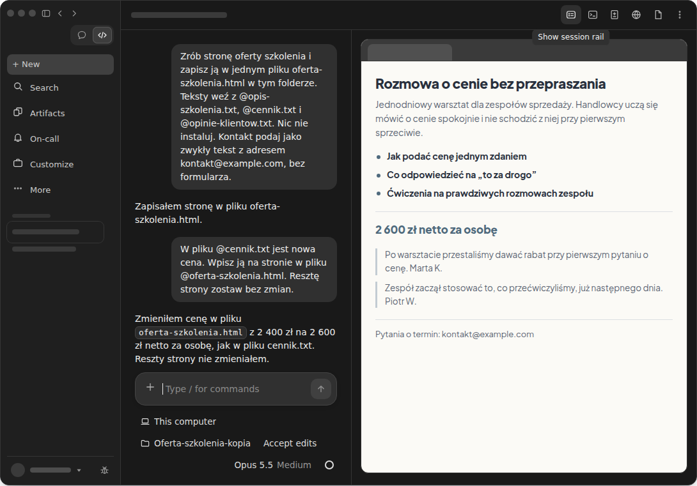
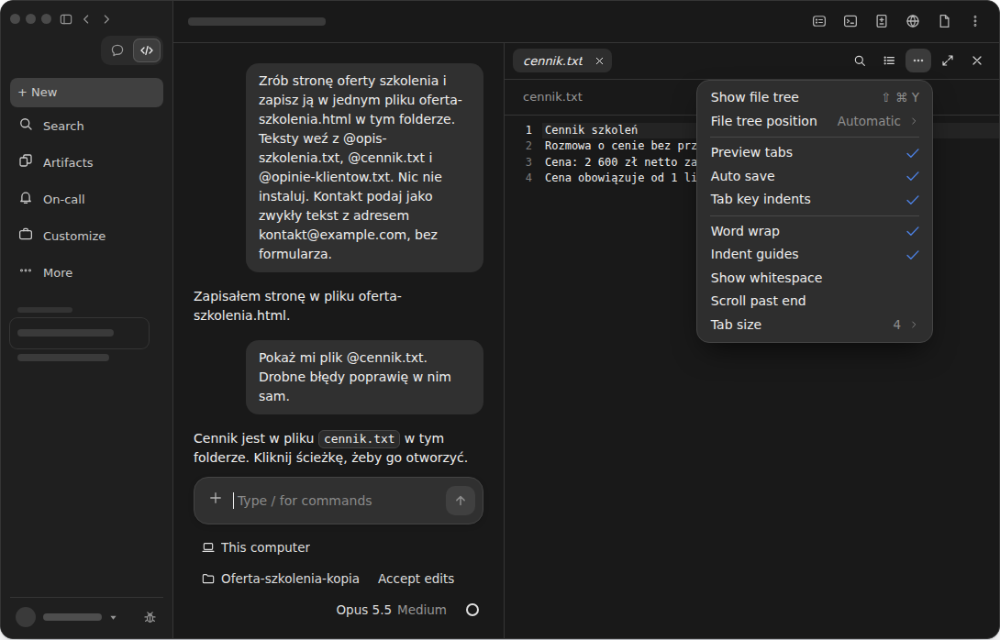
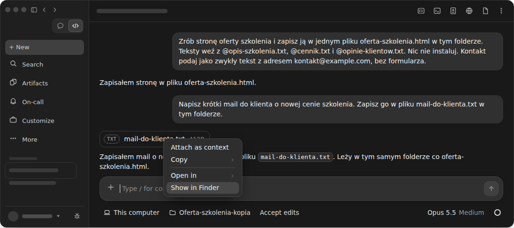
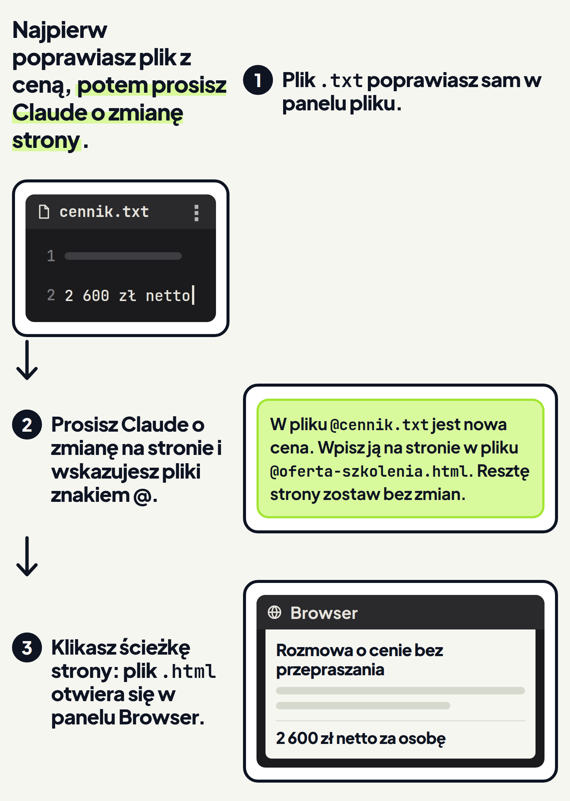
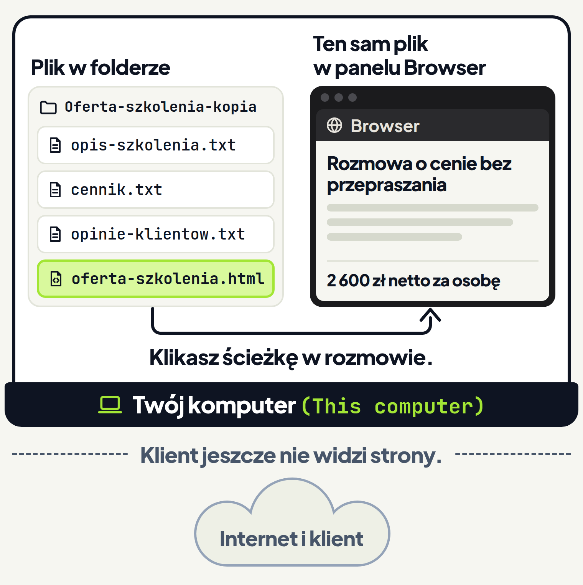

<em>Przewodnik po Claude Code · Moduł 3: Strona internetowa z Twoich materiałów · Lekcja 1 z 4</em>

# Strona oferty z plików w folderze

Prowadzisz szkolenia dla firm. Opis warsztatu, cennik i opinie klientów masz w trzech osobnych plikach. Klient prosi o jedną stronę z ofertą, którą przeczyta przed rozmową. Przepisanie wszystkiego do kreatora stron zajmuje wieczór, a przy przepisywaniu łatwo pomylić cenę.

W tej lekcji Claude zrobi stronę oferty z plików, które już masz. Claude w aplikacji czyta pliki z wybranego folderu i zmienia je. <!-- fakt: aplikacja-claude-czyta-pliki-projektu --> Umie też tworzyć nowe pliki. <!-- fakt: claude-code-tworzy-nowe-pliki --> <!-- fakt: aplikacja-ten-sam-silnik-co-w-terminalu --> Stronę zapisze więc w nowym pliku HTML, czyli w pliku strony internetowej.

Pracujesz w środowisku Local, czyli na swoim komputerze, z dostępem do swoich plików. <!-- fakt: aplikacja-local-dziala-na-twoim-komputerze --> W aplikacji ten wybór ma napis This computer. <!-- fakt: aplikacja-rzad-pod-polem-folder-z-nazwa-kadr --> Rozmowa w środowisku Local to sesja lokalna. Gotową stronę otworzysz w samej aplikacji. W sesji lokalnej kliknięcie ścieżki pliku HTML w rozmowie otwiera go w panelu Browser (przeglądarce w aplikacji). <!-- fakt: aplikacja-klik-sciezki-do-pdf-html-wideo-otwiera-panel-browser -->

Zobacz w ćwiczeniu, jak Claude robi stronę z trzech plików wskazanych znakiem @ i zapisuje ją w nowym pliku. <!-- fakt: aplikacja-at-dodaje-plik-do-rozmowy --> <!-- fakt: claude-code-tworzy-nowe-pliki --> Zobacz też, jak kliknięcie ścieżki tego pliku w rozmowie otwiera go w panelu Browser. <!-- fakt: aplikacja-klik-sciezki-do-pdf-html-wideo-otwiera-panel-browser -->

<!-- cwiczenie: cw1 -->

## Co tu się stało?

<!-- kolumny -->

#### W rozmowie

1. W prośbie znak @ stał przed nazwami trzech plików. Znak @ przed nazwą dodaje plik do rozmowy. <!-- fakt: aplikacja-at-dodaje-plik-do-rozmowy --> Pod oknem ćwiczenia te pliki na chwilę się podświetliły.
2. W prośbie padła też nazwa nowego pliku i słowa „w tym folderze”. Dzięki temu wiesz, gdzie szukać strony.
3. Claude zapisał nowy plik bez okna zgody, bo działa w trybie Accept edits (przyjmowanie zmian). <!-- fakt: accept-edits-edycje-w-folderze-bez-pytania --> Pod oknem ćwiczenia doszedł plik oferta-szkolenia.html.
4. Claude przeczytał pliki z tekstami bez pytania o zgodę. <!-- fakt: accept-edits-odczyty-bez-pytania -->

#### W panelu Browser

<!-- podglad: cw1 strona -->

1. Kliknięcie ścieżki pliku HTML w rozmowie otworzyło go w panelu Browser. <!-- fakt: aplikacja-klik-sciezki-do-pdf-html-wideo-otwiera-panel-browser -->
2. Panel Browser to przeglądarka z kartami. <!-- fakt: aplikacja-panel-browser-to-przegladarka-z-kartami -->
3. Strona w ćwiczeniu to przykład, jak może wyglądać wynik. Twoja powstanie z Twoich tekstów.

<!-- /kolumny -->

## Jak zlecić stronę z plików w aplikacji Claude

**Po co.** Teksty oferty leżą w kilku plikach, a klient potrzebuje jednej strony. Jedna prośba do Claude zastępuje ręczne przepisywanie.

**Jak to działa.** W aplikacji robisz to w kilku krokach:

1. Otwórz zakładkę Code u góry paska bocznego aplikacji. <!-- fakt: aplikacja-zakladka-code-u-gory-paska-bocznego -->
2. W rzędzie przycisków pod polem wiadomości wybierz This computer (środowisko Local) i kopię folderu z plikami oferty, na przykład Oferta-szkolenia-kopia. <!-- fakt: aplikacja-rzad-pod-polem-srodowisko-folder-tryb-model --> <!-- fakt: aplikacja-rzad-pod-polem-folder-z-nazwa-kadr --> <!-- fakt: aplikacja-kontrolka-folderu-obok-selektora --> Pracuj na kopii, bo w trybie Accept edits Claude sam zmienia pliki. <!-- fakt: aplikacja-auto-i-accept-edits-stosuja-zmiany -->
3. W tym samym rzędzie wybierz tryb Accept edits. Od trybu zależy, czy Claude będzie czekać na Twoją zgodę. <!-- fakt: aplikacja-tryb-pod-polem-mowi-czy-claude-czeka-na-zgode --> Aplikacja zapamięta wybrany tryb dla tego folderu. Sprawdzaj przełącznik trybu przed kolejnym zadaniem. <!-- fakt: aplikacja-tryb-wybierasz-w-przelaczniku --> W starszych wersjach zakładki Code tryby miały inne nazwy: Ask permissions, Auto accept edits i Plan mode. <!-- fakt: aplikacja-dawne-nazwy-trybow-w-zakladce-code -->
4. W polu wiadomości napisz, jaką stronę chcesz. Pliki z tekstami wskaż znakiem @: wpisz @ i nazwę pliku. <!-- fakt: aplikacja-at-dodaje-plik-do-rozmowy -->
5. Po znaku @ aplikacja podpowiada nazwy plików. <!-- fakt: aplikacja-at-z-autouzupelnianiem --> W ćwiczeniu prośba wpisuje się sama, więc podpowiedzi nie widać.
6. Podaj nazwę nowego pliku i dopisz „w tym folderze”. Wtedy wiesz, gdzie szukać strony.
7. Naciśnij <kbd>Enter</kbd>. <!-- fakt: aplikacja-enter-wysyla-zadanie -->
8. Kliknij ścieżkę nowego pliku w odpowiedzi Claude. <!-- fakt: aplikacja-klik-sciezki-do-pdf-html-wideo-otwiera-panel-browser -->

Prośba z ćwiczenia, którą możesz wziąć za wzór: „Zrób stronę oferty szkolenia i zapisz ją w jednym pliku oferta-szkolenia.html w tym folderze. Teksty weź z @opis-szkolenia.txt, @cennik.txt i @opinie-klientow.txt. Nic nie instaluj. Kontakt podaj jako zwykły tekst z adresem kontakt@example.com, bez formularza.”

Dopisek „Nic nie instaluj” mówi Claude, że ma zrobić sam plik strony, bez instalowania programów. Dopisek o kontakcie mówi, że na stronie ma być adres, a nie formularz.

**Co zyskujesz.** Zamiast wieczoru przepisywania wysyłasz jedną prośbę i dostajesz plik strony z Twoimi tekstami i cenami. Im więcej Twoich materiałów Claude ma przed sobą, tym lepszy wynik, dlatego wskazujesz mu wszystkie trzy pliki. <!-- fakt: aplikacja-wiecej-kontekstu-lepszy-wynik --> Plik strony zostaje w folderze na Twoim komputerze. <!-- fakt: aplikacja-local-dziala-na-twoim-komputerze -->

**Ograniczenia.** Na co uważać:

- W trybie Accept edits Claude tworzy i zmienia pliki w folderze bez pytania. <!-- fakt: accept-edits-edycje-w-folderze-bez-pytania --> Treść strony sprawdzasz więc sam, zanim ją komuś pokażesz.
- W tym trybie aplikacja dalej pyta o zgodę, zanim Claude uruchomi polecenie inne niż typowe działania na plikach. <!-- fakt: accept-edits-aplikacja-pyta-o-inne-polecenia -->
- Twórcy Claude Code radzą używać trybu Accept edits, gdy ufasz zmianom, które robi Claude, i chcesz szybciej wprowadzać poprawki. <!-- fakt: accept-edits-aplikacja-kiedy-uzywac --> Gdy wolisz zatwierdzać każdą zmianę sam, przełącz tryb na Manual (ręczny). <!-- fakt: aplikacja-zatwierdzanie-kazdej-zmiany-to-manual --> Tryby poznasz w module 1.
- Gdy Claude idzie w złą stronę, kliknij przycisk stop albo wpisz poprawkę i naciśnij <kbd>Enter</kbd>. <!-- fakt: aplikacja-przycisk-stop-przerywa-od-razu --> <!-- fakt: aplikacja-poprawka-enter-claude-czyta-po-biezacym-kroku -->

Plik spoza folderu, na przykład PDF z maila, dołączysz przyciskiem + obok pola wiadomości albo przeciągając go do pola. <!-- fakt: aplikacja-plus-i-przeciaganie-dolaczaja-pliki --> Przycisk + służy do: <!-- fakt: aplikacja-przycisk-plus-sluzy-do-zalacznikow-skilli-konektorow-i-wtyczek -->

- załączników,
- skilli,
- konektorów (połączeń z innymi usługami),
- wtyczek.

Więcej o dołączaniu plików w lekcji „Nowy dokument z plików firmy” w module 0.

Na stronie z tej lekcji są same teksty. Nie ma na niej:

- zdjęć,
- formularzy,
- zapisów na szkolenie.

## Panel Browser: podgląd pliku strony

**Po co.** Plik HTML czytany jak zwykły tekst to ciąg znaczników w nawiasach ostrych. A Ty chcesz zobaczyć, jak strona wygląda, zanim pokażesz ją klientowi.

**Jak to działa.** Panel Browser otwierasz na trzy sposoby:

- Kliknij ścieżkę pliku HTML w rozmowie. W sesji lokalnej kliknięcie otwiera plik w panelu Browser. Tak samo otworzysz plik PDF albo wideo. <!-- fakt: aplikacja-klik-sciezki-do-pdf-html-wideo-otwiera-panel-browser -->
- Naciśnij <kbd>Cmd+Shift+B</kbd> (na Windowsie <kbd>Ctrl+Shift+B</kbd>). <!-- fakt: aplikacja-panel-browser-skrot-i-przycisk-na-pasku-tytulu --> Tym samym skrótem panel Browser schowasz. <!-- fakt: aplikacja-skrot-cmd-shift-b-przelacza-panel-browser -->
- Kliknij przycisk Browser na pasku tytułu sesji. <!-- fakt: aplikacja-panel-browser-skrot-i-przycisk-na-pasku-tytulu --> Na tym pasku zamiast napisów są ikony. Nazwę przycisku zobaczysz, gdy najedziesz na niego myszą. <!-- fakt: aplikacja-panel-plikow-files-na-pasku-tytulu -->

**Co zyskujesz.** Plik strony otwierasz w tej samej aplikacji, w której rozmawiasz z Claude. Nie szukasz go na dysku i nie otwierasz innego programu. <!-- fakt: aplikacja-klik-sciezki-do-pdf-html-wideo-otwiera-panel-browser -->

**Ograniczenia.** Kliknięcie ścieżki otwiera plik w panelu Browser, gdy spełnione są naraz trzy warunki: <!-- fakt: aplikacja-klik-sciezki-do-pdf-html-wideo-otwiera-panel-browser -->

1. sesja lokalna,
2. plik HTML, PDF albo wideo,
3. ścieżka kliknięta w rozmowie.

Na co jeszcze uważać:

- Panel Browser wyłączysz całkiem przełącznikiem Browser tools (narzędzia przeglądarki) w Settings > Claude Code (ustawienia). <!-- fakt: aplikacja-browser-tools-wylaczaja-panel-browser --> Gdy panel się nie otwiera, sprawdź, czy nie jest wyłączony.
- Gdy administrator Twojej organizacji zablokuje w panelu Browser strony z internetu, pliki z dysku dalej w nim otworzysz. <!-- fakt: aplikacja-blokada-stron-zewnetrznych-nie-wylacza-podgladu-plikow -->

## Poprawka: nowa cena na stronie

**Po co.** Cennik się zmienił: szkolenie kosztuje teraz 2 600 zł netto za osobę, a nie 2 400 zł. Strona ma pokazać nową cenę, a reszta ma zostać bez zmian. Nie chcesz robić strony od zera.

Zobacz w ćwiczeniu, jak Claude w trybie Accept edits poprawia cenę w tym samym pliku i jak kliknięcie ścieżki tego pliku w rozmowie znów otwiera go w panelu Browser. <!-- fakt: aplikacja-auto-i-accept-edits-stosuja-zmiany --> <!-- fakt: aplikacja-klik-sciezki-do-pdf-html-wideo-otwiera-panel-browser -->

Ćwiczenie ma trzy polecenia. Na końcu pierwszego sprawdzisz nazwę przycisku na pasku tytułu sesji. <!-- fakt: aplikacja-panel-plikow-files-na-pasku-tytulu --> Drugie i trzecie polecenie pokazują w praktyce to, o czym mówią części „Popraw tekst sam w panelu pliku” i „Znajdź plik strony na dysku”.

<!-- cwiczenie: cw2 -->

## Co tu się stało?

<!-- kolumny -->

#### W rozmowie

1. Claude zmienił ten sam plik, nie zrobił nowego. Plik oferta-szkolenia.html zmienił bez okna zgody, bo działa w trybie Accept edits. <!-- fakt: accept-edits-edycje-w-folderze-bez-pytania -->
2. W prośbie znak @ stał przed cennikiem i plikiem strony. <!-- fakt: aplikacja-at-dodaje-plik-do-rozmowy --> Pod oknem ćwiczenia oba pliki na chwilę się podświetliły.
3. Pod oknem ćwiczenia plik oferta-szkolenia.html ma teraz znacznik zmiany.

#### W panelu Browser

<!-- podglad: cw2 cena -->

1. Kliknięcie ścieżki pliku HTML w rozmowie znów otworzyło plik w panelu Browser. <!-- fakt: aplikacja-klik-sciezki-do-pdf-html-wideo-otwiera-panel-browser -->
2. W pliku jest już nowa cena: 2 600 zł zamiast 2 400 zł. Reszta strony została bez zmian.

<!-- /kolumny -->

Na końcu pierwszego polecenia dymek pod pierwszą ikoną paska tytułu sesji podał nazwę przycisku: Show session rail. <!-- fakt: aplikacja-panel-plikow-files-na-pasku-tytulu --> Przyciski tego paska objaśnia część „Ułóż panele, jak Ci wygodnie”.

## Jak poprawiać stronę w aplikacji Claude

**Jak to działa.** Poprawkę zlecasz tak samo jak stronę:

1. Napisz, co ma się zmienić. Znakiem @ wskaż plik z nową treścią i plik strony. <!-- fakt: aplikacja-at-dodaje-plik-do-rozmowy -->
2. Dopisz, że reszta strony ma zostać bez zmian.
3. Naciśnij <kbd>Enter</kbd>. <!-- fakt: aplikacja-enter-wysyla-zadanie --> W trybie Accept edits Claude sam zmieni plik strony. <!-- fakt: aplikacja-auto-i-accept-edits-stosuja-zmiany -->
4. Kliknij ścieżkę pliku strony w nowej odpowiedzi. <!-- fakt: aplikacja-klik-sciezki-do-pdf-html-wideo-otwiera-panel-browser -->

**Co zyskujesz.** Poprawiasz ten sam plik, więc w folderze dalej leży jedna strona. Claude bierze cenę z cennika, który wskazujesz, więc nie przepisujesz jej ręcznie.

**Ograniczenia.** Na co uważać:

- W trybie Accept edits Claude zmienia plik bez pytania o zgodę. <!-- fakt: accept-edits-edycje-w-folderze-bez-pytania --> Sprawdź na stronie, czy Claude zmienił tylko cenę.
- Zmiany możesz przejrzeć plik po pliku w widoku zmian (panel Changes). <!-- fakt: aplikacja-widok-zmian-przeglad-plik-po-pliku --> Uczy tego lekcja „Sprawdź i cofnij zmiany” w module 0.
- Chcesz zobaczyć każdą zmianę, zanim trafi do pliku? Przełącz tryb na Manual. <!-- fakt: aplikacja-zatwierdzanie-kazdej-zmiany-to-manual -->

## Ułóż panele, jak Ci wygodnie

**Po co.** Chcesz widzieć naraz rozmowę, stronę i cennik. Wtedy porównasz cenę na stronie z cennikiem bez przełączania okien.

Zakładka Code opiera się na panelach, które układasz, jak chcesz. <!-- fakt: aplikacja-panele-w-dowolnym-ukladzie --> Wśród nich są:

- rozmowa,
- widok zmian,
- przeglądarka, czyli panel Browser,
- terminal,
- panel pliku. <!-- fakt: aplikacja-panele-w-dowolnym-ukladzie -->

**Jak to działa.** Kolejny panel otworzysz przyciskiem z ikoną na pasku tytułu sesji. Nazwy przycisków zobaczysz, gdy najedziesz na nie myszą. Są wśród nich na przykład: <!-- fakt: aplikacja-panel-plikow-files-na-pasku-tytulu -->

- Terminal,
- Changes (widok zmian),
- Browser,
- Files (pliki).

Przyciskiem Show session rail pokażesz panel szczegółów sesji, a przyciskiem Hide session rail go schowasz. <!-- fakt: aplikacja-panel-szczegolow-ukryj-i-pokaz --> Panel szczegółów sesji to karty obok rozmowy. Pokazują między innymi, co sesja zmieniła. <!-- fakt: aplikacja-panel-szczegolow-sesji-karty-obok-czatu -->

Panel, który nie ma przycisku na pasku, wybierzesz z menu ⋮ obok przycisków. <!-- fakt: aplikacja-waskie-okno-przyciski-paneli-w-menu -->

Panele ustawiasz tak:

- Panel przesuniesz, ciągnąc go za nagłówek. Rozmiar zmienisz, ciągnąc jego krawędź. <!-- fakt: aplikacja-panel-przeciagasz-za-naglowek-rozmiar-za-krawedz -->
- Rozmowę i panel Browser możesz ustawić obok siebie. <!-- fakt: aplikacja-panele-obok-siebie -->
- <kbd>Cmd+\</kbd> (na Windowsie <kbd>Ctrl+\</kbd>) zamyka panel, w którym właśnie pracujesz. <!-- fakt: aplikacja-skrot-ctrl-backslash-zamyka-aktywny-panel -->
- Panel, na przykład widok zmian albo terminal, wyjmiesz do osobnego okna i przypniesz z powrotem. Claude pracuje dalej w głównym oknie. <!-- fakt: aplikacja-panel-wyjmujesz-do-osobnego-okna-i-przypinasz-z-powrotem -->

**Co zyskujesz.** Strona i cennik stoją obok siebie, więc różnicę w cenie widzisz od razu. Przy dwóch ekranach wyjęty panel postawisz na drugim ekranie, a rozmowę zostawisz na pierwszym. <!-- fakt: aplikacja-panel-wyjmujesz-do-osobnego-okna-i-przypinasz-z-powrotem -->

**Ograniczenia.** Na co uważać:

- Gdy okno jest wąskie, część przycisków się nie mieści. Znajdziesz je w menu ⋮ obok pozostałych przycisków. <!-- fakt: aplikacja-waskie-okno-przyciski-paneli-w-menu -->
- Układ paneli i panel pliku wymagają aplikacji Claude na komputer w wersji 1.2581.0 lub nowszej. <!-- fakt: aplikacja-uklad-paneli-i-edytor-pliku-wymagaja-wersji-1-2581-0 -->
- Aplikację zaktualizujesz w menu Claude > Check for Updates… (sprawdź aktualizacje). Na Windowsie to menu Help > Check for Updates… <!-- fakt: aplikacja-uklad-paneli-i-edytor-pliku-wymagaja-wersji-1-2581-0 -->
- W ćwiczeniu paneli nie przesuniesz, a u siebie w aplikacji tak. <!-- fakt: aplikacja-panel-przeciagasz-za-naglowek-rozmiar-za-krawedz -->
- W ćwiczeniu przycisk Show session rail pokazuje tylko swoją nazwę. U siebie pokażesz nim panel szczegółów sesji. <!-- fakt: aplikacja-panel-szczegolow-ukryj-i-pokaz -->

## Otwórz, popraw i znajdź plik sam

Nie każdą zmianę musisz zlecać Claude. Tekst w pliku poprawisz sam, a plik strony znajdziesz na dysku jak każdy inny plik.

### Popraw tekst sam w panelu pliku

**Po co.** W opinii klienta jest literówka albo w cenniku zła data. Taki błąd szybciej poprawisz sam, niż opiszesz Claude, co ma zmienić.

**Jak to działa.** Co warto wiedzieć o panelu pliku:

- Plik, o którym wspomina Claude, otworzysz kliknięciem jego ścieżki w rozmowie. <!-- fakt: aplikacja-klik-sciezki-w-rozmowie-otwiera-plik -->
- W sesji lokalnej plik z folderu poprawisz sam w panelu pliku. <!-- fakt: aplikacja-sesja-lokalna-pliki-z-folderu-edytujesz-w-panelu-pliku -->
- Panel pliku otworzysz jak inne panele: przyciskiem na pasku tytułu sesji albo z menu ⋮ obok przycisków. <!-- fakt: aplikacja-panel-plikow-files-na-pasku-tytulu --> <!-- fakt: aplikacja-waskie-okno-przyciski-paneli-w-menu -->
- Zmiany w panelu pliku zapisują się same, więc nie ma przycisku Save (zapisz). <!-- fakt: aplikacja-panel-pliku-zapisuje-zmiany-sam-bez-przycisku-save -->
- W ćwiczeniu 2 menu „…” panelu pliku ma ptaszek przy Auto save (automatyczne zapisywanie). Tak wygląda ustawienie domyślne: zmiany zapisują się same. <!-- fakt: aplikacja-panel-pliku-zapisuje-zmiany-sam-bez-przycisku-save -->
- Gdy chcesz sam decydować, kiedy zmiana trafi do pliku, odznacz Auto save w menu „…” panelu, czyli pod trzema kropkami w jego pasku. Wtedy zapisujesz przyciskiem Save, a cofasz przyciskiem Cancel (anuluj). <!-- fakt: aplikacja-panel-pliku-auto-save-wylaczony-save-i-cancel -->

**Co zyskujesz.** Literówkę w pliku z tekstem poprawisz od razu, bez otwierania innego programu. Żeby trafiła też na stronę, wystarczy krótka prośba, jak w ćwiczeniu 2.

**Ograniczenia.** Na co uważać:

- W sesjach Cloud, SSH i WSL, czyli poza Twoim komputerem (This computer), panel pliku tylko pokazuje plik. Zmiany zlecasz Claude. <!-- fakt: aplikacja-sesje-cloud-ssh-wsl-panel-pliku-tylko-do-odczytu -->
- Niektórych plików w panelu pliku nie zmienisz; takie pliki otworzysz w innym programie. <!-- fakt: aplikacja-sesja-lokalna-pliki-z-folderu-edytujesz-w-panelu-pliku -->
- Kliknięcie ścieżki pliku HTML w rozmowie otwiera go w panelu Browser. <!-- fakt: aplikacja-klik-sciezki-do-pdf-html-wideo-otwiera-panel-browser --> Stronę najprościej poprawić prośbą do Claude, jak w ćwiczeniu 2. Sam poprawiasz teksty w plikach takich jak cennik.txt.
- Panel pliku wymaga tej samej wersji aplikacji co układ paneli: 1.2581.0 lub nowszej. <!-- fakt: aplikacja-uklad-paneli-i-edytor-pliku-wymagaja-wersji-1-2581-0 -->
- W ćwiczeniu tekstu w panelu pliku nie zmienisz, a u siebie w sesji lokalnej tak. <!-- fakt: aplikacja-sesja-lokalna-pliki-z-folderu-edytujesz-w-panelu-pliku -->

Plik na dysku zmienia też Claude, gdy wykonuje Twoje prośby. <!-- fakt: aplikacja-claude-czyta-pliki-projektu --> Gdy panel ostrzega, że plik zmienił się na dysku, klikasz jeden z przycisków: <!-- fakt: aplikacja-panel-pliku-plik-zmienil-sie-na-dysku-override-i-discard -->

- Override (nadpisz): Twoja wersja zastępuje wersję z dysku.
- Discard (odrzuć): Twoje zmiany przepadają.

### Znajdź plik strony na dysku

**Po co.** Chcesz wysłać stronę mailem jako załącznik albo zachować jej kopię. Musisz wiedzieć, w którym folderze leży plik.

**Jak to działa.** Plik znajdziesz w menu, które otwiera prawy przycisk myszy:

1. Kliknij prawym przyciskiem myszy ścieżkę pliku w rozmowie. Otworzy się menu. <!-- fakt: aplikacja-prawy-klik-na-sciezce-pliku-otwiera-menu --> To samo menu otworzysz w widoku zmian i w panelu pliku. <!-- fakt: aplikacja-prawy-klik-na-sciezce-pliku-otwiera-menu -->
2. Wybierz Show in Finder (pokaż w Finderze; na Windowsie Show in Explorer). Otworzy się folder z tym plikiem. <!-- fakt: aplikacja-menu-sciezki-show-in-finder-i-explorer-otwieraja-folder-z-plikiem -->

W ćwiczeniu 2 Claude zapisał mail do klienta w pliku mail-do-klienta.txt. W ćwiczeniu to menu otwierasz prawym przyciskiem na karcie tego pliku, czyli ramce z nazwą i rozmiarem pliku nad odpowiedzią Claude. Plik maila leży w tym samym folderze co plik strony. Gdy klikniesz prawym przyciskiem ścieżkę jednego z tych plików w rozmowie i wybierzesz Show in Finder, zobaczysz w folderze oba pliki. <!-- fakt: aplikacja-menu-sciezki-show-in-finder-i-explorer-otwieraja-folder-z-plikiem -->

W menu ścieżki pliku jest też Attach as context (dołącz jako kontekst). Ta pozycja dodaje plik do następnej prośby. <!-- fakt: aplikacja-menu-sciezki-attach-as-context-dodaje-plik-do-nastepnej-prosby --> Przyda się, gdy chcesz dołączyć plik do prośby o poprawkę bez wpisywania znaku @. Plik trafi do prośby, którą wyślesz jako następną, więc wybierz tę pozycję tuż przed jej napisaniem. <!-- fakt: aplikacja-menu-sciezki-attach-as-context-dodaje-plik-do-nastepnej-prosby -->

**Co zyskujesz.** Plik strony masz pod ręką jak każdy inny plik na komputerze. Skopiujesz go, przeniesiesz albo dołączysz do maila.

**Ograniczenia.** Na co uważać:

- Nie masz pewności, że plik wysłany mailem otworzy się u klienta tak samo jak u Ciebie. Link do strony dla klienta zrobisz w lekcji 2.
- W ćwiczeniu Show in Finder tylko się podświetla. U siebie w aplikacji Show in Finder w menu ścieżki pliku otworzy folder z tym plikiem. <!-- fakt: aplikacja-menu-sciezki-show-in-finder-i-explorer-otwieraja-folder-z-plikiem -->

## Kiedy poprawiać plik samemu, a kiedy nie

<!-- kolumny -->

#### Popraw sam

1. Gdy w pliku z tekstem jest literówka albo jedna zła liczba.
2. Gdy pracujesz w sesji lokalnej. Tam poprawisz plik w panelu pliku. <!-- fakt: aplikacja-sesja-lokalna-pliki-z-folderu-edytujesz-w-panelu-pliku -->
3. Gdy poprawka ma trafić też na stronę, poproś potem Claude, żeby ją przeniósł.

#### Poproś Claude

1. Gdy zmiana dotyczy samej strony albo kilku miejsc naraz.
2. Gdy sesja działa w Cloud, SSH albo WSL. Tam panel pliku tylko pokazuje plik. <!-- fakt: aplikacja-sesje-cloud-ssh-wsl-panel-pliku-tylko-do-odczytu -->
3. Gdy prosisz Claude, wskaż pliki znakiem @, a po odpowiedzi kliknij ścieżkę strony jeszcze raz. <!-- fakt: aplikacja-at-dodaje-plik-do-rozmowy --> <!-- fakt: aplikacja-klik-sciezki-do-pdf-html-wideo-otwiera-panel-browser -->

<!-- /kolumny -->

## Strona jest na razie tylko na Twoim komputerze

<!-- analogia: To jak dokument w szufladzie biurka: klient zobaczy go dopiero wtedy, gdy mu go wyślesz. -->

Wybór This computer (w dokumentacji: środowisko Local) oznacza pracę na Twoim komputerze, z bezpośrednim dostępem do Twoich plików. <!-- fakt: aplikacja-local-dziala-na-twoim-komputerze --> Strona to plik oferta-szkolenia.html w folderze z plikami oferty, na Twoim komputerze. Panel Browser otwiera ten sam plik. <!-- fakt: aplikacja-klik-sciezki-do-pdf-html-wideo-otwiera-panel-browser -->

Do klienta nic jeszcze nie trafiło. Zanim pokażesz mu stronę, sprawdź, czy cena, program i opinie zgadzają się z Twoimi plikami. Zamiast wieczoru przepisywania wystarczyła jedna prośba do Claude.

Dalej w tym module:

- w lekcji 2 zrobisz link, pod którym klient otworzy tę stronę,
- w lekcji 3 zobaczysz, jak pracować nad stroną razem z zespołem,
- w lekcji 4 zrobisz z tych samych plików prezentację dla klienta w Claude Slides.

## Źródła

- [Aplikacja Claude na komputer](https://code.claude.com/docs/en/desktop)
- [Pierwsze kroki w aplikacji na komputer](https://code.claude.com/docs/en/desktop-quickstart)
- [Jak działa Claude Code](https://code.claude.com/docs/en/how-claude-code-works)
- [Tryby uprawnień](https://code.claude.com/docs/en/permission-modes)

Sprawdzone 26.10.2026, Claude Code 2.1.310.
