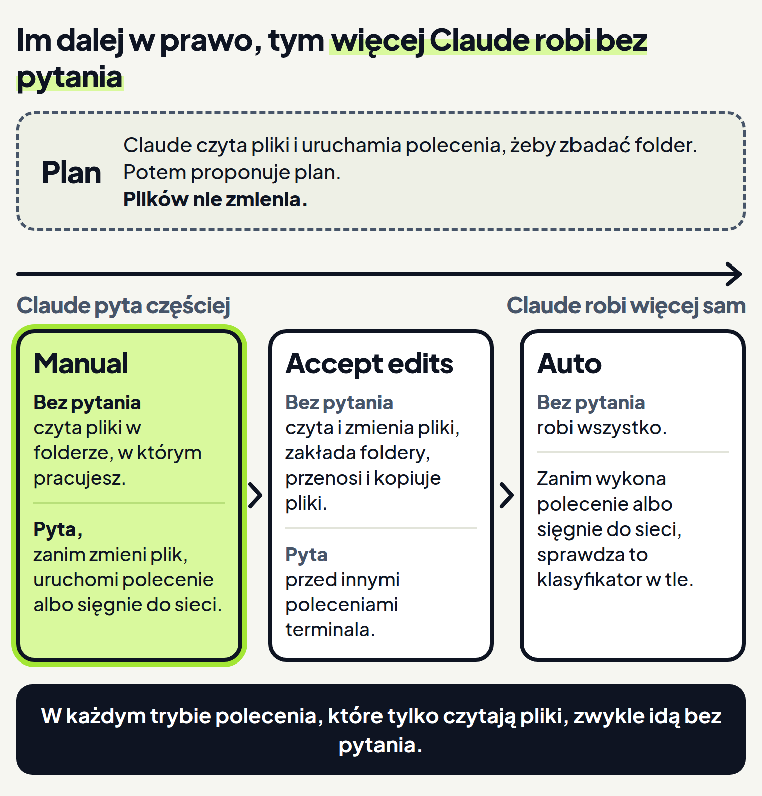
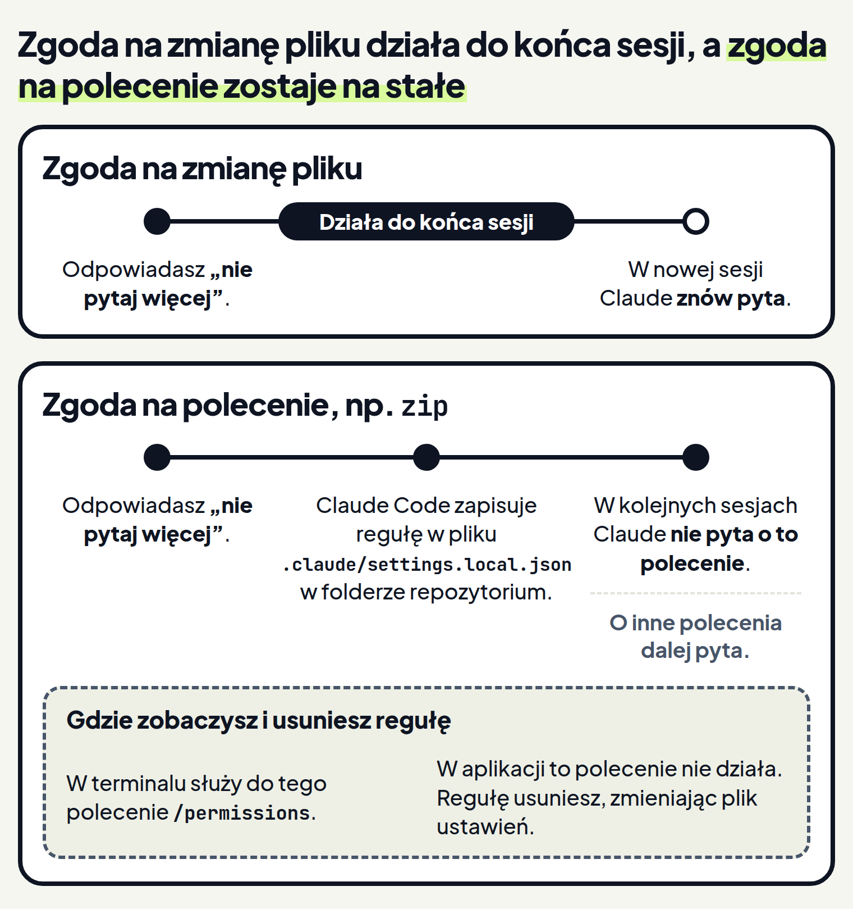

<em>Przewodnik po Claude Code · Moduł 1: Tryby pracy · Lekcja 1 z 4</em>

# Pytania o zgodę: tryb Manual

Chcesz poprosić Claude, żeby wpisał sumę sprzedaży do pliku dla księgowej. Zanim wyślesz prośbę, warto wiedzieć jedno: czy Claude zmieni ten plik sam, czy najpierw Cię zapyta?

Rozstrzyga o tym tryb uprawnień, czyli ustawienie, które ustala, co Claude może zrobić bez pytania Cię o zgodę. <!-- fakt: tryb-uprawnien-ustala-co-bez-pytania --> Wybierasz go w przełączniku pod polem wiadomości. <!-- fakt: aplikacja-przelacznik-pod-polem-wiadomosci -->

Tryb ma znaczenie zwłaszcza wtedy, gdy pracujesz na jedynej wersji umowy, faktury albo raportu. Z trybu wiesz z góry, przy jakich działaniach Claude się zatrzyma.

W tej lekcji poznasz tryb Manual (ręczny). W tym trybie Claude zatrzymuje się i pyta przed większością działań, które: <!-- fakt: tryb-manual-pyta-przed-akcjami -->

- zmieniają pliki,
- uruchamiają polecenia w terminalu,
- sięgają do sieci.

Gdy pracujesz w aplikacji, Claude najpierw proponuje każdą zmianę pliku i czeka, aż ją zatwierdzisz. <!-- fakt: tryb-manual-aplikacja-czeka-na-zatwierdzenie -->

Poproś o sumę sprzedaży z września. Zobaczysz, że Claude czyta pliki bez pytania, a plik podsumowanie.txt zmienia dopiero wtedy, gdy zatwierdzisz zmianę. <!-- fakt: odczyty-w-folderze-roboczym-bez-zgody-w-manual --> <!-- fakt: tryb-manual-aplikacja-czeka-na-zatwierdzenie -->

<!-- cwiczenie: cw1 -->

## Co tu się stało?

<!-- kolumny -->

#### Karta zgody

1. Claude pokazał zmianę na karcie zgody. <!-- fakt: aplikacja-manual-podglad-i-przyciski -->
2. Plik zmienił się dopiero po kliknięciu ptaszka. <!-- fakt: aplikacja-manual-przyciski-zatwierdzania --> <!-- fakt: tryb-manual-aplikacja-czeka-na-zatwierdzenie -->
3. Liczby +1 -1 na karcie Changes (zmiany) w panelu obok rozmowy to liczby linijek w zmianie. <!-- fakt: aplikacja-widok-zmian-liczby-na-karcie-changes --> <!-- fakt: aplikacja-panel-szczegolow-sesji-karty-obok-czatu --> Gdy klikniesz liczby, otworzy się widok zmian. <!-- fakt: aplikacja-klikniecie-wskaznika-otwiera-widok-zmian -->

#### Zanim pojawiła się karta zgody

1. Claude bez pytania przeczytał pliki i policzył sumę: 48 200 zł. <!-- fakt: odczyty-w-folderze-roboczym-bez-zgody-w-manual -->
2. Pliki, które Claude czytał, podświetliły się w folderze pod oknem.
3. Przez cały czas widać, co Claude właśnie robi. <!-- fakt: aplikacja-manual-aktualizacje-na-biezaco -->

<!-- /kolumny -->

### Po co jest karta zgody

Przy karcie zgody decydujesz, czy zmiana trafi do pliku. Pomyłkę zobaczysz, zanim plik się zmieni. <!-- fakt: tryb-manual-aplikacja-czeka-na-zatwierdzenie -->

Podgląd na karcie pokazuje dokładnie to, co się zmieni. <!-- fakt: aplikacja-manual-podglad-dokladnie-co-sie-zmieni --> W ćwiczeniu to jedna linijka: „do uzupełnienia” znika, a kwota dochodzi.

Każdą zmianę możesz przyjąć albo odrzucić. <!-- fakt: aplikacja-manual-podglad-i-przyciski --> W ćwiczeniu przyjmujesz ją ptaszkiem.

Zatwierdzoną zmianę obejrzysz jeszcze raz w widoku zmian. Otworzysz go, gdy klikniesz liczby na karcie Changes w panelu obok rozmowy. <!-- fakt: aplikacja-widok-zmian-liczby-na-karcie-changes --> <!-- fakt: aplikacja-panel-szczegolow-sesji-karty-obok-czatu --> Ten sam widok otwiera przycisk Changes na pasku tytułu rozmowy. <!-- fakt: aplikacja-widok-zmian-przycisk-changes-na-pasku-tytulu --> W ćwiczeniu to druga ikona w prawym górnym rogu okna.

## O co Manual pyta, a o co nie

### Pyta

W trybie Manual Claude pyta, zanim zmieni plik albo uruchomi polecenie. <!-- fakt: aplikacja-manual-podglad-i-przyciski --> Ćwiczenie pokazuje tylko pierwszy przypadek: kartę zgody przy zmianie pliku. Przy poleceniu Claude też zapyta, ale wyglądu tego pytania w aplikacji dokumentacja nie opisuje. <!-- fakt: aplikacja-manual-podglad-i-przyciski -->

Wyjątkiem są polecenia, które tylko czytają. O nich za chwilę. <!-- fakt: polecenia-tylko-do-odczytu-bez-pytania -->

### Nie pyta

W trybie Manual bez pytania idzie tylko czytanie plików. <!-- fakt: tryb-manual-bez-pytania-tylko-odczyt --> Claude czyta i przeszukuje bez Twojej zgody pliki w folderze, w którym pracujesz, i w folderach dodatkowych. <!-- fakt: odczyty-w-folderze-roboczym-bez-zgody-w-manual -->

Czytanie to nie tylko otwieranie plików. Claude Code ma też stały zestaw poleceń, które tylko czytają. Są w nim na przykład: <!-- fakt: polecenia-tylko-do-odczytu-bez-pytania -->

- `ls`,
- `cat`,
- `grep`,
- `find`,
- `wc`.

Nazw nie musisz znać. Te polecenia zwykle idą bez pytania w każdym trybie, ale w Manual Claude Code czasem i tak o nie pyta. <!-- fakt: polecenia-tylko-do-odczytu-bez-pytania -->

Ponieważ Claude czyta bez pytania, może najpierw przejrzeć folder i policzyć sumę, a zapyta dopiero przed zmianą pliku. <!-- fakt: tryb-manual-bez-pytania-tylko-odczyt --> Uważaj na jedno: Manual nie pyta o czytanie plików w folderze, w którym pracujesz, i w folderach dodatkowych. <!-- fakt: odczyty-w-folderze-roboczym-bez-zgody-w-manual --> Jeśli leży tam umowa z danymi klienta, Claude może ją przeczytać bez pytania. <!-- fakt: odczyty-w-folderze-roboczym-bez-zgody-w-manual -->

### Prośba w wiadomości nie wyłączy pytań

O zgodę każe pytać program Claude Code, według ustawionego trybu. Claude, z którym piszesz, nie ma na to wpływu. <!-- fakt: uprawnienia-egzekwuje-program-nie-model --> <!-- fakt: tryb-uprawnien-ustala-co-bez-pytania --> Nie wyłączysz pytań, prosząc o to w wiadomości. <!-- fakt: uprawnienia-egzekwuje-program-nie-model -->

Twoja prośba zmienia to, co Claude próbuje zrobić. Nie zmienia tego, na co pozwala program Claude Code. <!-- fakt: uprawnienia-egzekwuje-program-nie-model --> Dlatego w trybie Manual karta zgody pojawi się także wtedy, gdy napiszesz „nie pytaj mnie”.

Żeby Claude pytał rzadziej, zmień tryb w przełączniku. O tym jest następna część.

## Cztery tryby, jeden przełącznik

Manual to jeden z czterech trybów w aplikacji. <!-- fakt: aplikacja-dostepne-tryby --> Tryby różnią się tym, co Claude robi sam, a o co pyta.

<!-- wyjasnienie: obrazy/cztery-tryby-wyjasnienie.png | Tryb ustala, gdzie Claude Cię zapyta: w Manual przy zmianie pliku i poleceniu, w Accept edits tylko przy poleceniu, a w Auto polecenie sprawdza strażnik. -->
<!-- analogia: To jak pracownik na okresie próbnym, stały pracownik i zaufany zastępca: im większe zaufanie, tym rzadziej przychodzi pytać. -->

- **Manual** (ręczny): Claude pyta przed zmianą plików i przed poleceniami. Widzisz podgląd i każdą zmianę przyjmujesz albo odrzucasz. <!-- fakt: aplikacja-manual-podglad-i-przyciski --> Bez pytania idzie tylko czytanie plików w folderze, w którym pracujesz, i w folderach dodatkowych. <!-- fakt: tryb-manual-bez-pytania-tylko-odczyt --> <!-- fakt: odczyty-w-folderze-roboczym-bez-zgody-w-manual -->
- **Accept edits** (przyjmowanie zmian): Claude sam zmienia pliki i wykonuje typowe polecenia na plikach, takie jak `mkdir`, `touch`, `mv` i `cp`. <!-- fakt: accept-edits-aplikacja-pyta-o-inne-polecenia --> <!-- fakt: accept-edits-odczyty-bez-pytania --> Czytanie plików też idzie bez pytania. <!-- fakt: accept-edits-odczyty-bez-pytania --> O inne polecenia terminala pyta. <!-- fakt: accept-edits-aplikacja-pyta-o-inne-polecenia --> Więcej o nim w lekcji 2.
- **Plan** (planowanie): Claude czyta pliki i uruchamia polecenia, żeby zbadać folder. Potem proponuje plan. <!-- fakt: plan-aplikacja-opis --> Plików nie zmienia. <!-- fakt: plan-aplikacja-bez-zmian-w-plikach --> Bez pytania idzie czytanie plików, a gdy tryb Auto jest dostępny, także polecenia zatwierdzone przez klasyfikator (opis w następnym punkcie). <!-- fakt: tryb-plan-bez-pytania-odczyty-i-polecenia-klasyfikatora --> Więcej o nim w lekcji 3.
- **Auto** (tryb automatyczny): Claude robi wszystko bez pytania. <!-- fakt: tryb-auto-bez-pytania-wszystko-z-kontrola-w-tle --> <!-- fakt: auto-aplikacja-opis-trybu --> Zanim Claude wykona polecenie albo sięgnie do sieci, sprawdza to klasyfikator. To osobny model w tle, który ocenia, czy działanie zgadza się z Twoją prośbą. <!-- fakt: auto-aplikacja-opis-trybu --> <!-- fakt: auto-klasyfikator-ocenia-przed-wykonaniem --> Więcej o nim w lekcji 4.

Auto pojawia się w przełączniku tylko wtedy, gdy masz do niego dostęp. <!-- fakt: aplikacja-dostepne-tryby --> Piąty tryb, Bypass permissions, pojawia się w przełączniku dopiero po włączeniu. <!-- fakt: aplikacja-dostepne-tryby -->

W plikach ustawień tryb Manual nazywa się `default`. <!-- fakt: tryb-manual-nazwa-i-wartosc-default --> Gdy spotkasz to słowo w dokumentacji, chodzi o Manual.

### Jak zmienić tryb w aplikacji

Tryb widać w rzędzie pod polem wiadomości. W tym samym rzędzie wybierasz miejsce pracy Claude, folder i model. <!-- fakt: aplikacja-rzad-pod-polem-srodowisko-folder-tryb-model -->

1. Kliknij przełącznik trybu. <!-- fakt: aplikacja-przelacznik-pod-polem-wiadomosci --> Otworzy się lista trybów. <!-- fakt: aplikacja-tryb-wybierasz-w-przelaczniku -->
2. Kliknij tryb na liście. Przełącznik pokaże jego nazwę. <!-- fakt: aplikacja-tryb-pod-polem-mowi-czy-claude-czeka-na-zgode -->

Listę trybów otworzysz też skrótem <kbd>Cmd</kbd> + <kbd>Shift</kbd> + <kbd>M</kbd> na Macu. <!-- fakt: aplikacja-skrot-menu-trybu --> Na Windowsie to <kbd>Ctrl</kbd> + <kbd>Shift</kbd> + <kbd>M</kbd>. <!-- fakt: aplikacja-skrot-menu-trybu-windows --> Gdy lista jest otwarta, tryb wybierzesz też klawiszem z cyfrą. <!-- fakt: aplikacja-cyfry-1-9-wybieraja-pozycje-w-menu -->

Tryb zmienisz w każdej chwili, także w trakcie rozmowy. <!-- fakt: aplikacja-przelacznik-pod-polem-wiadomosci --> Nie musisz zaczynać nowej rozmowy, gdy zmiany w umowie chcesz zatwierdzać sam, a notatki Claude może poprawiać bez pytania.

### Aplikacja pamięta tryb dla folderu

Aplikacja zapamiętuje tryb wybrany dla folderu. <!-- fakt: aplikacja-tryb-wybierasz-w-przelaczniku --> Gdy znów otworzysz ten folder, wróci ostatnio wybrany tryb. Wyjątkiem jest Plan: obowiązuje tylko w bieżącej rozmowie, więc aplikacja go nie zapamięta. <!-- fakt: plan-aplikacja-tylko-biezaca-sesja -->

Dzięki temu nie ustawiasz trybu za każdym razem. Ma to też drugą stronę: tryb, który zostawisz, wróci przy następnej pracy w tym folderze. Jeśli wczoraj w tym folderze był Accept edits, dziś Claude zmieni umowę bez karty zgody. <!-- fakt: aplikacja-tryb-wybierasz-w-przelaczniku --> <!-- fakt: aplikacja-accept-edits-auto-bez-czekania-na-zgode --> Przed prośbą spójrz na przełącznik. Pokazuje, czy Claude poczeka na Twoją zgodę. <!-- fakt: aplikacja-tryb-pod-polem-mowi-czy-claude-czeka-na-zgode -->

Teraz wybierz w przełączniku tryb Accept edits i poproś o sumę z października. Sprawdź, czy pojawi się karta zgody. <!-- fakt: aplikacja-tryb-wybierasz-w-przelaczniku -->

<!-- cwiczenie: cw2 -->

## Co tu się stało?

<!-- kolumny -->

#### Bez karty zgody

1. W trybie Accept edits Claude zmienił plik sam, bez karty zgody. <!-- fakt: aplikacja-accept-edits-auto-bez-czekania-na-zgode -->
2. Liczby +1 -1 na karcie Changes pojawiły się od razu. <!-- fakt: aplikacja-accept-edits-auto-bez-czekania-na-zgode --> Zmianę widać w widoku zmian, ale dopiero po fakcie. <!-- fakt: aplikacja-klikniecie-wskaznika-otwiera-widok-zmian -->

#### Zmiana trybu

1. Aplikacja zapamięta Accept edits i włączy ten tryb, gdy znów otworzysz ten folder. <!-- fakt: aplikacja-tryb-wybierasz-w-przelaczniku -->
2. Żeby znów zatwierdzać każdą zmianę, wybierz w przełączniku Manual. <!-- fakt: aplikacja-zatwierdzanie-kazdej-zmiany-to-manual -->

<!-- /kolumny -->

W dwóch trybach prawie ta sama prośba przebiegła inaczej. W Manual decydujesz przed zmianą, w Accept edits sprawdzasz ją po fakcie. <!-- fakt: aplikacja-accept-edits-auto-bez-czekania-na-zgode -->

## Kiedy włączać tryb Manual, a kiedy nie

<!-- kolumny -->

#### Włącz

- Gdy pracujesz z umowami albo danymi klientów i chcesz obejrzeć każdą zmianę, zanim trafi do pliku. <!-- fakt: tryb-manual-bez-pytania-tylko-odczyt --> <!-- fakt: tryb-manual-pyta-przed-akcjami -->
- Gdy pracujesz na jedynej wersji pliku i nie masz kopii.

#### Nie musisz

- Gdy ufasz, że Claude dobrze zmieni pliki, i chcesz pracować szybciej. Wtedy wybierz Accept edits (lekcja 2). <!-- fakt: accept-edits-aplikacja-kiedy-uzywac -->
- Gdy Claude ma najpierw tylko zbadać folder i zaproponować, co zrobi. Wtedy wybierz Plan (lekcja 3). <!-- fakt: plan-aplikacja-opis -->

<!-- /kolumny -->

### Na co uważać w trybie Manual

- W trybie Manual Claude czyta bez pytania pliki w folderze, w którym pracujesz, i w folderach dodatkowych. <!-- fakt: tryb-manual-bez-pytania-tylko-odczyt --> <!-- fakt: odczyty-w-folderze-roboczym-bez-zgody-w-manual -->
- Karta zgody chroni tylko wtedy, gdy ją czytasz. Przy dziesiątej karcie łatwo kliknąć ptaszek bez patrzenia.
- Prośba w wiadomości nie wyłączy pytań. <!-- fakt: uprawnienia-egzekwuje-program-nie-model --> Żeby Claude pytał rzadziej, zmień tryb w przełączniku.

## Jeśli pracujesz w terminalu

Claude Code działa też w terminalu. Tryb Manual ma tam tę samą nazwę. <!-- fakt: tryb-manual-nazwa-i-wartosc-default --> Pytanie o zgodę wygląda jednak inaczej: to okno z odpowiedziami do wyboru. <!-- fakt: okno-zgody-pokazuje-co-claude-zamierza-i-opcje -->

### Jak włączyć tryb Manual w terminalu

1. Naciskaj <kbd>Shift</kbd> + <kbd>Tab</kbd>, aż pasek stanu pokaże <em>⏸ manual mode on</em>. Pasek stanu pokazuje bieżący tryb, a Manual oznacza tym szarym napisem. <!-- fakt: pasek-napisy-trybow -->
2. W sesji, która działa w trybie Auto, każde naciśnięcie przełącza na następny tryb w kolejności: auto → manual → accept edits → plan → auto. <!-- fakt: cykl-shift-tab-od-auto --> <!-- fakt: accept-edits-shift-tab-raz-z-manual -->

W aplikacji <kbd>Shift</kbd> + <kbd>Tab</kbd> nie zmienia trybu. <!-- fakt: cykl-aplikacja-brak-shift-tab -->

W terminalu tryb Manual pyta o zgodę przy pierwszym użyciu każdego narzędzia Claude. <!-- fakt: tryb-default-pyta-przy-pierwszym-uzyciu-narzedzia --> Narzędzie to rodzaj działania Claude, na przykład zmiana pliku albo polecenie. <!-- fakt: okno-zgody-tab-otwiera-komentarz -->

### Okno zgody

Okno zgody pokazuje, co Claude zamierza zrobić, a pod spodem odpowiedzi do wyboru. <!-- fakt: okno-zgody-pokazuje-co-claude-zamierza-i-opcje --> Przykład: gdy Claude chce uruchomić polecenie, okno pyta <em>Do you want to proceed?</em> (czy kontynuować?) i daje cztery odpowiedzi: <!-- fakt: okno-zgody-cztery-opcje-polecenia -->

1. <em>Yes</em> (tak),
2. <em>Yes, and don't ask again for: …</em> (tak i nie pytaj więcej o …),
3. <em>Yes, and switch to auto mode</em> (tak i przełącz na tryb auto),
4. <em>No</em> (nie).

W tym przykładowym oknie stopka podaje dwa klawisze: <kbd>Esc</kbd> (anuluj) i <kbd>Tab</kbd> (dopisz komentarz do odpowiedzi, opis niżej). <!-- fakt: okno-zgody-stopka-esc-i-tab --> <!-- fakt: okno-zgody-tab-otwiera-komentarz -->

### Na jak długo działa „nie pytaj więcej”

Odpowiedź <em>Yes, and don't ask again</em> wybierasz po to, żeby nie zatwierdzać tego samego polecenia albo pliku przy każdym użyciu. Ta zgoda działa różnie długo. Zależy to od tego, na co się zgadzasz:

- **Zmiana pliku.** Zgoda nie zapisuje się w ustawieniach i trwa tylko do końca sesji (bieżącej rozmowy z Claude). <!-- fakt: okno-zgody-zmiana-pliku-do-konca-sesji --> W nowej sesji Claude znów zapyta.
- **Polecenie w terminalu.** Zgoda zapisuje się na stałe dla tego polecenia w tym repozytorium git. <!-- fakt: okno-zgody-polecenie-zapisuje-sie-na-stale --> Repozytorium git to folder, w którym program git zapisuje historię zmian.

Claude Code zapisuje taką zgodę jako regułę w pliku `.claude/settings.local.json` w głównym folderze repozytorium. <!-- fakt: okno-zgody-regula-polecenia-w-settings-local-json --> Poza repozytorium git, a także na przykład na Windowsie, zapisuje ją w innym miejscu. <!-- fakt: okno-zgody-poza-git-regula-zapisuje-sie-gdzie-indziej --> Zapisana reguła działa w kolejnych sesjach w całym repozytorium. <!-- fakt: okno-zgody-regula-dziala-w-kolejnych-sesjach-repozytorium -->

Reguła obejmuje tylko polecenie nazwane w odpowiedzi. <!-- fakt: okno-zgody-czasem-tylko-zgoda-jednorazowa --> Czasem okno daje tylko zgodę jednorazową, bez „nie pytaj więcej”. <!-- fakt: okno-zgody-czasem-tylko-zgoda-jednorazowa -->

<!-- analogia: Zgoda na zmianę pliku to przepustka ważna do końca wizyty, a zgoda na polecenie to stała karta do jednych drzwi: działa, dopóki jej nie unieważnisz. -->

Dzięki temu wiesz, która zgoda zostaje na dłużej, a która znika. Zgoda na zmianę pliku znika sama z końcem sesji. <!-- fakt: okno-zgody-zmiana-pliku-do-konca-sesji --> Zgodę na polecenie usuniesz, wpisując w terminalu `/permissions` (o tym niżej). <!-- fakt: permissions-dodanie-i-usuniecie-reguly-od-nastepnego-narzedzia -->

### Odmowa z powodem

To opis okna zgody w terminalu. Odmowę możesz od razu uzasadnić. Claude dostaje wtedy Twój powód i pracuje dalej. <!-- fakt: okno-zgody-no-z-komentarzem-powod -->

1. W większości okien zgody zaznacz <em>No</em> i naciśnij <kbd>Tab</kbd>. Otworzy się pole komentarza. <!-- fakt: okno-zgody-tab-otwiera-komentarz -->
2. Wpisz powód, na przykład „spakuj tylko wrzesień”.
3. Naciśnij <kbd>Enter</kbd>. Odpowiedź pójdzie razem z komentarzem. <!-- fakt: okno-zgody-enter-wysyla-odpowiedz-z-komentarzem -->

Komentarz dopiszesz też do <em>Yes</em>. Wtedy Claude Code najpierw wykona działanie, a Twój komentarz przekaże Claude po wyniku. <!-- fakt: okno-zgody-yes-z-komentarzem-po-wyniku -->

Komentarza nie przyjmują odpowiedzi, które pozwalają na działanie do końca sesji albo zapisują regułę. Pola komentarza nie mają też okna zgody na pobranie strony i okna w przeglądarce. <!-- fakt: okno-zgody-bez-komentarza-przy-zgodzie-na-sesje-i-regule -->

<em>No</em> bez komentarza działa inaczej. Gdy okno pochodzi z głównej rozmowy, Claude Code przerywa pracę nad Twoją ostatnią prośbą. <!-- fakt: okno-zgody-no-bez-komentarza-zatrzymuje-ture --> <kbd>Esc</kbd> w oknie zgody działa tak samo jak <em>No</em> bez komentarza. <!-- fakt: okno-zgody-esc-to-no-bez-komentarza -->

### Gdzie zobaczyć zapisane zgody

W terminalu polecenie `/permissions` pokazuje wszystkie reguły uprawnień, w tym zapisane zgody. Przy każdej podaje plik ustawień, z którego pochodzi. <!-- fakt: permissions-lista-regul-i-plik-zrodlowy -->

Tam też regułę dodasz albo usuniesz. Zmiana obowiązuje od następnego kroku Claude, nawet w trakcie pracy nad prośbą. <!-- fakt: permissions-dodanie-i-usuniecie-reguly-od-nastepnego-narzedzia -->

W aplikacji `/permissions` nie działa. Po wpisaniu go aplikacja pokaże napis <em>isn't available in this environment</em> (niedostępne w tym środowisku). <!-- fakt: aplikacja-permissions-niedostepne -->

W aplikacji reguły uprawnień zmieniasz, edytując pliki ustawień. Możesz też uruchomić potrzebne polecenie w programie w terminalu. <!-- fakt: aplikacja-reguly-uprawnien-w-plikach-ustawien --> Aplikacja czyta te same pliki ustawień co program w terminalu. <!-- fakt: aplikacja-czyta-te-same-ustawienia-co-terminal -->

## Źródła

- [Tryby uprawnień](https://code.claude.com/docs/en/permission-modes)
- [Konfiguracja uprawnień](https://code.claude.com/docs/en/permissions)
- [Aplikacja Claude na komputer](https://code.claude.com/docs/en/desktop)
- [Pierwsze kroki w aplikacji](https://code.claude.com/docs/en/desktop-quickstart)
- [Tryb interaktywny](https://code.claude.com/docs/en/interactive-mode)

Sprawdzone 26.10.2026, Claude Code 2.1.310.
