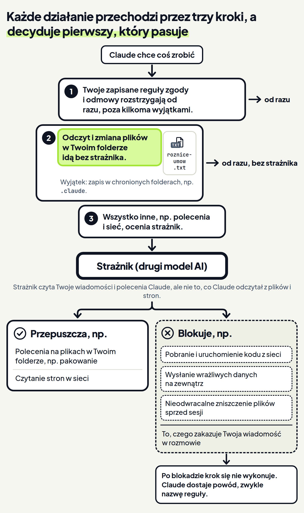

<em>Przewodnik po Claude Code · Moduł 1: Tryby pracy · Lekcja 4 z 4</em>

# Tryb auto: strażnik zamiast pytań

Wynajmujesz lokal. Twoja kancelaria prawna prosi o umowy najmu. Claude ma:

- przeczytać umowy z dwóch lat,
- dopisać różnice do zestawienia,
- spakować pliki.

W trybie Manual (ręczny) z lekcji 1 Claude pyta przed większością zmian w plikach i poleceń. <!-- fakt: tryb-manual-pyta-przed-akcjami --> Przy takim zadaniu to pytanie za pytaniem.

Na długie zadania dokumentacja Claude Code poleca tryb Auto (automatyczny). Ma on zmniejszyć zmęczenie pytaniami o zgodę. <!-- fakt: auto-do-dlugich-zadan -->

W trybie Auto Claude pracuje bez rutynowych pytań. <!-- fakt: auto-aplikacja-opis-trybu --> Pilnuje go drugi model AI, strażnik (klasyfikator). <!-- fakt: auto-klasyfikator-ocenia-przed-wykonaniem --> Zanim Claude uruchomi polecenie albo sięgnie do sieci, strażnik w tle sprawdza, czy to działanie zgadza się z Twoją prośbą. <!-- fakt: auto-aplikacja-opis-trybu --> Ryzykowne działania blokuje, zamiast pytać Ciebie. <!-- fakt: auto-aplikacja-klasyfikator-blokuje-ryzykowne -->

Wybierz Auto w przełączniku trybu pod polem wiadomości. <!-- fakt: aplikacja-przelacznik-pod-polem-wiadomosci --> Potem poproś Claude, żeby dopisał różnicę w czynszu do zestawienia i spakował umowy dla kancelarii. Zobaczysz, że zmiana pliku i pakowanie przejdą bez karty zgody. <!-- fakt: aplikacja-auto-i-accept-edits-stosuja-zmiany --> <!-- fakt: auto-aplikacja-opis-trybu -->

<!-- cwiczenie: cw1 -->

## Co tu się stało?

<!-- kolumny -->

#### Zmiana zestawienia

1. Claude przeczytał umowy i zmienił zestawienie bez karty zgody. <!-- fakt: aplikacja-auto-i-accept-edits-stosuja-zmiany -->
2. Strażnik nie ocenia odczytów ani zmian zwykłych plików w Twoim folderze, więc przechodzą one od razu. <!-- fakt: auto-odczyty-i-zmiany-w-folderze-bez-klasyfikatora --> <!-- fakt: auto-kolejnosc-odczyty-i-edycje-w-folderze -->
3. Liczby +1 -1 na karcie Changes (zmiany) mówią, że jest zmiana do przejrzenia. <!-- fakt: aplikacja-accept-edits-auto-bez-czekania-na-zgode --> Gdy je klikniesz, otworzy się widok zmian. <!-- fakt: aplikacja-widok-zmian-liczby-na-karcie-changes -->

#### Paczka zip

1. Claude spakował umowy poleceniem zip. To polecenie pakuje i kompresuje pliki w archiwum. <!-- fakt: polecenie-zip-pakuje-pliki -->
2. Zmiana zwykłego pliku w folderze omija strażnika, a polecenie zip trafia do niego. <!-- fakt: auto-odczyty-i-zmiany-w-folderze-bez-klasyfikatora --> <!-- fakt: auto-kolejnosc-reszta-do-klasyfikatora --> Zanim polecenie się wykonało, strażnik sprawdził, czy zgadza się ono z Twoją prośbą. <!-- fakt: auto-aplikacja-opis-trybu -->
3. Operacje na plikach w Twoim folderze strażnik domyślnie przepuszcza. Paczka powstała więc bez pytania. <!-- fakt: auto-domyslnie-dozwolone-operacje-na-plikach-w-folderze -->

<!-- /kolumny -->

Dzięki temu całe zadanie przeszło bez klikania. Gdyby polecenie było ryzykowne, strażnik by je zablokował, zamiast pytać Ciebie. <!-- fakt: auto-aplikacja-klasyfikator-blokuje-ryzykowne -->

## Co strażnik blokuje, a co przepuszcza

Skoro w trybie Auto Claude nie zadaje rutynowych pytań, warto wiedzieć, co strażnik zatrzyma, a co przepuści. <!-- fakt: auto-aplikacja-opis-trybu --> I kiedy mimo wszystko musisz patrzeć mu na ręce.

<!-- wyjasnienie: obrazy/lejek-straznika-wyjasnienie.png | Zmiana pliku w folderze idzie od razu, a polecenia i sieć zatrzymuje szlaban strażnika, który przepuszcza pakowanie, a pobranie programu blokuje i oddaje Claude powód. -->
<!-- analogia: To jak ochrona na lotnisku. Kto jest na liście wpuszczonych albo zakazanych, czyli w Twoich regułach, jest rozstrzygnięty od razu. Bagaż w Twojej strefie nikogo nie interesuje, a wszystko inne trafia do prześwietlenia, czyli do strażnika. -->

### Kto decyduje o każdym kroku

Każde działanie Claude w trybie Auto przechodzi przez te same kroki, zawsze w tej samej kolejności. Rozstrzyga pierwszy pasujący krok: <!-- fakt: auto-kolejnosc-najpierw-reguly -->

1. Zapisane w ustawieniach reguły zgody i odmowy rozstrzygają od razu, z kilkoma wyjątkami. <!-- fakt: auto-kolejnosc-najpierw-reguly --> Ten kurs nie pokazuje, jak takie reguły zapisać.
2. Odczyty i zmiany plików w Twoim folderze przechodzą bez oceny strażnika. <!-- fakt: auto-kolejnosc-odczyty-i-edycje-w-folderze --> Wyjątkiem są zapisy w folderach chronionych, na przykład w `.claude` z ustawieniami Claude. <!-- fakt: auto-odczyty-i-zmiany-w-folderze-bez-klasyfikatora --> <!-- fakt: sciezki-chronione-czym-sa -->
3. Wszystko inne trafia do strażnika, na przykład polecenia i żądania do sieci. <!-- fakt: auto-kolejnosc-reszta-do-klasyfikatora --> <!-- fakt: auto-aplikacja-opis-trybu --> Osobno idzie tylko kasowanie najważniejszych folderów, o którym przeczytasz niżej. <!-- fakt: auto-kolejnosc-reszta-do-klasyfikatora -->

Gdy strażnik zablokuje działanie, Claude dostaje powód. Zwykle to nazwa reguły, a nie pisemne wyjaśnienie. <!-- fakt: auto-claude-dostaje-powod-blokady -->

Dzięki tej kolejności wiesz z góry, co się stanie. Zmiana zestawienia w folderze przechodzi od razu. <!-- fakt: auto-odczyty-i-zmiany-w-folderze-bez-klasyfikatora --> Pakowanie i wysyłanie przechodzą przez strażnika. <!-- fakt: auto-kolejnosc-reszta-do-klasyfikatora --> <!-- fakt: auto-aplikacja-opis-trybu -->

### Co strażnik domyślnie blokuje

Na liście blokad są między innymi:

- pobranie i uruchomienie kodu z sieci, <!-- fakt: auto-blokuje-pobieranie-i-uruchamianie-kodu -->
- wysłanie wrażliwych danych na zewnątrz, <!-- fakt: auto-blokuje-wysylanie-danych -->
- nieodwracalne zniszczenie plików, które istniały przed sesją, <!-- fakt: auto-blokuje-niszczenie-plikow -->
- wypisanie do rozmowy lub pliku hasła albo klucza dostępu, <!-- fakt: auto-blokuje-wypisanie-danych-dostepowych -->
- umieszczenie wrażliwych szczegółów w treści dla innych ludzi, gdy Twoja wiadomość nie pozwoliła na te szczegóły, <!-- fakt: auto-blokuje-wrazliwe-szczegoly-do-innych -->
- kasowanie plików we wspólnych folderach tymczasowych według wzorca nazwy albo wieku plików, a nie po nazwie konkretnego pliku. <!-- fakt: auto-blokuje-kasowanie-w-tmp-wzorcem -->

### Co strażnik domyślnie przepuszcza

- operacje na plikach w Twoim folderze, <!-- fakt: auto-domyslnie-dozwolone-operacje-na-plikach-w-folderze -->
- żądania do sieci, które tylko czytają, na przykład otwarcie strony. <!-- fakt: auto-przepuszcza-odczyt-http -->

### Kasowanie najważniejszych folderów

Program chroni między innymi folder, w którym pracujesz, i Twój folder domowy przed poleceniami kasowania `rm` i `rmdir`. <!-- fakt: sciezki-krytyczne-rm-pyta-w-manual-i-accept-edits --> Program może jednak przeoczyć niektóre takie polecenia. <!-- fakt: sciezki-krytyczne-sprawdzenie-moze-przeoczyc --> Gdy w trybie Auto w aplikacji rozpozna polecenie, które kasuje taki folder, od razu je odrzuci. Claude ma Ci wtedy zgłosić, co chciał skasować, i zostawić kasowanie Tobie. <!-- fakt: auto-kasowanie-folderu-aplikacja-odmowa --> W terminalu program pyta wtedy o zgodę z dwuminutowym odliczaniem. <!-- fakt: auto-kasowanie-folderu-terminal-odliczanie -->

### Co strażnik widzi

Strażnik ufa folderowi, w którym pracujesz. Miejsca poza nim domyślnie traktuje jako zewnętrzne. <!-- fakt: auto-klasyfikator-ufa-folderowi-roboczemu -->

Strażnik czyta Twoje wiadomości i polecenia Claude, ale nie to, co Claude odczytał z plików i stron. <!-- fakt: auto-klasyfikator-widzi-wiadomosci-nie-wyniki --> Dlatego podejrzany tekst w pliku albo na stronie nie może sterować strażnikiem wprost. <!-- fakt: auto-klasyfikator-widzi-wiadomosci-nie-wyniki -->

### Blokadę możesz zdjąć zgodą

Gdy napiszesz Claude, że zablokowane działanie jest dozwolone, strażnik uzna to za Twoją zgodę. Może wtedy zdjąć blokadę. <!-- fakt: auto-zgoda-w-rozmowie-nazwij-dzialanie --> Zgoda działa według trzech zasad:

1. Nazwij działanie i to, co czyni je niebezpiecznym. Samo nazwanie czynności niczego nie zdejmuje. <!-- fakt: auto-zgoda-w-rozmowie-nazwij-dzialanie -->
2. Zgoda obejmuje jedno nazwane działanie. Następne takie działanie strażnik znów zablokuje, chyba że zgodzisz się na stałe. <!-- fakt: auto-zgoda-obejmuje-jedno-dzialanie -->
3. Niektórych blokad zgoda w rozmowie nie zdejmie. Wtedy wyjdź z trybu Auto i odpowiedz na pytanie o zgodę. <!-- fakt: auto-niektorych-blokad-zgoda-nie-zdejmuje -->

Dzięki temu jedną blokadę możesz zdjąć zdaniem w rozmowie. <!-- fakt: auto-zgoda-w-rozmowie-nazwij-dzialanie -->

### Gdy blokad jest dużo

Każdą blokadę program zgłasza powiadomieniem. <!-- fakt: auto-blokada-powiadomienie --> Dokumentacja nie opisuje, jak to powiadomienie wygląda w aplikacji, więc ćwiczenie go nie pokazuje.

Gdy strażnik zablokuje działania 3 razy z rzędu albo 20 razy łącznie, tryb Auto się wstrzymuje. Program znów pyta wtedy o zgodę. <!-- fakt: auto-wstrzymanie-po-blokadach --> Zgoda na działanie, o które pyta, wznawia tryb Auto. <!-- fakt: auto-zgoda-po-wstrzymaniu-wznawia-auto -->

Czasem jeden krok ma poczekać na Ciebie, na przykład pakowanie, dopóki nie przejrzysz zestawienia. Taką granicę stawiasz jednym zdaniem w prośbie. Zobaczysz, że granica zatrzyma pakowanie, a zdejmie ją dopiero Twoja wiadomość. <!-- fakt: auto-granice-z-rozmowy --> <!-- fakt: auto-granica-trwa-do-zdjecia-wiadomoscia -->

<!-- cwiczenie: cw2 -->

## Co tu się stało?

<!-- kolumny -->

#### Blokada

1. Zdanie „Nie pakuj niczego, dopóki nie przejrzę zestawienia” strażnik potraktował jak sygnał blokady. <!-- fakt: auto-granice-z-rozmowy -->
2. Granica blokuje pasujące działania, nawet takie, które strażnik zwykle przepuszcza. <!-- fakt: auto-granice-z-rozmowy -->
3. Pakowanie się nie wykonało, a Claude dostał powód blokady. <!-- fakt: auto-claude-dostaje-powod-blokady -->

#### Granica zdjęta

1. Claude sam uznał zestawienie za gotowe, ale granica dalej obowiązywała. <!-- fakt: auto-granica-trwa-do-zdjecia-wiadomoscia -->
2. Zdjęła ją dopiero Twoja kolejna wiadomość. <!-- fakt: auto-granica-trwa-do-zdjecia-wiadomoscia -->
3. Wtedy paczka powstała. <!-- fakt: auto-granica-trwa-do-zdjecia-wiadomoscia --> <!-- fakt: auto-domyslnie-dozwolone-operacje-na-plikach-w-folderze -->

<!-- /kolumny -->

Dzięki granicy jeden krok czeka na Ciebie, a reszta pracy idzie bez pytań i bez karty zgody. <!-- fakt: auto-granice-z-rozmowy --> <!-- fakt: auto-granica-trwa-do-zdjecia-wiadomoscia -->

## Granica nie jest zapisaną regułą

Strażnik czyta granicę z rozmowy przy każdej ocenie. <!-- fakt: auto-granice-z-rozmowy --> Gdy długa rozmowa zostanie streszczona, wiadomość z granicą może zniknąć. Razem z nią może zniknąć granica. <!-- fakt: auto-granice-z-rozmowy -->

Granicę stosuje strażnik. <!-- fakt: auto-granice-z-rozmowy --> Strażnika omijają odczyty i zmiany zwykłych plików w folderze. <!-- fakt: auto-odczyty-i-zmiany-w-folderze-bez-klasyfikatora --> Dlatego granicą zatrzymuj kroki takie jak pakowanie albo wysyłanie. Zmian plików w folderze granica może nie zatrzymać. <!-- fakt: auto-odczyty-i-zmiany-w-folderze-bez-klasyfikatora -->

W lekcjach 1 i 2 prośba w wiadomości nie zmieniała tego, na co pozwala program. <!-- fakt: uprawnienia-egzekwuje-program-nie-model --> W trybie Auto granicę czyta strażnik i to on blokuje pasujące działania. <!-- fakt: auto-granice-z-rozmowy -->

## Jak włączyć tryb Auto

<!-- kolumny -->

#### W aplikacji Claude na komputer

1. Kliknij przełącznik trybu pod polem wiadomości. <!-- fakt: aplikacja-przelacznik-pod-polem-wiadomosci --> Listę trybów otworzysz też skrótem <kbd>Cmd</kbd> + <kbd>Shift</kbd> + <kbd>M</kbd> na Macu <!-- fakt: aplikacja-skrot-menu-trybu --> albo <kbd>Ctrl</kbd> + <kbd>Shift</kbd> + <kbd>M</kbd> na Windowsie. <!-- fakt: aplikacja-skrot-menu-trybu-windows -->
2. Kliknij Auto. <!-- fakt: aplikacja-tryb-wybierasz-w-przelaczniku --> Auto jest na liście tylko wtedy, gdy masz do niego dostęp. <!-- fakt: aplikacja-dostepne-tryby --> Osobnego przełącznika w ustawieniach nie ma. <!-- fakt: auto-aplikacja-opis-trybu -->
3. Tryb Auto włączysz też przy zatwierdzaniu planu, jak w lekcji 3. Po kliknięciu <em>Accept and auto mode</em> (zatwierdź i włącz tryb Auto) przełącznik pokazuje Auto. <!-- fakt: aplikacja-plan-accept-and-auto-mode-karta-znika-auto -->
4. Aplikacja zapamiętuje wybrany tryb dla folderu. <!-- fakt: aplikacja-tryb-wybierasz-w-przelaczniku --> Po skończonym zadaniu wybierz więc z powrotem Manual.
5. W aplikacji <kbd>Shift</kbd> + <kbd>Tab</kbd> nie zmienia trybu. <!-- fakt: cykl-aplikacja-brak-shift-tab -->

#### Jeśli pracujesz w terminalu

1. Od wersji 2.1.283 programu Claude Code nowa sesja w terminalu zwykle zaczyna się w trybie Auto. <!-- fakt: tryb-startowy-terminal-auto --> Bez dostępu do Auto zaczyna się w trybie Manual. <!-- fakt: tryb-startowy-manual-gdy-auto-niedostepne -->
2. Gdy sesja pierwszy raz sama zacznie się w Auto, program raz pokaże na jej początku notkę z odnośnikiem do strony o trybach. <!-- fakt: auto-pierwszy-start-notka-terminal -->
3. W innym trybie naciskaj <kbd>Shift</kbd> + <kbd>Tab</kbd>, aż pasek stanu pokaże <em>⏵⏵ auto mode on</em> (tryb Auto włączony). <!-- fakt: pasek-napisy-trybow --> <!-- fakt: cykl-shift-tab-od-auto --> Auto jest w tym cyklu tylko wtedy, gdy masz do niego dostęp. Przejście do niego nie wymaga potwierdzenia. <!-- fakt: auto-w-cyklu-shift-tab-gdy-dostepny -->
4. W oknie zgody na polecenie bywa odpowiedź <em>Yes, and switch to auto mode</em> (tak, i przełącz na tryb Auto). Zatwierdza polecenie i przełącza sesję na Auto. <!-- fakt: okno-zgody-yes-and-switch-to-auto-mode --> Pojawia się tylko w trybach Manual i Accept edits (przyjmowanie zmian), gdy tryb Auto jest dostępny. <!-- fakt: okno-zgody-switch-to-auto-mode-kiedy -->

<!-- /kolumny -->

### Gdy tryb Auto jest niedostępny

- Przy połączeniu z API Anthropic tryb Auto wymaga jednego z nowszych modeli: Claude Opus 4.6 lub nowszego, Sonnet 4.6 lub nowszego, Haiku 5.5 albo modelu Fable. <!-- fakt: auto-wymagane-modele -->
- Na planach Team i Enterprise tryb Auto jest domyślnie dostępny, ale administrator może go wyłączyć dla całej firmy. <!-- fakt: auto-administrator-wylacza-na-team-i-enterprise -->
- Gdy program powie, że tryb Auto jest niedostępny, czasem zostaje tak do końca sesji. Spróbuj wtedy później, w nowej sesji. <!-- fakt: auto-niedostepny-sesja-bez-auto-do-konca -->

### Gdy Claude sięga po plik spoza folderu

Wzór umowy może leżeć w innym folderze niż ten, w którym pracujesz. Gdy Claude ma pracować też w innym folderze, dodaj go do sesji. Kliknij + obok pola wiadomości i wybierz <em>Add folder</em> (dodaj folder). Claude pracuje wtedy bezpośrednio w tym folderze. <!-- fakt: aplikacja-dodaj-folder-w-sesji -->

Za pierwszym razem, gdy w trybie Auto Claude sięgnie po plik spoza folderów roboczych, program zapyta o zgodę. <!-- fakt: auto-pierwszy-odczyt-spoza-folderu-pyta --> Dokumentacja nie mówi, że to pytanie pojawia się w aplikacji, a jego wygląd znamy tylko z terminala. <!-- fakt: auto-pierwszy-odczyt-spoza-folderu-pyta --> <!-- fakt: okno-odczyt-spoza-folderu-tytul-i-pytanie-terminal --> Jeśli pracujesz w aplikacji, resztę tej części możesz pominąć.

W terminalu okno ma tytuł <em>Read outside the working directories</em> (odczyt spoza folderów roboczych) i pytanie <em>Allow this read outside the working directories?</em> (zezwolić na ten odczyt?). <!-- fakt: okno-odczyt-spoza-folderu-tytul-i-pytanie-terminal --> Masz cztery odpowiedzi:

- <em>Yes, and keep allowing any reads outside the working directories</em> (tak, i zawsze pozwalaj): odczyt się wykona, a pytanie nie wróci. <!-- fakt: odczyt-spoza-folderu-yes-keep-allowing -->
- <em>Yes, but ask again next time</em> (tak, ale zapytaj następnym razem): odczyt się wykona, a przy następnym program znów zapyta. <!-- fakt: odczyt-spoza-folderu-yes-ask-again -->
- <em>No, and ask again next time</em> (nie, ale zapytaj następnym razem): ten odczyt zostanie odrzucony, a przy następnym program znów zapyta. <!-- fakt: odczyt-spoza-folderu-no-ask-again -->
- <em>No, and block reads outside the working directories from now on</em> (nie, i blokuj od teraz): narzędzia do czytania plików odmówią takich odczytów w każdej kolejnej sesji i w każdym trybie. <!-- fakt: odczyt-spoza-folderu-no-block-na-stale --> Odczyty z takiego folderu przywrócisz, dodając go poleceniem `/add-dir`. <!-- fakt: odczyt-spoza-folderu-no-block-na-stale -->

Po każdej z tych odpowiedzi Claude pracuje dalej. <!-- fakt: odczyt-spoza-folderu-claude-pracuje-dalej --> Dzięki temu pytaniu to Ty decydujesz, czy Claude może czytać pliki poza Twoim folderem.

## Kiedy włączać tryb Auto, a kiedy nie

<!-- kolumny -->

#### Włącz

- Do długiego zadania, przy którym pytania o zgodę Cię męczą. <!-- fakt: auto-do-dlugich-zadan -->
- Gdy ufasz, że praca idzie w dobrą stronę. <!-- fakt: auto-nie-gwarantuje-bezpieczenstwa -->
- Gdy na Ciebie ma poczekać tylko jeden krok. Napisz to jednym zdaniem w prośbie. <!-- fakt: auto-granice-z-rozmowy -->

#### Nie włączaj

- Zamiast samodzielnie sprawdzać wrażliwe operacje. Tryb Auto nie gwarantuje bezpieczeństwa. <!-- fakt: auto-nie-gwarantuje-bezpieczenstwa -->
- Gdy prośba jest niepełna. Tryb Auto zachęca Claude, żeby pracował dalej bez pytań doprecyzowujących. Napisz więc od razu wszystko, co ważne. <!-- fakt: auto-zacheca-do-pracy-bez-pytan-doprecyzowujacych -->
- Gdy granica ma obowiązywać zawsze. Zdanie z rozmowy może zniknąć po streszczeniu długiej rozmowy. <!-- fakt: auto-granice-z-rozmowy -->

<!-- /kolumny -->

### Tryb bez żadnych pytań

Na liście trybów może się też pojawić <em>Bypass permissions</em> (pomijanie uprawnień), na planach Pro i Max po włączeniu w ustawieniach aplikacji. <!-- fakt: aplikacja-dostepne-tryby --> <!-- fakt: aplikacja-bypass-zalezy-od-planu --> Ten tryb wyłącza pytania o zgodę i kontrole bezpieczeństwa, z kilkoma wyjątkami. <!-- fakt: bypass-wylacza-pytania-i-kontrole --> <!-- fakt: aplikacja-bypass-tylko-kontenery --> Nie chroni przed poleceniami podrzuconymi w treści (prompt injection). <!-- fakt: bypass-bez-ochrony-przed-wstrzyknieciem --> Dokumentacja każe go używać tylko w odizolowanych kontenerach i maszynach wirtualnych. <!-- fakt: aplikacja-bypass-tylko-kontenery --> Na zwykłym komputerze z Twoimi plikami go nie włączaj.

## Źródła

- [Tryby uprawnień](https://code.claude.com/docs/en/permission-modes)
- [Konfiguracja uprawnień](https://code.claude.com/docs/en/permissions)
- [Aplikacja Claude na komputer](https://code.claude.com/docs/en/desktop)
- [Pierwsze kroki w aplikacji](https://code.claude.com/docs/en/desktop-quickstart)

Sprawdzone 26.10.2026, Claude Code 2.1.310. Napisy okna odczytu spoza folderu w terminalu pochodzą z programu Claude Code 2.1.310.
