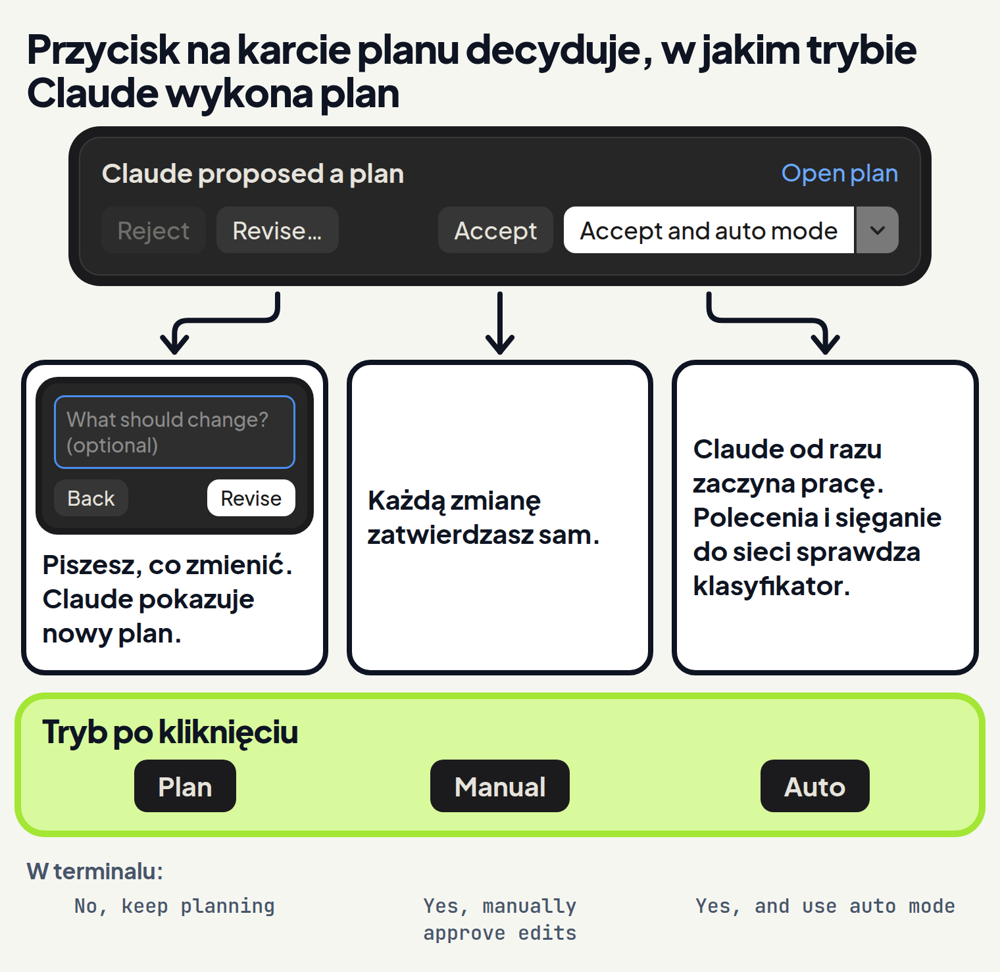

<em>Przewodnik po Claude Code · Moduł 1: Tryby pracy · Lekcja 3 z 4</em>

# Tryb planowania: najpierw plan, potem zmiany

Prosisz Claude o podwyżkę cen w cenniku dla klientów. Claude od razu zmienia plik. Podnosi też cenę pakietu, który obiecujesz klientom w promocji do końca roku. Pomyłkę widzisz dopiero w zmienionym pliku.

Dokumentacja Claude Code opisuje taką sytuację wprost. Gdy Claude od razu zabiera się do pisania kodu, może rozwiązać nie ten problem. <!-- fakt: plan-od-razu-do-kodu-zly-problem --> W cenniku wygląda to tak: prosisz o podwyżkę wszystkich cen, a cenę promocyjną chcesz zostawić.

Na to jest tryb Plan (planowanie). Oddziela badanie od wykonania. <!-- fakt: plan-od-razu-do-kodu-zly-problem --> W trybie Plan Claude czyta pliki i uruchamia polecenia, żeby zbadać folder. Potem proponuje plan. <!-- fakt: plan-aplikacja-opis --> Plików nie zmienia, dopóki nie zatwierdzisz planu. <!-- fakt: plan-edycje-zablokowane-do-zatwierdzenia -->

Wyślij tę samą prośbę dwa razy: najpierw bez planu, potem z planem. Zobaczysz, że bez planu pomyłkę widać dopiero w zmienionym pliku. Z planem widać ją już w planie, zanim plik się zmieni.

<!-- cwiczenie: cw1 -->

## Co tu się stało?

<!-- kolumny -->

#### Bez planu

<!-- podglad: cw1 bez-planu -->

1. W trybie Accept edits (przyjmowanie zmian) Claude od razu zmienił cennik. <!-- fakt: aplikacja-accept-edits-auto-bez-czekania-na-zgode -->
2. Cena promocyjna też wzrosła: 990 zł zamiast 900 zł.
3. Pomyłkę widać dopiero w widoku zmian, po fakcie. <!-- fakt: aplikacja-widok-zmian-liczby-na-karcie-changes -->

#### Z planem

<!-- podglad: cw1 z-planem -->

1. W trybie Plan Claude przeczytał cennik i zaproponował plan. <!-- fakt: plan-aplikacja-opis -->
2. Plan pojawił się w rozmowie na karcie <em>Claude proposed a plan</em> (Claude zaproponował plan). <!-- fakt: aplikacja-karta-planu-napisy -->
3. Po kliknięciu <em>Open plan</em> (otwórz plan) cały plan z tytułem i sekcjami stanął w panelu Plan po prawej. <!-- fakt: aplikacja-open-plan-otwiera-panel --> <!-- fakt: aplikacja-panel-plan-wyglad -->
4. Promocję widać w planie, a plik jest jeszcze bez zmian. <!-- fakt: plan-edycje-zablokowane-do-zatwierdzenia -->
5. Po kliknięciu <em>Accept and auto mode</em> przełącznik pokazał Auto, a Claude od razu zmienił plik. <!-- fakt: aplikacja-plan-accept-and-auto-mode-karta-znika-auto --> <!-- fakt: aplikacja-plan-accept-and-auto-mode-claude-buduje -->

<!-- /kolumny -->

W obu próbach Claude zrobił to samo: podniósł też cenę promocyjną. Różnica leży w chwili, w której to widzisz. Bez planu widzisz gotową zmianę w pliku. Z planem widzisz zamiar, a plik czeka.

Plan chroni więc tylko wtedy, gdy go przeczytasz. Gdy w ćwiczeniu klikniesz <em>Accept and auto mode</em> bez czytania, cena promocyjna i tak wzrośnie.

### Jak działa tryb Plan

W trybie Plan Claude bada sprawę i proponuje zmiany, ale ich nie wprowadza. <!-- fakt: tryb-plan-nie-zmienia-plikow --> Zmiany w plikach są zablokowane, dopóki nie zatwierdzisz planu. <!-- fakt: plan-edycje-zablokowane-do-zatwierdzenia -->

Plan widzisz w dwóch miejscach:

- w rozmowie: karta <em>Claude proposed a plan</em> z przyciskami do decyzji, <!-- fakt: aplikacja-karta-planu-napisy -->
- w panelu Plan po prawej: plan z tytułem i sekcjami. <!-- fakt: aplikacja-panel-plan-wyglad -->

Panel nie otwiera się sam. Otworzysz go odnośnikiem <em>Open plan</em> na karcie planu. <!-- fakt: aplikacja-open-plan-otwiera-panel --> W panelu przeczytasz cały plan, zanim wybierzesz przycisk na karcie. <!-- fakt: aplikacja-panel-plan-wyglad -->

Panel Plan to jeden z paneli zakładki Code. Obok niego są między innymi: <!-- fakt: aplikacja-panele-zakladki-code -->

- rozmowa,
- widok zmian,
- terminal.

### Po co Ci plan

Dzięki planowi widzisz, co dokładnie Claude zamierza, zanim zmieni plik. <!-- fakt: plan-edycje-zablokowane-do-zatwierdzenia --> Pomyłkę łapiesz w planie, zanim trafi do pliku z cennikiem.

Dokumentacja radzi zaczynać złożone zadania w trybie Plan. Wtedy Claude najpierw rozpisuje, jak je zrobi, a dopiero potem zmienia pliki. <!-- fakt: plan-aplikacja-porada-po-zatwierdzeniu -->

### Na co uważać w trybie Plan

- **Plan zajmuje czas.** Tryb Plan pomaga, ale dokłada pracy. <!-- fakt: plan-drobna-zmiana-bez-planu --> Przy małej, jasnej zmianie poproś Claude, żeby zrobił ją od razu. <!-- fakt: plan-drobna-zmiana-bez-planu --> Więcej o tym na końcu lekcji.
- **Plan działa tylko w tej sesji.** W aplikacji wybór trybu Plan obowiązuje tylko w bieżącej sesji (rozmowie). <!-- fakt: plan-aplikacja-tylko-biezaca-sesja --> W nowej sesji wybierasz go znowu.
- **Polecenia nie zawsze idą bez pytania.** Co dzieje się z poleceniem, zależy od sesji: <!-- fakt: plan-polecenia-klasyfikator-albo-pytanie -->

1. Czytanie plików idzie bez pytania. <!-- fakt: tryb-plan-bez-pytania-odczyty-i-polecenia-klasyfikatora -->
2. Gdy masz dostęp do trybu Auto, polecenia domyślnie ocenia klasyfikator w tle (wyjątek: usuwanie najważniejszych folderów). <!-- fakt: plan-polecenia-klasyfikator-albo-pytanie --> To osobny model w tle, który ocenia, czy działanie zgadza się z Twoją prośbą (lekcja 1). <!-- fakt: auto-aplikacja-opis-trybu --> <!-- fakt: auto-klasyfikator-ocenia-przed-wykonaniem --> Zatwierdzone polecenia się wykonują, a odrzucone są blokowane. <!-- fakt: plan-polecenia-klasyfikator-albo-pytanie -->
3. Bez dostępu do trybu Auto Claude pyta Cię o zgodę na polecenia spoza stałego zestawu poleceń, które tylko czytają (lekcja 1). <!-- fakt: plan-polecenia-klasyfikator-albo-pytanie -->

## Trzy wyjścia z planu

Plan sam niczego nie zmienia. <!-- fakt: plan-edycje-zablokowane-do-zatwierdzenia --> Ty decydujesz, co dalej: poprawić plan czy go wykonać. A jeśli wykonać, to w jakim trybie.

Decyzję podejmujesz przyciskiem na karcie planu. W tej lekcji poznasz trzy z nich: <!-- fakt: aplikacja-karta-planu-napisy -->

- **Revise…** (popraw). Plan poprawiasz tak:

1. Na karcie pojawia się pole <em>What should change? (optional)</em> (co zmienić? nieobowiązkowe). <!-- fakt: aplikacja-plan-revise-pole-poprawki -->
2. Piszesz w nim, co zmienić w planie, i klikasz <em>Revise</em>. <!-- fakt: aplikacja-plan-revise-poprawia-plan -->
3. Twoja poprawka pojawia się w rozmowie jako wiadomość, a przełącznik dalej pokazuje Plan. <!-- fakt: aplikacja-plan-revise-dymek-tryb-plan -->
4. Claude poprawia plan. <!-- fakt: aplikacja-plan-revise-poprawia-plan --> Potem w rozmowie pojawia się nowa karta planu. <!-- fakt: aplikacja-plan-revise-nowa-karta -->

Po kliknięciu <em>Back</em> (wstecz) karta wraca do przycisków, a do rozmowy nic nie trafia. <!-- fakt: aplikacja-plan-revise-back-wraca -->

- **Accept** (zatwierdź). Zatwierdzasz plan, ale każdą zmianę zatwierdzasz potem ręcznie. <!-- fakt: aplikacja-plan-accept-potem-zmiany-recznie --> Przełącznik pokazuje wtedy Manual (ręczny). <!-- fakt: aplikacja-plan-accept-potem-zmiany-recznie --> <!-- fakt: plan-zatwierdzenie-wychodzi-z-trybu-planowania --> W tym trybie Claude proponuje każdą zmianę i czeka na Twoją zgodę. <!-- fakt: tryb-manual-aplikacja-czeka-na-zatwierdzenie --> Widzisz podgląd zmiany i przyjmujesz ją albo odrzucasz, jak w lekcji 1. <!-- fakt: aplikacja-manual-podglad-i-przyciski --> W ćwiczeniu ta droga kończy się, gdy przełącznik pokaże Manual, a Claude odpowie.
- **Accept and auto mode** (zatwierdź i włącz tryb Auto). Karta znika, przełącznik pokazuje Auto, a panel Plan zostaje otwarty. <!-- fakt: aplikacja-plan-accept-and-auto-mode-karta-znika-auto --> Claude od razu zaczyna pracę. <!-- fakt: aplikacja-plan-accept-and-auto-mode-claude-buduje --> Zanim Claude wykona polecenie albo sięgnie do sieci, klasyfikator w tle sprawdza, czy to działanie zgadza się z Twoją prośbą. <!-- fakt: auto-aplikacja-opis-trybu --> Tryb Auto poznasz w lekcji 4.

Zatwierdzenie planu kończy tryb Plan i przełącza sesję na tryb przypisany do przycisku: po Accept na Manual, po Accept and auto mode na Auto. <!-- fakt: plan-zatwierdzenie-wychodzi-z-trybu-planowania --> <!-- fakt: aplikacja-plan-accept-potem-zmiany-recznie --> <!-- fakt: aplikacja-plan-accept-and-auto-mode-karta-znika-auto --> Żeby znów planować, wybierz Plan w przełączniku. <!-- fakt: aplikacja-tryb-wybierasz-w-przelaczniku --> Poprawka trybu nie zmienia. <!-- fakt: aplikacja-plan-revise-dymek-tryb-plan -->

Dzięki temu sam decydujesz, jak Claude wykona plan:

- z Twoją zgodą przy każdej zmianie (Accept), <!-- fakt: aplikacja-plan-accept-potem-zmiany-recznie -->
- sam, pod okiem klasyfikatora (Accept and auto mode). <!-- fakt: auto-aplikacja-opis-trybu -->

Tryb Auto pojawia się w aplikacji tylko wtedy, gdy masz do niego dostęp. <!-- fakt: aplikacja-dostepne-tryby -->

Teraz sam włącz tryb Plan w przełączniku i poproś o zmianę w cenniku. Poprosisz o usunięcie konsultacji, a potem zmienisz zdanie. Przyciskiem Revise… poprawisz plan, zanim plik się zmieni.

<!-- cwiczenie: cw2 -->

## Co tu się stało?

<!-- kolumny -->

#### Poprawka planu

1. Po wybraniu trybu Plan z listy przełącznik pokazał Plan. <!-- fakt: aplikacja-tryb-wybierasz-w-przelaczniku -->
2. Claude przeczytał cennik i zaproponował plan. Plik się nie zmienił. <!-- fakt: plan-aplikacja-bez-zmian-w-plikach -->
3. Revise… otworzył pole na poprawkę. <!-- fakt: aplikacja-plan-revise-pole-poprawki -->
4. Poprawka poszła jako Twoja wiadomość, a przełącznik dalej pokazywał Plan. <!-- fakt: aplikacja-plan-revise-dymek-tryb-plan -->
5. Claude napisał nowy plan: konsultacja zostaje. <!-- fakt: aplikacja-plan-revise-nowa-karta -->

#### Wykonanie planu

1. Po Accept przełącznik pokazał Manual. Zmianę w cenniku zatwierdzasz sam. <!-- fakt: aplikacja-plan-accept-potem-zmiany-recznie --> <!-- fakt: plan-zatwierdzenie-wychodzi-z-trybu-planowania -->
2. Po Accept and auto mode przełącznik pokazał Auto, a audyt od razu trafił do cennika. <!-- fakt: aplikacja-plan-accept-and-auto-mode-karta-znika-auto --> <!-- fakt: aplikacja-auto-i-accept-edits-stosuja-zmiany -->
3. Gdy plan poprawisz, konsultacja zostaje, bo poprawka trafia do planu, zanim plik się zmieni. <!-- fakt: plan-edycje-zablokowane-do-zatwierdzenia -->

<!-- /kolumny -->

## Jak włączyć tryb Plan

### W aplikacji Claude na komputer

1. W zakładce Code kliknij przełącznik trybu pod polem wiadomości. <!-- fakt: aplikacja-przelacznik-pod-polem-wiadomosci --> Otworzy się lista trybów. <!-- fakt: aplikacja-tryb-wybierasz-w-przelaczniku --> Listę otworzysz też skrótem <kbd>Cmd</kbd> + <kbd>Shift</kbd> + <kbd>M</kbd> na Macu <!-- fakt: aplikacja-skrot-menu-trybu --> albo <kbd>Ctrl</kbd> + <kbd>Shift</kbd> + <kbd>M</kbd> na Windowsie. <!-- fakt: aplikacja-skrot-menu-trybu-windows -->
2. Kliknij Plan. <!-- fakt: aplikacja-dostepne-tryby -->
3. Napisz prośbę i naciśnij <kbd>Enter</kbd>. <!-- fakt: aplikacja-enter-wysyla-zadanie --> Claude zbada folder i zaproponuje plan. <!-- fakt: plan-aplikacja-opis -->

Tryb zmienisz w każdej chwili, także w trakcie rozmowy. <!-- fakt: aplikacja-przelacznik-pod-polem-wiadomosci --> Inne tryby aplikacja zapamiętuje dla folderu, a Plan obowiązuje tylko w bieżącej sesji. <!-- fakt: plan-aplikacja-tylko-biezaca-sesja --> W aplikacji <kbd>Shift</kbd> + <kbd>Tab</kbd> nie zmienia trybu. <!-- fakt: cykl-aplikacja-brak-shift-tab -->

### Jeśli pracujesz w terminalu

Claude Code działa też w terminalu. Tryb Plan włączasz tam i kończysz inaczej niż w aplikacji.

- Naciskaj <kbd>Shift</kbd> + <kbd>Tab</kbd>, aż pasek stanu pokaże <em>⏸ plan mode on</em> (tryb planowania włączony). <!-- fakt: plan-terminal-shift-tab-az-do-plan-mode-on --> <!-- fakt: pasek-napisy-trybow -->
- Albo wpisz `/plan` przed prośbą. Plan obejmie wtedy jedną wiadomość. <!-- fakt: tryb-plan-wlaczenie-shift-tab-lub-plan -->

Gdy Claude napisze plan, wybierasz jedną z odpowiedzi:

- <em>Yes, and use auto mode</em> (tak, i włącz tryb Auto): zatwierdzasz plan, a Claude zaczyna pracę w trybie Auto. <!-- fakt: plan-opcja-yes-and-use-auto-mode --> Gdy tryb Auto nie jest dostępny w sesji, ta odpowiedź nazywa się <em>Yes, auto-accept edits</em> (tak, przyjmuj zmiany automatycznie). <!-- fakt: plan-opcja-yes-auto-accept-edits -->
- <em>Yes, manually approve edits</em> (tak, zmiany zatwierdzę ręcznie): zatwierdzasz plan, ale każdą zmianę przeglądasz osobno. <!-- fakt: plan-opcja-yes-manually-approve-edits -->
- <em>No, keep planning</em> (nie, planuj dalej): zostajesz w trybie Plan i piszesz Claude, co zmienić. <!-- fakt: plan-opcja-no-keep-planning -->

Zatwierdzenie planu kończy tryb Plan i włącza tryb z wybranej odpowiedzi. Wtedy Claude zaczyna zmieniać pliki. <!-- fakt: plan-zatwierdzenie-wychodzi-z-trybu-planowania --> W trakcie pracy sprawdza ją z planem. <!-- fakt: plan-wyjscie-zatwierdzenie-albo-shift-tab -->

Plan poprawisz też sam. <kbd>Ctrl</kbd> + <kbd>G</kbd> otwiera go w Twoim domyślnym edytorze tekstu, zanim Claude przejdzie dalej. <!-- fakt: plan-ctrl-g-otwiera-plan-w-edytorze -->

Z trybu Plan wyjdziesz bez zatwierdzania, gdy znów naciśniesz <kbd>Shift</kbd> + <kbd>Tab</kbd>. Tak porzucasz plan. <!-- fakt: tryb-plan-wyjscie-shift-tab -->

## Kiedy włączać tryb Plan, a kiedy nie

Dokumentacja zaleca pracę w czterech fazach: <!-- fakt: plan-cztery-fazy-pracy -->

1. badanie,
2. plan,
3. wykonanie,
4. zapis zmian w repozytorium git (folderze, w którym git zapisuje historię zmian; lekcja 1).

Tryb Plan pilnuje, żeby badanie i plan przyszły przed wykonaniem. <!-- fakt: plan-od-razu-do-kodu-zly-problem -->

<!-- kolumny -->

#### Włącz

- Gdy nie masz pewności, jak zadanie zrobić. <!-- fakt: plan-kiedy-najbardziej-przydatny -->
- Gdy zmiana obejmie wiele plików, na przykład cennik, oferty i umowy naraz. <!-- fakt: plan-kiedy-najbardziej-przydatny -->
- Gdy nie znasz plików, które mają się zmienić, na przykład folderu po poprzednim wykonawcy. <!-- fakt: plan-kiedy-najbardziej-przydatny -->

#### Nie musisz

- Gdy zmianę opiszesz jednym zdaniem. Wtedy pomiń plan. <!-- fakt: plan-kiedy-najbardziej-przydatny -->
- Gdy zakres jest jasny, a poprawka mała, na przykład literówka. Poproś Claude, żeby zrobił to od razu. <!-- fakt: plan-drobna-zmiana-bez-planu -->

<!-- /kolumny -->

Chodzi o zmianę w plikach, nie o prośbę. <!-- fakt: plan-kiedy-najbardziej-przydatny --> Prośba z ćwiczenia miała jedno zdanie, ale nie mówiła, że cena promocyjna ma zostać.

## Źródła

- [Tryby uprawnień](https://code.claude.com/docs/en/permission-modes)
- [Aplikacja Claude na komputer](https://code.claude.com/docs/en/desktop)
- [Pierwsze kroki w aplikacji](https://code.claude.com/docs/en/desktop-quickstart)
- [Dobre praktyki](https://code.claude.com/docs/en/best-practices)

Dokumentacja nie opisuje karty planu w aplikacji. Wygląd karty i skutki przycisków Revise… i Accept and auto mode wzięliśmy z nagrań aplikacji: [12.10.2026](https://www.youtube.com/watch?v=wnSIIVqS48A&t=650s), [18.07.2026](https://www.youtube.com/watch?v=ZW6d_2rwcdk&t=805s), [13.07.2026](https://www.youtube.com/watch?v=-YTot4fwNFY&t=313s) i [30.04.2026](https://www.youtube.com/watch?v=bqJzIWAEn40&t=1033s). O przycisku Accept nagranie mówi tylko słowami („zmiany zatwierdzasz potem ręcznie”). Tryb Manual po nim wynika z dokumentacji terminala.

Sprawdzone 26.10.2026, Claude Code 2.1.310.
