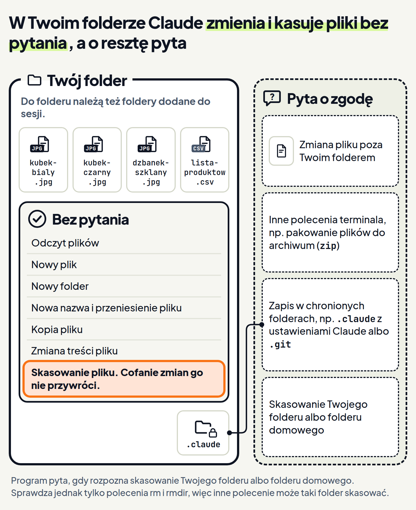

<em>Przewodnik po Claude Code · Moduł 1: Tryby pracy · Lekcja 2 z 4</em>

# Accept edits: Claude sam zmienia pliki

Masz w folderze zdjęcia produktów o nazwach IMG_2041, IMG_2042 i IMG_2043. Chcesz, żeby nazywały się tak jak produkty w sklepie. W trybie Manual (ręczny) z lekcji 1 Claude pyta o zgodę przed zapisem plików i przed poleceniami. <!-- fakt: manual-po-dziesiatej-zgodzie-klikasz --> Przy porządkach w folderze to pytanie za pytaniem.

Dokumentacja Claude Code mówi o tym wprost: taka praca jest bezpieczna, ale męcząca. Po dziesiątej zgodzie klikasz, zamiast przeglądać zmiany. <!-- fakt: manual-po-dziesiatej-zgodzie-klikasz -->

Na takie porządki jest tryb Accept edits (przyjmowanie zmian). W aplikacji Claude bez pytania zmienia w tym trybie pliki i uruchamia typowe polecenia na plikach. <!-- fakt: accept-edits-aplikacja-pyta-o-inne-polecenia --> O inne polecenia terminala nadal pyta. <!-- fakt: accept-edits-aplikacja-pyta-o-inne-polecenia -->

Ten tryb przepuszcza bez pytania także kasowanie plików w folderze, w którym pracujesz. <!-- fakt: accept-edits-polecenia-na-plikach --> <!-- fakt: accept-edits-aplikacja-to-accept-edits --> Dlatego w tej lekcji poznasz też granice tego trybu.

Przełącznik pod polem wiadomości pokazuje już Accept edits. <!-- fakt: aplikacja-przelacznik-pod-polem-wiadomosci --> Poproś o nowe nazwy zdjęć i zobaczysz, że trzy zmiany nazw przejdą bez ani jednej karty zgody. <!-- fakt: accept-edits-aplikacja-pyta-o-inne-polecenia -->

<!-- cwiczenie: cw1 -->

## Co tu się stało?

<!-- kolumny -->

#### Bez karty zgody

1. Claude przeczytał listę produktów bez pytania. <!-- fakt: accept-edits-odczyty-bez-pytania -->
2. Nazwę pliku Claude zmienia poleceniem `mv`. <!-- fakt: polecenie-mv-zmienia-nazwe-lub-przenosi --> W aplikacji tryb Accept edits przepuszcza to polecenie bez pytania. <!-- fakt: accept-edits-aplikacja-pyta-o-inne-polecenia -->
3. Przełącznik pokazywał Accept edits, więc Claude nie czekał na Twoją zgodę. <!-- fakt: aplikacja-tryb-pod-polem-mowi-czy-claude-czeka-na-zgode -->

#### Tu Claude nadal pyta

1. Accept edits nie przepuszcza wszystkiego.
2. Claude nadal pyta o polecenia terminala inne niż typowe polecenia na plikach. <!-- fakt: accept-edits-aplikacja-pyta-o-inne-polecenia -->
3. Jedno takie polecenie zobaczysz w drugim ćwiczeniu.

<!-- /kolumny -->

### Co Claude robi bez pytania w trybie Accept edits

W aplikacji, w sesji na Twoim komputerze, Accept edits to ten sam tryb, który dokumentacja trybów nazywa `acceptEdits`. <!-- fakt: accept-edits-aplikacja-to-accept-edits --> Aplikacja działa na tym samym silniku co Claude Code w terminalu. <!-- fakt: aplikacja-ten-sam-silnik-co-w-terminalu -->

W tym trybie Claude bez pytania tworzy i zmienia pliki w folderze, w którym pracujesz. <!-- fakt: accept-edits-edycje-w-folderze-bez-pytania --> Bez pytania uruchamia też typowe polecenia na plikach: <!-- fakt: accept-edits-polecenia-na-plikach -->

- `mkdir` tworzy folder, <!-- fakt: polecenie-mkdir-tworzy-folder -->
- `touch` tworzy pusty plik, jeśli go jeszcze nie ma, <!-- fakt: polecenie-touch-tworzy-pusty-plik -->
- `mv` przenosi plik albo zmienia jego nazwę, <!-- fakt: polecenie-mv-zmienia-nazwe-lub-przenosi -->
- `cp` kopiuje plik, <!-- fakt: polecenie-cp-kopiuje -->
- `sed` zmienia tekst, także prosto w pliku, <!-- fakt: polecenie-sed-zmienia-tekst -->
- `rm` kasuje plik, <!-- fakt: polecenie-rm-kasuje-pliki -->
- `rmdir` kasuje pusty folder. <!-- fakt: polecenie-rmdir-kasuje-pusty-folder -->

Nazw nie musisz znać. Zapamiętaj tylko, że na tej liście jest kasowanie.

### Co zyskujesz

Przy porządkach w folderze nie odpowiadasz na pytanie za pytaniem. W trybie Accept edits Claude sam wprowadza zmiany w plikach. <!-- fakt: aplikacja-auto-i-accept-edits-stosuja-zmiany --> <!-- fakt: aplikacja-accept-edits-auto-bez-czekania-na-zgode --> Zmiany sprawdzasz po fakcie, zamiast zatwierdzać każdą osobno. <!-- fakt: accept-edits-przeglad-po-fakcie -->

Gdy Claude zmienia treść plików, przegląd po fakcie robisz w widoku zmian z lekcji 1. <!-- fakt: aplikacja-accept-edits-auto-bez-czekania-na-zgode --> Liczby linijek, na przykład +12 -1, stoją na karcie Changes (zmiany) w panelu obok rozmowy. <!-- fakt: aplikacja-widok-zmian-liczby-na-karcie-changes --> <!-- fakt: aplikacja-panel-szczegolow-sesji-karty-obok-czatu --> W widoku zmian przejrzysz zmienione pliki jeden po drugim. <!-- fakt: aplikacja-widok-zmian-przeglad-plik-po-pliku -->

Dokumentacja nie mówi, czy te liczby pojawiają się przy zmianie nazwy albo skasowaniu pliku. Dlatego ćwiczenie ich nie pokazuje. Nowe nazwy zobaczysz w folderze pod oknem.

Teraz poproś Claude, żeby usunął duplikat zdjęcia i spakował zdjęcia dla sklepu. Zobaczysz, że kasowanie przejdzie bez pytania, a przy pakowaniu Claude się zatrzyma i poczeka na Twoją zgodę. <!-- fakt: accept-edits-polecenia-na-plikach --> <!-- fakt: accept-edits-aplikacja-pyta-o-inne-polecenia -->

<!-- cwiczenie: cw2 -->

## Co tu się stało?

<!-- kolumny -->

#### Kasowanie

1. Claude skasował duplikat bez karty zgody. <!-- fakt: accept-edits-polecenia-na-plikach -->
2. Kasowanie pliku poleceniem `rm` jest na liście poleceń, na które ten tryb pozwala bez pytania. <!-- fakt: accept-edits-polecenia-na-plikach --> <!-- fakt: accept-edits-aplikacja-to-accept-edits -->
3. Działa to tylko w folderze, w którym pracujesz, i w folderach dodanych do sesji. <!-- fakt: accept-edits-tylko-w-zakresie-folderu -->

#### Pakowanie

1. Do pakowania Claude potrzebował polecenia `zip`.
2. `zip` nie należy do poleceń na plikach, na które ten tryb pozwala bez pytania. <!-- fakt: accept-edits-polecenia-na-plikach -->
3. Claude nadal pyta o inne polecenia terminala, więc paczka jeszcze nie powstała. <!-- fakt: accept-edits-aplikacja-pyta-o-inne-polecenia -->

<!-- /kolumny -->

Dokumentacja nie opisuje, jak w aplikacji wygląda pytanie o polecenie. Dlatego ćwiczenie pokazuje tylko, że Claude czeka i że w folderze nie ma paczki.

### Prośba „nic nie kasuj” nie wyłączy kasowania

Tego, na co pozwala tryb, pilnuje program Claude Code, a nie Claude, z którym piszesz. <!-- fakt: uprawnienia-egzekwuje-program-nie-model --> Twoja prośba zmienia to, co Claude próbuje zrobić. Nie zmienia tego, na co pozwala program. <!-- fakt: uprawnienia-egzekwuje-program-nie-model -->

Jeśli Claude mimo prośby użyje `rm` w Twoim folderze, nie zapyta o zgodę. <!-- fakt: uprawnienia-egzekwuje-program-nie-model --> <!-- fakt: accept-edits-polecenia-na-plikach -->

### Cofanie zmian nie przywróci skasowanego pliku

Plik, który zmieniały tylko polecenia terminala, takie jak `rm`, nie jest śledzony przy cofaniu zmian. Po cofnięciu zostaje taki, jaki jest. <!-- fakt: cofanie-nie-obejmuje-plikow-zmienionych-tylko-przez-bash --> <!-- fakt: accept-edits-polecenia-na-plikach --> <!-- fakt: aplikacja-ten-sam-silnik-co-w-terminalu -->

Dlatego cofanie zmian nie przywróci pliku skasowanego w ten sposób. Zanim włączysz ten tryb, zrób kopię folderu i pracuj na niej.

## Granice trybu Accept edits

Ten tryb ma granice. Gdy je znasz, wiesz z góry, kiedy Claude zapyta, a kiedy zrobi coś sam.

### Tylko w Twoim folderze

Bez pytania Claude działa tylko na plikach w folderze, w którym pracujesz, i w folderach dodanych do sesji. <!-- fakt: accept-edits-tylko-w-zakresie-folderu --> W aplikacji ten folder wybierasz kontrolką folderu obok wyboru środowiska. <!-- fakt: aplikacja-kontrolka-folderu-obok-selektora --> Ta kontrolka stoi w rzędzie pod polem wiadomości, a wybór środowiska to wybór miejsca pracy Claude z pierwszej lekcji kursu. <!-- fakt: aplikacja-rzad-pod-polem-srodowisko-folder-tryb-model --> <!-- fakt: aplikacja-selektor-srodowiska-pierwsza-kontrolka --> W ćwiczeniu pokazuje nazwę folderu Zdjecia-sklep.

W dokumentacji uprawnień taki folder nazywa się folderem roboczym. <!-- fakt: folder-roboczy-to-folder-uruchomienia --> W terminalu to folder, w którym uruchamiasz Claude. <!-- fakt: folder-roboczy-to-folder-uruchomienia --> W folderach dodanych do sesji obowiązują te same zasady, a zgody na zmiany zależą od bieżącego trybu. <!-- fakt: foldery-dodatkowe-te-same-zasady -->

### Co nadal wymaga zgody

Nawet w trybie Accept edits Claude zapyta o zgodę, gdy chce: <!-- fakt: accept-edits-nadal-pytaja -->

- zmienić plik poza Twoim folderem i folderami dodanymi do sesji,
- zapisać coś w chronionych folderach, na przykład w `.claude` z ustawieniami Claude albo w `.git`, <!-- fakt: accept-edits-sciezki-chronione-pytaja --> <!-- fakt: sciezki-chronione-czym-sa -->
- skasować cały folder, w którym pracujesz, albo Twój folder domowy, <!-- fakt: sciezki-krytyczne-rm-pyta-w-manual-i-accept-edits -->
- uruchomić inne polecenie terminala, na przykład `zip`. <!-- fakt: accept-edits-aplikacja-pyta-o-inne-polecenia -->

Wyjątkiem od ostatniego punktu jest stały zestaw poleceń, które tylko czytają (lekcja 1). <!-- fakt: accept-edits-nadal-pytaja -->

### Dlaczego Claude pyta o chronione foldery i o skasowanie Twojego folderu

Dzięki chronionym folderom Claude przypadkiem nie uszkodzi własnych ustawień ani stanu repozytorium git. <!-- fakt: sciezki-chronione-czym-sa -->

Gdy program rozpozna polecenie, które kasuje folder, w którym pracujesz, albo Twój folder domowy, zapyta o zgodę. <!-- fakt: sciezki-krytyczne-rm-pyta-w-manual-i-accept-edits --> To sprawdzenie może jednak przeoczyć niektóre polecenia. <!-- fakt: sciezki-krytyczne-sprawdzenie-moze-przeoczyc --> Sprawdza tylko polecenia `rm` i `rmdir`, więc inne zatwierdzone polecenia też mogą skasować taki folder. <!-- fakt: sciezki-krytyczne-sprawdzenie-tylko-rm-i-rmdir --> Nie polegaj więc tylko na nim. Pracuj na kopii folderu.

## Jak włączyć tryb Accept edits

Włączasz go na czas porządków, a potem wracasz do Manual.

<!-- kolumny -->

#### W aplikacji Claude na komputer

1. Kliknij przełącznik trybu pod polem wiadomości i wybierz Accept edits, tak jak w lekcji 1. <!-- fakt: aplikacja-przelacznik-pod-polem-wiadomosci --> <!-- fakt: aplikacja-tryb-wybierasz-w-przelaczniku --> <!-- fakt: aplikacja-dostepne-tryby -->
2. Na Macu listę trybów otworzysz też skrótem <kbd>Cmd</kbd> + <kbd>Shift</kbd> + <kbd>M</kbd>. <!-- fakt: aplikacja-skrot-menu-trybu -->
3. Aplikacja zapamięta ten tryb dla folderu. <!-- fakt: aplikacja-tryb-wybierasz-w-przelaczniku --> Gdy znów otworzysz ten folder, Claude też będzie zmieniać pliki bez pytania. <!-- fakt: plan-aplikacja-tylko-biezaca-sesja --> <!-- fakt: aplikacja-accept-edits-auto-bez-czekania-na-zgode -->
4. Przed prośbą spójrz na przełącznik. Pokazuje, czy Claude poczeka na Twoją zgodę. <!-- fakt: aplikacja-tryb-pod-polem-mowi-czy-claude-czeka-na-zgode -->
5. Po porządkach wybierz w przełączniku znów Manual. <!-- fakt: aplikacja-tryb-wybierasz-w-przelaczniku -->

#### Jeśli pracujesz w terminalu

1. W trybie Manual naciśnij raz <kbd>Shift</kbd> + <kbd>Tab</kbd>. <!-- fakt: accept-edits-shift-tab-raz-z-manual --> Pasek stanu pokaże <em>⏵⏵ accept edits on</em> (przyjmowanie zmian włączone). <!-- fakt: pasek-napisy-trybow -->
2. W sesji, która działa w trybie Auto, naciśnij ten skrót dwa razy: z auto przejdziesz do manual, a potem do accept edits. <!-- fakt: cykl-shift-tab-od-auto -->
3. W aplikacji <kbd>Shift</kbd> + <kbd>Tab</kbd> nie zmienia trybu. <!-- fakt: cykl-aplikacja-brak-shift-tab -->

<!-- /kolumny -->

## Kiedy włączać tryb Accept edits, a kiedy nie

<!-- kolumny -->

#### Włącz

- Gdy ufasz, że Claude dobrze zmieni pliki, i chcesz pracować szybciej. <!-- fakt: accept-edits-aplikacja-kiedy-uzywac -->
- Gdy wolisz przejrzeć zmiany po fakcie, zamiast zatwierdzać każdą osobno. <!-- fakt: accept-edits-przeglad-po-fakcie -->
- Gdy pracujesz na kopii folderu, a oryginał leży gdzie indziej.

#### Nie włączaj

- Gdy w folderze leży jedyna kopia ważnych dokumentów, na przykład umów z klientami. Kasowanie plików przejdzie tam bez pytania. <!-- fakt: accept-edits-polecenia-na-plikach -->
- Gdy nie wiesz, co Claude zrobi. Wybierz wtedy Plan (planowanie, lekcja 3) albo Manual (lekcja 1).

<!-- /kolumny -->

## Źródła

- [Tryby uprawnień](https://code.claude.com/docs/en/permission-modes)
- [Konfiguracja uprawnień](https://code.claude.com/docs/en/permissions)
- [Aplikacja Claude na komputer](https://code.claude.com/docs/en/desktop)
- [Pierwsze kroki w aplikacji](https://code.claude.com/docs/en/desktop-quickstart)
- [Dobre praktyki](https://code.claude.com/docs/en/best-practices)
- [Cofanie zmian](https://code.claude.com/docs/en/checkpointing)

Sprawdzone 26.10.2026, Claude Code 2.1.310.
