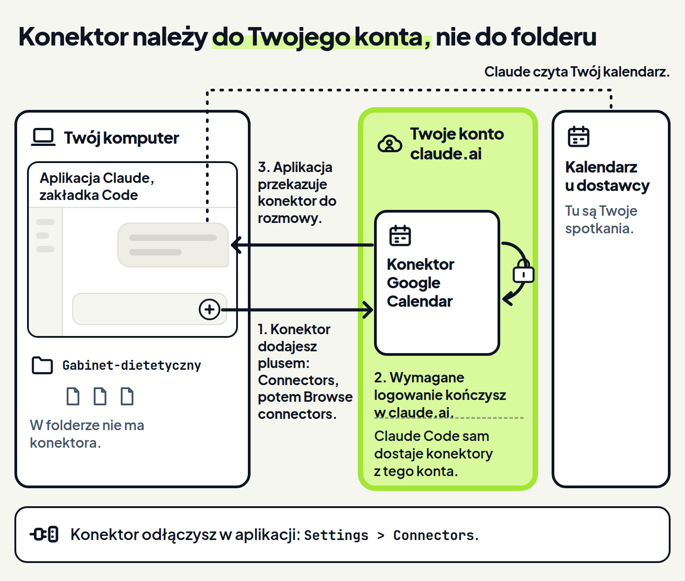

<em>Przewodnik po Claude Code · Moduł 5: Claude w Twoich narzędziach · Lekcja 1 z 4</em>

# Pierwszy konektor: połączenie Claude z kalendarzem

Prowadzisz gabinet dietetyczny. Klientów przyjmujesz na miejscu i online. Co rano przepisujesz do rozmowy z Claude terminy konsultacji z kalendarza, żeby ułożył Ci plan dnia. Zabiera to czas, a jedna źle przepisana godzina psuje cały plan.

Dokumentacja radzi właśnie w takiej sytuacji: gdy przeklejasz do rozmowy dane z innego narzędzia, podłącz to narzędzie. <!-- fakt: mcp-po-co-zamiast-przeklejania --> Służy do tego konektor. Konektor daje Claude dostęp do Twoich narzędzi, na przykład do kalendarza. <!-- fakt: mcp-czym-jest --> <!-- fakt: aplikacja-konektor-to-serwer-mcp-z-kreatorem -->

Po podłączeniu Claude może sam czytać Twój kalendarz. <!-- fakt: aplikacja-konektor-czyta-kalendarz-wysyla-wiadomosci --> Pracuje wtedy wprost na kalendarzu, a nie na tym, co mu wkleisz. <!-- fakt: mcp-po-co-zamiast-przeklejania -->

W ćwiczeniu niżej podłączysz kalendarz tym samym plusem obok pola wiadomości, którym dołączasz pliki. <!-- fakt: aplikacja-plus-menu-pliki-skille-konektory-wtyczki --> Potem zapytasz Claude, jakie konektory ma w rozmowie. <!-- fakt: aplikacja-zapytaj-claude-o-konektory -->

<!-- cwiczenie: cw1 -->

## Co tu się stało?

<!-- kolumny -->

#### W menu plusa

1. Plus obok pola wiadomości otworzył menu, w którym dołączasz pliki i sięgasz po skille, konektory i wtyczki. <!-- fakt: aplikacja-plus-menu-pliki-skille-konektory-wtyczki --> Skille kryją się pod pozycją Slash commands. <!-- fakt: skill-aplikacja-menu -->
2. Pozycja Connectors (konektory) rozwinęła podmenu, a Browse connectors (przeglądaj konektory) otworzyła katalog konektorów. <!-- fakt: aplikacja-add-connectors-otwiera-katalog -->
3. Po wybraniu kalendarza ćwiczenie pokazało krok logowania. Wymagane logowanie do konektora kończysz w claude.ai. <!-- fakt: konektor-logowanie-w-claude-ai -->

#### W rozmowie

1. Okno katalogu się zamknęło i wróciła pusta rozmowa.
2. Pytanie „Jakie konektory masz w tej rozmowie?” trafiło do Claude. <!-- fakt: aplikacja-zapytaj-claude-o-konektory -->
3. Claude odpowiedział, że ma konektor Google Calendar. To przykład odpowiedzi, prawdziwa może brzmieć inaczej.

<!-- /kolumny -->

W miejscu logowania ćwiczenie pokazało kartę z kłódką, bez napisów. Dokumentacja nie opisuje, jak logowanie wygląda w zakładce Code, więc ćwiczenie nie rysuje ekranu logowania.

Konektor nie dodał do folderu żadnego pliku. Konektory z claude.ai ustawia się poza repozytorium projektu, czyli nie jako plik w Twoim folderze. <!-- fakt: konektory-claude-ai-poza-folderem-projektu --> Folder pod oknem wygląda tak samo jak przed ćwiczeniem.

Pytanie o konektory przydaje się przed zadaniem, do którego Claude potrzebuje kalendarza. Odpowiedź Claude powie Ci, czy ma kalendarz w tej rozmowie. <!-- fakt: aplikacja-zapytaj-claude-o-konektory -->

<!-- analogia: Konektor działa jak karta biblioteczna. Należy do Ciebie, a nie do biurka, przy którym siedzisz, więc korzystasz z niej przy każdym biurku. -->

## Gdzie jest konektor

Konektor nie leży w folderze z plikami gabinetu. Należy do Twojego konta claude.ai. <!-- fakt: aplikacja-dostarcza-konektory-z-konta-claude-ai --> <!-- fakt: aplikacja-konektor-odlaczasz-na-claude-ai -->

Konektory dodane do konta claude.ai są w Claude Code dostępne same, gdy logujesz się tym kontem. <!-- fakt: konektory-claude-ai-dostepne-w-claude-code -->

Konektor działa według otwartego standardu łączenia AI z narzędziami (MCP). <!-- fakt: mcp-czym-jest --> W aplikacji ustawiasz go w kilku okienkach. <!-- fakt: aplikacja-konektor-to-serwer-mcp-z-kreatorem --> Nie potrzebujesz do tego plików ustawień ani terminala. <!-- fakt: aplikacja-mcp-przez-interfejs-konektorow --> <!-- fakt: aplikacja-serwery-przez-connectors-ui -->

Konektory wybierasz z katalogu. <!-- fakt: aplikacja-add-connectors-otwiera-katalog --> Google Calendar, Gmail i Microsoft 365 to przykłady konektorów, które utrzymuje sam Anthropic. <!-- fakt: konektory-google-calendar-gmail-microsoft-365 -->

Narzędzie, którego nie ma wśród konektorów, dodajesz ręcznie w plikach ustawień albo jako własny konektor. <!-- fakt: aplikacja-integracje-spoza-katalogu --> Tego kurs nie uczy.

W drugim ćwiczeniu poprosisz o plan jutrzejszego dnia. Zobaczysz, że Claude bierze terminy z kalendarza, którego nie ma w folderze. <!-- fakt: aplikacja-konektor-czyta-kalendarz-wysyla-wiadomosci --> Plan i tak zapisze w folderze jako nowy plik. <!-- fakt: claude-code-tworzy-nowe-pliki -->

<!-- cwiczenie: cw2 -->

## Co tu się stało?

<!-- kolumny -->

#### W rozmowie

1. Claude sprawdził terminy w kalendarzu przez konektor. <!-- fakt: aplikacja-konektor-czyta-kalendarz-wysyla-wiadomosci -->
2. Żaden plik w folderze się nie podświetlił, bo terminów nie ma w żadnym pliku gabinetu.
3. Nie trzeba było niczego przepisywać do rozmowy. <!-- fakt: mcp-po-co-zamiast-przeklejania -->

#### W folderze

<!-- podglad: cw2 plan -->

1. Claude zapisał plan w nowym pliku plan-wtorek.txt. <!-- fakt: claude-code-tworzy-nowe-pliki -->
2. Kliknięcie ścieżki pliku w odpowiedzi Claude otworzyło plik. <!-- fakt: aplikacja-klik-sciezki-w-rozmowie-otwiera-plik -->

<!-- /kolumny -->

Terminy przyszły spoza folderu, a wynik leży w folderze jak każdy inny plik. <!-- fakt: claude-code-tworzy-nowe-pliki --> Plan otworzysz i poprawisz tak samo jak cennik-konsultacji.txt czy zasady-umawiania.txt.

Aplikacja działa na tym samym silniku co Claude Code w terminalu. <!-- fakt: aplikacja-ten-sam-silnik-co-w-terminalu --> Dlatego dotyczy jej też to, co dokumentacja pisze o terminalu: konektora (w dokumentacji: serwera) zwykle nie nazywasz w prośbie. <!-- fakt: aplikacja-ten-sam-silnik-co-w-terminalu --> <!-- fakt: mcp-claude-sam-wybiera-narzedzia --> Claude sam wybiera odpowiednie narzędzia. <!-- fakt: mcp-claude-sam-wybiera-narzedzia --> Dokumentacja nie opisuje, jak w rozmowie w aplikacji widać, że Claude sięga po konektor. Dlatego w ćwiczeniu mówi o tym tylko odpowiedź Claude: „Sprawdziłem Twój kalendarz”.

Dokumentacja nie pisze, czy konektor kalendarza dodaje albo przesuwa wydarzenia, dlatego ćwiczenie tego nie pokazuje.

Przez konektory Claude może też wysyłać wiadomości. <!-- fakt: aplikacja-konektor-czyta-kalendarz-wysyla-wiadomosci --> Które działania przez konektory Claude wykona bez pytania, a o które zapyta, zobaczysz w lekcji 2.

## Jak podłączyć kalendarz u siebie

Konektory dodajesz przed rozmową albo w jej trakcie. <!-- fakt: aplikacja-add-connectors-otwiera-katalog --> Potrzebujesz do tego:

- konta Claude, <!-- fakt: aplikacja-add-connectors-otwiera-katalog -->
- rozmowy Local albo SSH. <!-- fakt: aplikacja-add-connectors-otwiera-katalog --> Local to praca na Twoim komputerze. W aplikacji ten wybór ma napis This computer. <!-- fakt: aplikacja-local-dziala-na-twoim-komputerze --> <!-- fakt: aplikacja-rzad-pod-polem-folder-z-nazwa-kadr --> SSH to praca na zdalnym komputerze, z którym łączysz się przez SSH. <!-- fakt: aplikacja-sesja-ssh-na-zdalnej-maszynie --> W rozmowach Local i SSH konektory dostarcza do rozmowy sama aplikacja. <!-- fakt: aplikacja-konektory-dostarcza-aplikacja -->

W rozmowach WSL na Windowsie konektory dopiero się pojawiają. <!-- fakt: aplikacja-konektory-w-wsl-jeszcze-nie -->

1. Kliknij plus (+) obok pola wiadomości, wybierz Connectors (konektory), a potem Browse connectors (przeglądaj konektory). Otworzy się katalog konektorów. <!-- fakt: aplikacja-add-connectors-otwiera-katalog -->
2. Wybierz w katalogu swój kalendarz. Jeśli konektor wymaga logowania, kończysz je w claude.ai. <!-- fakt: konektor-logowanie-w-claude-ai -->
3. Zapytaj Claude: „Jakie konektory masz w tej rozmowie?”. <!-- fakt: aplikacja-zapytaj-claude-o-konektory -->

Konektor dodasz też na stronie claude.ai/customize/connectors. Na planach Team i Enterprise dodawać je tam mogą tylko administratorzy. <!-- fakt: konektory-team-enterprise-dodaje-admin -->

Organizacja może też ustawić zasady dla każdego narzędzia konektora osobno. <!-- fakt: konektor-organizacja-ustawia-zasady-narzedzi --> O tym jest lekcja 2.

## Jak odłączyć konektor

Gdy nie chcesz, żeby kalendarz trafiał do Twoich rozmów Local i SSH z Claude, odłącz konektor. <!-- fakt: aplikacja-konektor-odlaczasz-na-claude-ai --> Według dokumentacji terminala (ten sam silnik) każdy podłączony konektor (w dokumentacji: serwer) zajmuje trochę miejsca w kontekście każdej rozmowy. <!-- fakt: aplikacja-ten-sam-silnik-co-w-terminalu --> <!-- fakt: mcp-serwer-zajmuje-miejsce-w-kontekscie --> Według tej samej strony usunięcie nieużywanych konektorów zwalnia to miejsce. <!-- fakt: mcp-serwer-zajmuje-miejsce-w-kontekscie -->

Konektorami zajmujesz się w trzech miejscach:

- Settings > Connectors (ustawienia, konektory) w aplikacji: zarządzasz konektorami i je odłączasz. <!-- fakt: aplikacja-konektory-zarzadzasz-w-settings-connectors -->
- Strona claude.ai/customize/connectors: odłączasz konektor. Konektor odłączony tam nie trafia do Twoich rozmów Local i SSH. <!-- fakt: aplikacja-konektor-odlaczasz-na-claude-ai -->
- Customize (dostosuj) na pasku bocznym aplikacji: zarządzasz w jednym miejscu konektorami, skillami i wtyczkami. <!-- fakt: aplikacja-customize-konektory-skille-wtyczki -->

Ćwiczenie nie pokazuje tych ekranów.

## Kiedy podłączać konektor, a kiedy nie

<!-- kolumny -->

#### Podłącz

- Gdy przeklejasz do rozmowy dane z innego narzędzia, na przykład terminy z kalendarza. <!-- fakt: mcp-po-co-zamiast-przeklejania -->
- Gdy Claude ma sam działać w narzędziu. Dokumentacja podaje przykład: szkice maili w Gmailu z zaproszeniem dla 10 osób na spotkanie. <!-- fakt: mcp-przyklad-szkice-maili-gmail -->

#### Wstrzymaj się

- Gdy nie masz pewności, czy możesz zaufać dostawcy konektora. Anthropic sprawdza konektory przed dodaniem do katalogu, ale nie robi audytu ich bezpieczeństwa. <!-- fakt: katalog-konektorow-przeglad-bez-audytu -->
- Gdy konektor pobiera treści z zewnątrz. Takie treści mogą narazić Cię na prompt injection, czyli ukryte polecenia, więc przed podłączeniem sprawdź, czy ufasz temu konektorowi. <!-- fakt: konektor-tresci-z-zewnatrz-ryzyko-wstrzykniecia --> Więcej o tym w lekcji 4.

<!-- /kolumny -->

## Źródła

- [Łączenie Claude Code z narzędziami przez MCP](https://code.claude.com/docs/en/mcp)
- [Pierwsze połączenie z serwerem MCP](https://code.claude.com/docs/en/mcp-quickstart)
- [Aplikacja Claude na komputer](https://code.claude.com/docs/en/desktop)
- [Bezpieczeństwo](https://code.claude.com/docs/en/security)

Sprawdzone 26.10.2026, Claude Code 2.1.310.
